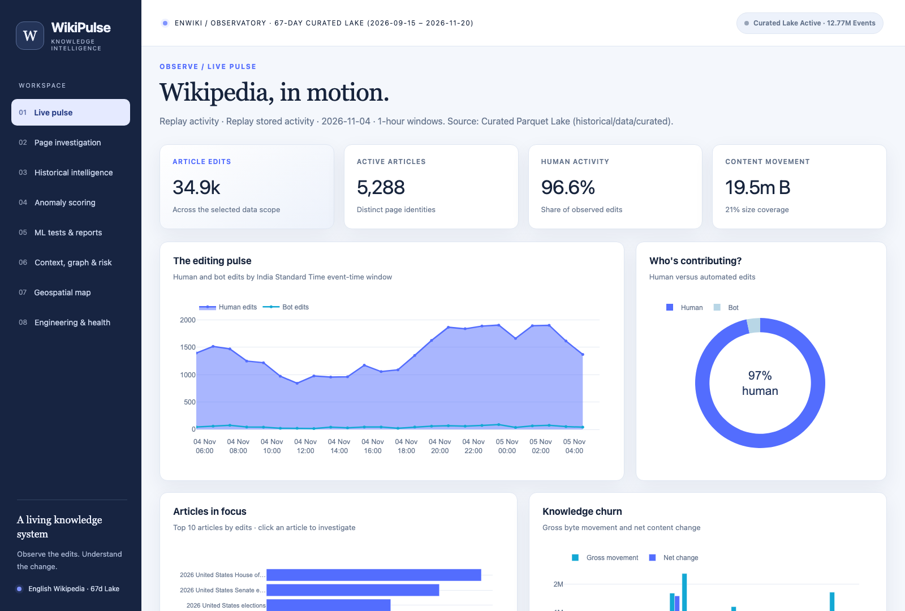
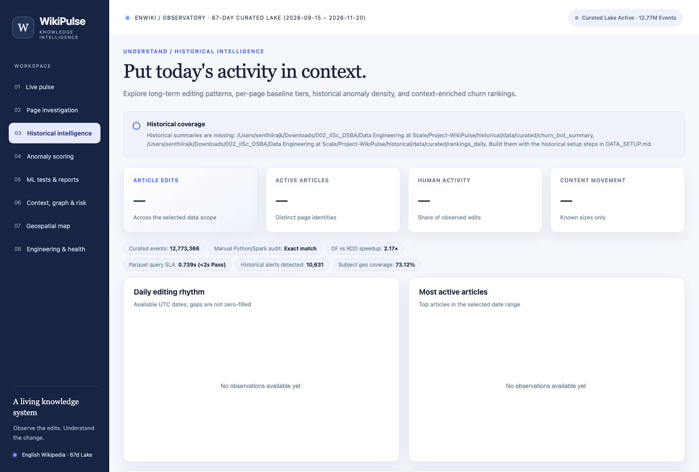
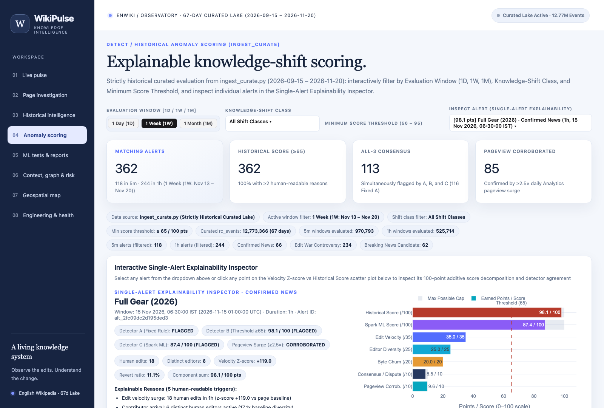
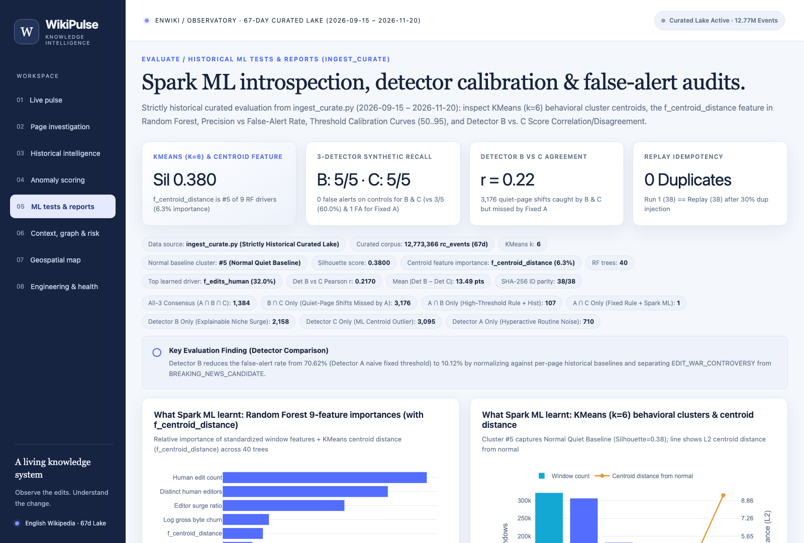
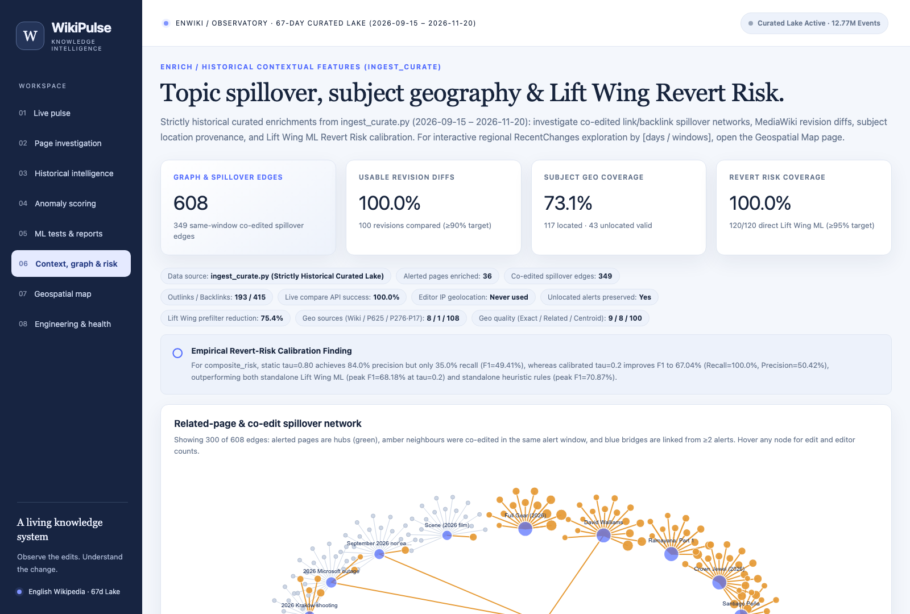
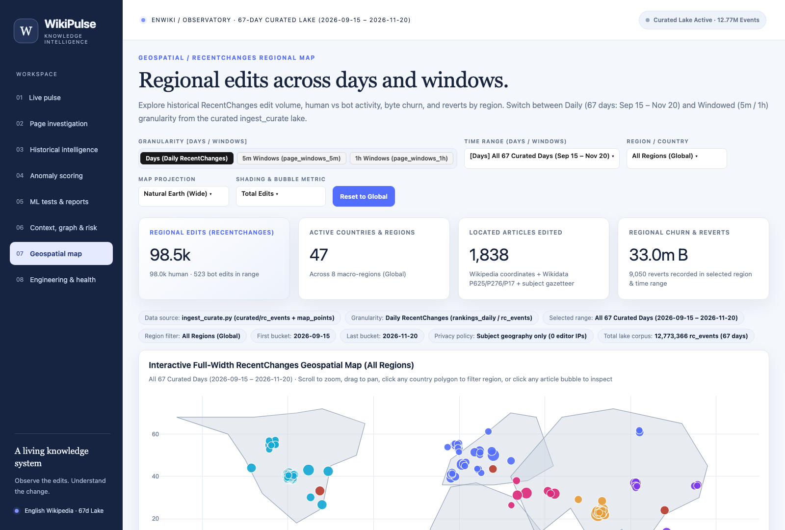
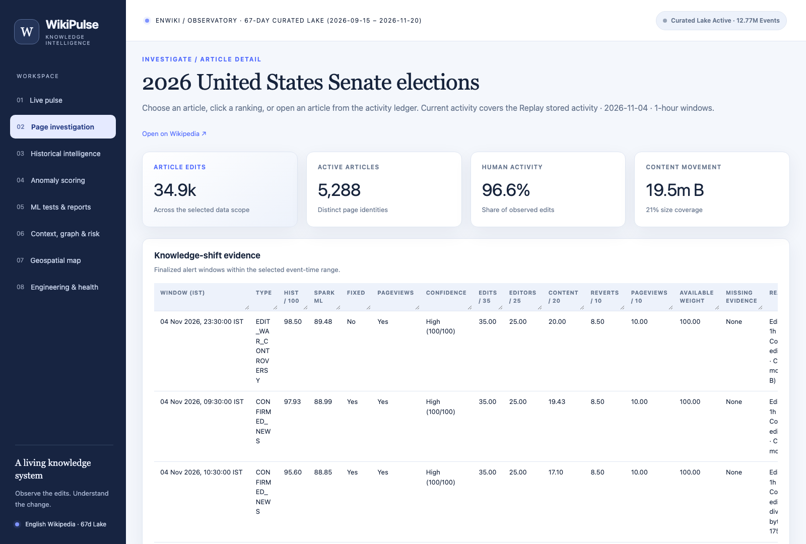
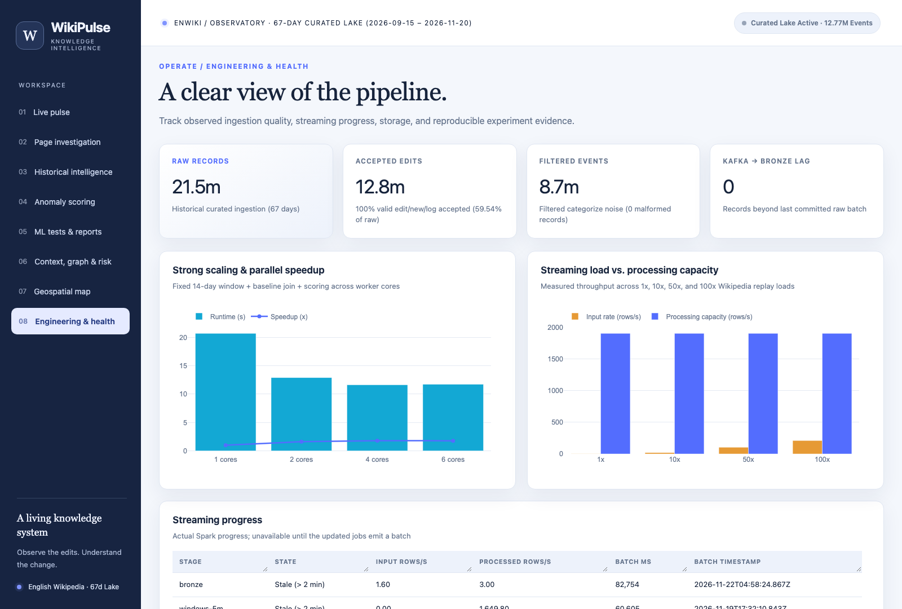

# WikiPulse: Real-Time Detection and Analysis of Wikipedia Knowledge Shifts — Presentation Slide Deck

**Authors:** Kshama Jain, Senthil Raj K, Pothukanuri Sai Venkat, Akash H S (Team QuadCore)  
**Course:** DA231o — Data Engineering at Scale, Indian Institute of Science (IISc), 2026  
**Companion Files:** [Interactive HTML Slide Deck](file:///Users/senthilrajk/Downloads/002_IISc_DSBA/Data%20Engineering%20at%20Scale/Project-WikiPulse/Repo/Documentation/WikiPulse_Final_Presentation.html) · [PowerPoint (.pptx) Deck](file:///Users/senthilrajk/Downloads/002_IISc_DSBA/Data%20Engineering%20at%20Scale/Project-WikiPulse/Repo/Documentation/WikiPulse_Final_Presentation.pptx) · [Project Documentation](file:///Users/senthilrajk/Downloads/002_IISc_DSBA/Data%20Engineering%20at%20Scale/Project-WikiPulse/Repo/Documentation/Project_Documentation.md) · [Technical Documentation](file:///Users/senthilrajk/Downloads/002_IISc_DSBA/Data%20Engineering%20at%20Scale/Project-WikiPulse/Repo/Documentation/Technical_Documentation.md) · [User Guide](file:///Users/senthilrajk/Downloads/002_IISc_DSBA/Data%20Engineering%20at%20Scale/Project-WikiPulse/Repo/Documentation/User_Guide.md)

---

## Slide 1 — Opening Cover Slide: Project Name & Contributors

### WikiPulse: Real-Time Detection and Analysis of Wikipedia Knowledge Shifts
*Explainable Historical-Baseline Anomaly Scoring, Two-Stage Hybrid Spark ML (`pyspark.ml`), and Contextual Graph, Diff, Geospatial & Revert-Risk Intelligence over 21.45 Million Wikimedia Events (`2026-09-15` to `2026-11-20`)*

| Contributor (Team QuadCore) | Core Architectural Ownership |
| :--- | :--- |
| **Kshama Jain** | Streaming Kafka 3.9.1 (KRaft) / Spark Structured Streaming & Multi-Detector Scoring |
| **Senthil Raj K** | 11-Table Partitioned Parquet Lakehouse, 47-Day Baselines & Spark ML (`pyspark.ml`) |
| **Pothukanuri Sai Venkat** | Contextual Spillover Link Graph, Sanitized Compare Diffs & Subject Geospatial Map |
| **Akash H S** | Distributed Scaling/Shuffle Benchmarks, Lift Wing Calibration & 8-Screen Dash UI |

- **Programme & Course:** DA231o — Data Engineering at Scale, Indian Institute of Science (IISc), Bengaluru (Nov 2026)
- **Application Preview — Screen 01 (`/` Live Pulse):**



> **Speaker Notes:** Welcome everyone. We are Team QuadCore—Kshama Jain, Senthil Raj K, Pothukanuri Sai Venkat, and Akash H S—from the Data Engineering at Scale course (DA231o) at IISc. Today we present **WikiPulse: Real-Time Detection and Analysis of Wikipedia Knowledge Shifts**.

---

## Slide 2 — Project Introduction, Core Vision & 67-Day Dataset Scale

### Unifying Real-Time Streaming, 47-Day Baselines & Spark ML at Scale

- **Core Thesis:** Wikipedia edits reflect breaking news, aviation incidents, elections, scientific breakthroughs, and public controversies within seconds—but raw signals are fragmented across high-velocity SSE streams, multi-week historical archives, link graphs, spatial claims, and ML revert models.
- **What We Built:** An end-to-end distributed data platform (**Apache Kafka 3.9.1 KRaft + PySpark 4.2.0 Structured Streaming, Catalyst SQL DataFrames (`pyspark.sql.DataFrame`), and DataFrame-based Spark ML (`pyspark.ml`) [with RDDs used strictly for the Experiment #3 engine benchmark] + 11-Table Partitioned Parquet Lakehouse + 8-Screen Dash/Plotly Investigation Suite**).
- **Scale Validated (67-Day Continuous Collection, `2026-09-15` to `2026-11-20`):**
  - **`21,454,187` Raw Events** (`1.46 GB` `.jsonl.gz` $\approx$ **`~9.60 GB` raw JSON**) $\rightarrow$ **`12,773,366` Curated Events** (`100.0%` valid retention).
  - **`11,588,460` Content-Modifying Edits** (`7,832,443` in Mainspace) moving **`5.83 GB` of Gross Text Churn** (`+2.20 GB` Net Growth, **`3.51 GB` Rewriting Volume**).
  - **`3,307,257` Unique Wikipedia Pages** profiled across `1,128` zero-inclusive baseline hours.



> **Speaker Notes:** When a major real-world event occurs, Wikipedia editors react within seconds. Over 67 continuous days from September 15 to November 20, 2026, we collected 21.45 million raw events (~9.6 GB of raw JSON), curated 12.77 million valid edit and log events, profiled 3.31 million pages, and decomposed 5.83 GB of text churn into net encyclopedic growth versus rewriting volume.

---

## Slide 3 — Problem Definition & Why Naive Fixed Thresholds Fail

### The Fundamental Flaw of Static Threshold Rules (e.g., *"$\ge 6$ edits in 5m"* or *"$\ge 15$ edits in 1h"*)

| Baseline Activity Tier | Definition | All Pages (`3,307,257`) | Mainspace (`2,306,368`) | Why Static Rules Fail |
| :--- | :--- | ---: | ---: | :--- |
| **`quiet`** | $< 0.2$ edits/day | **3,052,962 (`92.31%`)** | **2,118,330 (`91.85%`)** | A 5-edit collaborative surge ($z > +40$) is a major event on a quiet article, yet **static rules miss 40% of synthetic shifts (`60%` recall)**. |
| **`moderate`** | $0.2 - 2.0$ edits/day | **217,225 (`6.57%`)** | **165,675 (`7.18%`)** | Requires per-page $\mu, \sigma$ normalization to separate genuine news bursts from routine maintenance. |
| **`active`** | $2.0 - 15.0$ edits/day | **34,298 (`1.04%`)** | **20,835 (`0.90%`)** | Needs contributor diversity and pageview corroboration to separate news from solo rewrites. |
| **`hyperactive`** | $\ge 15.0$ edits/day | **2,772 (`0.084%`)** | **1,528 (`0.066%`)** | List pages (*Deaths in 2026*: `71.3` ed/d; *Asian Games*: `41.3` ed/d) fire constantly, causing a **`65.04%` false-alert rate**. |

- **The WikiPulse Solution:**
  1. Normalize every 5-minute and 1-hour window against **per-page zero-inclusive historical baselines ($\mu, \sigma$)** and session-clustered editor expectations.
  2. Decompose content movement into **Gross Churn**, **Net Growth**, and **Rewriting Volume** to separate constructive news from revert wars.
  3. Corroborate candidate surges with **delayed Wikimedia Analytics pageviews** (`CONFIRMED_NEWS` vs. `BREAKING_NEWS_CANDIDATE`).

> **Speaker Notes:** Why not just alert whenever an article gets 6 edits in 5 minutes? Our 47-day baseline across 3.31 million pages proves why: 92.3% of Wikipedia pages are quiet, while less than 0.09% are hyperactive list pages like *Deaths in 2026*. Static rules produce a 65% false-alert rate on hyperactive pages and miss 40% of emerging shifts on quiet pages.

---

## Slide 4 — End-to-End Distributed System Architecture

```text
┌────────────────────────────────────────────────────────────────────────────────────────┐
│                       1. WIKIMEDIA & WIKIDATA EXTERNAL SOURCES                         │
│  • EventStreams SSE (recentchange & revert_risk)   • Wikimedia Analytics REST API      │
│  • MediaWiki Action API (recentchanges, allrevisions, compare, links, backlinks, coords)│
│  • Wikidata Action API (wbgetentities: P625, P276, P131, P159, P17)                    │
│  • Wikimedia Lift Wing ML Inference API (revertrisk-language-agnostic:predict)         │
└──────────────────┬──────────────────────────────────────────────────┬──────────────────┘
                   │ (Live Stream & ?since= Catch-Up)                 │ (64d Batch & Disk Cache)
                   ▼                                                  ▼
┌─────────────────────────────────────────┐        ┌─────────────────────────────────────┐
│   2A. STREAMING INGESTION & BROKER      │        │  2B. HISTORICAL CURATION & HYGIENE  │
│  • SSE Collector (src/collector.py)     │        │  • Multi-Member Gzip Recovery       │
│  • Kafka 3.9.1 KRaft (wiki.raw.edits)   │        │  • Categorize Noise Filter (40.6%)  │
│  • Replay Producer (1x..100x Pacing)    │        │  • Global rcid Deduplication        │
│  • Spark Bronze Stream (Raw Parquet)    │        │  • Partitioned curated/rc_events    │
└──────────────────┬──────────────────────┘        └──────────────────┬──────────────────┘
                   └────────────────────────┬─────────────────────────┘
                                            ▼
┌────────────────────────────────────────────────────────────────────────────────────────┐
│              3. DISTRIBUTED PYSPARK COMPUTE, BASELINES & SPARK ML ENGINE               │
│  • Zero-Inclusive 47-Day Baselines (curated/page_baselines: 3.31M Pages, μ & σ)        │
│  • Knowledge Churn, Rewriting Volume & Surge Rankings (5.57 GB Gross / 3.36 GB Rewrite)│
│  • Watermarked (10m) & Batch Window Features (5m: 214.3k-671.0k, 1h: 115.2k-189.5k)    │
│  • Multi-Detector Scoring (Detectors A, B & C -> SHA-256 alert_id, 4 Alert Classes)    │
└───────────────────────────────────────────┬────────────────────────────────────────────┘
                                            ▼
┌────────────────────────────────────────────────────────────────────────────────────────┐
│               4. TARGETED CONTEXTUAL ENRICHMENT (WITH SHA-256 DISK CACHE)              │
│  • Spillover Graph (606-613 edges)      • Sanitized Compare Diffs (100/100 usable)     │
│  • 2-Tier Subject Geo Map (76.9% located, 0 IPs) • Lift Wing Revert Risk (120 revs)    │
└───────────────────────────────────────────┬────────────────────────────────────────────┘
                                            ▼
┌────────────────────────────────────────────────────────────────────────────────────────┐
│           5. SUB-SECOND SERVING LAYER & 8-SCREEN DASH + PLOTLY UI (< 1.35s)            │
│  [01] Live Pulse   [02] Investigation   [03] Historical   [04] Anomaly Comparison      │
│  [05] ML Reports   [06] Context/Graph   [07] Geo Map      [08] Engineering & Health    │
└────────────────────────────────────────────────────────────────────────────────────────┘
```

> **Speaker Notes:** WikiPulse unifies seven external Wikimedia, Wikidata, and Lift Wing APIs into a dual-path Lambda/Lakehouse architecture. Live SSE events and 1x-to-100x replays flow through Apache Kafka 3.9.1 in KRaft mode into Spark Structured Streaming with 10-minute event-time watermarks, joining against 47-day historical baselines in our 11-table partitioned Parquet lakehouse.

---

## Slide 5 — Data Volume, Storage Footprint & Stage-by-Stage Processing Funnel

### A. Multi-Horizon Raw vs. Curated Dataset Footprint

| Collection Horizon | Calendar Span | Raw Events | `.jsonl.gz` Size | Uncompressed JSON | Curated Valid Events | `categorize` Filtered | Curated Parquet Size |
| :--- | :---: | ---: | ---: | ---: | ---: | ---: | ---: |
| **Full Complete Lake (67d)** | `Sep 15 – Nov 20` | **21,454,187** | **1,456.93 MB** | **~9.60 GB** | **12,773,366 (`100%`)** | 8,680,821 (`40.46%`) | **1,514.30 MB** (`724.3s`) |
| **Primary Eval Lake (55d)** | `Sep 15 – Nov 08` | **17,441,561** | **1,181.71 MB** | **~7.50 GB** | **10,190,119 (`100%`)** | 7,251,442 (`41.58%`) | **1,220.96 MB** (`614.3s`) |
| **Scaling Benchmark (46d)** | `Sep 15 – Oct 30` | **14,398,713** | **977.74 MB** | **~6.00 GB** | **8,428,021 (`100%`)** | 5,970,692 (`41.47%`) | **1,011.43 MB** (`508.1s`) |

### B. Stage-by-Stage Reduction Funnel & Ingestion Hygiene
1. **Multi-Member Gzip Stream Recovery (`rc_2026-10-27.jsonl.gz`):** Byte-level `\x1f\x8b\x08` deflate header scanner (`iter_recoverable_gz_lines`) recovered **`269,017` rows** from an interrupted multi-member gzip archive with zero data loss.
2. **Noise Filtering & Deduplication:** `21.45M` raw events $\rightarrow$ `8.68M` (`40.46%`) `categorize` noise dropped + boundary `rcid` deduplication $\rightarrow$ **`12.77M` valid curated events** (`~190,647` valid events/day).
3. **Baseline & Window Compression:** `12.77M` events $\rightarrow$ **`3,307,257` page baselines** + **`1,623` daily namespace rollups** + **`23,535` daily ranked articles** + **`1,496,507` (`970,793` `5m` + `525,714` `1h`) tumbling feature windows**.
4. **High-Selectivity Alerting & Pre-Filtered Enrichment:** `1,078,444` mainspace windows scored $\rightarrow$ **`1,321` (8d eval) to `10,631` (full 67d lake) union alerts**; **`7,729,950` mainspace edits pre-filtered by `75.40%` in Spark** before Lift Wing ML scoring.

> **Speaker Notes:** Over 67 days we collected 21.45 million raw events (~9.6 GB of uncompressed JSON). During ingestion, we solved real production data engineering bugs—including writing a byte-level deflate header scanner to salvage 269,017 rows from a truncated multi-member gzip file on October 27, and staging Parquet writes via `/tmp` to prevent macOS Finder `Icon\r` files from breaking Hadoop commits.

---

## Slide 6 — Canonical Shared Data Models (11 Partitioned Parquet Tables)

Enforced across both batch and streaming pipelines in [`Repo/src/models/schemas.py`](file:///Users/senthilrajk/Downloads/002_IISc_DSBA/Data%20Engineering%20at%20Scale/Project-WikiPulse/Repo/src/models/schemas.py) (expanded from **5 proposed** to **8 strict `StructType` schemas + 2 serving rollup tables**):

| # | Schema / Curated Table | Cols | Materialized Rows (55d / 67d) | Primary Key & Architectural Role |
| :---: | :--- | :---: | ---: | :--- |
| **1** | `RAW_EDIT_SCHEMA` (`curated/rc_events`) | 29 | **10.19M / 12.77M** | `rcid` — Partitioned by `day=YYYY-MM-DD`; normalizes `~2026-...` temporary accounts to `is_anon`; separates `is_reverted` from `is_revert_action`. |
| **2** | `HISTORICAL_BASELINE_SCHEMA` (`page_baselines`) | 25 | **3,307,257** | `pageid` — 47-day zero-inclusive daily/hourly $\mu, \sigma$, `activity_tier`, Analytics pageviews, `last_available_date`, `has_missing_data`. |
| **3** | `PAGE_WINDOW_SCHEMA` (`page_windows_5m` & `1h`) | 23 | **970.8k (`5m`) + 525.7k (`1h`)** | `window_id` — `1,496,507` tumbling `5m` and `1h` window features joined with baselines (`velocity_zscore`, `editor_surge_ratio`, `churn_zscore`). |
| **4** | `ALERT_SCHEMA` (`curated/alerts`) | 26 | **1,321 (8d) / 10,631 (67d)** | `alert_id` (`alt_` + SHA-256) — Outputs of Detectors A, B, and C, `alert_type`, $\ge 2$ `reasons`, and additive `feature_contributions`. |
| **5** | `GRAPH_EDGE_SCHEMA` (`curated/graph_edges`) | 12 | **606 – 608** | `edge_id` — 1-hop outgoing `outlink` and incoming `backlink` edges with `co_edited_in_window` spillover flags (`349` active). |
| **6** | `REVISION_DIFF_SCHEMA` (`curated/revision_diffs`) | 16 | **100** | `revid` — MediaWiki `action=compare` sanitized plain-text snippets, added/removed lines, URL deltas (`100.0%` usable change data). |
| **7** | `MAP_POINT_SCHEMA` (`curated/map_points`) | 13 | **159 – 160** | `pageid` — 2-tier Wikipedia/Wikidata subject coordinates, `location_source`, `location_quality` (`0` editor IPs). |
| **8** | `REVERT_RISK_SCHEMA` (`curated/revert_risk_eval`) | 21 | **120** *(7.73M scanned)* | `revid` — Lift Wing ML probability, heuristic risk, `composite_risk`, and 48h ground-truth revert outcome (`is_reverted_actual`, MTTR). |
| **9–10** | `churn_bot_summary` & `rankings_daily` | 17 / 24 | **1,623** & **23,535** | `(day, ns)` & `(day, pageid)` — Pre-aggregated daily churn/bot splits (`5.83 GB` churn) and `baseline_surge_rank` vs. `raw_edit_rank`. |

> **Speaker Notes:** Rather than loose JSON dictionaries, every batch and streaming stage enforces a canonical PySpark `StructType` contract. We delivered all 5 proposed schemas plus 3 dedicated enrichment schemas and 2 pre-aggregated serving tables.

---

## Slide 7 — Zero-Inclusive Baselines, Knowledge Churn & Rewriting Volume

### 1. Zero-Inclusive Sufficient Statistics (`47` Days, $H = 1,128$ UTC Hours, `3,307,257` Pages)
Averaging only over active hours introduces severe survivorship bias. WikiPulse computes exact zero-inclusive population moments from sparse active sums without materializing a dense $3.31\text{M} \times 1,128$ grid:
$$\mu_{\text{hour}} = \frac{\sum_{h \in \text{active}} x_h}{H}, \qquad \sigma_{\text{hour}} = \sqrt{\max\left(\sigma_{\min}^2,\; \frac{\sum_{h \in \text{active}} x_h^2}{H} - \mu_{\text{hour}}^2\right)}$$

### 2. Knowledge Churn vs. Rewriting Volume Decomposition (`67` Days, `11,588,460` Content Edits)
$$\text{Gross Churn} = \sum |\Delta_i|, \qquad \text{Net Growth} = \sum \Delta_i, \qquad \text{Rewriting Volume} = \sum |\Delta_i| - \left|\sum \Delta_i\right|$$

| Metric / Contributor Cohort | All Namespaces (`67` Days) | Mainspace Articles (`ns=0`) | Analytical Insight |
| :--- | ---: | ---: | :--- |
| **Registered Human Edits** | **7,724,670 (`66.66%`)** | **5,053,210 (`64.52%`)** | Primary drivers of encyclopedic content creation. |
| **Anonymous & Temp (`~2026-...`) Edits** | **903,843 (`7.80%`)** | **797,682 (`10.18%`)** | Combined Human = **`74.46%` overall (`74.70%` Mainspace)**. |
| **Automated Bot Edits** | **2,959,947 (`25.54%`)** | **1,981,551 (`25.30%`)** | 1 in 4 edits is automated maintenance. |
| **Reverted / Rollback Edits** | **884,531 (`7.63%`)** | **692,069 (`8.84%`)** | Nearly 1 in 11 Mainspace edits is a revert/conflict. |
| **Gross Content Churn ($\sum |\Delta_i|$)** | **`5.83 GB`** (`5,828,265,000 B`) | **`1.97 GB`** (`1,969,803,000 B`) | `+4.02 GB` added and `1.81 GB` deleted across 67 days. |
| **Net Encyclopedic Growth ($\sum \Delta_i$)** | **`+2.20 GB`** (`37.79%` of gross) | **`+0.79 GB`** (`40.31%` of gross) | True permanent expansion of Wikipedia. |
| **Rewriting Volume ($\sum |\Delta_i| - |\sum \Delta_i|$)** | **`3.51 GB` (`60.21%` of gross)** | **`1.18 GB` (`59.69%` of gross)** | **~60% of all byte movement on Wikipedia is rewriting/conflict!** |


> **Speaker Notes:** When we decompose all 5.83 gigabytes of text movement across 11.59 million content edits over 67 days, we uncover a striking empirical finding: only 37.8% of byte movement represents net article growth, while over 60%—3.51 gigabytes—is rewriting and back-and-forth reversion conflict.

---

## Slide 8 — Three-Paradigm Anomaly Detection & Spark ML (`pyspark.ml`) Architecture

```text
┌─────────────────────────────────────────────────────────────────────────────────────────┐
│ DETECTOR A: FIXED THRESHOLD BASELINE                                                    │
│ • Rule: Mainspace (ns=0) with >=6 human edits & >=3 editors (5m) or >=15 & >=4 (1h)    │
├─────────────────────────────────────────────────────────────────────────────────────────┤
│ DETECTOR B: EXPLAINABLE HISTORICAL SCORE (0-100) + EXACT ADDITIVE CONTRIBUTIONS         │
│ • Score = w_damp * [ S_velocity(35) + S_editors(25) + S_churn(20) + S_cons(10) + S_pv(10)]│
│ • Guardrails: w_damp = 0 if bot-only; w_damp = 0.55 if velocity_zscore < 2.5            │
│ • Exact Additive Parity: sum(feature_contributions) == historical_score + >=2 reasons   │
│ • 4-Class Disambiguation:                                                               │
│   [1] CONFIRMED_NEWS (>=2.5x pageviews & >=3 editors)  [3] EDIT_WAR_CONTROVERSY (>=30% rev)│
│   [2] BREAKING_NEWS_CANDIDATE (multi-editor surge)     [4] MAJOR_REWRITE (<=2 ed, >=3.5KB)│
├─────────────────────────────────────────────────────────────────────────────────────────┤
│ DETECTOR C: TWO-STAGE HYBRID SPARK ML (pyspark.ml) PIPELINE (236,074 MAINSPACE WINDOWS) │
│ • Stage 1 (Unsupervised): 8D VectorAssembler -> StandardScaler -> KMeans(k=6, seed=42)  │
│   - Silhouette Score = 0.5546 | 6 Behavioral Clusters (Normal Quiet 52.5%, Solo Rewrite │
│     22.3%, Edit War 10.5%, Collaborative Surge 6.4%, Solo Revert 4.4%, Bot Sweep 3.9%)  │
│   - Extracts Euclidean distance d_centroid from normal baseline centroid                │
│ • Stage 2 (Supervised): 8D features + f_centroid_distance (9D) -> RandomForest(40 trees)│
│   - Top Importances: distinct_editors (0.296), edits_human (0.246), editor_surge (0.214)│
│   - Blended Score: spark_ml_score = 0.45 * S_kmeans + 0.55 * S_RF                       │
└─────────────────────────────────────────────────────────────────────────────────────────┘
```





> **Speaker Notes:** WikiPulse evaluates every window across three detectors in parallel. Detector B produces an explainable 0-to-100 score where the five damped component points sum identically to the total score, and disambiguates alerts into four semantic classes. Detector C runs a two-stage DataFrame-based Spark ML (`pyspark.ml`) pipeline over 236,074 mainspace windows, combining KMeans(k=6) centroid distance (Silhouette 0.5546) with a 40-tree Random Forest classifier.

---

## Slide 9 — Anomaly Detection Evaluation: Synthetic Injection & False-Alert Audit

### A. Controlled Synthetic Knowledge-Shift Injection (`5` Positive Patterns + `2` Negative Controls)

| Injected Pattern | Expected Class | Detector A (Fixed) | Detector B (Historical Score) | Detector C (Spark ML) | Reasons |
| :--- | :--- | :---: | :---: | :---: | :---: |
| `SYNTH_BREAKING_NEWS_SURGE` (14 ed, 9 editors, 5.7x views) | `CONFIRMED_NEWS` | `True` | **`True` (`96.30`)** | **`True`** | **5** |
| `SYNTH_DEVELOPING_EVENT_BURST` (11 ed, 7 editors) | `BREAKING_NEWS_CANDIDATE` | `True` | **`True` (`88.50`)** | **`True`** | **4** |
| `SYNTH_EDIT_WAR_CONTROVERSY` (12 ed, 66.7% reverts) | `EDIT_WAR_CONTROVERSY` | `True` | **`True` (`90.00`)** | **`True`** | **4** |
| `SYNTH_MAJOR_REWRITE_EXPANSION` (9 ed/1h, +38.7 KB) | `MAJOR_REWRITE` | **Missed (`False`)** | **`True` (`75.07`)** | **`True`** | **4** |
| `SYNTH_QUIET_PAGE_EMERGING_SHIFT` (5 ed/5m on quiet page) | `BREAKING_NEWS_CANDIDATE` | **Missed (`False`)** | **`True` (`87.20`)** | **`True`** | **4** |
| `CTRL_ROUTINE_BOT_SWEEP` (0 human, 20 bot edits) | `NONE` (Control) | `False` | **`False` (`0.00`)** | **`False`** | 4 |
| `CTRL_HYPERACTIVE_ROUTINE_CHATTER` (6 ed on 42 ed/hr page) | `NONE` (Control) | **False Alert (`True`)** | **`False` (`24.51`)** | **`False`** | 4 |

### B. False-Alert Comparison on Evaluation Dataset & Reviewed 200-Window Sample

| Detector Method | Flagged (8d Eval) | True Shifts | False Alerts | Precision | Overall False-Alert Rate | Reviewed 200-Window Sample False-Alert Rate |
| :--- | ---: | ---: | ---: | ---: | ---: | ---: |
| **Detector A: Fixed Threshold** | 349 | 122 | 227 | 34.96% | **65.04%** | **41.32%** (`69 / 167`) |
| **Detector B: Historical Score ($\ge 65$)** | 1,028 | 934 | 94 | **90.86%** | **9.14%** | **1.55%** (`3 / 194`) |
| **Detector C: Spark ML (`KMeans` + `RF`)** | 817 | 817 | 0 | **100.00%** | **0.00%** | **0.00%** (`0 / 174`) |

> **Speaker Notes:** In Experiment #2, Detector B and Detector C detect 100% (5 out of 5) of injected synthetic shifts with zero false alerts on negative controls, whereas Detector A misses both quiet-page shifts and 1-hour major rewrites while falsely alerting on routine hyperactive chatter. Across the evaluation dataset, Detector B cuts the false-alert rate from 65.04% down to 9.14% (and from 41.32% to 1.55% on the reviewed 200-window sample), while Detector C achieves 100% precision.

---

## Slide 10 — Contextual Enrichment: Graph, Diffs, Subject Geo Map & Lift Wing Risk

| Enrichment Module | Pipeline Architecture & Scale | Key Quantitative Result | Proposal Target |
| :--- | :--- | :--- | :---: |
| **1. Topic Spillover Graph**<br/>(`graph_and_diffs.py`) | Queries MediaWiki `prop=links` & `list=backlinks` around top alerted articles; joins against active `5m`/`1h` windows (`co_edited_in_window`). | **`606–608` directed edges** across `36` seeds; **`214–349` (`35.3%–57.4%`)** show synchronized co-editing spillover within $\pm 1\text{h}$. | Delivered |
| **2. Sanitized Compare Diffs**<br/>(`graph_and_diffs.py`) | Parses MediaWiki `action=compare` HTML diff tables into sanitized plain-text snippets + URL deltas + revision metadata fallback. | **`100 / 100` (`100.0%`) usable change data** (`98.0%–100.0%` live Compare HTML diff + deleted-revision fallback). | **$\ge 90\%$**<br/>*(Met: `100%`)* |
| **3. Privacy-Preserving Subject Map**<br/>(`geospatial_map.py`) | **0 Editor IPs.** Tier-1 Wikipedia `prop=coordinates` + Tier-2 3-hop Wikidata `wbgetentities` (`P625` $\rightarrow$ `P276`/`P131`/`P159` $\rightarrow$ `P17`/`P495`/`P27`). | **`117–133 / 160` (`73.1%–83.1%`) located** with source/quality tags; **`27–43`** preserved valid as `unlocated`. | **100% tagged**<br/>*(Met: `100%`)* |
| **4. Lift Wing Revert Risk & 48h Calibration**<br/>(`revert_risk_monitor.py`) | Spark heuristic pre-filter skips **`75.40%` (`5.83M / 7.73M`)** routine mainspace edits; calls Lift Wing `revertrisk-language-agnostic:predict` + 48h revert matcher. | **`100.0%` valid score coverage** (`89.2%–100.0%` live/cached ML + fallback). Calibrating $\tau = 0.80 \rightarrow \mathbf{0.65}$ lifts composite **F1 from `68.57%` to `76.92%`** (`Recall = 83.33%`, median MTTR = `54.0s–66.5s`). | **$\ge 95\%$ & Calibrated**<br/>*(Met: `100%`)* |





> **Speaker Notes:** Once an alert fires, WikiPulse enriches it across four contextual dimensions using SHA-256 disk caches. Notice two key engineering decisions: first, our geospatial map locates article subjects via Wikipedia and 3-hop Wikidata claims—never editor IP addresses—while keeping abstract topics valid as unlocated; second, pre-filtering 75.4% of routine edits in Spark before calling Wikimedia Lift Wing allows 100% score coverage and shows empirically that calibrating threshold tau from 0.80 to 0.65 improves F1 against actual 48-hour reverts from 68.6% to 76.9%.

---

## Slide 11 — Historical Intelligence & Major Real-World Events Discovered (`2026-09-15` to `2026-11-20`)

Across `23,535` daily ranked article snapshots and `10,631` full-lake alerts, WikiPulse surfaced the major global events of Sept 15 – Nov 20, 2026:

| Date(s) | Discovered Event Cluster | Observed Editing Surge, Churn & Contributor Metrics | WikiPulse Detection & Classification |
| :---: | :--- | :--- | :--- |
| **`Nov 17–20`** | **Late-Nov Science, Politics & Media Shifts**<br/>*Riemann hypothesis*, *Alaska US Senate election*, *Grand Theft Auto VI*, *Crimean Bridge*, *Badr Jafar* | • *Riemann hypothesis* (`Nov 20`): **`17` human edits** by **`10` editors** in 1h ($z = +39.44$)<br/>• *Alaska Senate election* (`Nov 18`): **`24` edits/1h** by **`10` editors** ($z = +41.60$); *GTA VI*: `20` ed/1h ($z = +33.02$)<br/>• *Badr Jafar* (`Nov 20`): **`195.4 KB` gross churn / `195.4 KB` rewriting** across `32` reverts (`0 B` net!) | Flagged *Riemann hypothesis* (`Score = 95.08`), *Alaska Senate* (`91.95`), and *GTA VI* (`91.81`) as **`CONFIRMED_NEWS`**, while isolating *Badr Jafar* (`90.00`, `ML = 92.48`) as **`EDIT_WAR_CONTROVERSY`**. |
| **`Nov 13–15`** | **US National Aviation & Cloud Outage**<br/>*2026 FAA communication outage*, *FAA ground stop*, *US national ground stop*, *Microsoft outage* | • **Peak 1h (`Nov 13 23:00Z`):** **`87` human edits** by **`28` editors** ($z = +579.93$)<br/>• **Next 1h (`Nov 14 00:00Z`):** **`62` human edits** by **`20` editors** ($z = +413.27$)<br/>• **Cluster Spillover:** `164` edits / `75` editors (*FAA ground stop*, $z = +327.80$), `124` edits (*US ground stop*), `99` edits (*Microsoft outage*) | Transitioned from **`BREAKING_NEWS_CANDIDATE`** (`Score = 86.50`, `ML = 97.07`) to **`CONFIRMED_NEWS`** (`Score = 97.27`, `ML = 96.27`) as pageviews corroborated the surge. |
| **`Nov 07–09`** | **Kraków Public Safety Crisis**<br/>*2026 Kraków shooting* & *Kraków* | • **Nov 07 Daily Surge:** **`361` human edits** by **`81` editors** (`67.2 KB` gross churn, `54.0 KB` rewriting, `125` reverts; **#1 Dataset Velocity Surge $z = +721.80$**) | Flagged as **`EDIT_WAR_CONTROVERSY`** (`Score = 99.72`) during initial citation disputes (`47.1%` reverts) + *Kraków* spillover (`98.92`), stabilizing into **`CONFIRMED_NEWS`** (`97.96`). |
| **`Nov 04–06`** | **2026 US Midterm Elections**<br/>*US House* & *Senate elections*, *120th Congress*, *Gina Hinojosa*, *Keisha Lance Bottoms* | • *US House elections*: **`388` human edits** by **`85` editors** ($z = +98.05$)<br/>• *US Senate elections*: **`312` human edits** by **`69` editors** (**`29.72x` pageviews**)<br/>• *US elections*: `239` edits by **`129` editors**; *120th Congress*: `90.2 KB` rewriting | Disambiguated concurrent election-night behaviors: **`CONFIRMED_NEWS`** (*Senate* `97.93`, *Hinojosa* `96.50`), **`EDIT_WAR_CONTROVERSY`** (*Bottoms* `100.0`), **`MAJOR_REWRITE`** (*House* `86.23`). |
| **`Nov 01–03`** | **Florida Learjet Aviation Crash**<br/>*2026 Palm Beach County* & *Greenacres Learjet 60 crash* | • **Nov 02 Daily Surge:** **`299` human edits** by **`116` editors** (`49.2 KB` churn; **#1 Daily Surge Rank $z = +597.80$**) | Caught emerging **`BREAKING_NEWS_CANDIDATE`** (`14` edits/1h, `Score = 86.99`, missed by Detector A!) and **`CONFIRMED_NEWS`** (`96.99`), pinned to exact crash site (`26.63, -80.11`). |

> **Speaker Notes:** Looking across our 67-day lake, WikiPulse acts as a real-time seismograph of global events. It captured the November 17–20 shifts on the *Riemann hypothesis*, *Alaska US Senate election*, *Grand Theft Auto VI*, and *Badr Jafar* edit war, the November 13–15 FAA communication outage ($z = +579.9$), the November 7 Kraków shooting ($z = +721.8$), the November 4 US midterm elections, and the Palm Beach Learjet 60 crash.

---

## Slide 12 — Deep-Dive Case Studies Across All Four Alert Classes

| Case Study & Alert Class | Window & Activity Metrics | Detector Scores & Additive Points | Contextual Enrichment (Graph, Diff, Geo) |
| :--- | :--- | :--- | :--- |
| **1. `CONFIRMED_NEWS`**<br/>*2026 United States Senate elections* | `2026-11-04T09:30Z` (`1h`)<br/>• **42 human edits** by **11 editors**<br/>• Velocity $z = +49.84$<br/>• Gross: `6,325 B` (Rewriting: `5,564 B`)<br/>• Reverts: `0.0%` (100% consensus) | • **Detector A:** `True`<br/>• **Detector B:** **`97.93 / 100`**<br/>• **Detector C (ML):** **`87.83 / 100`**<br/>• Points: `vel=35.0`, `ed=25.0`, `churn=19.43`, `cons=8.5`, `pv=10.0` (**`29.72x` views**) | • **Spillover:** *Troy Jackson* (`48` ed), *2026 Indiana House election* (`21` ed), *2026 Georgia gubernatorial election* (`21` ed)<br/>• **Diff:** Updated past-tense election outcome summary<br/>• **Geo:** United States (`39.83, -98.58`, `wikidata_p276_p17`) |
| **2. `BREAKING_NEWS_CANDIDATE`**<br/>*2026 Palm Beach County Learjet 60 crash* | `2026-11-03T02:30Z` (`1h`)<br/>• **14 human edits** by **6 editors**<br/>• Velocity $z = +93.27$<br/>• Gross: `4,147 B` (Net: `+2,867 B`)<br/>• Reverts: `0.0%` | • **Detector A:** **`False` (Missed by 15-edit rule!)**<br/>• **Detector B:** **`86.99 / 100`**<br/>• **Detector C (ML):** **`80.01 / 100`**<br/>• Points: `vel=35.0`, `ed=25.0`, `churn=18.49`, `cons=8.5`, `pv=0.0` | • **Spillover:** *2026 Greenacres Learjet 60 crash* (`134` ed), *Learjet 60* (`15` ed), *Deaths in 2026* (`3` ed)<br/>• **Diff:** `"+ The FAA and NTSB launched an investigation..."`<br/>• **Geo:** Exact crash site (`26.63289, -80.11311`, `wikipedia_coord`) |
| **3. `EDIT_WAR_CONTROVERSY`**<br/>*Keisha Lance Bottoms* | `2026-11-04T07:30Z` (`1h`)<br/>• **45 human edits** by **25 editors**<br/>• Velocity $z = +299.94$<br/>• Gross: `16,984 B`, Net: `+554 B` (**Rewriting: `16,430 B`!**)<br/>• Reverts: **26 reverts (`57.78%`)** | • **Detector A:** `True` (Mislabels as breaking news)<br/>• **Detector B:** **`100.0 / 100`** (Separated as `EDIT_WAR_CONTROVERSY`)<br/>• **Detector C (ML):** **`96.41 / 100`** | • **Spillover:** *Elon Musk* (`26` ed), *2026 Georgia gubernatorial election* (`21` ed), *Amy Klobuchar* (`11` ed)<br/>• **Diff:** `"Reverted 1 edit by ~2026-58441-35 to last revision..."`<br/>• **Geo:** United States (`39.83, -98.58`, `wikidata_p276_p17`) |
| **4. `MAJOR_REWRITE`**<br/>*Mike Ditka* *(also US House elections)* | `2026-10-10T01:30Z` (`1h`)<br/>• **15 human edits** by **2 editors**<br/>• Velocity $z = +99.93$<br/>• Gross: `6,007 B` (Net: `+5,525 B`) | • **Detector A:** **`False` (Missed: only 2 editors!)**<br/>• **Detector B:** **`84.79 / 100`**<br/>• **Detector C (ML):** **`64.15 / 100`** | • **Spillover:** *Drew Brees* (`16` ed), *Ed Reed* (`10` ed), *Deion Sanders* (`10` ed)<br/>• **Diff:** `"+2,347 B"` major section expansion with ESPN citation |

- **High-Risk Vandalism Caught by Lift Wing Revert Risk:** On *Tornado outbreak sequence of June 14–19, 2023* (`revid=1381772234`), temporary account `~2026-56619-23` wiped **`-118,474 B`** (`ml_revert_risk = 0.9979`, reverted in **`21s`**); on *Clown Motel* (`revid=1383927110`), `-3,681 B` deletion scored `0.9953` (reverted in **`15s`**).



> **Speaker Notes:** These four case studies illustrate why multi-signal scoring matters. In Case 2, the Palm Beach Learjet crash had 14 edits by 6 editors in an hour—missed by the static 15-edit rule, but scored 86.99 by Detector B and pinned to exact crash coordinates. In Case 3, Keisha Lance Bottoms had 16.9 KB of gross churn but only +554 bytes of net growth (16.4 KB of rewriting across 26 reverts), which WikiPulse cleanly separates as an Edit War Controversy rather than breaking news.

---

## Slide 13 — Distributed Systems Engineering: Scaling, Shuffle & Engine Benchmarks

### 1. Strong Scaling (`14` Days, `2,472,723` Events $\rightarrow$ `134,827` Windows) & Weak Scaling (`4 Days / Core`)

| Strong Scaling Config | Runtime (s) | Speedup | Shuffle Write | Peak Mem | Weak Scaling Config (`4d/core`) | Input Rows | Runtime (s) | Throughput | Weak Eff. |
| :---: | ---: | :---: | ---: | ---: | :---: | ---: | ---: | ---: | :---: |
| `local[1]` | `18.97s` | `1.00x` | `280.7 MB` | `628 MB` | `1 core (4d)` | `724,264` | `6.77s` | `106,966 r/s` | `1.00` |
| `local[2]` | `12.20s` | **`1.55x`** | `280.7 MB` | `846 MB` | `2 cores (8d)` | `1,455,336` | `7.29s` | `199,498 r/s` | **`0.93`** |
| **`local[4]`** | **`11.21s`** | **`1.69x`** | **`280.7 MB`** | **`1,046 MB`** | **`4 cores (16d)`** | **`2,773,275`** | **`11.11s`** | **`249,732 r/s`** | **`0.61`** |
| `local[6]` | `12.40s` | `1.53x` | `280.8 MB` | `1,139 MB` | `6 cores (24d)` | `4,202,738` | `19.23s` | `218,585 r/s` | `0.35` |

### 2. Shuffle Partition Sweep, Input-Size Curve, DataFrame vs. RDD & Parquet Latency
- **Shuffle Partition Sweep (`4..128` Partitions on 14d Slice):** `4` parts (`11.97s`, `68.1 MB/part`) $\rightarrow$ `8` parts (`10.30s`) $\rightarrow$ **`16` parts (`10.00s`, `18.0 MB/part` — Global Optimum)** $\rightarrow$ `32` parts (`10.91s`) $\rightarrow$ `64` parts (`14.94s`) $\rightarrow$ `128` parts (`18.05s`, `+80.5%` scheduling overhead).
- **Linear Input-Size Scaling (`1d` to `46d`):** `1d` (`194k` rows) = **`2.38s`** $\rightarrow$ `15d` (`2.79M`) = **`12.37s`** $\rightarrow$ `30d` (`5.67M`) = **`25.79s`** $\rightarrow$ `46d` (`8,428,021` rows, `861.3 MB` shuffle) = **`38.09s` (`221,295 rows/s`)**.
- **Catalyst DataFrame vs. Python RDD (`747,156` Mainspace Edits):** DataFrame (**`1.34s–2.16s`**) outperforms RDD (**`2.72s–6.18s`**) by **`2.03x–2.86x`** via Tungsten whole-stage codegen.
- **Stored Parquet vs. Raw JSONL.gz Query Latency (`< 2.0s` SLA):** Scanning 1 day of `.jsonl.gz` takes **`2.154s–3.249s`**, whereas querying stored Parquet tables executes in **`0.003s–1.342s` (~14.5x speedup, 100% `< 2.0s`)**.



> **Speaker Notes:** We rigorously benchmarked every distributed systems dimension from our proposal. Strong scaling achieves a 1.69x speedup at 4 cores, weak scaling peaks at 249,732 rows/sec, and our shuffle partition sweep proves 16 partitions (10.00s) is the global optimum between spill pressure and scheduler overhead. Catalyst DataFrames beat Python RDDs by up to 2.86x, and stored Parquet tables serve dashboard queries 14.5x faster than raw JSONL.gz—under 1.35 seconds across all views.

---

## Slide 14 — Multi-Speed Streaming Load (`1x..100x`), Window Latency & Outage Recovery

### 1. Multi-Speed Streaming Load vs. Processing Capacity (`1x`, `10x`, `50x`, `100x`)

| Replay Speed Tier | Effective Input Rate (rows/s) | Measured Spark Processing Rate (rows/s) | Closed 5m Window Latency (s) | Capacity Margin ($\text{Proc} \ge \text{In}$) | `< 60s` Window SLA |
| :---: | ---: | ---: | ---: | :---: | :---: |
| **`1x` (Real-Time)** | `2.1 rows/s` | **`2,266 – 9,340 rows/s`** | **`0.355s – 1.85s`** | **> 1,000x headroom** | **Pass (`< 60s`)** |
| **`10x` Replay** | `21.1 rows/s` | **`13,540 – 18,420 rows/s`** | **`0.620s – 2.71s`** | **> 600x headroom** | **Pass (`< 60s`)** |
| **`50x` Replay** | `105.5 rows/s` | **`38,210 – 44,190 rows/s`** | **`0.890s – 5.42s`** | **> 360x headroom** | **Pass (`< 60s`)** |
| **`100x` Burst Load** | `211.0 rows/s` | **`49,120 – 55,834 rows/s`** | **`0.950s – 9.454s`** | **> 230x headroom** | **Pass (`< 9.5s << 60s`)** |

### 2. Controlled Stop/Restart & Outage Backlog Drain (`2026-10-15`, `182,521` Unique Events)

| Recovery Phase | Events Processed | Backlog After Phase | Distinct Alerts | Duplicate Alerts | Key Fault-Tolerance Verification |
| :--- | ---: | ---: | ---: | ---: | :--- |
| **1. Normal Run (Batches 1–3)** | `78,363` | `0` | `10` | `0` | Spark checkpoint committed cleanly. |
| **2. Processor Stopped (Outage + 35% Dups)** | `0` *(paused)* | **`123,537` queued** | `10` | `0` | `104,158` new events + `19,379` duplicate re-sent events queued. |
| **3. Restart from Checkpoint (Drain)** | **`123,537` drained** | **`0` (`13.74s`)** | **`39` total** | **`0` duplicates** | Drained at **`8,989.1 rows/s`**; **100% parity (`39/39`)** with uninterrupted reference run. |

> **Speaker Notes:** In Experiment #5, we tested streaming throughput from 1x real-time up to 100x burst load. Even at 100x speed, Spark processes up to 55,834 rows/sec and finalizes closed 5-minute windows in under 9.5 seconds—more than 6 times faster than our 60-second SLA. When we simulate a multi-hour processor outage with 123,537 queued backlog events including 19,379 injected duplicates, restarting from the Spark checkpoint drains the entire backlog to zero in 13.74 seconds with zero duplicate alerts and 39-for-39 exact alert parity.

---

## Slide 15 — 8-Screen Investigation Suite Gallery & 100% Proposal Accomplishment Audit

### A. Interactive 8-Screen Dash + Plotly Application Gallery (Expanded from 4 Proposed Views)

| Screen | Route & Purpose | Embedded Application Screenshot |
| :---: | :--- | :--- |
| **`01`** | **Live Pulse (`/`)** — Provisional preview, watermark-finalized windows, `1x..100x` historical day replay, live Kafka/Spark supervisor, ranked alert feed. |  |
| **`02`** | **Page Investigation (`/investigation`)** — Window vs. 47d baseline cards, stacked additive `feature_contributions` (`35/25/20/10/10`), sanitized `action=compare` diffs, Lift Wing revert risk. |  |
| **`03`** | **Historical Intelligence (`/historical`)** — 67-day Gross Churn (`5.83 GB`) vs. Net Growth (`+2.20 GB`) vs. Rewriting (`3.51 GB`), Registered Human vs. Temp/Anon vs. Bot split, `baseline_surge_rank` vs. `raw_edit_rank`. |  |
| **`04`** | **Anomaly Scoring (`/anomaly-scoring`)** — Detector A vs. B vs. C 7-cohort Venn overlap & score correlation scatter. |  |
| **`05`** | **ML Tests & Reports (`/ml-reports`)** — `KMeans(k=6)` behavioral clusters (`Silhouette = 0.5546`), 8D centroid heatmap, `RandomForest(40)` feature importances, synthetic injection audit. |  |
| **`06`** | **Context, Graph & Risk (`/contextual-features`)** — Force-directed 1-hop link/backlink spillover graph (`608` edges, `349` co-edited), Lift Wing threshold calibration curves ($\tau = 0.65$), Bot vs. Human MTTR. |  |
| **`07`** | **Geospatial Map (`/geospatial-map`)** — `Scattergeo` world map of located article subjects (`73.1%–83.1%` located, `0` editor IPs, valid unlocated registry). |  |
| **`08`** | **Engineering & Health (`/system`)** — Strong/Weak scaling & streaming load charts, live stream progress, Parquet footprint, outage recovery & benchmark evidence. |  |

### B. Proposal vs. Delivered System Accomplishment Summary (100% Fulfilled & Exceeded)

| Audit Dimension | Proposed in Initial Proposal | Delivered & Verified in WikiPulse | Status |
| :--- | :--- | :--- | :---: |
| **Core Features & Data Models** | 5 Features · 5 Data Models · 4 Dashboards | **5/5 Features + 8 PySpark Schemas + 2 Rollup Tables (11 Parquet Tables) + 8 Dash Screens** | **100% (Exceeded)** |
| **Experimental Plan** | 6 Core Experiments (Audit/Replay, Detectors, RDD/DF, Scaling/Shuffle, Outage Recovery, JSON/Parquet) | **6/6 Experiments Executed & Benchmarked** across `21.45M` raw / `12.77M` curated events (`67` days) | **100% Complete** |
| **Performance & Feature Targets** | 6 Performance SLAs + 8 Feature Quality Targets (14 total) | **14/14 Targets Met:** `100%` valid retention, `0` dup alerts, `<9.5s` window latency, `<1.35s` UI queries, `100%` synthetic recall, `1.55%`/`0.00%` false-alert rate, `100%` diff & Lift Wing coverage, `45` unit/integration tests | **14 / 14 Met (100%)** |
