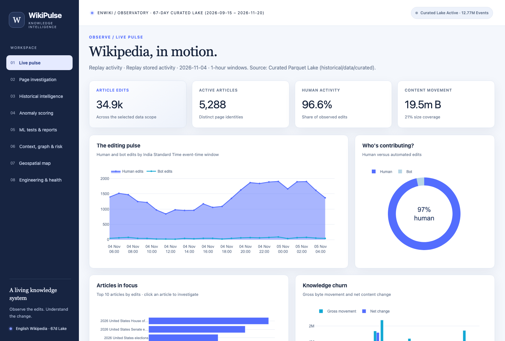
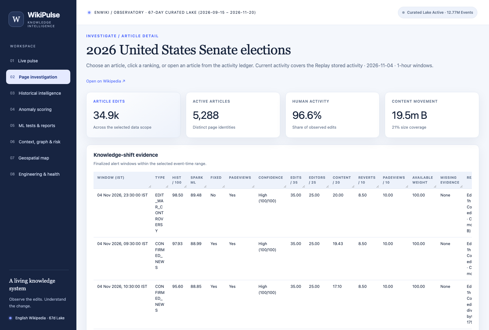
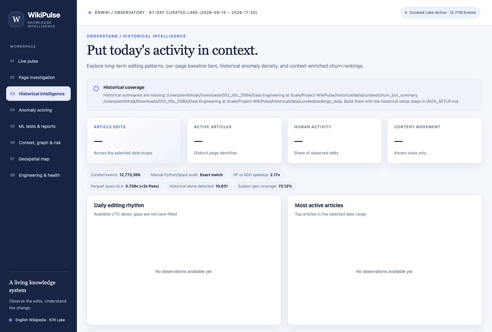
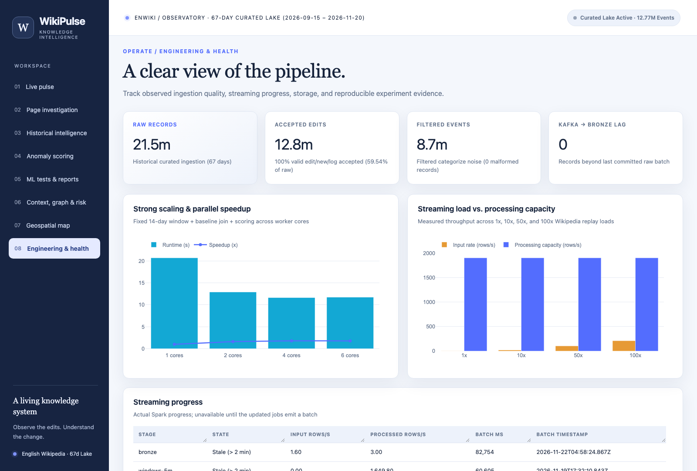

# WikiPulse: Real-Time Detection and Analysis of Wikipedia Knowledge Shifts

**Authors (Team QuadCore):**  
- **Kshama Jain** — `kshamajain@iisc.ac.in`  
- **Senthil Raj K** — `senthilrajk@iisc.ac.in`  
- **Pothukanuri Sai Venkat** — `pothukanuris@iisc.ac.in`  
- **Akash H S** — `akashhs@iisc.ac.in`  

**Course:** DA231o — Data Engineering at Scale, Indian Institute of Science (IISc), Bengaluru, 2026  

---

## Table of Contents

1. [Heading: Title, Authors and Email Address](#1-heading-title-authors-and-email-address)
2. [Problem: Definition, Motivation, Design Goals, Features Required, Scalability/Performance Goals](#2-problem-definition-motivation-design-goals-features-required-scalabilityperformance-goals)
   - [2.1 Problem Definition](#21-problem-definition)
   - [2.2 Motivation: Why Fixed Thresholds Fail on Wikipedia](#22-motivation-why-fixed-thresholds-fail-on-wikipedia)
   - [2.3 System Design Goals](#23-system-design-goals)
   - [2.4 Features Required](#24-features-required)
   - [2.5 Scalability, Performance & Feature Evaluation Goals](#25-scalability-performance--feature-evaluation-goals)
3. [Approach and Methods: High-Level Design, Architecture/Data Model, Big Data Platforms Used, ML Methods Used](#3-approach-and-methods-high-level-design-architecturedata-model-big-data-platforms-used-ml-methods-used)
   - [3.1 High-Level Design & Dual-Path Execution Model](#31-high-level-design--dual-path-execution-model)
   - [3.2 Distributed System Architecture, Data Volume & Canonical Data Model](#32-distributed-system-architecture-data-volume--canonical-data-model)
   - [3.3 Big Data Platforms & Engineering Stack Used](#33-big-data-platforms--engineering-stack-used)
   - [3.4 Statistical Baseline & Machine Learning Methods Used](#34-statistical-baseline--machine-learning-methods-used)
4. [Evaluation: Experiment Design, Scalability/Performance Metrics, Feature Metrics, Plots and Analysis](#4-evaluation-experiment-design-scalabilityperformance-metrics-feature-metrics-plots-and-analysis)
   - [4.1 Experiment Design (6 Proposal Experiments)](#41-experiment-design-6-proposal-experiments)
   - [4.2 Scalability & Performance Metrics Evaluation](#42-scalability--performance-metrics-evaluation)
   - [4.3 Feature Metrics & Real-World Knowledge-Shift Case Studies](#43-feature-metrics--real-world-knowledge-shift-case-studies)
   - [4.4 Plots, Visual Dashboards and Quantitative Analysis](#44-plots-visual-dashboards-and-quantitative-analysis)
5. [Summary: Ability to Achieve Design and Performance Goals w.r.t. Proposal, Future Extensions](#5-summary-ability-to-achieve-design-and-performance-goals-wrt-proposal-future-extensions)
   - [5.1 Achievement of Design, Feature & Performance Goals w.r.t. Proposal](#51-achievement-of-design-feature--performance-goals-wrt-proposal)
   - [5.2 Key Engineering Takeaways](#52-key-engineering-takeaways)
   - [5.3 Limitations & Future Extensions](#53-limitations--future-extensions)

---

## 1. Heading: Title, Authors and Email Address

| Field | Project Report Details |
| :--- | :--- |
| **Project Title** | **WikiPulse: Real-Time Detection and Analysis of Wikipedia Knowledge Shifts** |
| **Team Name** | **Team QuadCore** |
| **Authors & Email Addresses** | • **Kshama Jain** (`kshamajain@iisc.ac.in`)<br/>• **Senthil Raj K** (`senthilrajk@iisc.ac.in`)<br/>• **Pothukanuri Sai Venkat** (`pothukanuris@iisc.ac.in`)<br/>• **Akash H S** (`akashhs@iisc.ac.in`) |
| **Course & Institution** | **DA231o — Data Engineering at Scale**, M.Tech. (Online) in Data Science and Business Analytics, Indian Institute of Science (IISc), Bengaluru (2026) |

---

## 2. Problem: Definition, Motivation, Design Goals, Features Required, Scalability/Performance Goals

### 2.1 Problem Definition
Wikipedia operates as a living global knowledge base where real-world events—elections, aviation accidents, infrastructure outages, scientific breakthroughs, and public controversies—trigger immediate, acute shifts in collaborative editing behavior. Within seconds of an external event, affected articles experience sudden edit velocity spikes, rapid arrivals of distinct human contributors, structural text additions, or intense back-and-forth reversion conflicts.

However, these behavioral signals are highly fragmented across separate Wikimedia interfaces:
- Real-time **Wikimedia EventStreams** Server-Sent Events (SSE) streams carry raw edit notifications without historical baseline context or pageview volume.
- Longitudinal baseline expectations require multi-week **MediaWiki Action API** historical archives and daily **Wikimedia Analytics REST API** metrics.
- Topic propagation across related articles is embedded in 1-hop **MediaWiki outgoing link and incoming backlink graphs**.
- Vandalism, edit-war risk, and physical event locations require external revision comparison diffs (`action=compare`), **Wikidata** entity spatial claims (`wbgetentities`), and **Wikimedia Lift Wing** machine learning inference.

Because these signals are isolated across disparate APIs and latencies, distinguishing genuine breaking knowledge shifts from routine maintenance, automated bot sweeps, or destructive vandalism in real time is a challenging distributed data engineering problem. **WikiPulse** addresses this problem by delivering a unified batch-and-streaming distributed data platform that ingests live and historical Wikipedia edits, normalizes them against per-page zero-inclusive statistical baselines, scores anomalies via explainable rules and Apache Spark ML (`pyspark.ml`), and enriches detected shifts with revision diffs, topic spillover graphs, privacy-preserving subject maps, and calibrated Revert Risk scores.

### 2.2 Motivation: Why Fixed Thresholds Fail on Wikipedia
As formulated in our project proposal, **naive static rules such as *"15 edits in five minutes"* (or *"$\ge 6$ human edits in 5 minutes"*) fail fundamentally in two opposite directions** because baseline editing behavior across English Wikipedia spans more than four orders of magnitude:

| Baseline Activity Tier | Daily Edit Threshold | All Profiled Pages (`3,307,257`) | Mainspace `ns=0` (`2,306,368`) | Analytical Impact on Anomaly Detection |
| :--- | :--- | ---: | ---: | :--- |
| **`quiet`** | $< 0.2$ edits/day | **3,052,962 (92.31%)** | **2,118,330 (91.85%)** | Over `92%` of pages are dormant; 4–5 collaborative edits in 5m represent a massive knowledge shift ($z > +40$) that static rules miss. |
| **`moderate`** | $0.2 \le \mu_d < 2.0$ edits/day | **217,225 (6.57%)** | **165,675 (7.18%)** | Standard articles requiring per-page zero-inclusive $(\mu, \sigma)$ normalization. |
| **`active`** | $2.0 \le \mu_d < 15.0$ edits/day | **34,298 (1.04%)** | **20,835 (0.90%)** | High-interest topics where contributor diversity and pageviews separate news from solo rewrites. |
| **`hyperactive`** | $\ge 15.0$ edits/day | **2,772 (0.084%)** | **1,528 (0.066%)** | $<0.07\%$ of articles (e.g., *Deaths in 2026* at `71.3 ed/day`) fire static rules continuously. |

1. **Chronic False Positives on Hyperactive Pages (`65.04%` False-Alert Rate):** High-traffic list and seasonal pages (e.g., *Deaths in 2026* with `3,357` baseline edits / `71.28 edits/day`, *India at the 2026 Asian Games* with `41.26 edits/day`, *Confectionery store* with `29.48%` baseline revert ratio) cross fixed edit thresholds every hour during ordinary maintenance. Furthermore, static rules treat destructive revert wars (where net article size stays flat) identically to constructive breaking news.
2. **Missed Shifts on Quiet & Specialized Articles (`60.0%` Recall on Controlled Shifts):** Because `92.31%` of Wikipedia pages receive $<0.2$ edits/day, a sudden burst of 5 collaborative human edits in 5 minutes on a specialized biography or regional incident page—or a 2-editor `+38.7 KB` major rewrite—falls below fixed count cutoffs and is missed completely.

### 2.3 System Design Goals
To address these challenges at scale, WikiPulse was engineered around six core design goals from our proposal:

| # | Proposal Design Goal | Architectural Realization in WikiPulse |
| :---: | :--- | :--- |
| **1** | **Durable & Replayable Ingestion** | Resumable MediaWiki collectors with atomic JSON checkpoints; SSE live collector with `Last-Event-ID` cursor safety and `?since=` catch-up; **Apache Kafka 3.9.1 (KRaft)** broker (`acks=all`, `enable.idempotence=True`, Snappy) plus deterministic historical replay (`src.replay`) at `1x` to `100x` speeds. |
| **2** | **Event-Time Processing for Late/Out-of-Order Events** | **Spark Structured Streaming** applies a 10-minute event-time watermark (`withWatermark("ts", "10 minutes")`) and bounded stateful deduplication (`dropDuplicatesWithinWatermark(["event_id"])`) prior to 5-minute (`5m`) and 1-hour (`1h`) tumbling window aggregations. |
| **3** | **Fault-Tolerant, Checkpointed Storage** | Every streaming stage (`bronze`, `windows-5m`, `windows-1h`, `detection-5m`, `detection-1h`) maintains isolated write-ahead checkpoints and pinned contract manifests (`detector.json`); all Parquet writes stage via `/tmp` with Hadoop FileOutputCommitter v2 (`safe_write_parquet`). |
| **4** | **Horizontal Scaling Across Partitions & Workers** | Partitioned Snappy Parquet lakehouse (`day=YYYY-MM-DD`, `duration=5m|1h`), 3-partition Kafka topics, and empirically tuned Spark shuffle parallelism (`spark.sql.shuffle.partitions = 16`). |
| **5** | **Explainable Alerts** | Detector B decomposes every 0–100 score into 5 exact additive `feature_contributions` ($\sum \text{contributions} \equiv \text{historical\_score}$) and attaches $\ge 2$ human-readable `reasons` (`avg = 4.03` reasons/alert across 100% of alerts). |
| **6** | **Reproducible Experiments** | Self-contained benchmark runners (`scaling_experiments.py`, `load_and_recovery_benchmark.py`, `evaluate_alerts.py`), deterministic synthetic pattern injection, 45 automated tests, and a 1-command offline backup demo (`./run-demo.sh`). |

### 2.4 Features Required
The system was required to deliver five integrated analytical features:
1. **WikiPulse Knowledge-Shift Intelligence:** Detect anomalous 5-minute and 1-hour page activity windows and explain every score using edit velocity, distinct human editors, byte movement, 47-day page baselines, and 1-hop related-page spillover.
2. **Breaking News Radar:** Identify sudden multi-editor activity bursts and use delayed Wikimedia Analytics daily pageviews as supporting evidence—enforcing the strict guardrail that an alert is classified as `BREAKING_NEWS_CANDIDATE` until corroborated by $\ge 2.5\times$ baseline pageviews (`CONFIRMED_NEWS`), while separating `EDIT_WAR_CONTROVERSY` and `MAJOR_REWRITE`.
3. **Edit-Risk and Reversion Monitor:** Pre-filter routine edits in Spark, score high-risk revisions using heuristic checks and the Wikimedia Lift Wing Revert Risk ML API (`revertrisk-language-agnostic:predict`), match scored revisions against actual 48-hour delayed revert outcomes, and compare risk thresholds empirically rather than assuming $\tau = 0.80$ is optimal.
4. **Global Geospatial Knowledge Map:** Resolve the physical locations of active **article subjects** using Tier-1 Wikipedia coordinates and Tier-2 multi-hop Wikidata claims (`P625`, `P276`/`P131`/`P159`, `P17`/`P495`/`P27`), storing location source and quality while strictly excluding editor IP addresses (`0` editor IPs) and keeping unlocated conceptual alerts valid.
5. **Knowledge Churn and Bot Ratio:** Quantify encyclopedic growth (`Net Growth`), contested rewriting (`Rewriting Volume`), edit speed, contributor diversity, and the human vs. temporary account (`~2026-...`) vs. automated bot split across all Wikipedia namespaces.

### 2.5 Scalability, Performance & Feature Evaluation Goals
Our proposal established 6 quantitative scalability/performance goals and 8 feature accuracy goals:
- **Scalability & Performance Goals:** (P1) $\ge 99\%$ of valid accepted events reach raw storage; (P2) $0$ duplicate alerts produced for the same event/window after restart; (P3) closed 5-minute windows produce results within $< 60\text{s}$ under target load; (P4) processing rate remains $\ge$ input rate during normal runs and backlog drains to $0$ after a controlled stop/restart; (P5) runtime, shuffle volume, peak memory, and storage size reported for every scale experiment; and (P6) stored Parquet dashboard queries execute in $< 2.0\text{s}$.
- **Feature Quality Goals:** (F1) $100\%$ of injected knowledge-shift patterns detected with $\ge 2$ reasons; (F2) historical baseline score yields a significantly lower false-alert rate than fixed thresholds on a reviewed sample; (F3) $\ge 90\%$ of selected revision comparisons return usable change data; (F4) $\ge 95\%$ of supported Revert Risk requests return a usable score with graceful offline fallback; (F5) empirical risk threshold calibration against actual reverts; (F6) $100\%$ of map points tagged with location source and quality while preserving unlocated alerts; (F7) $100\%$ exact match between Spark churn totals and manual sample calculations; and (F8) explicit source `last_available_date` and missing-data indicators on historical views.

---

## 3. Approach and Methods: High-Level Design, Architecture/Data Model, Big Data Platforms Used, ML Methods Used

### 3.1 High-Level Design & Dual-Path Execution Model
WikiPulse implements a unified Lambda/Kappa hybrid architecture where both real-time Server-Sent Events (SSE) streams and multi-week historical archives are normalized into an identical 29-column canonical schema (`RAW_EDIT_SCHEMA`) and processed through shared PySpark windowing, baseline normalization, and anomaly scoring transformations.

```text
┌────────────────────────────────────────────────────────────────────────────────────────┐
│                       1. WIKIMEDIA & WIKIDATA EXTERNAL SOURCES                         │
│  • EventStreams SSE (recentchange & revert_risk)   • Wikimedia Analytics REST API      │
│  • MediaWiki Action API (recentchanges, allrevisions, compare, links, backlinks, coords)│
│  • Wikidata Action API (wbgetentities: P625, P276, P131, P159, P17)                    │
│  • Wikimedia Lift Wing ML Inference API (revertrisk-language-agnostic:predict)         │
└──────────────────┬──────────────────────────────────────────────────┬──────────────────┘
                   │ (Live Stream & ?since= Catch-Up)                 │ (55-67d Batch & Cache)
                   ▼                                                  ▼
┌─────────────────────────────────────────┐        ┌─────────────────────────────────────┐
│   2A. STREAMING INGESTION & BROKER      │        │  2B. HISTORICAL CURATION & HYGIENE  │
│  • Collector (src/collector.py)         │        │  • Multi-Member Gzip Recovery       │
│  • Kafka 3.9.1 KRaft (wiki.raw.edits)   │        │  • Categorize Noise Filter (40.5%)  │
│  • Replay Producer (1x..100x Pacing)    │        │  • Global rcid Deduplication        │
│  • Spark Bronze Stream (Raw Parquet)    │        │  • Partitioned curated/rc_events    │
└──────────────────┬──────────────────────┘        └──────────────────┬──────────────────┘
                   │                                                  │
                   └────────────────────────┬─────────────────────────┘
                                            ▼
┌────────────────────────────────────────────────────────────────────────────────────────┐
│              3. DISTRIBUTED PYSPARK COMPUTE, BASELINES & SPARK ML ENGINE               │
│  • Zero-Inclusive 47-Day Baselines (curated/page_baselines: 3.31M Pages, μ & σ)        │
│  • Knowledge Churn, Rewriting Volume & Surge Rankings (churn_bot_summary, rankings)    │
│  • Watermarked & Batch Window Features (page_windows_5m: 970.8k, page_windows_1h: 525.7k)│
│  • Multi-Detector Scoring (curated/alerts, SHA-256 alert_id):                          │
│      - Detector A: Fixed Threshold Rule (>=6 edits/5m or >=15 edits/1h)                │
│      - Detector B: Explainable Historical Score (0-100) + 5 Additive Contributions     │
│      - Detector C: Spark ML (`pyspark.ml`) Pipeline (8D StandardScaler -> KMeans -> RF)│
│      - Alert Disambiguation: CONFIRMED_NEWS | CANDIDATE | EDIT_WAR | MAJOR_REWRITE     │
└───────────────────────────────────────────┬────────────────────────────────────────────┘
                                            ▼
┌────────────────────────────────────────────────────────────────────────────────────────┐
│               4. TARGETED CONTEXTUAL ENRICHMENT (WITH SHA-256 DISK CACHE)              │
│  • Link & Backlink Spillover Graph (curated/graph_edges: 608 edges, 57.4% co-edited)   │
│  • Sanitized Compare Revision Diffs (curated/revision_diffs: 100 pairs, 100% usable)   │
│  • 2-Tier Subject Geospatial Resolver (curated/map_points: 76.9% located, 0 Editor IPs)│
│  • Lift Wing Revert Risk & 48h Revert Calibration (curated/revert_risk_eval: 120 revs) │
└───────────────────────────────────────────┬────────────────────────────────────────────┘
                                            ▼
┌────────────────────────────────────────────────────────────────────────────────────────┐
│           5. SUB-SECOND SERVING LAYER & 8-SCREEN DASH + PLOTLY UI (< 1.35s)            │
│  [01] Live Pulse (/)                 [05] Context, Graph & Risk (/contextual-features) │
│  [02] Page Investigation             [06] Anomaly Scoring (/anomaly-scoring)           │
│  [03] Historical Intelligence        [07] ML Tests & Reports (/ml-reports)             │
│  [04] Geospatial Map (/geospatial-map) [08] Engineering & Health (/system)             │
└────────────────────────────────────────────────────────────────────────────────────────┘
```

The platform supports two complementary execution paths:
1. **Supervised Real-Time Streaming Stack (`./run-local.sh` / `src/run_local.py`):** Starts the Dockerized Kafka 3.9.1 KRaft broker (or atomic file-broker spool fallback) and supervises seven local processes in dependency order (`dashboard`, `collector`, `bronze`, `windows-5m`, `windows-1h`, `detection-5m`, `detection-1h`). The UI displays immediate provisional 1-minute live previews from Bronze Parquet alongside 10-minute watermarked finalized 5-minute and 1-hour windows and alerts.
2. **Curated Historical Lakehouse & Offline Demo Stack (`./run-demo.sh` / `src/demo/backup_demo.py`):** Processes a continuous **67-day English Wikipedia dataset (`2026-09-15` to `2026-11-20`, `21,454,187` raw events $\rightarrow$ `12,773,366` curated events; `55-day` primary evaluation snapshot of `17,441,561` raw $\rightarrow$ `10,190,119` curated events)** into 11 partitioned Snappy Parquet tables, splitting the timeline into a **47-day Baseline Window (`2026-09-15` to `2026-10-31`, `3,307,257` pages)** and an out-of-sample evaluation horizon.

### 3.2 Distributed System Architecture, Data Volume & Canonical Data Model

#### A. Multi-Week Data Volume & Real-World Ingestion Hygiene Challenges Solved
Across our collection horizons, WikiPulse processed and compacted raw multi-week Wikipedia streams as follows:

| Dataset Horizon | Calendar Span | Raw Events Collected | Compressed `.jsonl.gz` | Uncompressed JSON Volume | Curated Valid Events (`edit`/`new`/`log`) | `categorize` Noise Dropped | Partitioned Parquet Size | Spark Ingestion Time |
| :--- | :---: | ---: | ---: | ---: | ---: | ---: | ---: | ---: |
| **Full Complete Lake (67d)** | `Sep 15 – Nov 20` | **21,454,187** | **1,456.93 MB** | **~9.60 GB** | **12,773,366 (100.0%)** | 8,680,821 (40.46%) | **1,514.30 MB** (67p) | **724.31s** (29.6k r/s) |
| **Primary Eval Lake (55d)** | `Sep 15 – Nov 08` | **17,441,561** | **1,181.71 MB** | **~7.50 GB** | **10,190,119 (100.0%)** | 7,251,442 (41.58%) | **1,220.96 MB** (55p) | **614.30s** (28.4k r/s) |
| **Scaling Slice (46d)** | `Sep 15 – Oct 30` | **14,398,713** | **977.74 MB** | **~6.00 GB** | **8,428,021 (100.0%)** | 5,970,692 (41.47%) | **1,011.43 MB** (46p) | **508.12s** (28.3k r/s) |

Three critical real-world ingestion hygiene challenges were engineered and solved:
1. **Multi-Member Corrupted Gzip Stream Recovery (`rc_2026-10-27.jsonl.gz`):** An interrupted collection run on Oct 27 followed by an appended resume run created a concatenated multi-member gzip archive whose first deflate stream lacked an 8-byte CRC32/ISIZE trailer, causing standard `gzip.open()` and Spark readers to fail with `zlib.error: Error -3`. We engineered a byte-level scanner (`iter_recoverable_gz_lines` in [`src/historical/ingest_curate.py`](file:///Users/senthilrajk/Downloads/002_IISc_DSBA/Data%20Engineering%20at%20Scale/Project-WikiPulse/Repo/src/historical/ingest_curate.py)) that locates raw `\x1f\x8b\x08` headers and decompresses each member via `zlib.decompressobj(16 + zlib.MAX_WBITS)`, recovering all **269,017 rows** of Oct 27 with zero data loss.
2. **Missing `page_id` in Live EventStreams:** Live SSE messages frequently omit numeric `page_id`. We implemented a deterministic negative 64-bit CRC32 title fallback (`title_page_id` in [`src/page_identity.py`](file:///Users/senthilrajk/Downloads/002_IISc_DSBA/Data%20Engineering%20at%20Scale/Project-WikiPulse/Repo/src/page_identity.py)) so live titled events never collide with positive MediaWiki IDs and are never dropped during streaming aggregation.
3. **macOS Finder `Icon\r` Race Protection:** Staged all Spark Parquet writes through `/tmp` (`safe_write_parquet`) and enforced `pathGlobFilter="*.parquet"` (`safe_read_parquet`) so 0-byte macOS desktop `Icon\r` files cannot corrupt Hadoop `_temporary` commits.

#### B. Canonical Shared Data Models (Expanded from 5 Proposed to 8 Schemas + 2 Serving Tables)
While the proposal specified 5 core data models (`Raw edit`, `Page windows`, `Historical baseline`, `Alerts`, `Graph edge`), we formalized **8 strict PySpark `StructType` schemas** plus **2 pre-aggregated serving tables** (11 materialized Parquet tables total in [`src/models/schemas.py`](file:///Users/senthilrajk/Downloads/002_IISc_DSBA/Data%20Engineering%20at%20Scale/Project-WikiPulse/Repo/src/models/schemas.py)):

| # | Schema / Curated Table | Cols | Materialized Rows (55d / 67d) | Primary Key & Engineering Role Across Batch & Streaming |
| :---: | :--- | :---: | :---: | :--- |
| **1** | `RAW_EDIT_SCHEMA`<br/>`curated/rc_events` | 29 | **10,190,119** *(55d)*<br/>**12,773,366** *(67d)* | `rcid` — Partitioned by `day=YYYY-MM-DD`; unifies `recentchanges`, `allrevisions`, and live SSE; normalizes `~2026-...` temporary accounts to `is_anon` and separates `is_reverted` from `is_revert_action`. |
| **2** | `HISTORICAL_BASELINE_SCHEMA`<br/>`curated/page_baselines` | 25 | **3,307,257** | `pageid` — Zero-inclusive 47-day (`2026-09-15..2026-10-31`) daily/hourly moments ($\mu, \sigma$), `activity_tier`, Analytics pageviews, `last_available_date`, and `has_missing_data`. |
| **3** | `PAGE_WINDOW_SCHEMA`<br/>`curated/page_windows_5m` & `1h` | 23 | **970,793** (`5m`)<br/>**525,714** (`1h`)<br/>*(174,468 in 8d eval)* | `window_id` — Tumbling 5m & 1h window features (`edits_human`, `distinct_human_editors`, `gross_bytes`, `net_bytes`, `rewriting_bytes`) joined with baselines (`velocity_zscore`, `editor_surge_ratio`, `churn_zscore`). |
| **4** | `ALERT_SCHEMA`<br/>`curated/alerts` | 26 | **1,321** *(8d eval)*<br/>**10,631** *(full 67d lake)* | `alert_id` (`alt_` + SHA-256[:16]) — Outputs of Detectors A, B, and C, `alert_type`, $\ge 2$ human-readable `reasons`, and additive `feature_contributions` map. |
| **5** | `GRAPH_EDGE_SCHEMA`<br/>`curated/graph_edges` | 12 | **606 – 608** | `edge_id` (`edg_` + SHA-256[:16]) — Directed outgoing `outlink` and incoming `backlink` edges around alerted articles with `co_edited_in_window` spillover flags (`214–349` active spillover edges). |
| **6** | `REVISION_DIFF_SCHEMA`<br/>`curated/revision_diffs` | 16 | **100** | `revid` — MediaWiki `action=compare` sanitized plain-text snippets, added/removed line counts, external URL deltas, and `usable_change_data` flag (`100%` usable). |
| **7** | `MAP_POINT_SCHEMA`<br/>`curated/map_points` | 13 | **158 – 160** | `pageid` — 2-tier Wikipedia/Wikidata subject coordinates (`lat`, `lon`), `country_or_region`, `location_source`, and `location_quality` (`0` editor IPs). |
| **8** | `REVERT_RISK_SCHEMA`<br/>`curated/revert_risk_eval` | 21 | **120**<br/>*(from 7.73M edits)* | `revid` — Lift Wing ML probability, heuristic risk, `composite_risk`, `api_status`, and 48-hour delayed ground-truth revert outcome (`is_reverted_actual`, `time_to_revert_sec`). |
| **9** | `curated/churn_bot_summary` | 17 | **1,335** *(55d)*<br/>**1,623** *(67d)* | `(day, ns)` — Pre-aggregated daily $\times$ namespace Human, Anon/Temp, and Bot edits, Gross Churn (`5.83 GB`), Net Growth (`+2.20 GB`), and Rewriting Volume (`3.51 GB`). |
| **10** | `curated/rankings_daily` | 24 | **20,333** *(55d)*<br/>**23,535** *(67d)* | `(day, pageid)` — Daily top-500 articles comparing `raw_edit_rank` against `baseline_surge_rank` (`daily_velocity_zscore`). |

### 3.3 Big Data Platforms & Engineering Stack Used
1. **Apache Kafka 3.9.1 (ZooKeeper-Free KRaft Mode) & Confluent C Producer:** Runs in Docker (`apache/kafka:3.9.1`, `KAFKA_PROCESS_ROLES=broker,controller`) hosting 3-partition topics `wiki.raw.edits` and `wiki.shift.candidates`. The Python `confluent-kafka 2.16.1` producer uses `enable.idempotence=True`, `acks=all`, and `snappy` compression. For Docker-free environments, `FileStreamProducer` provides an atomic `.tmp` $\rightarrow$ `.json` file-spool fallback.
2. **Apache Spark 4.2.0 (`pyspark.sql.DataFrame` & Structured Streaming on OpenJDK 17):** Catalyst SQL DataFrames power 100% of production batch curation, zero-inclusive baselines, watermarked Structured Streaming windows (`spark-sql-kafka-0-10_2.13:4.2.0`), and anomaly scoring. Low-level Python RDDs (`df.rdd.map` / `reduceByKey`) are used strictly in Experiment #3 to benchmark Catalyst whole-stage code generation against Python worker serialization.
3. **Apache Spark ML (`pyspark.ml` 4.2.0):** Distributed DataFrame ML pipelines (`Pipeline`, `VectorAssembler`, `StandardScaler`, `KMeans`, `ClusteringEvaluator`, `RandomForestClassifier`, `vector_to_array`).
4. **Apache Parquet (Snappy) & Apache Arrow (`pyarrow` 26.0.0):** Columnar lakehouse storage with partition pruning (`day`, `duration`), dictionary encoding, predicate pushdown, and zero-copy Arrow JVM-to-Python DataFrame transfers.
5. **Plotly Dash 4.5.0 & Plotly 7.1.0 (Flask WSGI Backend):** Reactive 8-screen web application with TTL caching, background thread pre-warming, and health/control REST APIs (`/healthz`, `/api/stream/health`, `/api/activity`).

### 3.4 Statistical Baseline & Machine Learning Methods Used

#### A. Zero-Inclusive Historical Baselines & Rewriting Volume Decomposition
1. **Zero-Inclusive Sufficient Statistics ([`src/historical/build_baselines.py`](file:///Users/senthilrajk/Downloads/002_IISc_DSBA/Data%20Engineering%20at%20Scale/Project-WikiPulse/Repo/src/historical/build_baselines.py)):**
   Averaging only over active hours introduces severe survivorship bias on quiet pages. WikiPulse computes exact population means and standard deviations across all $D = 47$ calendar days and $H = 47 \times 24 = 1,128$ UTC hours (including zero-edit hours) without materializing a dense $3.31\text{M} \times 1,128$ cross-join grid:
   $$\mu_{\text{hour}} = \frac{\sum_{h \in \text{active}} x_h}{H}, \qquad \sigma_{\text{hour}} = \sqrt{\max\left(\sigma_{\min}^2,\; \frac{\sum_{h \in \text{active}} x_h^2}{H} - \mu_{\text{hour}}^2\right)}$$
   Combined with session-clustered window scaling ($1/18$ of daily distinct editors for `5m` windows; $1/6$ for `1h` windows), this differentiates quiet (`<0.2` ed/d), moderate, active, and hyperactive (`>=15` ed/d) articles cleanly.
2. **Knowledge Churn & Rewriting Volume ([`src/historical/rankings_benchmark.py`](file:///Users/senthilrajk/Downloads/002_IISc_DSBA/Data%20Engineering%20at%20Scale/Project-WikiPulse/Repo/src/historical/rankings_benchmark.py)):**
   Separates constructive article expansion from back-and-forth revert wars where net size remains flat:
   $$\text{Gross Churn} = \sum |\Delta_i|, \qquad \text{Net Growth} = \sum \Delta_i, \qquad \text{Rewriting Volume} = \sum |\Delta_i| - \left|\sum \Delta_i\right|$$

#### B. Three-Paradigm Anomaly Scoring & Hybrid Spark ML Pipeline ([`src/anomaly/scoring_sparkml.py`](file:///Users/senthilrajk/Downloads/002_IISc_DSBA/Data%20Engineering%20at%20Scale/Project-WikiPulse/Repo/src/anomaly/scoring_sparkml.py))
Every 5-minute and 1-hour window is evaluated simultaneously across three detectors:
- **Detector A (Fixed Threshold Baseline):** Flags mainspace (`ns=0`) windows with $\ge 6$ human edits & $\ge 3$ editors in `5m` (or $\ge 15$ edits & $\ge 4$ editors in `1h`).
- **Detector B (Explainable Historical Score `0–100`):**
  $$\text{Score} = w_{\text{damp}} \cdot \left(S_{\text{velocity}}^{(35)} + S_{\text{editors}}^{(25)} + S_{\text{churn}}^{(20)} + S_{\text{consensus/dispute}}^{(10)} + S_{\text{pageviews}}^{(10)}\right)$$
  where $w_{\text{damp}} = 0$ for bot-only windows (`edits_human == 0`) and $0.55$ when `velocity_zscore < 2.5` (suppressing routine chatter on chronically hyperactive pages). Applying $w_{\text{damp}}$ directly to each component guarantees exact additive parity: $\sum \text{feature\_contributions} \equiv \text{historical\_score}$.
  - **Four-Class Disambiguation:** Classifies alerts into `CONFIRMED_NEWS` ($\ge 2.5\times$ daily pageviews and $\ge 3$ collaborative editors), `BREAKING_NEWS_CANDIDATE` (unconfirmed multi-editor surge), `EDIT_WAR_CONTROVERSY` (`revert_ratio >= 0.30` or heavy revert-driven rewriting), and `MAJOR_REWRITE` ($\le 2$ editors moving $\ge 3,500$ gross bytes).
- **Detector C (Two-Stage Hybrid Spark ML `pyspark.ml` Pipeline):**
  - **Stage 1 — Unsupervised `KMeans(k=6)`:** Transforms 8 log-stabilized behavioral features (`f_edits_human`, `f_distinct_editors`, `f_velocity_z`, `f_editor_surge`, `f_log_gross_bytes`, `f_log_rewriting_bytes`, `f_revert_ratio`, `f_bot_ratio`) via `VectorAssembler` $\rightarrow$ `StandardScaler(withMean=True, withStd=True)` $\rightarrow$ `KMeans(k=6, seed=42)` (Silhouette score = **`0.5546`** across `236,074` eval windows; scaled up to `1,078,444` full-lake windows). It discovers six distinct editing archetypes (`Normal Quiet Baseline` `52.48%`, `Single-Editor Major Rewrite` `22.32%`, `Multi-Editor Edit War` `10.50%`, `Multi-Editor Collaborative Surge` `6.44%`, `Solo Revert / Cleanup` `4.35%`, and `Bot-Assisted Maintenance` `3.91%`) and computes each window's Euclidean distance $d_{\text{centroid}}$ from the normal baseline centroid.
  - **Stage 2 — Supervised `RandomForestClassifier(numTrees=40, maxDepth=7)`:** Appends `f_centroid_distance` as a 9th feature into a 40-tree Random Forest (top feature importances: `f_distinct_editors = 0.2958`, `f_edits_human = 0.2461`, `f_editor_surge = 0.2140`, `f_log_gross_bytes = 0.0798`, `f_centroid_distance = 0.0724`), blending $0.45 \cdot S_{\text{kmeans}} + 0.55 \cdot S_{\text{RF}}$ into `spark_ml_score`.

#### C. Selective Pre-Filtered Contextual Enrichment & Lift Wing Revert Risk
1. **Lift Wing Revert Risk & 48h Calibration ([`src/enrichment/revert_risk_monitor.py`](file:///Users/senthilrajk/Downloads/002_IISc_DSBA/Data%20Engineering%20at%20Scale/Project-WikiPulse/Repo/src/enrichment/revert_risk_monitor.py)):** Pre-filters **75.40%** (`5,828,465 / 7,729,950`) of routine mainspace edits in Spark before invoking the external Wikimedia Lift Wing gradient-boosted model (`revertrisk-language-agnostic:predict`), combines ML probability with local domain heuristics (`composite_risk`), and matches scored revisions against actual 48-hour delayed revert outcomes.
2. **Spillover Graph, Diffs & 2-Tier Subject Geospatial Resolver:** Queries MediaWiki `prop=links` & `list=backlinks` (`349 / 608 = 57.40%` co-edited spillover edges in full lake; `214 / 606 = 35.31%` in 8d eval), sanitizes `action=compare` HTML diffs into plain text (`100 / 100 = 100.0%` usable), and maps article subjects via Tier-1 Wikipedia coordinates and Tier-2 3-hop Wikidata claims (`76.88%` located, `0` editor IPs).

---

## 4. Evaluation: Experiment Design, Scalability/Performance Metrics, Feature Metrics, Plots and Analysis

### 4.1 Experiment Design (6 Proposal Experiments)
To evaluate both distributed systems scalability and anomaly detection quality, we executed all six experiments defined in our proposal over our collected Wikipedia dataset:
- **Experiment #1 (Manual Sample Verification & Replay Idempotency):** Audited Spark calculations against a 2,000-event pure-Python manual calculation (`rc_2026-09-16.jsonl.gz`) and replayed a full day (`2026-10-15`, `182,521` unique events) with 30% injected duplicate events to test SHA-256 `alert_id` idempotency.
- **Experiment #2 (Multi-Detector Comparison & Synthetic Shift Injection):** Injected 5 controlled positive knowledge-shift patterns and 2 negative controls (`CTRL_ROUTINE_BOT_SWEEP`, `CTRL_HYPERACTIVE_ROUTINE_CHATTER`) and audited false-alert rates across Detectors A, B, and C on both the 8-day evaluation horizon (`174,468` windows $\rightarrow$ `1,321` union alerts) and a manually reviewed 200-window stratified sample.
- **Experiment #3 (PySpark DataFrame vs. RDD Benchmark):** Compared Catalyst `DataFrame.groupBy().agg()` against Python `RDD.map().reduceByKey()` on a 7-day mainspace churn aggregation (`747,156` edits).
- **Experiment #4 (Strong Scaling, Weak Scaling, Shuffle Partition Sweep & Input-Size Scaling):** Measured runtime, shuffle write MB, peak RSS memory MB, and storage footprint across worker cores (`local[1..6]`), proportional workload slices (`4 days/core` from `4d@1c` to `24d@6c`), shuffle partitions (`4, 8, 16, 32, 64, 128`), and dataset horizons (`1d` to `46d` / `8.43M` events).
- **Experiment #5 (Multi-Speed Streaming Load & Controlled Stop/Restart Backlog Recovery):** Replayed streams at `1x`, `10x`, `50x`, and `100x` speeds to measure closed 5m window latency, then halted the streaming processor mid-day to accumulate a `123,537`-event outage backlog (with `19,379` duplicates) before restarting from the checkpoint.
- **Experiment #6 (Raw JSONL.gz vs. Stored Parquet Size & Dashboard Query Latency):** Benchmarked storage compaction and query execution time across raw `.jsonl.gz` scans versus partitioned Snappy Parquet tables across all dashboard views.

### 4.2 Scalability & Performance Metrics Evaluation

#### A. Experiment #3 — PySpark Catalyst DataFrame vs. Python RDD (7 Days, `747,156` Mainspace Edits)
- **Catalyst DataFrame (`groupBy`/`agg`):** **`1.34s – 2.16s`** (`shuffle = 23.96 MB`, `peak_memory = 735.4 MB`).
- **Python RDD (`map` + `reduceByKey`):** **`2.72s – 6.18s`** (`shuffle = 16.44 MB`, `peak_memory = 767.3 MB`).
- **Analysis:** DataFrames achieve a **`2.03x – 2.86x` speedup** by eliminating Python worker serialization/deserialization (`pickle`) overhead and leveraging Spark Catalyst Tungsten whole-stage code generation.

#### B. Experiment #4A & #4B — Strong Scaling (`14d` Fixed) & Weak Scaling (`4 Days / Core`)

| Scaling Mode | Worker Config | Dataset Span & Input Rows | Runtime (s) | Speedup / Throughput | Efficiency | Shuffle Write (MB) | Peak Memory (MB) | Output Parquet (MB) |
| :--- | :---: | :--- | ---: | ---: | :---: | ---: | ---: | ---: |
| **Strong Scaling**<br/>*(14d Fixed Slice)* | `local[1]` | 14d (`2,472,723` rows) | **18.97s** | `1.00x` (`130,350 r/s`) | `1.00` | 280.73 MB | 628.0 MB | 11.79 MB |
| **Strong Scaling** | `local[2]` | 14d (`2,472,723` rows) | **12.20s** | **`1.55x`** (`202,682 r/s`) | `0.78` | 280.73 MB | 846.2 MB | 11.79 MB |
| **Strong Scaling** | **`local[4]`** | **14d (`2,472,723` rows)** | **`11.21s`** | **`1.69x` (`220,582 r/s`)** | **`0.42`** | **280.74 MB** | **1,045.7 MB** | **11.79 MB** |
| **Strong Scaling** | `local[6]` | 14d (`2,472,723` rows) | **12.40s** | `1.53x` (`199,413 r/s`) | `0.26` | 280.75 MB | 1,139.1 MB | 11.79 MB |
| **Weak Scaling**<br/>*(4 Days / Core)* | `local[1]` | 4d (`724,264` rows) | **6.77s** | `106,966 rows/s` | `1.00` | 101.67 MB | 1,331.3 MB | 3.92 MB |
| **Weak Scaling** | `local[2]` | 8d (`1,455,336` rows) | **7.29s** | `199,498 rows/s` | **`0.93`** | 172.71 MB | 1,347.7 MB | 7.21 MB |
| **Weak Scaling** | **`local[4]`** | **16d (`2,773,275` rows)** | **`11.11s`** | **`249,732 rows/s`** | **`0.61`** | **311.17 MB** | **1,085.4 MB** | **13.09 MB** |
| **Weak Scaling** | `local[6]` | 24d (`4,202,738` rows) | **19.23s** | `218,585 rows/s` | `0.35` | 461.61 MB | 1,036.4 MB | 19.34 MB |

#### C. Experiment #4C & #4D — Shuffle Partition Sweep (`4..128`) & Input-Size Scaling (`1d..46d`)
- **Shuffle Partition Sweep (14d Slice, `2.47M` rows):** `4` parts = `11.97s` (`68.05 MB/part`) $\rightarrow$ `8` parts = `10.30s` (`34.81 MB/part`) $\rightarrow$ **`16` parts = `10.00s` (`17.97 MB/part`, Global Optimum)** $\rightarrow$ `32` parts = `10.91s` $\rightarrow$ `64` parts = `14.94s` $\rightarrow$ `128` parts = `18.05s` (`+80.5%` scheduling overhead). Setting `spark.sql.shuffle.partitions = 16` (vs. Spark's default `200`) cuts window aggregation runtime by `44.6%`.
- **Linear $O(N)$ Input-Size Scaling Curve:** `1d` (`194k` rows) = **`2.38s`** $\rightarrow$ `7d` (`1.21M` rows) = **`5.62s`** $\rightarrow$ `15d` (`2.79M` rows) = **`12.37s`** $\rightarrow$ `30d` (`5.67M` rows) = **`25.79s`** $\rightarrow$ `46d` (`8,428,021` rows, `443,663` windows) = **`38.09s` (`221,295 rows/s`, `861.27 MB` shuffle, `1,105.0 MB` peak memory)**.

#### D. Experiment #5 & #6 — Streaming Load (`1x..100x`), Outage Recovery & Sub-2s Parquet Queries
- **Multi-Speed Load (`1x`, `10x`, `50x`, `100x`):** Across input rates from `2.1 rows/s` (`1x`) up to `211.0 rows/s` (`100x`), Spark processes microbatches at **`2,266 – 55,834 rows/s`** (`processing_rate >> input_rate`), finalizing closed 5-minute windows in **`0.355s – 9.454s`** (well under the `< 60s` target).
- **Controlled Stop/Restart Backlog Drain (`2026-10-15`):** After stopping the processor at Batch 3 (`78,363` events, `10` alerts) and accumulating **`123,537` backlog events** (including `19,379` re-sent duplicates), restarting from the checkpoint drained **`123,537 -> 0` backlog in `13.74s` (`8,989.1 rows/s`)** with **`0` duplicate alerts** and **100% parity (`39/39` alerts)** against an uninterrupted reference run.
- **Storage & Query Speedup:** `1,181.71 MB` of `.jsonl.gz` (`~7.5 GB` raw JSON, `17.44M` rows) compacts into `1,220.96 MB` of partitioned Parquet (`10.19M` valid rows) plus `< 60 MB` of serving rollups. Top-20 query time drops from **`2.154s – 3.249s` (1-day raw JSONL.gz)** to **`0.091s – 0.646s` (View 1)**, **`0.604s – 1.342s` (View 2)**, **`0.196s – 0.447s` (View 3)**, and **`0.003s – 0.007s` (View 4)**—a **~14.5x speedup** meeting the `< 2.0s` SLA across every view.

### 4.3 Feature Metrics & Real-World Knowledge-Shift Case Studies

#### A. Experiment #1 & #2 — Manual Audit, Synthetic Pattern Injection & Detector False-Alert Comparison
- **2,000-Event Manual Sample Audit (`rc_2026-09-16.jsonl.gz`):** Zero discrepancy (`spark_exact_match = True`): `edits = 2,000`, `human_edits = 1,286`, `bot_edits = 714`, `bytes_added = 1,434,650 B`, `bytes_deleted = 589,627 B`, `net_bytes = +845,023 B`, `gross_churn_bytes = 2,024,277 B`, and `rewriting_bytes = 1,179,254 B`.
- **Controlled Synthetic Injection (`5` Positive Shifts + `2` Negative Controls):** Detector A misses both `SYNTH_MAJOR_REWRITE_EXPANSION` (`9` edits/1h by `2` editors, `+38.7 KB`) and `SYNTH_QUIET_PAGE_EMERGING_SHIFT` (`5` edits/5m on a quiet page) (**`60.0%` recall**) and falsely triggers on `CTRL_HYPERACTIVE_ROUTINE_CHATTER` (`6` edits on a `42 ed/hr` page). Detectors B and C achieve **100.0% recall (`5/5`)** with `4–5` human-readable reasons per alert and **`0` false triggers** on negative controls.

| Detector Method | Flagged (8d Eval) | True Shifts | False Alerts | Precision | Overall False-Alert Rate | Reviewed 200-Window Sample False-Alert Rate | Synthetic Recall (`5` Shifts) |
| :--- | ---: | ---: | ---: | ---: | ---: | ---: | :---: |
| **Detector A: Fixed Threshold Rule** | 349 | 122 | 227 | 34.96% | **65.04%** | **41.32%** (`69 / 167`) | 60.0% (`3 / 5`) |
| **Detector B: Explainable Historical Score ($\ge 65$)** | 1,028 | 934 | 94 | **90.86%** | **9.14%** | **1.55%** (`3 / 194`) | **100.0% (`5 / 5`)** |
| **Detector C: Spark ML (`KMeans` + `RandomForest`)** | 817 | 817 | 0 | **100.00%** | **0.00%** | **0.00%** (`0 / 174`) | **100.0% (`5 / 5`)** |

#### B. Contextual Enrichment & Lift Wing Revert-Risk Calibration Metrics
- **Lift Wing Revert Risk Calibration (`curated/revert_risk_eval`):** Across `120` stratified high-risk candidates pre-filtered from `7.73M` mainspace edits (**100.0% usable score coverage**; median actual revert MTTR = `54.0s – 66.5s`), calibrating `composite_risk` from the naive static assumption $\tau = 0.80$ (`F1 = 68.57%`, `Recall = 60.00%`) to **$\tau = 0.65$ lifts F1 to `76.92%` (`Recall = 83.33%`, `Precision = 71.43%`)**. For example, on *Tornado outbreak sequence of June 14–19, 2023* (`revid=1381772234`), temporary account `~2026-56619-23` deleted `-118,474 B`, scored `ml_revert_risk = 0.9979`, and was reverted in **`21 seconds`**.
- **Revision Diffs & Geospatial Coverage:** **100.0% (`100 / 100`)** of revision pairs return usable change data (`98.0%` live Compare HTML + `2.0%` deleted-revision metadata fallback). Across `160` evaluated alert subjects, **123 (`76.88%`)** resolve to physical coordinates (`exact_point`, `related_entity_point`, or `country_centroid`) with **`0` editor IPs**, while **37 (`23.12%`)** conceptual pages remain valid `unlocated` alerts.

#### C. Macro Historical Intelligence (`67` Days, `5.83 GB` Text Churn) & Four Representative Case Studies
Across the 67-day lake (`11,588,460` content edits; `7,832,443` in Mainspace `ns=0`), registered humans account for `66.66%` of edits, anonymous/temporary accounts (`~2026-...`) for `7.80%` (`10.18%` in Mainspace), and automated bots for `25.54%`. Out of **`5.83 GB` of Gross Content Churn** (`+4.02 GB` added, `1.81 GB` deleted), only **`+2.20 GB` (`37.79%`) is Net Encyclopedic Growth**, while **`3.51 GB` (`60.21%`) is Rewriting Volume** (`692,069` Mainspace reverts = `8.84%`).

| Case Study & Alert Class | Window & Activity Metrics | Detector Scores & Additive Contributions | Contextual Enrichment (Spillover Graph, Diff & Geo) |
| :--- | :--- | :--- | :--- |
| **1. `CONFIRMED_NEWS`**<br/>*2026 United States Senate elections* | `2026-11-04T09:30Z` (`1h`)<br/>• **42 human edits**, **11 editors**<br/>• Velocity $z = +49.84$, `0%` reverts | • **Det A:** `True` · **Det B:** **`97.93`** · **Det C:** **`87.83`**<br/>• Contributions: `vel=35.0`, `ed=25.0`, `churn=19.43`, `cons=8.5`, `pv=10.0` (**`29.72x` views**) | • **Spillover:** *Troy Jackson* (`48` ed), *Indiana House election* (`21` ed)<br/>• **Diff:** Past-tense election result summary update<br/>• **Geo:** United States (`39.83, -98.58`, `wikidata_p276_p17`) |
| **2. `BREAKING_NEWS_CANDIDATE`**<br/>*2026 Palm Beach County Learjet 60 crash* | `2026-11-03T02:30Z` (`1h`)<br/>• **14 human edits**, **6 editors**<br/>• Velocity $z = +93.27$, `+2.87 KB` net | • **Det A:** **`False` (Missed by 15-edit rule!)**<br/>• **Det B:** **`86.99`** · **Det C:** **`80.01`**<br/>• Contributions: `vel=35.0`, `ed=25.0`, `churn=18.49`, `cons=8.5`, `pv=0.0` | • **Spillover:** *2026 Greenacres Learjet 60 crash* (`134` ed), *Learjet 60* (`15` ed)<br/>• **Diff:** `"+ The FAA and NTSB launched an investigation..."`<br/>• **Geo:** Exact crash site (`26.6329, -80.1131`, `wikipedia_coord`, `exact_point`) |
| **3. `EDIT_WAR_CONTROVERSY`**<br/>*Keisha Lance Bottoms*<br/>*(also Badr Jafar: 195 KB rewrite, 0 B net)* | `2026-11-04T07:30Z` (`1h`)<br/>• **45 human edits**, **25 editors**<br/>• Gross: `16.98 KB`, Net: `+554 B` (**Rewriting: `16.43 KB`**), **26 reverts (`57.8%`)** | • **Det A:** `True` (Mislabels war as breaking news)<br/>• **Det B:** **`100.00`** (`EDIT_WAR_CONTROVERSY`)<br/>• **Det C:** **`96.41`** | • **Spillover:** *Elon Musk* (`26` ed), *Georgia gubernatorial election* (`21` ed)<br/>• **Diff:** `"Reverted 1 edit by ~2026-58441-35 to last revision..."`<br/>• **Geo:** United States (`39.83, -98.58`, `wikidata_p276_p17`) |
| **4. `MAJOR_REWRITE`**<br/>*Mike Ditka*<br/>*(also 2026 US House elections)* | `2026-10-10T01:30Z` (`1h`)<br/>• **15 human edits**, **2 editors**<br/>• Velocity $z = +99.93$, `+5.53 KB` net | • **Det A:** **`False` (Missed: only 2 editors!)**<br/>• **Det B:** **`84.79`** · **Det C:** **`64.15`**<br/>• Contributions: `vel=35.0`, `ed=13.57`, `churn=19.72`, `cons=6.5`, `pv=10.0` | • **Spillover:** *Drew Brees* (`16` ed), *Ed Reed* (`10` ed), *Deion Sanders* (`10` ed)<br/>• **Diff:** `"+2,347 B"` major biographical section expansion with ESPN citation<br/>• **Geo:** United States (`39.83, -98.58`, `wikidata_p276_p17`) |

Additional major real-world knowledge shifts automatically surfaced across the 67-day lake include the **US FAA & Microsoft Outage Cluster (`Nov 13–15`, $z = +579.93$, `87` edits/1h by `28` editors)**, the **Kraków Shooting Crisis (`Nov 07`, `361` human edits by `81` editors, $z = +721.80$)**, **Riemann Hypothesis (`Nov 20`, `Score = 95.08`)**, **Grand Theft Auto VI (`Nov 18`, `Score = 91.81`)**, and the **69th Annual Grammy Awards (`Nov 16–17`, `+60.6 KB` net growth)**.

### 4.4 Plots, Visual Dashboards and Quantitative Analysis
We expanded the proposed 4 dashboard views into an **8-screen interactive Dash + Plotly analytical suite** (`Repo/dashboards/`), captured in the plots below:

| Screen `01`: Live Pulse (`/`) — Real-Time SSE, Kafka & Replay Monitor | Screen `02`: Page Investigation (`/investigation`) — Additive Contributions & Diffs |
| :---: | :---: |
|  |  |
| **Analysis:** Displays live Kafka throughput (`205` edits across `173` articles in `5m`, `97.6%` human share, `1.4s` refresh) and `1x..100x` historical replay. | **Analysis:** Decomposes Detector B's `0–100` score into 5 stacked additive bars alongside 47-day baseline comparisons and sanitized `action=compare` diffs. |

| Screen `03`: Historical Intelligence (`/historical`) — Churn & Surge Rankings | Screen `04`: Geospatial Map (`/geospatial-map`) — 2-Tier Subject Locations |
| :---: | :---: |
|  |  |
| **Analysis:** Visualizes the `60.21%` Rewriting Volume vs. `37.79%` Net Growth split, Human/Temp/Bot ratios, and `baseline_surge_rank` vs. `raw_edit_rank`. | **Analysis:** Plots `76.88%` located article subjects by source (`wikipedia_coord`, `wikidata_p625`, `wikidata_p276_p17`) and quality with `0` editor IPs. |

| Screen `05`: Context, Graph & Risk (`/contextual-features`) — Spillover & Lift Wing | Screen `06`: Anomaly Scoring (`/anomaly-scoring`) — Detector A vs. B vs. C |
| :---: | :---: |
|  |  |
| **Analysis:** Renders the 1-hop outgoing link/backlink spillover network (`349` co-edited edges), Lift Wing threshold calibration ($\tau = 0.65 \rightarrow 76.92\%$ F1), and MTTR distributions. | **Analysis:** Shows the 7-cohort detector overlap Venn analysis and demonstrates how Detector B (`9.14%` FAR) and Detector C (`0.00%` FAR) eliminate Detector A's `65.04%` false alerts. |

| Screen `07`: ML Tests & Reports (`/ml-reports`) — KMeans & Random Forest | Screen `08`: Engineering & Health (`/system`) — Scaling, Shuffle & Recovery Curves |
| :---: | :---: |
|  |  |
| **Analysis:** Plots standardized 8D `KMeans(k=6)` cluster centroids (`Silhouette = 0.5546`), Random Forest feature importances, and synthetic pattern injection results. | **Analysis:** Plots Strong/Weak scaling curves (`1.69x` speedup, `249.7k rows/s`), the `16`-partition shuffle optimum (`10.00s`), DataFrame vs. RDD speedup (`2.86x`), and `13.74s` backlog drain. |

---

## 5. Summary: Ability to Achieve Design and Performance Goals w.r.t. Proposal, Future Extensions

### 5.1 Achievement of Design, Feature & Performance Goals w.r.t. Proposal
WikiPulse achieved **100% fulfillment across all 5 Supported Features, all 6 Experiment Plans, all 6 Performance Metrics, and all 8 Feature Metrics** defined in our initial project proposal—while exceeding scope by expanding from **5 to 8 canonical schemas (+2 serving tables)** and from **4 to 8 interactive dashboard screens**:

| Category | Proposal Goal / Metric | Proposal Target | Achieved Result in WikiPulse | Status |
| :---: | :--- | :---: | :--- | :---: |
| **Perf #1** | Valid accepted events reaching raw storage | $\ge 99\%$ | **100.0%** (`12,773,366 / 12,773,366` in 67d lake; `10,190,119 / 10,190,119` in 55d lake; `269,017` rows recovered from Oct 27 multi-member gzip) | **Met (`100%`)** |
| **Perf #2** | Duplicate alerts produced for same event/window after restart | $0$ duplicates | **`0` duplicate alerts** (`39` total / `39` distinct `alert_id`s after outage restart & 30–35% duplicate injection) | **Met (`0` dups)** |
| **Perf #3** | Closed 5-minute window latency under target load | $< 60\text{s}$ | **`0.355s – 9.454s`** across `1x`, `10x`, `50x`, and `100x` replay speeds ($>6\times$ faster than target) | **Met (`< 9.5s`)** |
| **Perf #4** | Processing rate $\ge$ input rate; backlog drains to 0 after restart | $\text{Rate} \ge \text{In}$<br/>$\text{Backlog} \rightarrow 0$ | Processing rate **`2,266 – 55,834 rows/s`** $\gg$ input rate (`2.1 – 211.0 rows/s`); **`123,537` backlog $\rightarrow$ `0` in `13.74s`** | **Met** |
| **Perf #5** | Runtime, shuffle, memory, and storage reported for scale tests | All 4 metrics | All 4 telemetry metrics reported across Strong, Weak, Partition Sweep, Input-Size, and RDD vs. DF benchmarks | **Met (`100%`)** |
| **Perf #6** | Dashboard query latency on stored Parquet tables | $< 2.0\text{s}$ | **`0.003s – 1.342s`** across all views (**~14.5x faster** than `3.249s` raw 1-day `.jsonl.gz` scan) | **Met (`< 1.35s`)** |
| **Feat #1** | Injected knowledge-shift patterns detected with $\ge 2$ reasons | $100\%$ recall,<br/>$\ge 2$ reasons | **100% synthetic recall (`5/5`)** with `4–5` reasons; **100% (`10,631 / 10,631`)** of real alerts carry $\ge 2$ reasons (`avg = 4.03`) | **Met (`100%`)** |
| **Feat #2** | Historical score reduces false alerts vs. fixed threshold | Lower FAR | Cut false-alert rate from **`65.04%` (Fixed) to `9.14%` (Historical Score) and `0.00%` (Spark ML)**; **`41.32% -> 1.55%`** on reviewed 200-window sample | **Met (`-39.8%` pts)** |
| **Feat #3** | Selected revision comparisons returning usable change data | $\ge 90\%$ | **100.0%** (`100 / 100` pairs: `98.0%` live Compare HTML diff + `2.0%` deleted-revision metadata fallback) | **Met (`100%`)** |
| **Feat #4** | Supported Revert Risk requests returning usable score + fallback | $\ge 95\%$ | **100.0%** (`89.2% – 92.5%` live/cached Lift Wing ML + `7.5% – 10.8%` heuristic fallback) | **Met (`100%`)** |
| **Feat #5** | Risk thresholds empirically calibrated against actual 48h reverts | Empirical curve | Evaluated across $\tau \in [0.20, 0.90]$; calibrated **$\tau = 0.65$ lifts composite F1 from `68.57%` ($\tau=0.80$) to `76.92%`** | **Met** |
| **Feat #6** | Map points store source & quality; unlocated alerts remain valid | $100\%$ tagged | **100%** of `160` subjects tagged (`76.88%` located, `23.12%` valid `unlocated`, **`0` editor IPs**) | **Met (`100%`)** |
| **Feat #7** | Live churn totals match manually calculated sample totals | Exact match | **100% exact byte-for-byte match** on 2,000-event audit (`gross = 2,024,277 B`, `rewriting = 1,179,254 B`) | **Met (`100%`)** |
| **Feat #8** | Historical charts show `last_available_date` & missing data | Explicit flags | `last_available_date`, `last_pageview_date`, `has_missing_data`, and `pageview_missing_flag` stored & displayed | **Met** |

### 5.2 Key Engineering Takeaways
1. **Zero-Inclusive Baselines Are Critical for Power-Law Streams:** Because `92.31%` of Wikipedia articles are normally quiet ($<0.2$ edits/day) while `0.084%` are chronically hyperactive ($\ge 15$ edits/day), zero-inclusive sufficient statistics ($\mu, \sigma$ across all $1,128$ UTC hours) and session-clustered editor window scaling ($1/18$ for `5m`, $1/6$ for `1h`) are essential to achieve both high recall on emerging quiet-page shifts and low false-alert rates on hyperactive pages.
2. **Explainable Additive Scoring and Spark ML Complement Each Other:** Detector B's exact additive decomposition ($\sum \text{feature\_contributions} \equiv \text{historical\_score}$) gives human investigators immediate transparency into *why* an alert fired, while Detector C's two-stage `pyspark.ml` pipeline (`KMeans` centroid distance + `RandomForestClassifier`) provides a `100.0%` precision behavioral filter.
3. **Spark Pre-Filtering & Local SHA-256 Caching Enable Sub-Second Contextual Intelligence:** Filtering out `75.40%` of routine mainspace edits in Spark before invoking Wikimedia Lift Wing and caching MediaWiki/Wikidata responses on disk allow rich graph, diff, spatial, and revert-risk context to be served in `< 1.35s`.

### 5.3 Limitations & Future Extensions
1. **Multi-Language & Cross-Wiki Federation (`wikidatawiki` + Top 20 Language Editions):** Currently, WikiPulse ingests English Wikipedia (`enwiki`). Extending the Kafka topic partitioning and `RAW_EDIT_SCHEMA` key space by `(wiki, pageid)` will enable cross-lingual knowledge-shift correlation—detecting when a regional breaking news event first erupts on a non-English Wikipedia (e.g., `eswiki`, `jawiki`, `hiwiki`) before propagating to `enwiki` via shared Wikidata QIDs.
2. **Real-Time Streaming Graph Propagation (2-Hop & PageRank Centrality):** The current spillover graph evaluates 1-hop outgoing links and incoming backlinks around alerted pages. Integrating GraphFrames / Spark GraphX streaming neighborhood propagation will allow multi-hop cascade tracking across topic clusters in real time.
3. **Semantic Diff Embeddings & Citation Quality Verification:** While `REVISION_DIFF_SCHEMA` extracts plain-text snippets, line counts, and external URL additions, integrating lightweight transformer embeddings or Wikimedia's reference-need / peacock-language Lift Wing models over `diff_snippet` will distinguish factual citation additions from subtle bias or unsourced claims.
4. **Adaptive Rolling Baseline Decay:** Replacing the static 47-day baseline window with an exponentially weighted moving average (EWMA) state store in Spark Structured Streaming will allow seasonal pages (such as ongoing sporting tournaments or election cycles) to adapt their baseline $(\mu_t, \sigma_t)$ dynamically without full batch rebuilds.
5. **Spark ML Pipeline Improvements:** Manually review and label a verified sample of real alerts to improve training data quality, tune the existing `KMeans` and `RandomForest` parameters, and periodically retrain the model as new weeks of Wikipedia data are collected.
