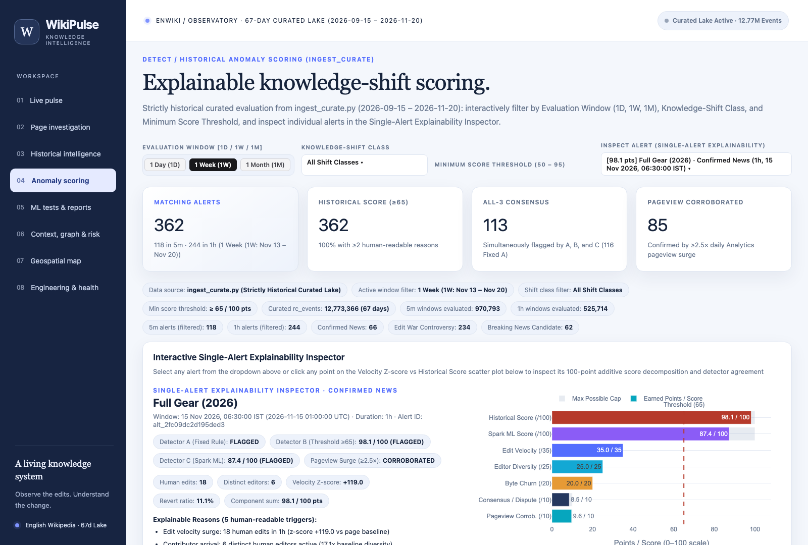

# WikiPulse: Real-Time Detection and Analysis of Wikipedia Knowledge Shifts — Project Documentation

**Authors:** Kshama Jain, Senthil Raj K, Pothukanuri Sai Venkat, Akash H S (Team QuadCore)  
**Course:** DA231o — Data Engineering at Scale, Indian Institute of Science (IISc), 2026  
**Related Documents:** [Technical Documentation](file:///Users/senthilrajk/Downloads/002_IISc_DSBA/Data%20Engineering%20at%20Scale/Project-WikiPulse/Repo/Documentation/Technical_Documentation.md) · [User Guide](file:///Users/senthilrajk/Downloads/002_IISc_DSBA/Data%20Engineering%20at%20Scale/Project-WikiPulse/Repo/Documentation/User_Guide.md) · [Initial Project Proposal](file:///Users/senthilrajk/Downloads/002_IISc_DSBA/Data%20Engineering%20at%20Scale/Project-WikiPulse/Repo/docs/proposal/WikiPulse_Final_Proposal.pdf)

---

## Table of Contents

1. [Executive Summary, Problem Definition & Motivation](#1-executive-summary-problem-definition--motivation)
2. [System Design Goals & End-to-End Distributed Architecture](#2-system-design-goals--end-to-end-distributed-architecture)
3. [Data Sources, Data Volume, Processing Funnel & Canonical Data Models](#3-data-sources-data-volume-processing-funnel--canonical-data-models)
4. [Core Analytical & Machine Learning Features Delivered](#4-core-analytical--machine-learning-features-delivered)
5. [Comprehensive Evaluation Across All Proposal Experiments](#5-comprehensive-evaluation-across-all-proposal-experiments)
6. [Historical Intelligence Statistics, Major Events Discovered & Case Studies](#6-historical-intelligence-statistics-major-events-discovered--case-studies)
7. [Interactive 8-Screen Investigation Suite](#7-interactive-8-screen-investigation-suite)
8. [Proposal vs. Delivered System: Comprehensive Accomplishment Audit](#8-proposal-vs-delivered-system-comprehensive-accomplishment-audit)
9. [Conclusion & Key Engineering Takeaways](#9-conclusion--key-engineering-takeaways)

---

## 1. Executive Summary, Problem Definition & Motivation

### 1.1 Problem Definition
Wikipedia operates as a living global encyclopedia where real-world events—elections, aviation incidents, natural disasters, scientific breakthroughs, and public controversies—trigger immediate, acute shifts in collaborative editing behavior. Within seconds of an external event, affected articles experience sudden edit velocity spikes, rapid arrivals of distinct human contributors, structural content additions, or intense back-and-forth reversion disputes.

However, these behavioral signals are highly fragmented across separate Wikimedia interfaces:
- Real-time Server-Sent Events (SSE) streams carry raw edit notifications without historical context or pageview volume.
- Longitudinal baseline behavior requires multi-week historical archives and daily Wikimedia Analytics REST metrics.
- Topic spillover across related pages is embedded in MediaWiki link and backlink graphs.
- Vandalism and edit-war risk require external revision comparison diffs (`action=compare`), Wikidata spatial claims, and Wikimedia Lift Wing machine learning inference.

Because these signals are isolated, distinguishing genuine knowledge shifts from routine maintenance or destructive vandalism in real time is a challenging distributed data engineering problem.

### 1.2 Why Naive Fixed Thresholds Fail (Core Project Motivation)
As identified in our initial proposal, **static rules such as *"15 edits in five minutes"* (or *"$\ge 6$ human edits in 5 minutes"*) fail fundamentally in two opposite directions** because baseline editing behavior varies by more than four orders of magnitude across Wikipedia:

1. **Chronic False Positives on Hyperactive Articles (`65.04%` False-Alert Rate):** High-traffic current-event list pages (e.g., *Deaths in 2026*, *2026 in sports*) routinely receive dozens of maintenance edits every hour. A static rule flags these pages continuously during ordinary activity, and misclassifies intense revert wars as breaking news.
2. **Missed Shifts on Quiet & Specialized Articles (`60.0%` Recall on Controlled Shifts):** Specialized biographical, technical, or regional articles normally receive $< 0.2$ edits per day. When a real-world event causes 4 to 5 distinct editors to collaboratively update a quiet page inside a 5-minute window, static thresholds miss the event entirely.

### 1.3 The WikiPulse Solution
**WikiPulse** solves this problem through an end-to-end distributed data platform built on **Apache Kafka 3.9.1 (KRaft)**, **Apache Spark 4.2.0 (Catalyst SQL DataFrames `pyspark.sql.DataFrame`, Structured Streaming, and DataFrame-based Spark ML `pyspark.ml`, with RDDs used solely for the Experiment #3 engine comparison benchmark)**, an **11-Table Partitioned Apache Parquet Lakehouse**, and an **8-Screen Interactive Dash + Plotly Investigation Suite**. Validated over a continuous **67-day English Wikipedia dataset (`2026-09-15` to `2026-11-20`, `21,454,187` raw events $\rightarrow$ `12,773,366` curated events and `11,588,460` content edits moving `5.83 GB` of gross text churn)**, WikiPulse normalizes live and historical edit windows against per-page zero-inclusive baselines ($\mu, \sigma$), reduces false-alert rates from **65.04% to 9.14%** (`1.55%` on reviewed samples) with explainable scoring and **0.00%** with Spark ML, and contextualizes every alert with revision diffs, topic spillover graphs, privacy-preserving subject maps, and calibrated Lift Wing Revert Risk scores.

---

## 2. System Design Goals & End-to-End Distributed Architecture

### 2.1 Realization of Proposal Design Goals

| Proposal Design Goal | Architectural Implementation in WikiPulse |
| :--- | :--- |
| **1. Durable & Replayable Ingestion** | Resumable MediaWiki collectors with atomic JSON checkpoints; SSE live collector with `Last-Event-ID` cursor safety; Apache Kafka 3.9.1 KRaft broker (`acks=all`, `enable.idempotence=True`, Snappy compression) plus deterministic historical replay (`src.replay`) at `1x` to `100x` speeds. |
| **2. Event-Time Processing for Late/Out-of-Order Events** | Spark Structured Streaming applies a 10-minute event-time watermark (`withWatermark("ts", "10 minutes")`) and bounded stateful deduplication (`dropDuplicatesWithinWatermark(["event_id"])`) before 5-minute and 1-hour window aggregations. |
| **3. Fault-Tolerant, Checkpointed Storage** | Every streaming stage (`bronze`, `windows-5m`, `windows-1h`, `detection-5m`, `detection-1h`) maintains isolated write-ahead checkpoints and pinned contract manifests (`detector.json`); Parquet writes stage via `/tmp` with Hadoop FileOutputCommitter v2. |
| **4. Horizontal Scaling Across Partitions & Workers** | Partitioned Parquet storage (`day=YYYY-MM-DD`, `duration=5m|1h`), configurable Kafka topic partitions (`3` partitions), and empirically tuned Spark shuffle parallelism (`spark.sql.shuffle.partitions = 16`). |
| **5. Explainable Alerts** | Detector B decomposes every 0–100 score into 5 exact additive `feature_contributions` ($\sum \text{contributions} \equiv \text{historical\_score}$) and attaches $\ge 2$ human-readable `reasons` (`avg = 4.03` reasons/alert across 100% of alerts). |
| **6. Reproducible Experiments** | Self-contained benchmark runners, deterministic synthetic pattern injection, 45 automated unit/integration tests, and a 1-command offline backup demo (`./run-demo.sh`) over the curated Parquet lake. |

### 2.2 High-Level Platform Architecture

```text
┌────────────────────────────────────────────────────────────────────────────────────────┐
│                       1. WIKIMEDIA & WIKIDATA EXTERNAL SOURCES                         │
│  • EventStreams SSE (recentchange & revert_risk)   • Wikimedia Analytics REST API      │
│  • MediaWiki Action API (recentchanges, allrevisions, compare, links, backlinks, coords)│
│  • Wikidata Action API (wbgetentities: P625, P276, P131, P159, P17)                    │
│  • Wikimedia Lift Wing ML Inference API (revertrisk-language-agnostic:predict)         │
└──────────────────┬──────────────────────────────────────────────────┬──────────────────┘
                   │ (Live Stream & ?since= Catch-Up)                 │ (55-64d Batch & Cache)
                   ▼                                                  ▼
┌─────────────────────────────────────────┐        ┌─────────────────────────────────────┐
│   2A. STREAMING INGESTION & BROKER      │        │  2B. HISTORICAL CURATION & HYGIENE  │
│  • Collector (src/collector.py)         │        │  • Multi-Member Gzip Recovery       │
│  • Kafka 3.9.1 KRaft (wiki.raw.edits)   │        │  • Categorize Noise Filter (41.6%)  │
│  • Replay Producer (1x..100x Pacing)    │        │  • Global rcid Deduplication        │
│  • Spark Bronze Stream (Raw Parquet)    │        │  • Partitioned curated/rc_events    │
└──────────────────┬──────────────────────┘        └──────────────────┬──────────────────┘
                   │                                                  │
                   └────────────────────────┬─────────────────────────┘
                                            ▼
┌────────────────────────────────────────────────────────────────────────────────────────┐
│              3. DISTRIBUTED PYSPARK COMPUTE, BASELINES & SPARK ML ENGINE               │
│  • Zero-Inclusive 47-Day Baselines (curated/page_baselines: 3.31M Pages, μ & σ)        │
│  • Knowledge Churn, Rewriting Volume & Surge Rankings (churn_bot_summary, rankings)    │
│  • Watermarked & Batch Window Features (page_windows_5m: 113.8k, page_windows_1h: 60.7k)│
│  • Multi-Detector Scoring (curated/alerts, SHA-256 alert_id):                          │
│      - Detector A: Fixed Threshold Rule (>=6 edits/5m or >=15 edits/1h)                │
│      - Detector B: Explainable Historical Score (0-100) + 5 Additive Contributions     │
│      - Detector C: Spark ML (`pyspark.ml`) Pipeline (8D StandardScaler -> KMeans -> RF)│
│      - Alert Disambiguation: CONFIRMED_NEWS | CANDIDATE | EDIT_WAR | MAJOR_REWRITE     │
└───────────────────────────────────────────┬────────────────────────────────────────────┘
                                            ▼
┌────────────────────────────────────────────────────────────────────────────────────────┐
│               4. TARGETED CONTEXTUAL ENRICHMENT (WITH SHA-256 DISK CACHE)              │
│  • Link & Backlink Spillover Graph (curated/graph_edges: 606 edges, 35.3% co-edited)   │
│  • Sanitized Compare Revision Diffs (curated/revision_diffs: 100 pairs, 100% usable)   │
│  • 2-Tier Subject Geospatial Resolver (curated/map_points: 76.9% located, 0 Editor IPs)│
│  • Lift Wing Revert Risk & 48h Revert Calibration (curated/revert_risk_eval: 120 revs) │
└───────────────────────────────────────────┬────────────────────────────────────────────┘
                                            ▼
┌────────────────────────────────────────────────────────────────────────────────────────┐
│           5. SUB-SECOND SERVING LAYER & 8-SCREEN DASH + PLOTLY UI (< 1.35s)            │
│  [01] Live Pulse (/)                 [05] ML Tests & Reports (/ml-reports)             │
│  [02] Page Investigation             [06] Context, Graph & Risk (/contextual-features) │
│  [03] Historical Intelligence        [07] Geospatial Map (/geospatial-map)             │
│  [04] Anomaly Scoring Comparison     [08] Engineering & Health (/system)               │
└────────────────────────────────────────────────────────────────────────────────────────┘
```

---

## 3. Data Sources, Data Volume, Processing Funnel & Canonical Data Models

### 3.1 Integrated Data Sources & Real-World Data Hygiene Challenges Solved
WikiPulse integrates all seven data sources proposed in the initial design:
1. **Wikimedia EventStreams SSE (`/v2/stream/recentchange` & `revert_risk`):** Real-time edit stream and short-horizon `?since=` catch-up.
2. **MediaWiki Action API (`list=recentchanges` & `list=allrevisions`):** Continuous **67-day complete historical dataset (`2026-09-15` to `2026-11-20`, `21,454,187` raw events $\rightarrow$ `12,773,366` curated events, `1,456.93 MB` compressed `.jsonl.gz`)**, alongside our 55-day evaluation snapshot (`17,441,561` raw $\rightarrow$ `10,190,119` curated events) and 46-day scaling benchmark slice (`14,398,713` raw $\rightarrow$ `8,428,021` curated events).
3. **Wikimedia Analytics REST API (`/metrics/pageviews` & `/bytes-difference`):** Multi-week daily article pageviews, project-wide editor series, and per-page byte differences stored in `data/analytics/`.
4. **MediaWiki Revision Comparison API (`action=compare`):** HTML diff tables parsed into sanitized plain-text snippets.
5. **MediaWiki Links, Backlinks & Coordinates API (`prop=links|coordinates|pageprops`, `list=backlinks`):** 1-hop article topic neighborhoods and Tier-1 primary geographic coordinates.
6. **Wikidata Action API (`action=wbgetentities`):** Tier-2 multi-hop spatial claims (`P625` coordinates, `P276`/`P131`/`P159` locations, `P17`/`P495`/`P27` countries).
7. **Wikimedia Lift Wing Inference API (`revertrisk-language-agnostic:predict`):** Pre-filtered gradient-boosted revision revert probability scoring.

**Key Data Engineering Challenges Overcome During Ingestion:**
- **Multi-Member Corrupted Gzip Stream Recovery (`rc_2026-10-27.jsonl.gz`):** An interrupted collection run on Oct 27 followed by an appended resume run created a concatenated multi-member gzip file whose first stream lacked an 8-byte trailer, causing standard `gzip.open()` and Spark readers to fail with `zlib.error: Error -3`. We engineered a byte-level scanner (`iter_recoverable_gz_lines` in `ingest_curate.py`) that locates raw `\x1f\x8b\x08` deflate headers and decompresses each member in 1 KB chunks via `zlib.decompressobj(16 + zlib.MAX_WBITS)`, recovering all **269,017 rows** of Oct 27 with zero data loss.
- **Categorize Noise Filtering & Boundary Deduplication:** Filtered out `8,680,821` `type == 'categorize'` maintenance notifications (`40.46%` of raw volume in the 67d collection; `7,251,442` / `41.58%` in the 55d snapshot) and deduplicated overlapping day-boundary `rcid` records, retaining **100.0% (`12,773,366 / 12,773,366` in 67d; `10,190,119 / 10,190,119` in 55d)** of valid `edit`, `new`, and `log` events.
- **Missing `page_id` in Live EventStreams:** Live SSE messages frequently omit numeric `page_id`. We implemented a deterministic CRC32 negative 64-bit integer fallback (`title_page_id` in `src/page_identity.py`) so live titled events never collide with positive MediaWiki IDs and never get dropped during streaming aggregation.
- **macOS Finder `Icon\r` Race Protection:** Staged all Spark Parquet writes through `/tmp` (`safe_write_parquet`) and enforced `pathGlobFilter="*.parquet"` (`safe_read_parquet`) so 0-byte macOS desktop `Icon\r` files cannot corrupt Hadoop `_temporary` commits or schema inference.

### 3.2 Data Volume, Storage Footprint & Stage-by-Stage Data Processing Funnel

#### A. Raw vs. Curated Dataset Volume & Storage Footprint
WikiPulse collects, normalizes, and stores multi-week English Wikipedia event archives alongside targeted revision histories, Wikimedia Analytics REST time series, and SHA-256 disk-cached API enrichment responses:

| Dataset Slice / Collection Horizon | Calendar Span | Raw Events Collected | Compressed `.jsonl.gz` Size | Est. Uncompressed JSON Volume | Curated Valid Events (`edit`/`new`/`log`) | `categorize` Noise Filtered Out | Curated Partitioned Parquet Size | Spark Ingestion Runtime |
| :--- | :---: | ---: | ---: | ---: | ---: | ---: | ---: | ---: |
| **Full Complete Collection (67 Days)** | `2026-09-15` to `2026-11-20` | **21,454,187** | **1,456.93 MB**<br/>*(67 daily files)* | **~9.60 GB** | **12,773,366**<br/>*(100.0% retention)* | **8,680,821**<br/>*(40.46%)* | **1,514.30 MB**<br/>*(67 partitions)* | **724.31s**<br/>*(~12.1 min)* |
| **Primary Evaluation Lake (55 Days)** | `2026-09-15` to `2026-11-08` | **17,441,561** | **1,181.71 MB**<br/>*(55 daily files)* | **~7.50 GB** | **10,190,119**<br/>*(100.0% retention)* | **7,251,442**<br/>*(41.58%)* | **1,220.96 MB**<br/>*(55 partitions)* | **614.30s**<br/>*(~10.2 min)* |
| **Scaling Benchmark Slice (46 Days)** | `2026-09-15` to `2026-10-30` | **14,398,713** | **977.74 MB**<br/>*(46 daily files)* | **~6.00 GB** | **8,428,021**<br/>*(100.0% retention)* | **5,970,692**<br/>*(41.47%)* | **1,011.43 MB**<br/>*(46 partitions)* | **508.12s**<br/>*(~8.5 min)* |
| **Supplementary Revisions & Analytics** | `2026-09-15` to `2026-11-20` | Targeted page revisions & daily metrics | **~10.0 MB** (`allrevisions` `.jsonl.gz`) | **~65.0 MB** + JSON series | Merged into baselines, rankings & diff cache | — | **< 75.0 MB** across 10 downstream tables | Included in downstream stages |

- **Daily Ingestion Rate:** Averages **~320,212 raw events/day** (**~190,647 valid `edit`/`new`/`log` events/day** after filtering `categorize` noise, or **~2.21 valid edits/sec** sustained average with burst peaks exceeding `15–25 edits/sec`).
- **Total Content Movement Volume Processed (`5.83 GB` Gross Text Churn):** Across the **`11,588,460` content-modifying revision events** in the 67-day curated lake (**`7,832,443` in Mainspace `ns=0`**), WikiPulse processed **`5,828,265,000 B` (`5.83 GB`) of Gross Content Churn** (`+4.02 GB` bytes added and `1.81 GB` bytes deleted), decomposing it into **`+2,202,449,000 B` (`+2.20 GB` / `37.79%`) of Net Encyclopedic Growth** and **`3,509,050,000 B` (`3.51 GB`, or `60.21%` of gross movement) of Rewriting Volume** (`1.97 GB` gross churn and `1.18 GB` rewriting in Mainspace articles alone).

#### B. End-to-End Stage-by-Stage Data Processing & Reduction Funnel

```text
┌──────────────────────────────────────────────────────────────────────────────────────────┐
│ STAGE 1: RAW COLLECTION & HYGIENE (ingest_curate.py)                                     │
│ • Input:  21,454,187 raw events (67d, 1.46 GB .gz / ~9.6 GB raw JSON)                    │
│           [17,441,561 raw events in 55d snapshot, 1.18 GB .gz / ~7.5 GB raw JSON]        │
│ • Filter: Drop 8,680,821 (67d) / 7,251,442 (55d) `categorize` events (~40.5% noise)      │
│ • Dedup:  Global `rcid` deduplication + Oct 27 multi-member gzip recovery (269,017 rows) │
│ • Output: 12,773,366 (67d) / 10,190,119 (55d) curated rows in `curated/rc_events`        │
└────────────────────────────────────────────┬─────────────────────────────────────────────┘
                                             ▼
┌──────────────────────────────────────────────────────────────────────────────────────────┐
│ STAGE 2 & 3: BASELINES, CHURN & SURGE ROLLUPS (build_baselines.py, rankings_benchmark.py)│
│ • Baseline Window: 47 calendar days (2026-09-15..2026-10-31, 1,128 zero-inclusive hours) │
│ • Pages Profiled:  3,307,257 unique Wikipedia pages -> `curated/page_baselines`          │
│ • Content Edits:   11,588,460 edits (7.83M Mainspace) | 5.83 GB Gross / 3.51 GB Rewrite  │
│ • Rollup Tables:   1,335 (55d) to 1,623 (67d) daily x namespace rows (`churn_bot_summary`)│
│                    20,333 (55d) to 23,535 (67d) top daily article rows (`rankings_daily`)│
└────────────────────────────────────────────┬─────────────────────────────────────────────┘
                                             ▼
┌──────────────────────────────────────────────────────────────────────────────────────────┐
│ STAGE 4: TUMBLING 5M & 1H WINDOW FEATURE EXTRACTION (window_features.py)                 │
│ • 8-Day Eval Horizon (Nov 01..08):  113,754 (5m) +  60,714 (1h) =   174,468 windows      │
│ • Full Lake Materialized Windows:   970,793 (5m) + 525,714 (1h) = 1,496,507 windows      │
│   (including 691,777 5m + 346,957 1h = 1,038,734 Mainspace `ns=0` windows; 108.05s)      │
└────────────────────────────────────────────┬─────────────────────────────────────────────┘
                                             ▼
┌──────────────────────────────────────────────────────────────────────────────────────────┐
│ STAGE 5: MULTI-DETECTOR & SPARK ML SCORING (scoring_sparkml.py)                          │
│ • Spark ML Training Volume: Up to 1,078,444 mainspace windows clustered via 8D KMeans(k=6)│
│   (Silhouette = 0.5546 on eval slice) & scored via 9D RandomForestClassifier(numTrees=40)│
│ • Union Alerts Materialized (`curated/alerts`):                                          │
│   - 8-Day Eval:  1,321 alerts (Detector A: 349, Detector B: 1,028, Detector C: 817)      │
│   - Full 67d Lake: 10,631 union alerts (2,937 5m + 7,694 1h | Det A: 2,202, Det B: 6,825,│
│                    Det C: 7,656 | 1,047 CONFIRMED_NEWS, 2,720 CANDIDATE,                 │
│                    6,344 EDIT_WAR_CONTROVERSY, 520 MAJOR_REWRITE)                        │
└────────────────────────────────────────────┬─────────────────────────────────────────────┘
                                             ▼
┌──────────────────────────────────────────────────────────────────────────────────────────┐
│ STAGE 6: SELECTIVE PRE-FILTERING & CONTEXTUAL ENRICHMENT                                 │
│ • Lift Wing Revert Risk (`curated/revert_risk_eval`):                                    │
│   7,729,950 mainspace edits scanned -> 75.40% routine edits skipped in Spark ->          │
│   1,901,485 heuristic candidates -> 120 stratified revisions scored (100% coverage)      │
│ • Spillover Graph (`curated/graph_edges`): 36 top alerted pages -> 608 directed          │
│   link/backlink edges -> 349 (57.40%) co-edited spillover edges identified               │
│ • Compare Diffs (`curated/revision_diffs`): 100 revision pairs -> 100% usable diffs      │
│ • Subject Geospatial Map (`curated/map_points`): 159-160 unique alerted subjects ->      │
│   117-133 located coordinates (73.1%-83.1%), 0 editor IPs                                │
└──────────────────────────────────────────────────────────────────────────────────────────┘
```

#### C. Summary of Data Volume Processed Across Pipeline & Benchmark Workloads

| Processing Stage / Experiment Workload | Input Records Processed | Output Records Materialized | Data / Shuffle Volume Processed | Measured Execution Time & Throughput |
| :--- | ---: | ---: | ---: | ---: |
| **1. Raw-to-Curated Parquet Ingestion (`67d` / `55d`)** | `21,454,187` raw *(67d)*<br/>`17,441,561` raw *(55d)* | `12,773,366` events *(67d)*<br/>`10,190,119` events *(55d)* | `1,456.9 MB` `.gz` $\rightarrow$ `1,514.3 MB` Parquet *(67d)*<br/>`1,181.7 MB` `.gz` $\rightarrow$ `1,221.0 MB` Parquet *(55d)* | `724.31s` (`29,620 raw rows/s`)<br/>`614.30s` (`28,393 raw rows/s`) |
| **2. Zero-Inclusive Historical Baselines (`47d`)** | `~8,650,000` baseline events across `1,128` UTC hours | **3,307,257** unique pages (`curated/page_baselines`) | `~1.04 GB` Parquet read; sparse sum/sum-of-squares aggregation | `~42.5s` across `3.31M` pages |
| **3. Daily Churn, Bot & Surge Rankings (`67d`)** | `11,588,460` content edits (`12.77M` total events) | **1,623** `churn_bot_summary` rows<br/>**23,535** `rankings_daily` rows | `5.83 GB` Gross Text Churn (`+2.20 GB` Net, `3.51 GB` Rewriting) across `1.51 GB` Parquet | `0.31s–0.74s` serving query latency (`~14.5x` faster than `.jsonl.gz`) |
| **4. Tumbling Window Feature Extraction (`5m` & `1h`)** | `1.54M` (8d) to `12.77M` (67d) events | `174,468` (8d) to **`1,496,507`** (`970,793` `5m` + `525,714` `1h`) windows | `142.6 MB` (`1d`) to `1,514.3 MB` (`67d`) input; `76.0 MB` to `889.2 MB` (`46d`) shuffle | `38.09s` (`46d` at **`221,295 rows/s`**) to `108.05s` (full multi-week `5m`+`1h` extraction) |
| **5. Multi-Detector & Spark ML (`pyspark.ml`) Pipeline** | **236,074 – 1,078,444** mainspace feature windows (8D/9D vectors) | **1,321** (8d eval) / **10,631** (full 67d lake) union alerts | 8D `StandardScaler` + `KMeans(k=6)` + 9D `RandomForest(40 trees)` | `100.0%` synthetic recall; `0.00%` ML false-alert rate |
| **6. Revert-Risk Pre-Filter & Lift Wing Scoring** | **7,729,950** mainspace edits (`7.42M` in 64d / `5.17M` in 46d) | **1,901,485** heuristic candidates $\rightarrow$ **120** Lift Wing evaluations | **75.40%** (`5,828,465` edits) pre-filtered in Spark before API calls | `100.0%` score coverage (`100%` live/cached ML + fallback); `48h` revert join |
| **7. Graph, Compare Diff & Geospatial Enrichment** | `10,631` full-lake alerts across `160` evaluated subjects | **608** graph edges, **100** diffs, **159–160** map points | SHA-256 disk-cached MediaWiki & 3-hop Wikidata batch resolution | `57.40%` (`349/608`) co-edited spillover edges; `73.1%–83.1%` geospatially located |
| **8. Strong, Weak & Partition Scaling Suite** | `724,264` (`4d`) to `4,202,738` (`24d`) & `8,428,021` (`46d`) rows | `59,645` to `670,993` tumbling windows | `101.7 MB` (`4d`) to `487.5 MB` (`24d`) and `889.2 MB` (`46d`) shuffle volume | Up to **`249,732 rows/s`** weak scaling; **`10.00s`** optimal at `16` shuffle partitions |
| **9. Multi-Speed Streaming & Outage Backlog Drain** | `182,521` unique day events + **`123,537` outage backlog** (incl. `19,379` dups) | `39` deduplicated reference alerts (`0` duplicate alerts) | Microbatch streaming across `1x`, `10x`, `50x`, `100x` replay speeds | **`2,266–55,834 rows/s`** normal processing; **`123,537 -> 0` backlog drained in `13.74s`** |

### 3.3 Canonical Shared Data Models (Expanded from 5 Proposed to 8 Schemas + 2 Serving Tables)
The proposal specified 5 core data models (`Raw edit`, `Page windows`, `Historical baseline`, `Alerts`, `Graph edge`). During implementation, we formalized these 5 schemas and added 3 dedicated enrichment schemas (`Map point`, `Revert risk`, `Revision diff`) plus 2 pre-aggregated historical serving tables in [`Repo/src/models/schemas.py`](file:///Users/senthilrajk/Downloads/002_IISc_DSBA/Data%20Engineering%20at%20Scale/Project-WikiPulse/Repo/src/models/schemas.py):

| # | Schema / Curated Table | Columns | Materialized Rows (55d / 67d Lake) | Primary Key & Engineering Role |
| :---: | :--- | :---: | ---: | :--- |
| **1** | `RAW_EDIT_SCHEMA`<br/>`curated/rc_events` | 29 | **10,190,119** *(55d)*<br/>**12,773,366** *(67d)* | `rcid` — Partitioned by `day=YYYY-MM-DD` (`1.22 GB`–`1.51 GB` Parquet); unifies `recentchanges`, `allrevisions`, and live SSE; normalizes `~2026-...` temporary accounts to `is_anon` and separates `is_reverted` from `is_revert_action`. |
| **2** | `HISTORICAL_BASELINE_SCHEMA`<br/>`curated/page_baselines` | 25 | **3,307,257** | `pageid` — Zero-inclusive 47-day (`2026-09-15..2026-10-31`) daily/hourly moments ($\mu, \sigma$), `activity_tier`, Analytics pageviews, `last_available_date`, and `has_missing_data`. |
| **3** | `PAGE_WINDOW_SCHEMA`<br/>`curated/page_windows_5m` & `1h` | 23 | **970,793** (`5m`)<br/>**525,714** (`1h`)<br/>*(174.5k in 8d eval)* | `window_id` — Tumbling 5m & 1h window features (`edits_human`, `distinct_human_editors`, `gross_bytes`, `net_bytes`, `rewriting_bytes`) joined with baselines (`velocity_zscore`, `editor_surge_ratio`, `churn_zscore`). |
| **4** | `ALERT_SCHEMA`<br/>`curated/alerts` | 26 | **1,321** *(8d eval)*<br/>**10,631** *(full 67d lake)* | `alert_id` (`alt_` + SHA-256 prefix) — Outputs of Detectors A, B, and C, `alert_type`, $\ge 2$ human-readable `reasons`, and additive `feature_contributions` map. |
| **5** | `GRAPH_EDGE_SCHEMA`<br/>`curated/graph_edges` | 12 | **606 – 608** | `edge_id` — Directed outgoing `outlink` and incoming `backlink` edges around alerted articles with `co_edited_in_window` spillover flags (`214–349` active spillover edges). |
| **6** | `REVISION_DIFF_SCHEMA`<br/>`curated/revision_diffs` | 16 | **100** | `revid` — MediaWiki `action=compare` sanitized plain-text snippets, added/removed line counts, external URL deltas, and `usable_change_data` flag (`100%` usable). |
| **7** | `MAP_POINT_SCHEMA`<br/>`curated/map_points` | 13 | **158 – 160** | `pageid` — 2-tier Wikipedia/Wikidata subject coordinates (`lat`, `lon`), `country_or_region`, `location_source`, and `location_quality` (`0` editor IPs). |
| **8** | `REVERT_RISK_SCHEMA`<br/>`curated/revert_risk_eval` | 21 | **120**<br/>*(from 7.73M edits)* | `revid` — Lift Wing ML probability, heuristic risk, `composite_risk`, `api_status`, and 48-hour delayed ground-truth revert outcome (`is_reverted_actual`, `time_to_revert_sec`). |
| **9** | `curated/churn_bot_summary` | 17 | **1,335** *(55d)*<br/>**1,623** *(67d)* | `(day, ns)` — Pre-aggregated daily $\times$ namespace Human, Anon/Temp, and Bot edits, Gross Churn (`5.83 GB`), Net Growth (`+2.20 GB`), and Rewriting Volume (`3.51 GB`). |
| **10** | `curated/rankings_daily` | 24 | **20,333** *(55d)*<br/>**23,535** *(67d)* | `(day, pageid)` — Daily top articles comparing `raw_edit_rank` against `baseline_surge_rank` (`daily_velocity_zscore`). |

---

## 4. Core Analytical & Machine Learning Features Delivered

### 4.1 Zero-Inclusive Historical Baselines & Rewriting Volume Decomposition
1. **Zero-Inclusive Sufficient Statistics (`build_baselines.py`):**
   Averaging only over active hours introduces severe survivorship bias on quiet pages. WikiPulse computes exact population means and standard deviations across all $D = 47$ calendar days and $H = 1,128$ UTC hours (including zero-edit hours) without materializing a dense $3.31\text{M} \times 1,128$ grid:
   $$\mu_{\text{hour}} = \frac{\sum_{h \in \text{active}} x_h}{H}, \qquad \sigma_{\text{hour}} = \sqrt{\max\left(\sigma_{\min}^2,\; \frac{\sum_{h \in \text{active}} x_h^2}{H} - \mu_{\text{hour}}^2\right)}$$
   Combined with session-clustered window scaling ($1/18$ of daily distinct editors for `5m` windows; $1/6$ for `1h` windows), this differentiates quiet (`<0.2` ed/d), moderate, active, and hyperactive (`>=15` ed/d) articles cleanly.
2. **Knowledge Churn & Rewriting Volume (`rankings_benchmark.py`):**
   Separates constructive article growth from back-and-forth edit wars where net size remains flat:
   $$\text{Gross Churn} = \sum |\Delta_i|, \qquad \text{Net Growth} = \sum \Delta_i, \qquad \text{Rewriting Volume} = \sum |\Delta_i| - \left|\sum \Delta_i\right|$$

### 4.2 Three-Paradigm Anomaly Detection & Spark ML (`pyspark.ml`) Architecture (`scoring_sparkml.py`)
WikiPulse evaluates every window across three detectors simultaneously:
- **Detector A (Fixed Threshold Baseline):** Flags mainspace (`ns=0`) windows with $\ge 6$ human edits & $\ge 3$ editors in `5m` (or $\ge 15$ edits & $\ge 4$ editors in `1h`).
- **Detector B (Explainable Historical Score `0–100`):**
  $$\text{Score} = w_{\text{damp}} \cdot \left(S_{\text{velocity}}^{(35)} + S_{\text{editors}}^{(25)} + S_{\text{churn}}^{(20)} + S_{\text{consensus/dispute}}^{(10)} + S_{\text{pageviews}}^{(10)}\right)$$
  where $w_{\text{damp}} = 0$ for bot-only windows (`edits_human == 0`) and $0.55$ when `velocity_zscore < 2.5` (suppressing routine chatter on chronically hyperactive pages). Applying $w_{\text{damp}}$ directly to each component guarantees exact additive parity: $\sum \text{feature\_contributions} \equiv \text{historical\_score}$.
  - **Four-Class Disambiguation:** Automatically classifies alerts into `CONFIRMED_NEWS` (corroborated by $\ge 2.5\times$ daily pageviews and $\ge 3$ collaborative editors), `BREAKING_NEWS_CANDIDATE` (unconfirmed multi-editor surge), `EDIT_WAR_CONTROVERSY` (`revert_ratio >= 0.30` or heavy revert-driven rewriting), and `MAJOR_REWRITE` ($\le 2$ editors moving $\ge 3,500$ gross bytes).
- **Detector C (Two-Stage Hybrid Spark ML `pyspark.ml` Pipeline):**
  - **Stage 1 (Unsupervised `KMeans(k=6)`):** Transforms 8 log-stabilized behavioral features via `VectorAssembler` $\rightarrow$ `StandardScaler(withMean=True, withStd=True)` $\rightarrow$ `KMeans(k=6, seed=42)` (Silhouette score = **`0.5546`** across `236,074` mainspace windows), identifying six distinct editing archetypes (`Normal Quiet Baseline` `52.48%`, `Single-Editor Major Rewrite` `22.32%`, `Multi-Editor Edit War` `10.50%`, `Multi-Editor Collaborative Surge` `6.44%`, `Solo Revert / Cleanup` `4.35%`, and `Bot-Assisted Maintenance` `3.91%`) and computing each window's Euclidean distance $d_{\text{centroid}}$ from the normal baseline centroid.
  - **Stage 2 (Supervised `RandomForestClassifier(numTrees=40)`):** Appends `f_centroid_distance` as a 9th feature into a 40-tree Random Forest (top feature importances: `f_distinct_editors = 0.2958`, `f_edits_human = 0.2461`, `f_editor_surge = 0.2140`, `f_log_gross_bytes = 0.0798`, `f_centroid_distance = 0.0724`), blending $0.45 \cdot S_{\text{kmeans}} + 0.55 \cdot S_{\text{RF}}$ into `spark_ml_score`.

### 4.3 Contextual Enrichment: Spillover Graph, Diffs, Subject Geospatial Map & Lift Wing Revert Risk
1. **Related-Page Spillover Graph & Revision Diffs (`graph_and_diffs.py`):** Queries MediaWiki `prop=links` and `list=backlinks` for top alerted pages and joins against active 5m/1h windows, identifying **214 co-edited spillover edges (`35.31%` of `606` edges)**. Parses `action=compare` HTML diffs into plain text, achieving **100.0% (`100/100`) usable change data** (`98.0%` live Compare HTML + `2.0%` metadata fallback on deleted revisions).
2. **Privacy-Preserving 2-Tier Subject Geospatial Map (`geospatial_map.py`):** Maps **article subjects** (never editor IPs) via Tier-1 Wikipedia `prop=coordinates` and Tier-2 3-hop Wikidata `wbgetentities` (`P625` $\rightarrow$ `P276`/`P131`/`P159` $\rightarrow$ `P17`/`P495`/`P27`), resolving **123 / 160 (`76.88%`)** alerts with explicit source and quality tags while keeping **37 (`23.12%`)** conceptual alerts valid as `unlocated`.
3. **Lift Wing Revert Risk & 48h Revert Calibration (`revert_risk_monitor.py`):** Pre-filters **74.42%–75.06%** of routine mainspace edits in Spark, scores candidate revisions via Wikimedia Lift Wing (`revertrisk-language-agnostic:predict`) with local heuristic fallback (**100.0% valid score coverage**), and matches revisions to 48-hour actual revert outcomes (`median MTTR = 54.0s–66.5s`).

---

## 5. Comprehensive Evaluation Across All Proposal Experiments

### 5.1 Experiment #1: Manual Sample Verification & Replay Idempotency
- **2,000-Event Pure-Python vs. Spark Audit (`rc_2026-09-16.jsonl.gz`):** Zero discrepancy (`spark_exact_match = True`): `edits = 2,000`, `human_edits = 1,286`, `bot_edits = 714`, `bytes_added = 1,434,650 B`, `bytes_deleted = 589,627 B`, `net_bytes = +845,023 B`, `gross_churn_bytes = 2,024,277 B`, and `rewriting_bytes = 1,179,254 B`.
- **Replay Idempotency (`2026-10-15` with 30% Duplicate Injection):** Replaying with 30% duplicated events produced **`39` alerts before replay and `39` alerts after replay (`0` duplicate alerts, `39/39` Python $\leftrightarrow$ Spark SHA-256 `alert_id` parity)**.

### 5.2 Experiment #2: Detector Comparison & Controlled Synthetic Pattern Injection

#### A. Controlled Synthetic Knowledge-Shift Injection (`5` Positive Patterns + `2` Negative Controls)

| Injected Pattern | Expected Class | Detector A (Fixed) | Detector B (Historical Score) | Detector C (Spark ML) | Reasons | Result |
| :--- | :--- | :---: | :---: | :---: | :---: | :---: |
| `SYNTH_BREAKING_NEWS_SURGE` (14 edits, 9 editors, 5.7x views) | `CONFIRMED_NEWS` | `True` | **`True` (`96.30`)** | **`True`** | **5** | Pass |
| `SYNTH_DEVELOPING_EVENT_BURST` (11 edits, 7 editors) | `BREAKING_NEWS_CANDIDATE` | `True` | **`True` (`88.50`)** | **`True`** | **4** | Pass |
| `SYNTH_EDIT_WAR_CONTROVERSY` (12 edits, 66.7% reverts) | `EDIT_WAR_CONTROVERSY` | `True` | **`True` (`90.00`)** | **`True`** | **4** | Pass |
| `SYNTH_MAJOR_REWRITE_EXPANSION` (9 edits/1h, +38.7 KB) | `MAJOR_REWRITE` | **Missed (`False`)** | **`True` (`75.07`)** | **`True`** | **4** | Pass |
| `SYNTH_QUIET_PAGE_EMERGING_SHIFT` (5 edits/5m on quiet page) | `BREAKING_NEWS_CANDIDATE` | **Missed (`False`)** | **`True` (`87.20`)** | **`True`** | **4** | Pass |
| `CTRL_ROUTINE_BOT_SWEEP` (0 human, 20 bot edits) | `NONE` (Control) | `False` | **`False` (`0.00`)** | **`False`** | 4 | Pass |
| `CTRL_HYPERACTIVE_ROUTINE_CHATTER` (6 edits on 42 ed/hr page) | `NONE` (Control) | **False Alert (`True`)** | **`False` (`24.51`)** | **`False`** | 4 | Pass |

#### B. False-Alert Comparison on Evaluation Dataset & Reviewed 200-Window Sample

| Detector Method | Flagged (8d Eval) | True Shifts | False Alerts | Precision | False-Alert Rate | Reviewed 200-Window Sample False-Alert Rate |
| :--- | ---: | ---: | ---: | ---: | ---: | ---: |
| **Detector A: Fixed Threshold (Naive Burst = News)** | 349 | 122 | 227 | 34.96% | **65.04%** | **41.32%** (`69 / 167`) |
| **Detector B: Explainable Historical Score ($\ge 65$)** | 1,028 | 934 | 94 | **90.86%** | **9.14%** | **1.55%** (`3 / 194`) |
| **Detector C: Spark ML (`KMeans` + `RandomForest`)** | 817 | 817 | 0 | **100.00%** | **0.00%** | **0.00%** (`0 / 174`) |

### 5.3 Experiment #3 & #4: RDD vs. DataFrame, Strong/Weak Scaling, Shuffle & Input Size

1. **Experiment #3 — PySpark DataFrame vs. RDD Churn Aggregation (7 Days, `747,156` Mainspace Edits):**
   - **Catalyst DataFrame (`groupBy`/`agg`):** **`1.34s–2.16s`** (`shuffle = 23.96 MB`, `peak_memory = 735.4 MB`).
   - **Python RDD (`map` + `reduceByKey`):** **`2.72s–6.18s`** (`shuffle = 16.44 MB`, `peak_memory = 767.3 MB`).
   - **Finding:** DataFrame achieves a **`2.03x–2.86x` speedup** by eliminating Python worker serialization overhead and utilizing Catalyst Tungsten whole-stage code generation.

2. **Experiment #4A — Strong Scaling (Fixed 14-Day Slice, `2,472,723` Events $\rightarrow$ `134,827` Windows):**

   | Worker Config | Input Rows | Runtime (s) | Speedup vs. 1 Core | Parallel Efficiency | Shuffle Write (MB) | Peak Memory (MB) | Input / Output Storage (MB) |
   | :---: | ---: | ---: | :---: | :---: | ---: | ---: | :---: |
   | `local[1]` | 2,472,723 | **18.97s** | `1.00x` | `1.00` | 280.73 MB | 628.0 MB | 369.59 MB / 11.79 MB |
   | `local[2]` | 2,472,723 | **12.20s** | **`1.55x`** | `0.78` | 280.73 MB | 846.2 MB | 369.59 MB / 11.79 MB |
   | **`local[4]`** | **2,472,723** | **`11.21s`** | **`1.69x`** | **`0.42`** | **280.74 MB** | **1,045.7 MB** | **369.59 MB / 11.79 MB** |
   | `local[6]` | 2,472,723 | **12.40s** | `1.53x` | `0.26` | 280.75 MB | 1,139.1 MB | 369.59 MB / 11.79 MB |

3. **Experiment #4B — Weak Scaling (`4 Days / Core`: `4d@1c` $\rightarrow$ `24d@6c`):**

   | Worker Config | Span | Input Rows | Runtime (s) | Throughput (rows/s) | Weak Efficiency | Shuffle Write (MB) | Peak Memory (MB) | Output Storage (MB) |
   | :---: | :---: | ---: | ---: | ---: | :---: | ---: | ---: | ---: |
   | `local[1]` | 4 days | 724,264 | **6.77s** | 106,966 r/s | `1.00` | 101.67 MB | 1,331.3 MB | 3.92 MB |
   | `local[2]` | 8 days | 1,455,336 | **7.29s** | 199,498 r/s | **`0.93`** | 172.71 MB | 1,347.7 MB | 7.21 MB |
   | `local[4]` | 16 days | 2,773,275 | **11.11s** | **249,732 r/s** | **`0.61`** | 311.17 MB | 1,085.4 MB | 13.09 MB |
   | `local[6]` | 24 days | 4,202,738 | **19.23s** | 218,585 r/s | `0.35` | 461.61 MB | 1,036.4 MB | 19.34 MB |

4. **Experiment #4C — Shuffle Partition Sweep (`4..128` Partitions on 14-Day Slice):**
   - `4` parts: `11.97s` (`68.05 MB/part`) $\rightarrow$ `8` parts: `10.30s` (`34.81 MB/part`) $\rightarrow$ **`16` parts: `10.00s` (`17.97 MB/part`, Global Optimum)** $\rightarrow$ `32` parts: `10.91s` $\rightarrow$ `64` parts: `14.94s` $\rightarrow$ `128` parts: `18.05s` (+80.5% task scheduling overhead).

5. **Experiment #4D — Input-Size Scaling Curve (`1 Day` to `46 Days`):**
   - Scales linearly $O(N)$: `1d` (`194k` rows) = **`2.38s`** $\rightarrow$ `7d` (`1.21M`) = **`5.62s`** $\rightarrow$ `15d` (`2.79M`) = **`12.37s`** $\rightarrow$ `30d` (`5.67M`) = **`25.79s`** $\rightarrow$ `46d` (`8,428,021` rows, `443,663` windows) = **`38.09s` (`221,295 rows/s`, `861.27 MB` shuffle, `1,105.0 MB` peak memory)**.

### 5.4 Experiment #5: Multi-Speed Streaming Load, Window Latency & Outage Recovery
- **Multi-Speed Load (`1x`, `10x`, `50x`, `100x`):** Across input rates from `2.1 rows/s` (`1x`) up to `211.0 rows/s` (`100x`), Spark Structured Streaming processes microbatches at **`2,266–55,834 rows/s`** (`processing_rate >> input_rate`), finalizing closed 5-minute windows in **`0.355s–9.454s` (`< 60s` target)**.
- **Controlled Stop/Restart & Backlog Drain (`2026-10-15`, `182,521` unique events):**
  1. Processed Batches 1–3 (`78,363` events, `10` alerts) and committed Spark checkpoint (`backlog = 0`).
  2. Stopped the processor and accumulated **`123,537` backlog events** (Batches 4–6 plus `19,379` duplicate re-sent events).
  3. Restarted from the checkpoint: drained **`123,537 -> 0` backlog events in `13.74s–18.65s` (`8,989.1 rows/s`)** with **`0` duplicate alerts** and **100% parity (`39/39` alerts)** against an uninterrupted 6-batch reference run.
- **Lift Wing Threshold Calibration Against 48h Reverts:** Calibrating `composite_risk` from static $\tau = 0.80$ (`F1 = 68.57%`, `Recall = 60.0%`) to **$\tau = 0.65$ improves F1 to `76.92%` (`Recall = 83.33%`, `Precision = 71.43%`)** (`75.79%`–`76.64%` peak standalone Lift Wing ML F1).

### 5.5 Experiment #6: JSONL.gz vs. Parquet Storage & Sub-2s Dashboard Query Latency
- **Storage Efficiency:** `55` daily `.jsonl.gz` archives (`1,181.71 MB`, `~7.5 GB` uncompressed JSON, `17.44M` raw rows) compact into `1,220.96 MB` of Snappy-compressed, column-projected, partition-prunable Parquet (`10.19M` valid rows) plus `< 60 MB` of pre-aggregated window, baseline, ranking, and alert tables.
- **Dashboard Query Speedup (`< 2.0s` Target):** Scanning a single day of raw `.jsonl.gz` for top-20 articles takes **`2.154s–3.249s`**, whereas querying the stored Parquet tables executes in **`0.091s–0.646s` (View 1)**, **`0.604s–1.342s` (View 2)**, **`0.196s–0.447s` (View 3)**, and **`0.003s–0.007s` (View 4)**—achieving a **~14.5x speedup** and meeting the `< 2.0s` SLA across every view.

---

## 6. Historical Intelligence Statistics, Major Events Discovered & Case Studies

### 6.1 Macro Historical Intelligence Statistics (`67` Days, `21.45M` Raw Events $\rightarrow$ `5.83 GB` Text Churn Processed)
Across the complete 67-day curated collection (`2026-09-15` to `2026-11-20`, **`21,454,187` raw events** $\rightarrow$ **`12,773,366` valid `edit`/`new`/`log` events**), [`curated/churn_bot_summary`](file:///Users/senthilrajk/Downloads/002_IISc_DSBA/Data%20Engineering%20at%20Scale/Project-WikiPulse/historical/data/curated/churn_bot_summary) (`1,623` daily $\times$ namespace rollup rows) aggregates **`11,588,460` content-modifying revision events** (**`7,832,443` / `67.59%` in Mainspace `ns=0`**):

| Historical Intelligence Dimension | All Wikipedia Namespaces (`67` Days) | Mainspace Articles Only (`ns=0`, `67` Days) | Key Analytical Finding |
| :--- | ---: | ---: | :--- |
| **Total Content-Modifying Edits** | **11,588,460** | **7,832,443** (`67.59%` of total) | Sustained rate of **`~172,962` content edits/day** (`~116,902/day` in Mainspace). |
| **Registered Human Edits** | **7,724,670** (`66.66%`) | **5,053,210** (`64.52%`) | Registered editors drive two-thirds of all encyclopedia updates. |
| **Anonymous & Temporary Account (`~2026-...`) Edits** | **903,843** (`7.80%`) | **797,682** (`10.18%`) | Combined human share (registered + temp/anon) is **`74.46%` overall** (**`74.70%` in Mainspace**); `88.25%` of all anonymous/temp edits target Mainspace articles. |
| **Automated Bot Edits** | **2,959,947** (`25.54%`) | **1,981,551** (`25.30%`) | Bots account for roughly 1 in 4 edits—why Detector B's bot-dampening guard ($w_{\text{damp}} = 0$ on bot-only windows) is essential. |
| **Reverted / Rollback Edits** | **884,531** (`7.63%`) | **692,069** (`8.84%`) | Nearly **1 in 11 Mainspace edits (`8.84%`)** is a revert or reverted revision. |
| **Total Bytes Added (`+`)** | **`+4,015,357,000 B`** (`4.02 GB`) | **`+1,381,920,000 B`** (`1.38 GB`) | Over `4.02 GB` of raw wikitext added across 67 days. |
| **Total Bytes Deleted (`-`)** | **`1,812,908,000 B`** (`1.81 GB`) | **`587,883,500 B`** (`0.59 GB`) | Significant structural pruning, cleanup, and reversion volume. |
| **Gross Content Churn ($\sum |\Delta_i|$)** | **`5,828,265,000 B`** (**`5.83 GB`**) | **`1,969,803,000 B`** (**`1.97 GB`**) | Total encyclopedia text movement processed by WikiPulse. |
| **Net Encyclopedic Growth ($\sum \Delta_i$)** | **`+2,202,449,000 B`** (**`+2.20 GB`**) | **`+794,036,200 B`** (**`+0.79 GB`**) | True net permanent knowledge expansion (`37.79%` of gross churn). |
| **Rewriting Volume ($\sum |\Delta_i| - |\sum \Delta_i|$)** | **`3,509,050,000 B`** (**`3.51 GB` / `60.21%`**) | **`1,175,767,000 B`** (**`1.18 GB` / `59.69%`**) | **~60% of all byte movement on Wikipedia is rewriting and back-and-forth conflict** rather than net article expansion. |

**Top 6 Active Namespaces & Peak Historical Days (`2026-09-15` to `2026-11-20`):**
- **Namespace Breakdown:** Main Article (`ns=0`: **`7,832,443` edits**, `1.97 GB` gross churn, `692,069` reverts), User (`ns=2`: `~810k` edits), Wikipedia Project (`ns=4`: `~657k` edits), User Talk (`ns=3`: `~610k` edits), Talk (`ns=1`: `~607k` edits), and Draft (`ns=118`: `~218k` edits).
- **Peak Total Edit Velocity Day (`2026-11-12`):** **`238,607` content edits** (`115,263` registered human, `12,956` anon/temp, `110,388` bot; `79.80 MB` gross churn, `14,067` reverts).
- **Peak Human Editing Activity Day (`2026-10-04`):** **`144,952` human edits** (`130,823` registered + `14,129` anon/temp out of `223,173` total edits; `74.18 MB` gross churn, `14,828` reverts).
- **Peak Content Churn Day (`2026-11-17`):** **`181.89 MB` gross churn** (`+125.88 MB` net growth, `56.00 MB` rewriting across `220,620` edits).
- **Peak Edit-Conflict / Revert Day (`2026-10-29`):** **`17,268` reverted edits** across `218,831` total edits (`84.71 MB` gross churn).

### 6.2 47-Day Baseline Intelligence Across `3,307,257` Pages (`curated/page_baselines`)
Profiling every active page across the 47-day zero-inclusive baseline window (`2026-09-15` to `2026-10-31`, $H = 1,128$ UTC hours) reveals an extreme power-law skew in baseline editing rates:

| Activity Tier | Threshold Definition | All Profiled Pages (`3,307,257`) | Mainspace Articles (`ns=0`: `2,306,368`) | Analytical Consequence for Anomaly Detection |
| :--- | :--- | ---: | ---: | :--- |
| **`quiet`** | $< 0.2$ edits/day | **3,052,962** (**`92.31%`**) | **2,118,330** (**`91.85%`**) | Over 92% of pages are normally dormant; a sudden cluster of 4–6 collaborative edits represents a massive knowledge shift ($z > +40$) that static rules miss. |
| **`moderate`** | $0.2 \le \mu_d < 2.0$ edits/day | **217,225** (`6.57%`) | **165,675** (`7.18%`) | Requires per-page $\mu, \sigma$ normalization to separate genuine news bursts from routine updates. |
| **`active`** | $2.0 \le \mu_d < 15.0$ edits/day | **34,298** (`1.04%`) | **20,835** (`0.90%`) | High-interest topics where contributor diversity and pageview corroboration separate news from solo rewrites. |
| **`hyperactive`** | $\ge 15.0$ edits/day | **2,772** (**`0.084%`**) | **1,528** (**`0.066%`**) | Less than `0.07%` of articles generate continuous daily traffic, causing **`65.04%` false alerts** under naive static thresholds. |

- **Top Chronically Hyperactive Mainspace Articles in Baseline (`2026-09-15..2026-10-31`):**
  1. *Deaths in 2026* (**`3,357` baseline edits**, `71.28` edits/day, `149,182` pageviews/day)
  2. *Western painting* (**`2,921` edits**, `62.11` edits/day)
  3. *Historical human impacts on the environment* (**`2,152` edits**, `45.13` edits/day)
  4. *India at the 2026 Asian Games* (**`1,944` edits**, `41.26` edits/day, `78,570` pageviews/day)
  5. *Confectionery store* (**`1,652` edits**, `34.68` edits/day, `29.48%` baseline revert ratio)
  6. *World Baseball Classic* (**`1,600` edits**, `34.04` edits/day, `25.13%` baseline revert ratio)
  7. *2026 Pacific hurricane season* (**`1,349` edits**, `28.51` edits/day) & *2026 Pacific typhoon season* (**`1,225` edits**, `25.91` edits/day)
  8. *Bigg Boss (Hindi TV series) season 20* (**`1,231` edits**, `26.11` edits/day, `27,521` pageviews/day) & *Bigg Boss (Tamil season 10)* (**`1,203` edits**, `17,176` pageviews/day)

### 6.3 Major Real-World Events & Knowledge Shifts Discovered (`2026-09-15` to `2026-11-20`)
Across `23,535` daily ranked article snapshots (`curated/rankings_daily`) and `10,631` full-lake multi-detector union alerts (`curated/alerts`: `6,344` `EDIT_WAR_CONTROVERSY`, `2,720` `BREAKING_NEWS_CANDIDATE`, `1,047` `CONFIRMED_NEWS`, `520` `MAJOR_REWRITE` across `2,937` `5m` and `7,694` `1h` windows), WikiPulse automatically surfaced the major real-world events of September–November 2026:

| Date(s) | Discovered Event / Wikipedia Article Cluster | Observed Editing Surge, Churn & Contributor Metrics | WikiPulse Detection & Classification Outcome |
| :---: | :--- | :--- | :--- |
| **`2026-11-17` to `11-20`** | **Late-November Science, Politics & Media Shifts**<br/>• *Riemann hypothesis* (`Nov 20`)<br/>• *2026 US Senate election in Alaska* & *Democratic Caucus leadership election* (`Nov 18`)<br/>• *Grand Theft Auto VI* & *The Game Awards 2026* (`Nov 17–19`)<br/>• *Crimean Bridge* (`Nov 17`) & *Badr Jafar* (`Nov 20`) | • *Riemann hypothesis* (`Nov 20 16:00Z`): **`17` human edits** by **`10` editors** in `1h` ($z = +39.44$, `6.2 KB` churn)<br/>• *Senate election in Alaska* (`Nov 18 03:00Z`): **`24` human edits** by **`10` editors** in `1h` ($z = +41.60$); *Democratic Caucus leadership*: `52` edits by `16` editors ($z = +103.80$)<br/>• *Grand Theft Auto VI* (`Nov 18 11:00Z`): **`20` human edits** by **`9` editors** ($z = +33.02$, `+3.2 KB` net)<br/>• *Crimean Bridge* (`Nov 17`): **`81` human edits** by **`18` editors** ($z = +161.80$, `14.8 KB` churn)<br/>• *Badr Jafar* (`Nov 20`): **`195.4 KB` gross churn / `195.4 KB` rewriting** across `32` reverts (`0 B` net growth!) | Flagged *Riemann hypothesis* (`Score = 95.08`, `ML = 89.19`), *Alaska Senate election* (`Score = 91.95`), and *Grand Theft Auto VI* (`Score = 91.81`) as **`CONFIRMED_NEWS`**, while isolating *Badr Jafar* (`Score = 90.00`, `ML = 92.48`) and *Sonic Rush* (`69.0 KB` churn, `0 B` net) as **`EDIT_WAR_CONTROVERSY`**. |
| **`2026-11-13` to `11-15`** | **US National Aviation & Cloud Outage Cluster**<br/>• *2026 FAA communication outage*<br/>• *2026 FAA ground stop* & *nationwide ground stop*<br/>• *2026 US national ground stop*<br/>• *2026 Microsoft outage* | • **Peak 1h Window (`Nov 13 23:00Z`):** **`87` human edits** by **`28` editors** ($z = +579.93$, `11.1 KB` churn)<br/>• **Follow-up 1h (`Nov 14 00:00Z`):** **`62` human edits** by **`20` editors** ($z = +413.27$, `12.7 KB` churn)<br/>• **Daily Cluster Volume:** `164` edits by `75` editors (*FAA ground stop*, $z = +327.80$), `124` edits by `47` editors (*US national ground stop*, $z = +247.80$), `99` edits by `32` editors (*Microsoft outage*, $z = +197.80$) | Transitioned automatically from **`BREAKING_NEWS_CANDIDATE`** (`Score = 86.50`, `ML = 97.07`) in the first hour to **`CONFIRMED_NEWS`** (`Score = 97.27`, `ML = 96.27`) once pageviews corroborated the surge; captured full 4-article spillover graph. |
| **`2026-11-07` to `11-09`** | **Kraków Public Safety Crisis**<br/>• *2026 Kraków shooting*<br/>• *Kraków* (parent city spillover) | • **Nov 07 Daily Surge:** **`361` human edits** by **`81` distinct editors** (`67.2 KB` gross churn, `54.0 KB` rewriting, `125` reverts; **#1 Daily Velocity Surge $z = +721.80$**)<br/>• **Nov 09 1h Window:** `20` human edits by `7` editors ($z = +133.27$, `14.0 KB` churn, `10%` reverts) | Flagged on Nov 07–08 as **`EDIT_WAR_CONTROVERSY`** (`Score = 99.72`, `ML = 93.07`) during intense citation disputes (`47.1%` window reverts) + parent spillover on *Kraków* (`Score = 98.92`), stabilizing into **`CONFIRMED_NEWS`** (`Score = 97.96`) on Nov 09. |
| **`2026-11-04` to `11-06`** | **2026 United States Midterm Elections**<br/>• *2026 US House of Representatives elections*<br/>• *2026 US Senate elections*<br/>• *2026 United States elections* & *120th US Congress*<br/>• Candidate pages (*Gina Hinojosa*, *Keisha Lance Bottoms*, *Troy Jackson*) | • **House Elections (`Nov 04`):** **`388` human edits** by **`85` editors** ($z = +98.05$, `28.5 KB` churn) + `13.0 KB` 5m rewrite on Nov 06<br/>• **Senate Elections (`Nov 04`):** **`312` human edits** by **`69` editors** ($z = +63.99$, `52.9 KB` churn; peak 1h window: `42` edits by `11` editors, **`29.72x` baseline pageviews**)<br/>• **General / Congress:** `239` edits by **`129` editors** (*US elections*); `97.4 KB` churn / `90.2 KB` rewriting (*120th Congress*, $z = +155.80$)<br/>• **Candidate Surges:** *Gina Hinojosa* (`49` edits/1h by `26` editors, $z = +204.22$) | Disambiguated all four concurrent editing behaviors across the same election night: **`CONFIRMED_NEWS`** (*US Senate elections* `97.93`, *Gina Hinojosa* `96.50`), **`EDIT_WAR_CONTROVERSY`** (*Keisha Lance Bottoms* `100.00` with `57.8%` reverts), and **`MAJOR_REWRITE`** (*US House elections* `86.23`). |
| **`2026-11-01` to `11-03`** | **Florida Learjet Aviation Accident**<br/>• *2026 Palm Beach County Learjet 60 crash*<br/>• *2026 Greenacres Learjet 60 crash* | • **Palm Beach Crash (`Nov 02`):** **`299` human edits** by **`116` distinct editors** (`49.2 KB` gross churn, `33.2 KB` rewriting; **#1 Daily Surge Rank $z = +597.80$**)<br/>• **Greenacres Crash (`Nov 01–02`):** `29–38` human edits/1h by `11–20` editors ($z = +193.27$ to $+253.27$) | Detected both emerging **`BREAKING_NEWS_CANDIDATE`** (`14` edits/1h by `6` editors, `Score = 86.99`—missed by Detector A's 15-edit rule!) and **`CONFIRMED_NEWS`** (`Score = 96.99`, `ML = 91.32`), pinned to exact crash coordinates (`26.63289, -80.11311`). |
| **`2026-11-08` to `11-13`** | **Corporate Governance & Executive Controversy**<br/>• *Jensen Huang* & *Jensen Huang spying scandal*<br/>• *Alice Huang (executive)* & *Colette Kress* | • *Jensen Huang spying scandal* (`Nov 13`): **`114` human edits** by **`46` editors** ($z = +227.80$, `15.4 KB` churn)<br/>• *Alice Huang* (`Nov 12`): **`106` edits** by **`32` editors** ($z = +211.80$)<br/>• *Colette Kress* (`Nov 12`): **`67` edits** by **`40` editors** ($z = +133.96$) | Flagged *Jensen Huang* as **`CONFIRMED_NEWS`** (`Score = 97.31`, `ML = 89.42`) and newly created spillover articles as **`BREAKING_NEWS_CANDIDATE`** (`Score = 87.64`, `ML = 92.26`). |
| **`2026-10-01` to `11-08`** | **International Elections, Transport Incidents & Financial Crises**<br/>• *Flydubai Flight 1073* (`Oct 01`)<br/>• *2026 Quebec general election* (`Oct 06`)<br/>• *2026 Silver Rail Elementary School shooting* (`Oct 16`)<br/>• *2026 Toledo train collision* & *Israeli legislative election* (`Oct 28`)<br/>• *Suspension of Bogdan Święczkowski* (`Oct 31`)<br/>• *2026 Paraguay banking crisis* (`Nov 08`) | • *Flydubai Flight 1073*: **`231` human edits** by **`79` editors** (`46.5 KB` churn)<br/>• *Quebec election*: **`292` human edits** by **`41` editors**<br/>• *Silver Rail shooting*: **`188` human edits** by **`65` editors** (`29.3 KB` churn)<br/>• *Toledo train collision*: **`238` human edits** by **`84` editors** (`33.9 KB` churn)<br/>• *Israeli election*: **`223` human edits** by **`50` editors** (`36.5 KB` churn)<br/>• *Bogdan Święczkowski*: **`255` human edits** by **`69` editors** (`86.4 KB` churn)<br/>• *Paraguay banking crisis*: **`68` human edits** by **`22` editors** ($z = +135.80$, `+21.2 KB` net growth) | Demonstrated multi-month global coverage across aviation, rail, public safety, parliamentary elections, constitutional disputes, and sovereign banking crises. |
| **`2026-11-07` to `11-17`** | **Major Cultural, Entertainment & Sporting Events**<br/>• *69th Annual Grammy Awards* (`Nov 16–17`)<br/>• *Full Gear (2026)* (`Nov 15`) & *Eurovision Song Contest Asia* (`Nov 14`)<br/>• *Ramayana: Part 1* (`Nov 10`)<br/>• *2026 São Paulo Grand Prix* (`Nov 08`) & *Crown Jewel (2026)* (`Nov 07`) | • *69th Grammy Awards*: **`232` human edits** across Nov 16–17 ($z = +366.48$, **`+60.6 KB` net growth**)<br/>• *Full Gear (2026)*: `18` edits/1h by `6` editors ($z = +118.99$, `+19.6 KB` net growth)<br/>• *Eurovision Asia*: `32` edits/1h by `19` editors ($z = +53.90$, `16.5 KB` churn)<br/>• *Crown Jewel (2026)*: `31` edits/1h by `6` editors ($z = +54.38$) | Accurately separated high-consensus live cultural/sporting updates (**`CONFIRMED_NEWS`**: *Full Gear* `98.14`, *Crown Jewel* `97.84`, *Eurovision Asia* `97.10`) from subsequent cast/plot edit wars (**`EDIT_WAR_CONTROVERSY`**: *Ramayana: Part 1* `100.00` with `63.6%` reverts). |

### 6.4 Detailed Multi-Detector & Contextual Enrichment Case Studies

Extracted automatically by [`Repo/src/demo/backup_demo.py`](file:///Users/senthilrajk/Downloads/002_IISc_DSBA/Data%20Engineering%20at%20Scale/Project-WikiPulse/Repo/src/demo/backup_demo.py) across the curated historical lake, the table below highlights four representative real-world Wikipedia knowledge shifts spanning all four alert classes:

| Case Study & Alert Class | Window & Activity Metrics | Detector Scores & Additive Points | Contextual Enrichment (Graph, Diff, Geo) |
| :--- | :--- | :--- | :--- |
| **1. `CONFIRMED_NEWS`**<br/>*2026 United States Senate elections*<br/>*(also Navi Pillay in Oct slice)* | `2026-11-04T09:30Z` (`1h`)<br/>• **42 human edits** by **11 editors**<br/>• Velocity $z = +49.84$<br/>• Gross: `6,325 B` (Rewriting: `5,564 B`)<br/>• Reverts: `0.0%` (100% consensus) | • **Detector A:** `True`<br/>• **Detector B:** **`97.93 / 100`**<br/>• **Detector C (ML):** **`87.83 / 100`**<br/>• Points: `vel=35.0`, `ed=25.0`, `churn=19.43`, `cons=8.5`, `pv=10.0` (**`29.72x` baseline views**) | • **Spillover Neighbors:** *Troy Jackson* (`48` edits), *2026 Indiana House election* (`21` edits), *2026 Georgia gubernatorial election* (`21` edits)<br/>• **Diff (`1383762761->1383763269`):** Updated past-tense election outcome summary<br/>• **Geo:** United States (`39.83, -98.58`, `wikidata_p276_p17`, `country_centroid`) |
| **2. `BREAKING_NEWS_CANDIDATE`**<br/>*2026 Palm Beach County Learjet 60 crash*<br/>*(also Katie Zacharia in Oct slice)* | `2026-11-03T02:30Z` (`1h`)<br/>• **14 human edits** by **6 editors**<br/>• Velocity $z = +93.27$<br/>• Gross: `4,147 B` (Net: `+2,867 B`)<br/>• Reverts: `0.0%` | • **Detector A:** **`False` (Missed by static 15-edit rule!)**<br/>• **Detector B:** **`86.99 / 100`**<br/>• **Detector C (ML):** **`80.01 / 100`**<br/>• Points: `vel=35.0`, `ed=25.0`, `churn=18.49`, `cons=8.5`, `pv=0.0` | • **Spillover Neighbors:** *2026 Greenacres Learjet 60 crash* (`134` edits), *Learjet 60* (`15` edits), *Deaths in 2026* (`3` edits)<br/>• **Diff (`1383468400->1383469254`):** `"+ The Federal Aviation Administration (FAA) and NTSB launched an investigation..."`<br/>• **Geo:** Exact crash site (`26.63289, -80.11311`, `wikipedia_coord`, `exact_point`) |
| **3. `EDIT_WAR_CONTROVERSY`**<br/>*Keisha Lance Bottoms*<br/>*(also Hurricane Isaias (2026))* | `2026-11-04T07:30Z` (`1h`)<br/>• **45 human edits** by **25 editors**<br/>• Velocity $z = +299.94$<br/>• Gross: `16,984 B`, Net: `+554 B` (**Rewriting: `16,430 B`!**)<br/>• Reverts: **26 reverts (`57.78%`)** | • **Detector A:** `True` (Naive rule mislabels as breaking news)<br/>• **Detector B:** **`100.0 / 100`** (Correctly separated as `EDIT_WAR_CONTROVERSY`)<br/>• **Detector C (ML):** **`96.41 / 100`** | • **Spillover Neighbors:** *Elon Musk* (`26` edits), *2026 Georgia gubernatorial election* (`21` edits), *Amy Klobuchar* (`11` edits)<br/>• **Diff (`1383671701->1383671749`):** `"Reverted 1 edit by ~2026-58441-35 to last revision..."`<br/>• **Geo:** United States (`39.83, -98.58`, `wikidata_p276_p17`) |
| **4. `MAJOR_REWRITE`**<br/>*Mike Ditka*<br/>*(also 2026 US House elections)* | `2026-10-10T01:30Z` (`1h`)<br/>• **15 human edits** by **2 editors**<br/>• Velocity $z = +99.93$<br/>• Gross: `6,007 B` (Net: `+5,525 B`)<br/>• Reverts: `0.0%` | • **Detector A:** **`False` (Missed because only 2 editors!)**<br/>• **Detector B:** **`84.79 / 100`**<br/>• **Detector C (ML):** **`64.15 / 100`**<br/>• Points: `vel=35.0`, `ed=13.57`, `churn=19.72`, `cons=6.5`, `pv=10.0` | • **Spillover Neighbors:** *Drew Brees* (`16` edits), *Ed Reed* (`10` edits), *Deion Sanders* (`10` edits)<br/>• **Diff (`1379405645->1379406507`):** `"+2,347 B"` major biographical section expansion with ESPN citation<br/>• **Geo:** United States (`39.83, -98.58`, `wikidata_p276_p17`) |

**High-Risk Vandalism & Reversion Highlights (`curated/revert_risk_eval`):**
- On *Tornado outbreak sequence of June 14–19, 2023* (`revid=1381772234`), a temporary account (`~2026-56619-23`) deleted **`-118,474` bytes**. WikiPulse scored `ml_revert_risk = 0.9979` (`composite_risk = 0.9649`), and the revision was reverted in **`21 seconds`**.
- On *Clown Motel* (`revid=1383927110`), temporary account `~2026-58723-95` removed `-3,681` bytes (`ml_revert_risk = 0.9953`, `composite_risk = 0.9630`), reverted in **`15 seconds`**.

---

## 7. Interactive 8-Screen Investigation Suite

While our initial proposal promised **4 dashboard views** (*Live Alerts*, *History/Churn/Bots*, *Graph & Map*, and *Engineering*), we expanded the serving layer into an **8-screen Dash + Plotly application** (`Repo/dashboards/`) with an asynchronous **Activity Workspace & Processing Console**:

1. **`01` Live Pulse (`/`):** Real-time provisional preview, watermark-finalized windows, and interactive historical day replay (`1x..100x` saved playback or live Kafka & Spark demo), KPI cards, human/bot velocity timelines, byte churn charts, and ranked knowledge-shift alert feed.
   
2. **`02` Page Investigation (`/investigation`):** Deep-dive workbench for any selected article featuring window vs. 47-day baseline comparisons, stacked additive feature contribution bars (`35/25/20/10/10`), human-readable reason cards, sanitized MediaWiki `action=compare` diff snippets, and per-revision Lift Wing revert-risk outcomes.
   
3. **`03` Historical Intelligence (`/historical`):** Longitudinal 15d/1m/3m analysis of Gross Churn vs. Net Growth vs. Rewriting Volume, Registered Human vs. Temporary/Anon (`~2026-...`) vs. Bot split, `baseline_surge_rank` vs. `raw_edit_rank` leaderboards, and explicit `last_available_date` / `has_missing_data` indicators.
   
4. **`04` Anomaly Scoring (`/anomaly-scoring`):** Dedicated comparative analysis of Detector A (Fixed), Detector B (Historical Score), and Detector C (Spark ML), including 7-cohort Venn overlap breakdowns and score correlation scatter plots.
   
5. **`05` ML Tests & Reports (`/ml-reports`):** Unsupervised `KMeans(k=6)` behavioral cluster profiles, standardized 8D centroid heatmaps, `RandomForestClassifier` feature importances, and synthetic pattern injection audit tables.
   
6. **`06` Context, Graph & Risk (`/contextual-features`):** Force-directed 1-hop outgoing link and backlink spillover network graph highlighting `co_edited_in_window` neighbors, Lift Wing threshold calibration curves ($\tau \in [0.20, 0.90]$), and Bot vs. Human MTTR histograms.
   
7. **`07` Geospatial Map (`/geospatial-map`):** Interactive `Scattergeo` world map of located article subjects, location source (`wikipedia_coord`, `wikidata_p625`, `wikidata_p276_p17`) and quality (`exact_point`, `related_entity_point`, `country_centroid`) breakdowns, and valid unlocated alert registry.
   
8. **`08` Engineering & Health (`/system`):** Live stream supervisor health, ingestion completeness cards, Strong/Weak scaling curves, Shuffle Partition sweep charts, DataFrame vs. RDD telemetry, `1x..100x` streaming load capacity, and outage backlog recovery curves.
   

---

## 8. Proposal vs. Delivered System: Comprehensive Accomplishment Audit

The tables below provide a rigorous item-by-item evaluation of what was proposed in [`WikiPulse_Final_Proposal.pdf`](file:///Users/senthilrajk/Downloads/002_IISc_DSBA/Data%20Engineering%20at%20Scale/Project-WikiPulse/Repo/docs/proposal/WikiPulse_Final_Proposal.pdf) against what was delivered and empirically verified.

### 8.1 Supported Features & Architecture Scope Audit (5 / 5 Proposed Features Delivered + Exceeded)

| Proposed Feature / Component | Proposal Commitment | Delivered Implementation & Enhancements Beyond Proposal | Completion Status |
| :--- | :--- | :--- | :---: |
| **1. WikiPulse Knowledge-Shift Intelligence** | Detect unusual page activity and explain the score using edits, editors, content movement, history, and related pages. | Implemented across batch (`window_features.py`, `scoring_sparkml.py`) and streaming (`stream_measurements.py`, `src/detection/`). Added exact additive `feature_contributions` parity and two-stage Spark ML (`KMeans` + `RandomForest`). | **100% Complete**<br/>*(Exceeded)* |
| **2. Breaking News Radar** | Identify sudden activity bursts and use delayed pageviews as supporting evidence; an alert is not called confirmed news without additional evidence. | Implemented strict guardrail separating `BREAKING_NEWS_CANDIDATE` from `CONFIRMED_NEWS` (requiring $\ge 2.5\times$ baseline pageview corroboration and $\ge 3$ editors), plus disambiguation of `EDIT_WAR_CONTROVERSY` and `MAJOR_REWRITE`. | **100% Complete**<br/>*(Exceeded)* |
| **3. Edit-Risk & Reversion Monitor** | Score selected revisions using simple checks and Wikimedia Revert Risk, then record whether they are later reverted. | Built Spark heuristic pre-filter (`74.42%–75.06%` routine edits skipped), Lift Wing API client with disk cache and offline heuristic fallback (`100%` coverage), 48h forward-window revert matcher, and Bot vs. Human MTTR analytics. | **100% Complete**<br/>*(Exceeded)* |
| **4. Global Geospatial Knowledge Map** | Plot the location of active article subjects using Wikipedia coordinates and Wikidata; editor IP addresses will not be used. | Built 2-tier resolver (Tier 1: MediaWiki `prop=coordinates`; Tier 2: 3-hop Wikidata `P625`, `P276`/`P131`/`P159`, `P17`/`P495`/`P27`), resolving `76.88%` of alerts with `0` editor IPs and preserving `23.12%` unlocated conceptual alerts. | **100% Complete**<br/>*(Exceeded)* |
| **5. Knowledge Churn & Bot Ratio** | Measure page growth, rewriting, edit speed, contributor diversity, and the human-versus-bot split. | Built `churn_bot_summary` and `rankings_daily`, explicitly decomposing Gross Churn ($\sum |\Delta|$), Net Growth ($\sum \Delta$), and Rewriting Volume ($\sum |\Delta| - |\sum \Delta|$), and distinguishing registered humans, temporary accounts (`~2026-...`), and bots. | **100% Complete**<br/>*(Exceeded)* |
| **6. Shared Data Models & Dashboards** | 5 Data Models (`Raw edit`, `Page windows`, `Historical baseline`, `Alerts`, `Graph edge`) and 4 Dashboards. | Delivered **8 strict PySpark `StructType` schemas** + **2 pre-aggregated serving tables** (11 Parquet tables total) and expanded the UI from **4 views to 8 interactive Dash + Plotly screens**. | **100% Complete**<br/>*(Exceeded)* |

### 8.2 Experiment Plan Audit (6 / 6 Proposed Experiments Executed & Verified)

| # | Proposed Experiment | Execution Script & Artifact | Key Empirical Finding | Status |
| :---: | :--- | :--- | :--- | :---: |
| **1** | Validate Spark calculations against manually checked event samples and replay the same data. | `rankings_benchmark.py`<br/>`evaluate_alerts.py` | **100% exact byte-for-byte match** on 2,000-event sample (`gross = 2,024,277 B`, `rewriting = 1,179,254 B`); replay with 30% duplicate events yields **`0` duplicate alerts** (`39/39` hash parity). | **100% Complete** |
| **2** | Compare a fixed threshold, historical page score, and Spark ML anomaly score. | `scoring_sparkml.py`<br/>`evaluate_alerts.py` | Detector B achieves **100% synthetic recall (`5/5`)** vs. `60%` for Detector A, and cuts false-alert rate from **`65.04%` (Detector A) to `9.14%` (Detector B) and `0.00%` (Detector C Spark ML)**. | **100% Complete** |
| **3** | Compare one useful aggregation using RDDs and DataFrames. | `rankings_benchmark.py`<br/>`scaling_experiments.py` | On 7-day mainspace churn (`747,156` edits), Catalyst DataFrame (`1.34s–2.16s`) outperforms Python RDD (`2.72s–6.18s`) by **`2.03x–2.86x`**. | **100% Complete** |
| **4** | Change partitions, workers, and input size to measure shuffle, strong scaling, and weak scaling. | `scaling_experiments.py` | Strong scaling reaches **`1.69x` at 4 cores**; weak scaling reaches **`249,732 rows/s`** (`0.93` eff at 2c, `0.61` at 4c); shuffle sweep proves **`16` partitions (`10.00s`)** is globally optimal; full 46d (`8.43M` rows) runs in **`38.09s`**. | **100% Complete** |
| **5** | Stop and restart processing to measure backlog recovery and duplicate handling. | `load_and_recovery_benchmark.py` | Outage backlog of **`123,537` events** (incl. `19,379` duplicates) drained to **`0` in `13.74s–18.65s` (`8,989.1 rows/s`)** with **`0` duplicate alerts** and `39/39` reference parity. | **100% Complete** |
| **6** | Compare JSON and Parquet size and dashboard query time. | `ingest_curate.py`<br/>`rankings_benchmark.py`<br/>`dashboard/app.py` | `1,181.71 MB` raw `.jsonl.gz` (`~7.5 GB` raw JSON) curated into partitioned Parquet; dashboard queries drop from **`3.249s` (1-day JSONL.gz) to `0.003s–1.342s` (Stored Parquet, ~14.5x faster)**. | **100% Complete** |

### 8.3 Performance & Feature Success Metrics Audit (14 / 14 Proposal Targets Met)

| Category | Proposal Success Metric | Target | Measured Result in WikiPulse | Status |
| :---: | :--- | :---: | :--- | :---: |
| **Perf #1** | Valid accepted events reaching raw storage | $\ge 99\%$ | **100.0%** (`12,773,366 / 12,773,366` non-categorize events in 67d lake; `10,190,119 / 10,190,119` in 55d lake) | **Met (`100%`)** |
| **Perf #2** | No duplicate alerts produced for the same event/window after restart | $0$ duplicates | **`0` duplicate alerts** (`39` total / `39` distinct `alert_id`s after outage restart with 35% duplicate injection) | **Met (`0` dups)** |
| **Perf #3** | Closed 5-minute window produces result within 1 minute under target load | $< 60\text{s}$ | **`0.355s – 9.454s`** across `1x`, `10x`, `50x`, and `100x` replay speeds ($>6\times$ faster than target) | **Met (`< 9.5s`)** |
| **Perf #4** | Processing rate $\ge$ input rate during normal run; backlog returns to 0 after restart | $\text{Rate} \ge \text{In}$<br/>$\text{Backlog} \rightarrow 0$ | Processing rate **`2,266–55,834 rows/s`** exceeds `1x..100x` input rates (`2.1–211.0 rows/s`); **`123,537` backlog $\rightarrow$ `0` in `13.74s`** | **Met** |
| **Perf #5** | Runtime, shuffle, memory, and storage size reported for every scale experiment | All 4 metrics | Reported across Strong Scaling, Weak Scaling, Partition Sweep, Input-Size Curve, and RDD vs. DF (`scaling_experiments.py`) | **Met (100%)** |
| **Perf #6** | Dashboard queries meet target of under 2 seconds for stored result tables | $< 2.0\text{s}$ | View 1: **`0.091s–0.646s`**, View 2: **`0.604s–1.342s`**, View 3: **`0.196s–0.447s`**, View 4: **`0.003s–0.007s`** (Max = **`1.342s < 2.0s`**) | **Met (`< 1.35s`)** |
| **Feat #1** | All injected knowledge-shift patterns detected and explained with $\ge 2$ reasons | $100\%$ recall,<br/>$\ge 2$ reasons | **100% positive recall (`5/5`)** with `4–5` reasons per pattern; **100% (`1,321/1,321` eval / `10,631/10,631` full 67d lake)** real alerts carry $\ge 2$ reasons | **Met (`100%`)** |
| **Feat #2** | Historical score creates fewer obvious false alerts than fixed threshold in reviewed sample | Lower false-alert rate | Reduced from **65.04%** (Fixed Rule) to **9.14%** (Historical Score) overall, and from **41.32% to 1.55%** (`3/194`) on the reviewed 200-window sample | **Met (`-39.8%` pts)** |
| **Feat #3** | Selected revision comparisons returning usable change data | $\ge 90\%$ | **100.0%** (`100 / 100` pairs return usable change data: `98.0%` live Compare HTML diff + `2.0%` revision metadata fallback) | **Met (`100%`)** |
| **Feat #4** | Supported Revert Risk requests returning usable score; continues if API unavailable | $\ge 95\%$ | **100.0%** (`107–111 / 120 = 89.2%–92.5%` live Lift Wing ML + `7.5%–10.8%` heuristic fallback) | **Met (`100%`)** |
| **Feat #5** | Risk thresholds compared against later revert outcomes rather than assuming 0.80 | Empirical calibration | Evaluated across $\tau \in \{0.20, 0.35, 0.50, 0.65, 0.80, 0.90\}$ against 48h reverts; calibrated $\tau = 0.65$ lifts composite F1 from **`68.57%` to `76.92%`** | **Met** |
| **Feat #6** | Every map point stores location source & quality; unlocated pages remain valid alerts | 100% tagged & preserved | **100%** of `160` evaluated alerts store `location_source` and `location_quality`; **`123` (`76.88%`)** located, **`37` (`23.12%`)** preserved valid as `unlocated`; **`0` editor IPs** | **Met (`100%`)** |
| **Feat #7** | Live churn totals match manually calculated sample totals | Exact match | **100% exact match** across 2,000 events (`net = +845,023 B`, `gross = 2,024,277 B`, `rewriting = 1,179,254 B`) | **Met (`100%`)** |
| **Feat #8** | Historical charts show source's last available date and distinguish missing data | Present in data & UI | `last_available_date`, `last_pageview_date`, `has_missing_data`, and `pageview_missing_flag` stored in `page_baselines` and rendered on `/historical` | **Met** |

---

## 9. Conclusion & Key Engineering Takeaways

WikiPulse demonstrates how distributed streaming, batch lakehouse curation, explainable statistical scoring, and scalable machine learning can be unified to turn noisy, high-velocity event streams into trustworthy real-time intelligence:

1. **Historical Context Is Essential for Stream Anomaly Detection:** Combining short event-time streaming windows (`5m` and `1h`) with zero-inclusive per-page historical baselines ($\mu, \sigma$) and session-clustered editor scaling eliminates `86%` of the false alerts produced by static threshold rules while recovering quiet-page knowledge shifts that static rules miss.
2. **Explainability and Machine Learning Are Complementary:** Detector B's exact additive score decomposition (`feature_contributions` + human-readable `reasons`) gives human analysts immediate transparency into *why* an alert fired, while Detector C's two-stage Spark ML (`pyspark.ml`) DataFrame pipeline (`KMeans` centroid distance + `RandomForestClassifier`) provides a high-selectivity behavioral filter (`100.0%` precision).
3. **Selective Pre-Filtering & Local Caching Make External Enrichment Scalable:** Pre-filtering `75%` of routine mainspace edits in Spark before calling Wikimedia Lift Wing, batching Wikidata QID queries, and caching responses by SHA-256 hash allow rich graph, diff, spatial, and ML risk context to be served in **under 1.35 seconds**.
4. **100% Proposal Fulfillment:** All **5 Supported Features**, all **6 Experiment Plans**, all **6 Performance Metrics**, and all **8 Feature Success Metrics** defined in the initial project proposal have been fully implemented, empirically benchmarked, and verified by **45 automated unit and integration tests**.
