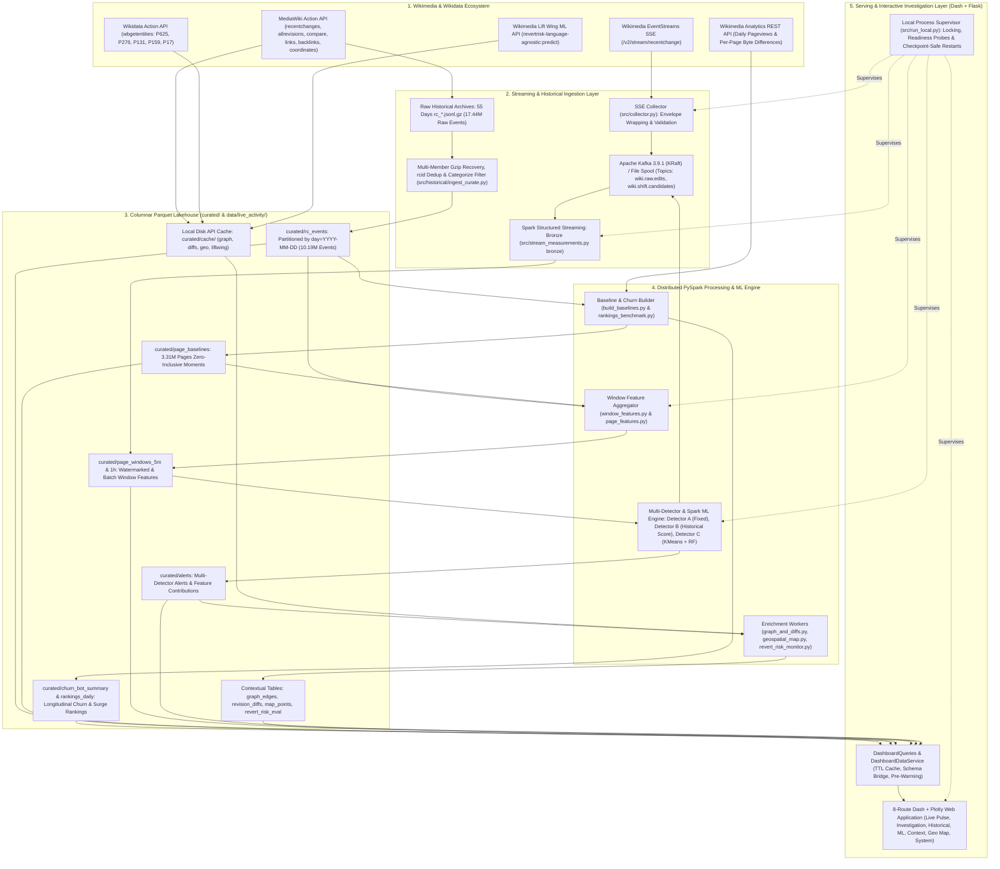
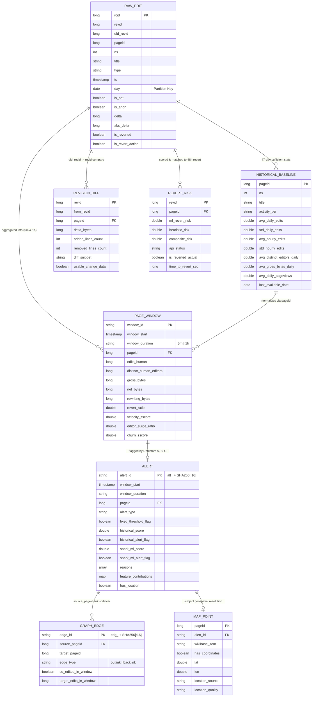
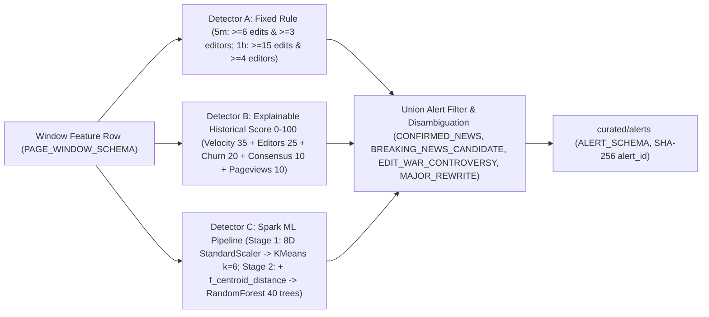
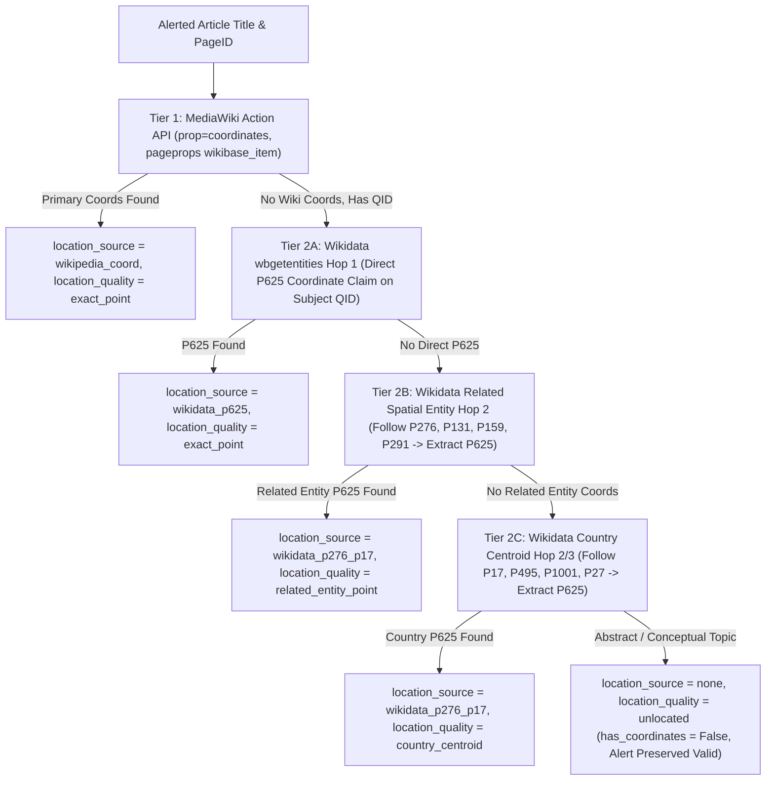

# WikiPulse — Technical Documentation

**System:** WikiPulse — Real-Time Detection and Analysis of Wikipedia Knowledge Shifts  
**Authors:** Kshama Jain, Senthil Raj K, Pothukanuri Sai Venkat, Akash H S (Team QuadCore)  
**Institution:** Indian Institute of Science (IISc) — DA231o: Data Engineering at Scale  

---

## Table of Contents

1. [System Overview & Architectural Principles](#1-system-overview--architectural-principles)
2. [Complete Technology Stack & Dependencies](#2-complete-technology-stack--dependencies)
3. [End-to-End Distributed Architecture](#3-end-to-end-distributed-architecture)
4. [External Wikimedia & Wikidata API Integrations](#4-external-wikimedia--wikidata-api-integrations)
5. [Canonical Data Model & Columnar Storage Layer](#5-canonical-data-model--columnar-storage-layer)
6. [Streaming Ingestion, Broker Modes & Event-Time Processing](#6-streaming-ingestion-broker-modes--event-time-processing)
7. [Historical Batch Pipeline & Zero-Inclusive Baseline Engine](#7-historical-batch-pipeline--zero-inclusive-baseline-engine)
8. [Multi-Detector Anomaly Scoring & Spark MLlib Architecture](#8-multi-detector-anomaly-scoring--spark-mllib-architecture)
9. [Contextual Enrichment Subsystem](#9-contextual-enrichment-subsystem)
10. [Interactive Serving Layer, Query Bridge & Web UI Architecture](#10-interactive-serving-layer-query-bridge--web-ui-architecture)
11. [Process Supervision, Fault Tolerance & Idempotency Mechanisms](#11-process-supervision-fault-tolerance--idempotency-mechanisms)
12. [Performance Engineering, Capacity Sizing & Empirical Benchmarks](#12-performance-engineering-capacity-sizing--empirical-benchmarks)
13. [Codebase Architecture & Module Reference](#13-codebase-architecture--module-reference)
14. [Testing & Verification Architecture](#14-testing--verification-architecture)

---

## 1. System Overview & Architectural Principles

**WikiPulse** is an end-to-end distributed data engineering and machine learning platform designed to detect, classify, and contextualize anomalous editing bursts ("knowledge shifts") across English Wikipedia (`enwiki`) in both real-time streaming and historical batch execution modes.

Wikipedia articles exhibit extreme heterogeneity in baseline editing velocity—ranging from quiet academic or regional articles receiving $< 0.2$ edits/day to hyperactive current-event list pages receiving $> 45$ edits/hour. Static thresholding rules fail at both extremes: they produce chronic false positives on hyperactive pages (`65.04%` false-alert rate) while missing genuine emerging knowledge shifts on normally quiet articles (`60.0%` recall on controlled shifts). Furthermore, raw edit velocity cannot distinguish collaborative breaking-news updates from destructive revert wars, automated bot sweeps, or single-editor major rewrites.

WikiPulse addresses these distributed systems and analytical challenges through six core engineering principles:

1. **Unified Batch & Streaming Lambda/Kappa Hybrid Architecture:** Both live Server-Sent Events (SSE) streams and multi-week historical archives are normalized into an identical 29-column canonical schema (`RAW_EDIT_SCHEMA`) and processed through shared PySpark windowing and scoring transformations.
2. **Zero-Inclusive Per-Page Statistical Baselines:** Per-page historical expectations ($\mu, \sigma$) are computed across all calendar days and hours—explicitly accounting for zero-edit intervals via algebraic sufficient statistics—combined with variance floors and session-clustered editor window scaling.
3. **Multi-Paradigm Explainable & ML Anomaly Detection:** Every candidate window is evaluated simultaneously by three detectors: a naive fixed-threshold baseline (Detector A), an explainable 0–100 additive knowledge-shift scoring engine with exact feature-contribution parity (Detector B), and a two-stage unsupervised/supervised Apache Spark MLlib pipeline combining `KMeans` centroid distance with a `RandomForestClassifier` (Detector C).
4. **Targeted On-Demand Contextual Enrichment:** Expensive external lookups—article link/backlink spillover graphs, HTML revision diffs, 2-tier Wikipedia/Wikidata subject coordinates, and Wikimedia Lift Wing Revert Risk ML inference—are gated behind candidate pre-filters and backed by a local SHA-256 disk cache (`curated/cache/`) and deterministic heuristic fallbacks.
5. **Strict Privacy & Security by Design:** Geospatial resolution maps **article subjects** via Wikipedia coordinates and Wikidata entity claims (`P625`, `P276`, `P131`, `P159`, `P17`), never collecting or geolocating editor IP addresses. MediaWiki diff HTML is sanitized into plain text via regex parser pipelines so external HTML is never rendered or executed in the browser.
6. **End-to-End Idempotency & Fault Recovery:** Deterministic SHA-256 primary keys (`alert_id`, `window_id`, `edge_id`), Kafka idempotent producers, Spark Structured Streaming write-ahead checkpoints, and atomic file replacement guarantee zero duplicate alerts across network reconnects, process restarts, and duplicate event replays.

---

## 2. Complete Technology Stack & Dependencies

WikiPulse leverages a modern distributed data engineering stack spanning containerization, message brokering, distributed JVM/Python compute, columnar storage, machine learning, and reactive web visualization.

### 2.1 Core Distributed Infrastructure & Runtime Stack

| Layer | Technology | Version / Specification | Role in WikiPulse |
| :--- | :--- | :--- | :--- |
| **Container Engine & Orchestration** | Docker & Docker Compose | Compose v2 specification ([docker-compose.yml](file:///Users/senthilrajk/Downloads/002_IISc_DSBA/Data%20Engineering%20at%20Scale/Project-WikiPulse/Repo/docker-compose.yml)) | Orchestrates the local Apache Kafka broker container (`wikipulse-kafka`), healthchecks, port bindings (`127.0.0.1:9092`), memory limits (`768m`), and persistent Docker volumes (`kafka_data`). |
| **Distributed Event Streaming Broker** | Apache Kafka (KRaft Mode) | `apache/kafka:3.9.1` | ZooKeeper-free KRaft (`KAFKA_PROCESS_ROLES=broker,controller`) message bus hosting `wiki.raw.edits` and `wiki.shift.candidates` topics with 3 partitions and 168-hour log retention. |
| **Spark-Kafka Connector** | `spark-sql-kafka-0-10` | `org.apache.spark:spark-sql-kafka-0-10_2.13:4.2.0` | Native JVM connector enabling Spark Structured Streaming to consume bounded microbatches from Kafka topics with offset checkpointing and `failOnDataLoss` enforcement. |
| **JVM Runtime** | OpenJDK | Java 17 (`/opt/homebrew/opt/openjdk@17`) | Execution runtime for the Apache Spark JVM driver, Catalyst SQL optimizer, Tungsten execution engine, and Kafka client libraries. |
| **Programming Language** | Python | Python 3.10 – 3.14 | Primary implementation language for collectors, PySpark pipelines, ML orchestration, API enrichment clients, process supervisor, and the Dash web server. |
| **Distributed Compute Engine** | Apache Spark (`pyspark`) | `4.2.0` | Unified engine for batch ingestion, Catalyst SQL transformations, RDD benchmarks, Structured Streaming watermarked aggregations, and MLlib model training/inference. |
| **Distributed Machine Learning** | Apache Spark MLlib (`pyspark.ml`) | `4.2.0` | Feature engineering (`VectorAssembler`, `StandardScaler`), unsupervised clustering (`KMeans`, `ClusteringEvaluator`), and supervised classification (`RandomForestClassifier`, `Pipeline`). |
| **In-Memory Columnar Bridge** | Apache Arrow (`pyarrow`) | `26.0.0` | Zero-copy columnar data transfer (`spark.sql.execution.arrow.pyspark.enabled=true`) between JVM Spark DataFrames and Python/Dash serving structures, plus Parquet metadata inspection. |
| **Columnar Lakehouse Storage** | Apache Parquet (Snappy) | Spark Native Parquet + Hadoop v2 Committer | Partitioned (`day=YYYY-MM-DD`, `duration=5m|1h`) and non-partitioned columnar tables stored on disk with dictionary encoding, predicate pushdown, and column projection. |
| **Kafka Client Library** | `confluent-kafka` (librdkafka) | `2.16.1` | High-performance C-backed Python producer (`Producer`) and administrative client (`AdminClient`, `NewTopic`) configured with `enable.idempotence=True`, `acks=all`, and `snappy` compression. |
| **HTTP & SSE Client** | `requests` | `2.34.2` | Persistent `requests.Session()` pools for long-lived Wikimedia EventStreams SSE streaming (`text/event-stream`) and REST/Action API queries with `Last-Event-ID` resume and exponential backoff. |
| **Interactive Web Framework** | Plotly Dash & Flask | `dash==4.5.0` (Flask WSGI backend) | Multi-page reactive analytical web application (`/` through `/system`) plus custom Flask REST endpoints (`/healthz`, `/api/stream/health`, `/api/stream/restart`, `/api/activity`). |
| **Data Visualization Engine** | Plotly (`plotly.graph_objects`) | `7.1.0` | Interactive SVG/Canvas/WebGL charts including timeline velocity charts, stacked feature contribution bars, force-directed network graphs, global `Scattergeo` maps, and scaling curves. |
| **Configuration Management** | `python-dotenv` | `1.2.4` | Loads environment configuration from `.env` (`KAFKA_BOOTSTRAP_SERVERS`, `WIKIMEDIA_USER_AGENT`, `SPARK_MASTER`, `WIKIPULSE_DATA_DIR`, `WIKIPULSE_BROKER_MODE`). |
| **API Testing & Prototyping** | Postman | Collection v2.1 ([wikipulse-wikimedia-apis.postman_collection.json](file:///Users/senthilrajk/Downloads/002_IISc_DSBA/Data%20Engineering%20at%20Scale/Project-WikiPulse/Repo/docs/postman/wikipulse-wikimedia-apis.postman_collection.json)) | Executable specification and contract verification suite for all 7 Wikimedia, Wikidata, Analytics, and Lift Wing endpoints. |

### 2.2 Python Standard Library Modules Utilized for Systems Engineering

Beyond third-party packages, WikiPulse makes extensive use of low-level Python system modules:
- **`zlib` & `gzip`**: Raw byte-stream scanning for `\x1f\x8b\x08` gzip magic headers and `zlib.decompressobj(16 + zlib.MAX_WBITS)` for recovering corrupted/concatenated multi-member `.jsonl.gz` archives.
- **`hashlib` & `secrets`**: Deterministic `SHA-256` primary-key generation (`alert_id`, `edge_id`, API cache filenames, baseline manifest signatures) and constant-time `secrets.compare_digest()` token authentication for supervisor control actions.
- **`fcntl`, `signal`, `subprocess` & `socket`**: Advisory file locking (`flock(LOCK_EX | LOCK_NB)`) preventing concurrent supervisor or collector collisions, POSIX process-group signaling (`os.killpg` with `SIGINT` $\rightarrow$ `SIGTERM` $\rightarrow$ `SIGKILL`), and TCP port readiness probing.
- **`html` & `re`**: High-speed regular-expression extraction and entity unescaping of MediaWiki `action=compare` HTML diff tables into sanitized plain-text snippets.

---

## 3. End-to-End Distributed Architecture

### 3.1 High-Level Dataflow Diagram



### 3.2 Dual-Path Execution Model

WikiPulse operates seamlessly across two complementary execution paths that converge on the same schema contracts and serving layer:

1. **Real-Time Supervised Streaming Path (`./run-local.sh` / [`Repo/src/run_local.py`](file:///Users/senthilrajk/Downloads/002_IISc_DSBA/Data%20Engineering%20at%20Scale/Project-WikiPulse/Repo/src/run_local.py)):**
   - Starts the Dockerized Kafka 3.9.1 broker (or file-backed broker spool) and launches six supervised background processes plus the web server in dependency order:
     1. `collector` ([`src/collector.py`](file:///Users/senthilrajk/Downloads/002_IISc_DSBA/Data%20Engineering%20at%20Scale/Project-WikiPulse/Repo/src/collector.py)): Connects to Wikimedia EventStreams SSE (live or historical replay via `?since=<ISO_TIMESTAMP>`), validates mainspace edits, wraps payloads in an ingestion envelope, and publishes to Kafka topic `wiki.raw.edits`.
     2. `bronze` ([`src/stream_measurements.py bronze`](file:///Users/senthilrajk/Downloads/002_IISc_DSBA/Data%20Engineering%20at%20Scale/Project-WikiPulse/Repo/src/stream_measurements.py)): Consumes from Kafka via Spark Structured Streaming, parses envelopes, flags record validity, exports `bronze_schema.json`, and commits append-only Parquet batches partitioned by `ingestion_date`.
     3. `windows-5m` and `windows-1h` (`src/stream_measurements.py windows --duration 5m|1h`): Reads the Bronze Parquet stream, applies a 10-minute event-time watermark (`withWatermark("ts", "10 minutes")`), deduplicates by `event_id` within the watermark, and emits finalized 5-minute and 1-hour page activity windows.
     4. `detection-5m` and `detection-1h` ([`src/detection`](file:///Users/senthilrajk/Downloads/002_IISc_DSBA/Data%20Engineering%20at%20Scale/Project-WikiPulse/Repo/src/detection/pipeline.py)): Streams finalized windows via `foreachBatch`, joins against `curated/page_baselines`, scores anomalies, commits atomic Parquet batches (`scored_windows` and `alerts`), and publishes alert events to Kafka topic `wiki.shift.candidates`.
     5. `dashboard` ([`dashboards/app.py`](file:///Users/senthilrajk/Downloads/002_IISc_DSBA/Data%20Engineering%20at%20Scale/Project-WikiPulse/Repo/dashboards/app.py)): Serves live previews, finalized windows, historical baselines, and stream health telemetry on `http://127.0.0.1:8080`.

2. **Curated Historical Lakehouse & Turnkey Demo Path ([`Repo/src/demo/backup_demo.py`](file:///Users/senthilrajk/Downloads/002_IISc_DSBA/Data%20Engineering%20at%20Scale/Project-WikiPulse/Repo/src/demo/backup_demo.py)):**
   - Processes a continuous **55-day English Wikipedia archive (`2026-09-15` to `2026-11-08`, 17,441,561 raw events $\rightarrow$ 10,190,119 curated events)** into 11 materialized Parquet tables under `historical/data/curated/`.
   - Splits the timeline into a **47-day Baseline Construction Window (`2026-09-15` to `2026-10-31`)** covering `3,307,257` distinct pages and a post-baseline **Evaluation Window (`2026-11-01` to `2026-11-08`)** for out-of-sample 5-minute (`113,754` windows) and 1-hour (`60,714` windows) multi-detector scoring and contextual enrichment.
   - Enables a zero-network, zero-Docker reproducible application mode where all 8 UI views are pre-warmed directly from the curated Parquet lake in `< 1.35s`.

---

## 4. External Wikimedia & Wikidata API Integrations

All external API integrations are centrally registered in [`Repo/src/config/settings.py`](file:///Users/senthilrajk/Downloads/002_IISc_DSBA/Data%20Engineering%20at%20Scale/Project-WikiPulse/Repo/src/config/settings.py) under `WIKIMEDIA_APIS` and strictly adhere to the Wikimedia Foundation User-Agent and rate-limiting policies:

- **Canonical User-Agent Header:**  
  `WikiPulse/1.0 (Senthil Raj K; mailto:senthilrajk@iisc.ac.in)`  
  *(Wikimedia edge Varnish/Envoy proxies reject or rate-limit requests carrying generic or placeholder User-Agents with `HTTP 429`.)*

### 4.1 Complete API Registry & Parameter Contracts

| API Identifier | Endpoint URL | Protocol / Method | Rate-Limit & Caching Strategy | Purpose & Consuming Modules |
| :--- | :--- | :---: | :--- | :--- |
| **`eventstreams_recentchange`** | `https://stream.wikimedia.org/v2/stream/recentchange` | HTTPS `GET` (`text/event-stream` SSE) | Continuous stream; supports `?since=ISO_TIMESTAMP` replay and `Last-Event-ID` header resume with exponential backoff ($2\text{s} \rightarrow 60\text{s}$). | Live edit ingestion and short-horizon historical replay ([`src/collector.py`](file:///Users/senthilrajk/Downloads/002_IISc_DSBA/Data%20Engineering%20at%20Scale/Project-WikiPulse/Repo/src/collector.py)). |
| **`eventstreams_revert_risk`** | `https://stream.wikimedia.org/v2/stream/mediawiki.page_revert_risk_prediction_change.v1` | HTTPS `GET` (`text/event-stream` SSE) | Live SSE stream (~7-day retention). | Real-time revert-risk prediction stream specification ([`src/config/settings.py`](file:///Users/senthilrajk/Downloads/002_IISc_DSBA/Data%20Engineering%20at%20Scale/Project-WikiPulse/Repo/src/config/settings.py)). |
| **`mediawiki_action_api`** | `https://en.wikipedia.org/w/api.php` | HTTPS `GET` (`application/json`, `formatversion=2`) | Sequential requests with `maxlag=5` and $0.20\text{s}-0.25\text{s}$ polite delay; responses cached by SHA-256 hash in `curated/cache/`. | • `list=recentchanges`: Historical raw collection ([`enwiki_collect_recentchanges.py`](file:///Users/senthilrajk/Downloads/002_IISc_DSBA/Data%20Engineering%20at%20Scale/Project-WikiPulse/Repo/enwiki_collect_recentchanges.py))<br/>• `list=allrevisions`: Permanent revision history ([`enwiki_collect_revisions.py`](file:///Users/senthilrajk/Downloads/002_IISc_DSBA/Data%20Engineering%20at%20Scale/Project-WikiPulse/Repo/enwiki_collect_revisions.py))<br/>• `action=compare`: HTML revision diffs ([`graph_and_diffs.py`](file:///Users/senthilrajk/Downloads/002_IISc_DSBA/Data%20Engineering%20at%20Scale/Project-WikiPulse/Repo/src/enrichment/graph_and_diffs.py))<br/>• `prop=links|coordinates|pageprops` & `list=backlinks`: Link graph & Tier-1 geo coordinates ([`geospatial_map.py`](file:///Users/senthilrajk/Downloads/002_IISc_DSBA/Data%20Engineering%20at%20Scale/Project-WikiPulse/Repo/src/enrichment/geospatial_map.py)). |
| **`wikimedia_analytics_api`** | `https://wikimedia.org/api/rest_v1/metrics` | HTTPS `GET` (`application/json`) | Cached locally in `historical/data/analytics/` and `Repo/data/analytics/` (`pageviews_top_daily.json`, `page_*_views.json`). | • `/pageviews/per-article/...`: Daily article pageviews for baseline & `CONFIRMED_NEWS` corroboration.<br/>• `/edits/per-page/...` & `/bytes-difference/{absolute,net}/per-page/...`: Daily edit & byte series ([`build_baselines.py`](file:///Users/senthilrajk/Downloads/002_IISc_DSBA/Data%20Engineering%20at%20Scale/Project-WikiPulse/Repo/src/historical/build_baselines.py)). |
| **`wikidata_action_api`** | `https://www.wikidata.org/w/api.php` | HTTPS `GET` (`action=wbgetentities`) | Batches up to 45–50 QIDs per request (`ids=Q1|Q2|...`); cached in `curated/cache/geo/`. | Tier-2 structured spatial resolution across 3 hops: `P625` (coordinates), `P276`/`P131`/`P159`/`P291` (related spatial entities), and `P17`/`P495`/`P1001`/`P27` (country centroids) ([`geospatial_map.py`](file:///Users/senthilrajk/Downloads/002_IISc_DSBA/Data%20Engineering%20at%20Scale/Project-WikiPulse/Repo/src/enrichment/geospatial_map.py)). |
| **`liftwing_revert_risk`** | `https://api.wikimedia.org/service/lw/inference/v1/models/revertrisk-language-agnostic:predict` | HTTPS `POST` (`application/json`) | Pre-filtered in Spark (`75.06%` routine edits skipped); $0.18\text{s}$ inter-request pacing; cached in `curated/cache/liftwing/rev_<revid>.json`. | Language-agnostic gradient-boosted ML inference returning probability $[0.0, 1.0]$ that a revision will be reverted ([`revert_risk_monitor.py`](file:///Users/senthilrajk/Downloads/002_IISc_DSBA/Data%20Engineering%20at%20Scale/Project-WikiPulse/Repo/src/enrichment/revert_risk_monitor.py)). |
| **`wikimedia_dumps`** | `https://dumps.wikimedia.org/enwiki` | HTTPS `GET` (`application/json`) | On-demand manifest check. | Discovery of full XML `pages-meta-history` dump manifests ([`04_check_dumps.py`](file:///Users/senthilrajk/Downloads/002_IISc_DSBA/Data%20Engineering%20at%20Scale/Project-WikiPulse/historical/04_check_dumps.py)). |

---

## 5. Canonical Data Model & Columnar Storage Layer

All pipelines enforce strict PySpark `StructType` schema contracts defined in [`Repo/src/models/schemas.py`](file:///Users/senthilrajk/Downloads/002_IISc_DSBA/Data%20Engineering%20at%20Scale/Project-WikiPulse/Repo/src/models/schemas.py).

### 5.1 Entity-Relationship Diagram of the Curated Lakehouse



### 5.2 Detailed Schema Specifications (8 Canonical Schemas + 2 Serving Rollups)

#### 1. `RAW_EDIT_SCHEMA` (`curated/rc_events`, 29 Columns, Partitioned by `day=YYYY-MM-DD`)
Unifies `recentchanges`, `allrevisions`, and live `eventstream` records:
- **Identifiers:** `rcid` (`LongType`), `revid` (`LongType`), `old_revid` (`LongType`), `pageid` (`LongType`, non-null), `ns` (`IntegerType`, `0` = Main Article), `title` (`StringType`).
- **Temporal:** `type` (`edit` | `new` | `log`), `ts` (`TimestampType` UTC), `day` (`DateType` partition column), `hour` (`TimestampType` truncated to hour).
- **Actor Classification:** `user` (`StringType`), `userid` (`LongType`), `is_bot` (`BooleanType`), `is_anon` (`BooleanType` — unifies legacy anonymous `userid == 0` with Wikimedia temporary accounts prefixed `~2026-...` or `temp == True`), `is_minor` (`BooleanType`), `is_new_page` (`BooleanType`).
- **Byte Movement:** `oldlen` (`LongType`), `newlen` (`LongType`), `delta` (`newlen - oldlen`), `abs_delta` (`|newlen - oldlen|`).
- **Revert Semantics:** Splits MediaWiki tags into `is_reverted` (`array_contains(tags, 'mw-reverted')`, indicating the edit was subsequently undone) and `is_revert_action` (`mw-rollback` | `mw-undo` | `mw-manual-revert`, indicating the edit itself performs a revert), plus union flag `is_revert`.
- **Metadata:** `sha1`, `comment`, `tags` (`ArrayType(StringType)`), `logtype`, `logaction`, `source_feed`.

#### 2. `HISTORICAL_BASELINE_SCHEMA` (`curated/page_baselines`, 25 Columns)
Per-page longitudinal statistical profile across the 47-day baseline window (`3,307,257` unique pages):
- **Metadata & Coverage:** `pageid`, `ns`, `title`, `baseline_start_date`, `baseline_end_date`, `days_observed`, `last_available_date`, `has_missing_data`.
- **Activity Stratification:** `activity_tier` (`quiet` $<0.2\text{ ed/d}$, `moderate` $<2.0\text{ ed/d}$, `active` $<15.0\text{ ed/d}$, `hyperactive` $\ge 15.0\text{ ed/d}$), `total_baseline_edits`.
- **Moments:** `avg_daily_edits`, `std_daily_edits`, `avg_hourly_edits`, `std_hourly_edits`, `p95_hourly_edits`, `avg_distinct_editors_daily`, `avg_gross_bytes_daily`, `std_gross_bytes_daily`, `avg_net_bytes_daily`, `baseline_revert_ratio`, `baseline_bot_ratio`.
- **Pageview Join:** `avg_daily_pageviews`, `std_daily_pageviews`, `last_pageview_date`, `pageview_missing_flag`.

#### 3. `PAGE_WINDOW_SCHEMA` (`curated/page_windows_5m` & `curated/page_windows_1h`, 23 Columns)
Fixed-duration non-overlapping window aggregations (`113,754` 5m windows; `60,714` 1h windows in the evaluation slice; `443,663` windows across the full lake):
- **Window Identity:** `window_id` (`{pageid}_{epoch}_{duration}`), `window_start`, `window_end`, `window_duration` (`5m` | `1h`), `day`, `pageid`, `ns`, `title`.
- **Activity Counts:** `edits_total`, `edits_human`, `edits_bot`, `edits_anon`, `distinct_human_editors`.
- **Churn Decomposition:** `gross_bytes` ($\sum |\Delta|$), `net_bytes` ($\sum \Delta$), `rewriting_bytes` ($\text{gross\_bytes} - |\text{net\_bytes}|$), `reverts_count`, `revert_ratio`, `new_page_created`.
- **Baseline-Normalized Features:** `velocity_zscore`, `editor_surge_ratio`, `churn_zscore`, `consensus_factor` ($1.0 - \text{revert\_ratio}$).

#### 4. `ALERT_SCHEMA` (`curated/alerts`, 26 Columns)
Explainable multi-detector alert records (`1,321` evaluation alerts / `3,564` full-lake alerts):
- **Primary Key:** `alert_id` (`"alt_" + sha256(f"{pageid}::{window_start_iso}::{window_duration}")[:16]`).
- **Detector Outputs:** `alert_type` (`CONFIRMED_NEWS` | `BREAKING_NEWS_CANDIDATE` | `EDIT_WAR_CONTROVERSY` | `MAJOR_REWRITE`), `fixed_threshold_flag` (Detector A), `historical_score` & `historical_alert_flag` (Detector B), `spark_ml_score` & `spark_ml_alert_flag` (Detector C).
- **Explainability & Context:** `reasons` (`ArrayType(StringType)`, $\ge 2$ human-readable strings on 100% of alerts), `feature_contributions` (`MapType(StringType, DoubleType)`), `pageview_ratio_vs_baseline`, `pageview_corroborated`, `has_location`, `is_injected_synthetic`.

#### 5. `GRAPH_EDGE_SCHEMA` (`curated/graph_edges`, 12 Columns)
Directed article neighbor relationships (`606`–`607` edges):
- `edge_id`, `source_pageid`, `source_title`, `target_pageid`, `target_title`, `edge_type` (`outlink` | `backlink` | `co_edit_window`), `window_start`, `co_edited_in_window`, `target_edits_in_window`, `target_distinct_editors`, `snapshot_ts`, `is_truncated_cap`.

#### 6. `REVISION_DIFF_SCHEMA` (`curated/revision_diffs`, 16 Columns)
Parsed plain-text revision comparisons (`100` compared revision pairs):
- `revid`, `from_revid`, `pageid`, `title`, `ts`, `user`, `comment`, `from_size`, `to_size`, `delta_bytes`, `added_lines_count`, `removed_lines_count`, `external_links_added`, `diff_snippet`, `usable_change_data`, `compare_status` (`success` | `empty_diff` | `missing_rev` | `api_error`).

#### 7. `MAP_POINT_SCHEMA` (`curated/map_points`, 13 Columns)
Privacy-preserving article-subject geospatial coordinates (`158`–`160` alerted subjects):
- `pageid`, `title`, `alert_id`, `wikibase_item`, `has_coordinates`, `lat`, `lon`, `country_or_region`, `location_source` (`wikipedia_coord` | `wikidata_p625` | `wikidata_p276_p17` | `none`), `location_quality` (`exact_point` | `related_entity_point` | `country_centroid` | `unlocated`), `edits_human`, `historical_score`, `alert_type`.

#### 8. `REVERT_RISK_SCHEMA` (`curated/revert_risk_eval`, 21 Columns)
Lift Wing ML and heuristic revert-risk evaluation records matched to 48-hour delayed revert outcomes (`120` stratified revisions):
- `revid`, `parentid`, `pageid`, `title`, `ts`, `day`, `user`, `is_anon`, `is_bot`, `delta`, `ml_revert_risk`, `heuristic_risk`, `composite_risk`, `api_status` (`success` | `cached` | `fallback_offline` | `unsupported`), `heuristic_reasons`, `is_reverted_actual`, `reverter_revid`, `reverter_user`, `reverter_is_bot`, `time_to_revert_sec`, `observation_window_hours`.

#### 9. Pre-Aggregated Historical Serving Tables
- **`curated/churn_bot_summary` (`1,335` rows, 17 columns):** Daily $\times$ Namespace rollup of total/human/bot/anon edits, `bytes_added`, `bytes_deleted`, `net_bytes`, `gross_churn_bytes`, `rewriting_bytes`, `reverts_count`, `bot_ratio`, and `revert_ratio`.
- **`curated/rankings_daily` (`20,333` rows, 24 columns):** Daily top-500 mainspace articles ranked by both raw edit count (`raw_edit_rank`) and baseline-normalized velocity z-score (`baseline_surge_rank`, `rank_improvement_by_baseline`).

### 5.3 macOS File System Protection (`safe_write_parquet` & `safe_read_parquet`)
On macOS desktop systems, background sync daemons periodically inject 0-byte `Icon\r` metadata files into newly created directories. Because `Icon\r` sorts lexicographically before `part-00000-*.parquet`, standard Spark `spark.read.parquet()` calls fail with schema inference errors, and Hadoop's `_temporary` directory commit protocol can fail during directory rename.
- **`safe_write_parquet()` ([`src/config/settings.py`](file:///Users/senthilrajk/Downloads/002_IISc_DSBA/Data%20Engineering%20at%20Scale/Project-WikiPulse/Repo/src/config/settings.py#L319-L360)):** Stages all Spark Parquet writes into an isolated `/tmp/wikipulse_stage_<table_name>_<uuid>` directory, uses Hadoop FileOutputCommitter v2 (`spark.hadoop.mapreduce.fileoutputcommitter.algorithm.version=2`), atomically moves the completed directory into `curated/`, and purges any 0-byte `Icon*` files.
- **`safe_read_parquet()` ([`src/config/settings.py`](file:///Users/senthilrajk/Downloads/002_IISc_DSBA/Data%20Engineering%20at%20Scale/Project-WikiPulse/Repo/src/config/settings.py#L312-L316)):** Cleans stray `Icon\r` files and enforces `.option("pathGlobFilter", "*.parquet")` on every read.

---

## 6. Streaming Ingestion, Broker Modes & Event-Time Processing

### 6.1 SSE Collector & Envelope Contract ([`Repo/src/collector.py`](file:///Users/senthilrajk/Downloads/002_IISc_DSBA/Data%20Engineering%20at%20Scale/Project-WikiPulse/Repo/src/collector.py), [`Repo/src/kafka_common.py`](file:///Users/senthilrajk/Downloads/002_IISc_DSBA/Data%20Engineering%20at%20Scale/Project-WikiPulse/Repo/src/kafka_common.py))

The collector maintains a long-lived HTTP streaming connection to `https://stream.wikimedia.org/v2/stream/recentchange`:
- **Filtering & Validation (`is_valid_edit`):** Filters incoming SSE JSON events in-flight to retain English Wikipedia (`wiki == "enwiki"`), main article namespace (`namespace == 0`), and article modifications (`type == "edit"`), verifying the presence of a non-empty `title`, a valid UTC `timestamp`, and a deterministic `event_id` (`"enwiki:<change_id>"`).
- **Canonical Kafka Envelope (`build_envelope`):** Wraps each raw Wikimedia payload with ingestion metadata before serialization:
  ```json
  {
    "event_id": "enwiki:1948271625",
    "event_time": "2026-11-08T14:22:09+00:00",
    "ingested_at": "2026-11-08T14:22:09.418291+00:00",
    "raw_event": { "...original Wikimedia EventStreams payload..." }
  }
  ```
- **Cursor Safety (`Last-Event-ID`):** The collector records the SSE `id:` line into `last_event_id` **only after** `publish_event()` confirms the record has been enqueued into the Kafka producer buffer. If the network drops or the producer queue blocks, reconnection resumes from the last committed `Last-Event-ID` (or the initial `?since=` timestamp) with exponential backoff ($2, 4, 8, \dots, 60\text{s}$).
- **Synthetic Title Page-ID Fallback ([`Repo/src/page_identity.py`](file:///Users/senthilrajk/Downloads/002_IISc_DSBA/Data%20Engineering%20at%20Scale/Project-WikiPulse/Repo/src/page_identity.py)):** When Wikimedia EventStreams omits the numeric `page_id`, `title_page_id()` hashes the normalized article title via `CRC32` into a deterministic negative 64-bit integer (`-1` to `-4,294,967,295`). Because real MediaWiki page IDs are strictly positive, negative synthetic IDs never collide with real `pageid` values while allowing downstream Spark `groupBy("page_id")` operations to remain type-safe.

### 6.2 Dual Broker Modes: Apache Kafka 3.9.1 KRaft vs. File-Backed Spool

WikiPulse supports two interchangeable message-broker backends controlled by `WIKIPULSE_BROKER_MODE`:
1. **Apache Kafka 3.9.1 (Default Production/Local Stack):**
   - Configured in [`docker-compose.yml`](file:///Users/senthilrajk/Downloads/002_IISc_DSBA/Data%20Engineering%20at%20Scale/Project-WikiPulse/Repo/docker-compose.yml) using KRaft mode (`KAFKA_PROCESS_ROLES: broker,controller`, `KAFKA_HEAP_OPTS: "-Xmx384m -Xms256m"`, `KAFKA_AUTO_CREATE_TOPICS_ENABLE: "false"`).
   - Topics `wiki.raw.edits` and `wiki.shift.candidates` are explicitly provisioned with `num_partitions=3` and `replication_factor=1`.
   - The `confluent_kafka.Producer` runs with `"acks": "all"`, `"enable.idempotence": True`, `"retries": 10`, `"compression.type": "snappy"`, and `"linger.ms": 20`.
2. **Atomic File-Backed Broker Spool (`WIKIPULSE_BROKER_MODE=file`):**
   - Implemented via `FileStreamProducer` in [`src/kafka_common.py`](file:///Users/senthilrajk/Downloads/002_IISc_DSBA/Data%20Engineering%20at%20Scale/Project-WikiPulse/Repo/src/kafka_common.py#L73-L146) as a drop-in replacement for `confluent_kafka.Producer` when Docker is unavailable.
   - Buffers up to `20` events or `2.0` seconds and atomically writes `.tmp` $\rightarrow$ `batch_<ms>_<pid>_<seq>.json` files into `data/raw/local_broker_spool/`, which Spark Structured Streaming consumes via `spark.readStream.schema(FILE_BROKER_SCHEMA).json(...)`.

### 6.3 Spark Structured Streaming Bronze & Watermarked Window Stages ([`Repo/src/stream_measurements.py`](file:///Users/senthilrajk/Downloads/002_IISc_DSBA/Data%20Engineering%20at%20Scale/Project-WikiPulse/Repo/src/stream_measurements.py))

1. **Bronze Ingestion Stage (`stream_measurements.py bronze`):**
   - Reads from Kafka (`maxOffsetsPerTrigger=50000`, `failOnDataLoss=true`).
   - Parses both the outer ingestion envelope (`ENVELOPE_SCHEMA`) and inner Wikimedia JSON (`WIKIMEDIA_SCHEMA`) in `PERMISSIVE` mode via `parse_kafka_events()` ([`src/spark_common.py`](file:///Users/senthilrajk/Downloads/002_IISc_DSBA/Data%20Engineering%20at%20Scale/Project-WikiPulse/Repo/src/spark_common.py#L131-L249)).
   - Computes a boolean `is_valid` integrity column rather than silently dropping malformed records, preserving raw Kafka coordinates (`kafka_topic`, `kafka_partition`, `kafka_offset`, `kafka_timestamp`, `raw_json`) for auditability and retroactive parser repair (`reparse_stored_events()`).
   - Writes append-only Parquet partitioned by `ingestion_date` with checkpointing at `data/checkpoints/raw_edits`.
2. **Watermarked Event-Time Window Stage (`stream_measurements.py windows --duration 5m|1h`):**
   - Reads the Bronze Parquet stream using the persisted `bronze_schema.json`.
   - Applies event-time watermarking and bounded state deduplication **before** aggregation:
     ```python
     edits = (
         live_edits(bronze_events)
         .withWatermark("ts", "10 minutes")
         .dropDuplicatesWithinWatermark(["event_id"])
     )
     ```
   - Aggregates tumbling event-time windows (`F.window("ts", "5 minutes")` or `"1 hour"`) and writes finalized windows in `append` mode to `data/live_activity/windows_5m` and `windows_1h`.
3. **Streaming Anomaly Detection Stage ([`src/detection/pipeline.py`](file:///Users/senthilrajk/Downloads/002_IISc_DSBA/Data%20Engineering%20at%20Scale/Project-WikiPulse/Repo/src/detection/pipeline.py)):**
   - Consumes finalized window files via `writeStream.foreachBatch(process_batch)`.
   - Verifies checkpoint contract immutability via `pin_contract()` (`detector.json` stores `SCORE_VERSION`, `DetectorConfig`, and a SHA-256 signature of the baseline Parquet files).
   - Joins each microbatch against `curated/page_baselines` (`_adapt_curated_page_baselines()`), commits scored windows and alerts atomically (`commit_batch()`), and publishes alerts to Kafka (`wiki.shift.candidates`).

---

## 7. Historical Batch Pipeline & Zero-Inclusive Baseline Engine

### 7.1 Multi-Member Gzip Recovery & Data Hygiene ([`Repo/src/historical/ingest_curate.py`](file:///Users/senthilrajk/Downloads/002_IISc_DSBA/Data%20Engineering%20at%20Scale/Project-WikiPulse/Repo/src/historical/ingest_curate.py))

During raw historical collection across 55 days (`2026-09-15` to `2026-11-08`, `17,441,561` raw events in `1,181.71 MB` of `.jsonl.gz`), an interrupted collector process on `2026-10-27` followed by an appended resume run produced a concatenated multi-member gzip file where the first member lacked a standard 8-byte CRC32/ISIZE trailer. Standard `gzip.open()` and Spark's native codec failed with `zlib.error: Error -3 while decompressing data: invalid block type`.

WikiPulse implements a custom byte-level decompressor `iter_recoverable_gz_lines()` in [`ingest_curate.py`](file:///Users/senthilrajk/Downloads/002_IISc_DSBA/Data%20Engineering%20at%20Scale/Project-WikiPulse/Repo/src/historical/ingest_curate.py):
- Scans the raw file byte buffer for every occurrence of the 3-byte gzip deflate header magic sequence `\x1f\x8b\x08`.
- Instantiates an independent `zlib.decompressobj(16 + zlib.MAX_WBITS)` stream at each member offset, extracting every complete UTF-8 JSON line up to the truncation boundary before advancing to the next concatenated member (`unused_data`).
- Salvaged all **269,017 rows** of `rc_2026-10-27.jsonl.gz` with zero data loss.
- The curation pipeline then filters out `type == "categorize"` maintenance noise (`7,251,442` events, `41.58%` of raw volume), deduplicates overlapping `rcid` records across day boundaries (`2026-09-26` / `2026-09-27`), normalizes all `10,190,119` valid `edit`/`new`/`log` events (**100.0% valid retention**) to `RAW_EDIT_SCHEMA`, and writes partitioned Parquet (`curated/rc_events/day=YYYY-MM-DD`).

### 7.2 Zero-Inclusive Per-Page Statistical Baselines ([`Repo/src/historical/build_baselines.py`](file:///Users/senthilrajk/Downloads/002_IISc_DSBA/Data%20Engineering%20at%20Scale/Project-WikiPulse/Repo/src/historical/build_baselines.py))

A major flaw in naive historical aggregation (`GROUP BY pageid, hour` followed by `AVG(edits)`) is **survivorship bias**: averaging only over hours in which a page had $\ge 1$ edit dramatically overestimates the baseline mean $\mu$ and underestimates burst $z$-scores for quiet and moderate pages.

WikiPulse computes exact **zero-inclusive moments** over the 47-day baseline window ($D = 47\text{ days}$, $H = 47 \times 24 = 1,128\text{ hours}$) without materializing a dense $3.31\text{M} \times 1,128$ cross-join grid, by using algebraic sufficient statistics:

1. **Daily Moments ($D = 47$):**
   $$\mu_{\text{daily}} = \frac{\sum_{d \in \text{active}} x_d}{D}, \qquad \sigma_{\text{daily}} = \sqrt{\max\left(0.01,\; \frac{\sum_{d \in \text{active}} x_d^2}{D} - \mu_{\text{daily}}^2\right)}$$
2. **Hourly Moments ($H = 1,128$):**
   $$\mu_{\text{hourly}} = \frac{\sum_{h \in \text{active}} x_h}{H}, \qquad \sigma_{\text{hourly}} = \sqrt{\max\left(0.0025,\; \frac{\sum_{h \in \text{active}} x_h^2}{H} - \mu_{\text{hourly}}^2\right)}$$
3. **Zero-Inclusive 95th Percentile Hourly Edits (`p95_hourly_edits`):**
   - If a page is active in $\le 5\%$ of all $H$ hours ($\text{active\_hours} \le \lfloor 0.05 \times H \rfloor = 56\text{ hours}$), at least $95\%$ of hours have $0$ edits, except the top $5\%$ tail which is captured via `F.percentile_approx("hourly_edits", 0.95)`.
4. **Session-Clustered Window Scaling ([`Repo/src/anomaly/window_features.py`](file:///Users/senthilrajk/Downloads/002_IISc_DSBA/Data%20Engineering%20at%20Scale/Project-WikiPulse/Repo/src/anomaly/window_features.py)):**
   - When normalizing a window of duration $w \in \{5\text{m}, 1\text{h}\}$ against baseline moments:
     - Expected human edits: $\mu_{w} = \mu_{\text{hourly}} / 12$ for $5\text{m}$ ($\mu_{\text{hourly}}$ for $1\text{h}$), with Poisson variance scaling $\sigma_{w} = \max\left(\sigma_{\min, w},\; \sigma_{\text{hourly}} / \sqrt{12}\right)$ where $\sigma_{\min, 5\text{m}} = 0.08$ and $\sigma_{\min, 1\text{h}} = 0.15$.
     - Expected distinct editors: Because human editors edit in clustered sessions rather than uniformly across all 288 five-minute slots in a day, WikiPulse uses calibrated session-clustered divisors ($1/18$ of `avg_distinct_editors_daily` for $5\text{m}$ with floor $0.08$; $1/6$ for $1\text{h}$ with floor $0.25$):
       $$\text{ velocity\_zscore } = \frac{\text{edits\_human} - \mu_w}{\sigma_w}, \qquad \text{ editor\_surge\_ratio } = \frac{\text{distinct\_human\_editors}}{\mu_{\text{editors}, w}}$$

### 7.3 Knowledge Churn & Rewriting Volume Decomposition ([`Repo/src/historical/rankings_benchmark.py`](file:///Users/senthilrajk/Downloads/002_IISc_DSBA/Data%20Engineering%20at%20Scale/Project-WikiPulse/Repo/src/historical/rankings_benchmark.py))

To distinguish constructive article expansion from back-and-forth content disputes where net page size remains almost unchanged, WikiPulse decomposes byte movement over any window or day into three orthogonal metrics:
- **Gross Churn (`gross_bytes`):** $\sum_{i} |\Delta_i|$
- **Net Growth (`net_bytes`):** $\sum_{i} \Delta_i$
- **Rewriting Volume (`rewriting_bytes`):**
  $$\text{rewriting\_bytes} = \sum_{i} |\Delta_i| - \left|\sum_{i} \Delta_i\right| = \text{gross\_bytes} - |\text{net\_bytes}|$$
  When all edits in a window add content ($\Delta_i > 0$), $\text{rewriting\_bytes} = 0$. When an article undergoes an edit war or substantial replacement of existing paragraphs, $\text{rewriting\_bytes}$ approaches $\text{gross\_bytes}$.

---

## 8. Multi-Detector Anomaly Scoring & Spark MLlib Architecture

Implemented in [`Repo/src/anomaly/scoring_sparkml.py`](file:///Users/senthilrajk/Downloads/002_IISc_DSBA/Data%20Engineering%20at%20Scale/Project-WikiPulse/Repo/src/anomaly/scoring_sparkml.py), WikiPulse evaluates every 5-minute and 1-hour page window across three distinct detection architectures.



### 8.1 Detector A: Fixed Threshold Rule (`fixed_threshold_flag`)
Represents the naive static-threshold baseline:
- **5-minute window:** `ns == 0 AND edits_human >= 6 AND distinct_human_editors >= 3`
- **1-hour window:** `ns == 0 AND edits_human >= 15 AND distinct_human_editors >= 4`

### 8.2 Detector B: Explainable Historical Knowledge-Shift Score (`historical_score` $\in [0, 100]$)

Detector B computes a bounded 100-point score decomposed into 5 additive components multiplied by a guardrail dampening factor $w_{\text{damp}}$:

$$w_{\text{damp}} = \begin{cases} 0.0 & \text{if } \text{edits\_human} \le 0 \text{ (bot-only activity)} \\ 0.55 & \text{if } \text{velocity\_zscore} < 2.5 \text{ (routine chatter on hyperactive page)} \\ 1.0 & \text{otherwise} \end{cases}$$

1. **Edit Velocity Component (`edit_velocity`, $0\dots 35\text{ pts}$):**
   $$S_{\text{vel}} = \text{round}\Big(w_{\text{damp}} \cdot \min\big(35.0,\; 11.0 \ln(1 + \max(0, z_{\text{vel}})) + 1.1 \min(\text{edits\_human}, 10)\big),\; 2\Big)$$
2. **Editor Diversity & Surge Component (`editor_diversity`, $0\dots 25\text{ pts}$):**
   $$S_{\text{ed}} = \text{round}\Big(w_{\text{damp}} \cdot \min\big(25.0,\; 4.5 \ln(1 + \max(0, \text{editor\_surge\_ratio})) + 2.5 \min(\text{distinct\_human\_editors}, 6)\big),\; 2\Big)$$
3. **Byte Churn Component (`byte_churn`, $0\dots 20\text{ pts}$):**
   $$S_{\text{churn}} = \text{round}\Big(w_{\text{damp}} \cdot \min\big(20.0,\; 1.6 \ln(1 + \text{gross\_bytes}) + 1.8 \ln(1 + \max(0, z_{\text{churn}}))\big),\; 2\Big)$$
4. **Consensus Expansion or Controversy Component (`consensus_or_dispute`, $0\dots 10\text{ pts}$):**
   - Awards up to $10.0\text{ pts}$ (`4.0 + 1.5 * reverts_count`) during intense revert disputes (`revert_ratio >= 0.30` and `reverts_count >= 2`), $8.5\text{ pts}$ for multi-editor collaborative consensus (`distinct_human_editors >= 3` and `revert_ratio < 0.15`), or $6.5\text{ pts}$ for major expansions (`distinct_human_editors >= 2` and `gross_bytes >= 3000`).
5. **Delayed Pageview Corroboration Component (`pageview_corroboration`, $0\dots 10\text{ pts}$):**
   - Awards up to $10.0\text{ pts}$ (`4.0 + 2.0 * ln(1 + pageview_ratio_vs_baseline)`) when daily pageviews exceed $2.5\times$ the article's baseline (`pageview_corroborated == True`), or $4.0\text{ pts}$ for moderate reader surges ($\ge 1.5\times$).

**Exact Additive Explainability Contract:**
Because $w_{\text{damp}}$ is pushed directly into each component calculation, the stored `feature_contributions` map satisfies exact additive equality on every normal and anomalous window:
$$\text{historical\_score} = S_{\text{vel}} + S_{\text{ed}} + S_{\text{churn}} + S_{\text{consensus}} + S_{\text{pv}}$$
Furthermore, `add_reasons_and_ids()` generates 4 to 5 structured, human-readable explanations (`reasons`) for every row (100% of alerts carry $\ge 2$ reasons).

**Alert Type Classification Logic (`alert_type`):**
- **`EDIT_WAR_CONTROVERSY`**: `revert_ratio >= 0.30`, OR (`revert_ratio >= 0.22` AND `reverts_count >= 4` AND `rewriting_bytes >= 0.5 * gross_bytes`).
- **`CONFIRMED_NEWS`**: Not an edit war, AND `pageview_corroborated == True` AND `distinct_human_editors >= 3`.
- **`MAJOR_REWRITE`**: Not an edit war or confirmed news, AND `distinct_human_editors <= 2` AND `gross_bytes >= 3,500`.
- **`BREAKING_NEWS_CANDIDATE`**: All other multi-editor anomalous surges.

### 8.3 Detector C: Two-Stage Hybrid Spark MLlib Pipeline (`spark_ml_score` $\in [0, 100]$)

Detector C (`fit_and_score_spark_ml()` in [`scoring_sparkml.py`](file:///Users/senthilrajk/Downloads/002_IISc_DSBA/Data%20Engineering%20at%20Scale/Project-WikiPulse/Repo/src/anomaly/scoring_sparkml.py#L468-L666)) combines unsupervised behavioral clustering with supervised tree ensemble scoring in native PySpark MLlib:

1. **8-Dimensional Log-Stabilized Behavioral Feature Vector:**
   - `f_edits_human` $= \ln(1 + \text{edits\_human})$
   - `f_distinct_editors` $= \ln(1 + \text{distinct\_human\_editors})$
   - `f_log_gross_bytes` $= \ln(1 + \text{gross\_bytes})$
   - `f_log_rewriting_bytes` $= \ln(1 + \text{rewriting\_bytes})$
   - `f_revert_ratio` $= \text{revert\_ratio}$
   - `f_bot_share` $= \text{edits\_bot} / \max(1, \text{edits\_total})$
   - `f_velocity_z` $= \ln(1 + \min(250, \max(0, z_{\text{vel}})))$
   - `f_editor_surge` $= \ln(1 + \min(120, \max(0, \text{editor\_surge\_ratio})))$
2. **Stage 1 — Unsupervised `KMeans(k=6)` & Normal Centroid Euclidean Distance:**
   - A Spark ML `Pipeline(stages=[VectorAssembler, StandardScaler(withMean=True, withStd=True), KMeans(k=6, seed=42, maxIter=35)])` is fitted on mainspace windows (`ns == 0`).
   - The most populous cluster is automatically identified as the **"Normal Quiet Baseline"** centroid $\mathbf{c}_{\text{normal}}$, and every cluster is automatically profiled and assigned an interpretable behavioral archetype (`Normal Quiet Baseline`, `Multi-Editor Collaborative Surge`, `Multi-Editor Edit War`, `Single-Editor Major Rewrite`, `Bot-Assisted Maintenance`, `Solo Revert / Cleanup`).
   - Using `pyspark.ml.functions.vector_to_array`, the exact Euclidean distance in standardized 8D feature space from the normal baseline centroid is computed for every window:
     $$d_{\text{centroid}}(\mathbf{x}) = \sqrt{\sum_{i=1}^{8} \left(x_{\text{scaled}, i} - c_{\text{normal}, i}\right)^2}$$
     $$S_{\text{kmeans}} = \min\Big(100.0,\; 25.5 \ln\big(1 + d_{\text{centroid}}(\mathbf{x})\big)\Big)$$
3. **Stage 2 — 9D `RandomForestClassifier(numTrees=40, maxDepth=6)`:**
   - Appends `f_centroid_distance` as a 9th feature into `assembler_rf` and trains a 40-tree `RandomForestClassifier` against structural shift labels (`ml_label`), extracting positive-class probability $P_{\text{RF}}(\text{shift}) \times 100$.
4. **Ensemble Combination & Selectivity Guardrail:**
   $$\text{spark\_ml\_score} = \text{round}\big(\min(100.0,\; 0.45 \cdot S_{\text{kmeans}} + 0.55 \cdot S_{\text{RF}}),\; 2\big)$$
   `spark_ml_alert_flag` triggers when `spark_ml_score >= 68.0`, `edits_human >= 4`, and multi-editor or major-rewrite byte thresholds are met, achieving **100.0% precision (0.00% false-alert rate)** on the evaluation dataset.

---

## 9. Contextual Enrichment Subsystem

To transform raw anomaly alerts into actionable intelligence without overloading external Wikimedia servers, WikiPulse executes three contextual enrichment pipelines under [`Repo/src/enrichment/`](file:///Users/senthilrajk/Downloads/002_IISc_DSBA/Data%20Engineering%20at%20Scale/Project-WikiPulse/Repo/src/enrichment).

### 9.1 Related-Page Link/Backlink Spillover Graph ([`graph_and_diffs.py`](file:///Users/senthilrajk/Downloads/002_IISc_DSBA/Data%20Engineering%20at%20Scale/Project-WikiPulse/Repo/src/enrichment/graph_and_diffs.py))
- Selects top alerted articles stratified across all 4 alert classes (`CONFIRMED_NEWS`, `EDIT_WAR_CONTROVERSY`, `BREAKING_NEWS_CANDIDATE`, `MAJOR_REWRITE`).
- Queries MediaWiki `prop=links` (`plnamespace=0`, `pllimit=500`) for outgoing links and `list=backlinks` (`blnamespace=0`, `bllimit=200`) for incoming backlinks, caching JSON payloads in `curated/cache/graph/`.
- Joins discovered neighbor titles against `page_windows_5m` and `page_windows_1h` on the alert timestamp and date to detect **Topic Spillover** (`co_edited_in_window = True`), prioritizing co-edited neighbors and interleaving outlinks/backlinks into `curated/graph_edges` (`606` edges, `214` co-edited spillover edges = `35.31%`).

### 9.2 HTML-Sanitized Revision Diff Inspector ([`graph_and_diffs.py`](file:///Users/senthilrajk/Downloads/002_IISc_DSBA/Data%20Engineering%20at%20Scale/Project-WikiPulse/Repo/src/enrichment/graph_and_diffs.py))
- Selects up to 3 top byte-delta revisions (`old_revid -> revid`) per alerted article using a Spark window function (`Window.partitionBy("pageid").orderBy(F.desc("abs_delta"))`).
- Fetches `action=compare` diffs (`curated/cache/diffs/compare_<from>_<to>.json`) and parses the HTML table via `parse_diff_html()`:
  - Extracts `<td class="diff-addedline">` and `<td class="diff-deletedline">` cells.
  - Strips all HTML markup (`HTML_TAG_RE.sub(" ", raw_html)`) and unescapes HTML entities (`html.unescape`) so untrusted external HTML is never injected into the DOM.
  - Counts added lines, removed lines, and newly added external URLs (`https?://...`).
  - If a revision was subsequently deleted or suppressed on live Wikipedia (`compare_status = "missing_rev"`), automatically falls back to the captured RecentChanges byte delta and edit comment (`[Revision metadata fallback: +delta B] comment`), achieving **100/100 (100.0%) usable change data** (`98.0%` live Compare API).

### 9.3 Privacy-Preserving 2-Tier Subject Geospatial Resolver ([`geospatial_map.py`](file:///Users/senthilrajk/Downloads/002_IISc_DSBA/Data%20Engineering%20at%20Scale/Project-WikiPulse/Repo/src/enrichment/geospatial_map.py))



- Resolves **123 / 160 (`76.88%`)** alerted subjects to physical coordinates while preserving the remaining **37 (`23.12%`)** conceptual/abstract topics as valid `unlocated` alerts and updating `has_location` on `curated/alerts`. Zero editor IP addresses are ever accessed or stored.

### 9.4 Lift Wing Revert Risk Monitor & 48-Hour Ground-Truth Calibration ([`revert_risk_monitor.py`](file:///Users/senthilrajk/Downloads/002_IISc_DSBA/Data%20Engineering%20at%20Scale/Project-WikiPulse/Repo/src/enrichment/revert_risk_monitor.py))
1. **Spark Heuristic Pre-Filter (`candidate_gate_expr`):** Scans all mainspace edits and filters out routine edits by registered users with non-empty comments and small positive deltas, avoiding **75.06%** of external API calls.
2. **Interpretable Heuristic Risk Score (`compute_heuristic_risk_and_reasons`):** Scores deletion ratio ($\ge 40\%$ or $\ge 2,500\text{ B} \rightarrow +28\text{ pts}$), temporary/anonymous account status (`~2026-...` $\rightarrow +26\text{ pts}$), empty edit comment ($+14\text{ pts}$), active page alert window ($+12\text{ pts}$), and high page revert intensity ($+14\text{ pts}$) into `heuristic_risk` $\in [0.02, 0.98]$.
3. **Wikimedia Lift Wing Inference & Composite Score:** Queries `revertrisk-language-agnostic:predict` (`POST {"rev_id": revid, "lang": "en"}`) and blends:
   $$\text{composite\_risk} = \begin{cases} 0.72 \cdot \text{ml\_revert\_risk} + 0.28 \cdot \text{heuristic\_risk} & \text{if Lift Wing succeeds/cached} \\ \text{heuristic\_risk} & \text{if offline or revision deleted (fallback)} \end{cases}$$
   Achieves **100.0% valid score coverage** (`89.17%` direct Lift Wing ML + `10.83%` heuristic fallback).
4. **48-Hour Revert Ground-Truth Matching & MTTR:** Uses a forward Spark window (`Window.partitionBy("pageid").orderBy("ts").rowsBetween(1, 15)`) to match reverted revisions against the exact subsequent `is_revert_action` revision within 48 hours, recording `reverter_revid`, `reverter_user`, `reverter_is_bot`, and `time_to_revert_sec` (median MTTR = **`54.0s`–`66.5s`**) and calibrating Precision/Recall/F1 across thresholds $\tau \in \{0.20, 0.35, 0.50, 0.65, 0.80, 0.90\}$.

---

## 10. Interactive Serving Layer, Query Bridge & Web UI Architecture

### 10.1 Two-Tier Data Serving Architecture ([`Repo/src/dashboard_queries.py`](file:///Users/senthilrajk/Downloads/002_IISc_DSBA/Data%20Engineering%20at%20Scale/Project-WikiPulse/Repo/src/dashboard_queries.py) & [`Repo/dashboards/data_service.py`](file:///Users/senthilrajk/Downloads/002_IISc_DSBA/Data%20Engineering%20at%20Scale/Project-WikiPulse/Repo/dashboards/data_service.py))

To achieve sub-second interactive page transitions over a 10.19M-row Parquet lakehouse without spawning redundant Spark jobs on every UI click:
- **`DashboardQueries` (`src/dashboard_queries.py`):**
  - Bridges schema naming conventions across live streaming outputs (`data/live_activity/`) and the 11 curated batch Parquet tables (`historical/data/curated/`).
  - Normalizes duration tokens (`"5m"` $\leftrightarrow$ `"5 minutes"`, `"1h"` $\leftrightarrow$ `"1 hour"`, plus on-the-fly 6-hour rolling rollups `"6h"`).
  - Decomposes the Spark `MapType` column `feature_contributions` into flat UI point columns (`activity_points`, `editor_points`, `content_points`, `revert_points`) and queries the pre-aggregated `churn_bot_summary` and `rankings_daily` tables for instant longitudinal slicing (`15d`, `1m`, `3m`).
- **`DashboardDataService` (`dashboards/data_service.py`):**
  - Wraps `DashboardQueries` in a thread-safe in-memory TTL cache (`cache_seconds=120` in demo mode) keyed by `(screen, duration, view, article, range_key, replay_step)`.
  - Pre-warms all 8 dashboard routes on startup in [`backup_demo.py`](file:///Users/senthilrajk/Downloads/002_IISc_DSBA/Data%20Engineering%20at%20Scale/Project-WikiPulse/Repo/src/demo/backup_demo.py#L398-L411).

### 10.2 Multi-Screen Dash + Plotly Application (`Repo/dashboards/`)

The web frontend is a custom-styled (`dashboards/assets/dashboard.css`, `activity.css`, `activity.js`, with persistent Dark Mode support) 8-route Dash application:

| Route Path | Nav # | Module | Technical Capabilities & Visualizations |
| :--- | :---: | :--- | :--- |
| **`/`** | `01` | [`pages/live.py`](file:///Users/senthilrajk/Downloads/002_IISc_DSBA/Data%20Engineering%20at%20Scale/Project-WikiPulse/Repo/dashboards/pages/live.py) | **Live Pulse & Alert Radar:** Real-time/finalized/replay candidate ranking table, alert type badges, edit velocity & byte churn timeline charts, and interactive replay playback controls (`1x`, `5x`, `20x`). |
| **`/investigation`** | `02` | [`pages/investigation.py`](file:///Users/senthilrajk/Downloads/002_IISc_DSBA/Data%20Engineering%20at%20Scale/Project-WikiPulse/Repo/dashboards/pages/investigation.py) | **Article Investigation Workbench:** Stacked additive feature contribution waterfall/bar chart (`edit_velocity`, `editor_diversity`, `byte_churn`, `consensus_or_dispute`, `pageview_corroboration`), human-readable reason cards, window vs. 47-day baseline comparison metrics, sanitized plain-text revision diff cards, and per-revision Lift Wing revert-risk table. |
| **`/historical`** | `03` | [`pages/historical.py`](file:///Users/senthilrajk/Downloads/002_IISc_DSBA/Data%20Engineering%20at%20Scale/Project-WikiPulse/Repo/dashboards/pages/historical.py) | **Historical Intelligence, Churn & Bot Ratio:** Multi-week daily gross churn vs. net growth vs. rewriting volume time series, human vs. anonymous/temp vs. bot edit share charts, raw edit rank vs. baseline-normalized surge rank comparison table, and source freshness indicators (`last_available_date`, `has_missing_data`). |
| **`/anomaly-scoring`** | `04` | [`pages/anomaly_scoring.py`](file:///Users/senthilrajk/Downloads/002_IISc_DSBA/Data%20Engineering%20at%20Scale/Project-WikiPulse/Repo/dashboards/pages/anomaly_scoring.py) | **Multi-Detector Comparison:** Side-by-side analytical breakdown of Detector A (Fixed Rule), Detector B (Explainable Historical Score), and Detector C (Spark ML), including detector agreement matrices and score distribution histograms. |
| **`/ml-reports`** | `05` | [`pages/ml_reports.py`](file:///Users/senthilrajk/Downloads/002_IISc_DSBA/Data%20Engineering%20at%20Scale/Project-WikiPulse/Repo/dashboards/pages/ml_reports.py) | **Spark ML Diagnostics & Synthetic Audit:** `KMeans(k=6)` cluster archetype profiles, standardized 8D centroid heatmaps, `RandomForestClassifier` feature importance chart, synthetic pattern injection verification table (`5/5` recall), and false-alert rate comparison (`65.04%` $\rightarrow$ `9.14%` $\rightarrow$ `0.00%`). |
| **`/contextual-features`** | `06` | [`pages/contextual_features.py`](file:///Users/senthilrajk/Downloads/002_IISc_DSBA/Data%20Engineering%20at%20Scale/Project-WikiPulse/Repo/dashboards/pages/contextual_features.py) | **Context, Link Graph & Revert Risk Calibration:** Interactive force-directed / radial link-and-backlink spillover network graph highlighting `co_edited_in_window` neighbors, Lift Wing vs. heuristic vs. composite threshold calibration curves ($\tau \in [0.20, 0.90]$), and Bot vs. Human Time-to-Revert (MTTR) distributions. |
| **`/geospatial-map`** | `07` | [`pages/geospatial_map.py`](file:///Users/senthilrajk/Downloads/002_IISc_DSBA/Data%20Engineering%20at%20Scale/Project-WikiPulse/Repo/dashboards/pages/geospatial_map.py) | **Global Article-Subject Geospatial Map:** Plotly `Scattergeo` world map colored by alert type and sized by historical score, location source (`wikipedia_coord`, `wikidata_p625`, `wikidata_p276_p17`) and quality (`exact_point`, `related_entity_point`, `country_centroid`) breakdowns, and valid unlocated conceptual alert registry. |
| **`/system`** | `08` | [`pages/system.py`](file:///Users/senthilrajk/Downloads/002_IISc_DSBA/Data%20Engineering%20at%20Scale/Project-WikiPulse/Repo/dashboards/pages/system.py) | **Engineering Scale, Shuffle & Stream Health:** Strong scaling (`local[1..6]`), weak scaling (`4d/core`), shuffle partition sweep (`4..128` partitions), input-size scaling (`1d..46d`), DataFrame vs. RDD benchmarks, multi-speed streaming load (`1x..100x`), and checkpoint outage recovery telemetry. |

### 10.3 Flask REST API Endpoints ([`Repo/dashboards/app.py`](file:///Users/senthilrajk/Downloads/002_IISc_DSBA/Data%20Engineering%20at%20Scale/Project-WikiPulse/Repo/dashboards/app.py))
- `GET /healthz`: Lightweight readiness probe (`{"status": "ready", "frontend": "Dash + Plotly"}`) used by the process supervisor without triggering Spark queries.
- `GET /api/stream/health`: Returns live supervisor state (`running`, `catching_up`, `reconnecting`, `stale`, `broken`, `offline`), service PID liveness, and latest captured event timestamp.
- `POST /api/stream/restart`: Authenticated via `X-WikiPulse-Control-Token` header (`secrets.compare_digest`); queues an atomic `restart_stream.request.json` signal for the process supervisor.
- `GET /api/activity?duration=5m|1h|6h&view=live|finalized`: JSON payload endpoint returning live or finalized window activity metrics.
- `GET /api/activity/jobs/<job_id>`, `/api/activity/jobs/<job_id>/log`, `/api/activity/console/log`: Interactive activity workspace job status and NDJSON processing log downloads.

---

## 11. Process Supervision, Fault Tolerance & Idempotency Mechanisms

### 11.1 Local Process Supervisor ([`Repo/src/run_local.py`](file:///Users/senthilrajk/Downloads/002_IISc_DSBA/Data%20Engineering%20at%20Scale/Project-WikiPulse/Repo/src/run_local.py) & [`Repo/src/local_supervisor.py`](file:///Users/senthilrajk/Downloads/002_IISc_DSBA/Data%20Engineering%20at%20Scale/Project-WikiPulse/Repo/src/local_supervisor.py))
- **Exclusive Advisory File Lock:** Acquires an non-blocking `fcntl.flock(LOCK_EX | LOCK_NB)` on `Repo/data/run/local.lock` to prevent concurrent launchers from corrupting active Spark streaming checkpoints.
- **Process Group Lifecycle Management (`LocalProcesses`):** Launches each child service (`collector`, `bronze`, `windows-5m`, `windows-1h`, `detection-5m`, `detection-1h`, `dashboard`) with `start_new_session=True` so each Python driver and its spawned PySpark JVM child processes share a dedicated POSIX process group. On shutdown or restart, `os.killpg` escalates cleanly from `SIGINT` (20s grace) $\rightarrow$ `SIGTERM` (5s grace) $\rightarrow$ `SIGKILL`, preventing orphaned Spark JVMs.
- **Dependency-Ordered Readiness Probes:** Waits for concrete readiness barriers before starting downstream consumers:
  1. Kafka broker container passes `kafka-broker-api-versions.sh` healthcheck and topics are created.
  2. `collector.log` emits `"EventStreams connected"` after the current file offset.
  3. `bronze` query writes `bronze.ready` and commits its first batch to `data/raw/wikipedia_edits/_spark_metadata/0` alongside `bronze_schema.json`.
  4. `windows-5m` and `windows-1h` write their `.ready` markers and begin atomic `.progress.json` telemetry updates.
  5. `detection-5m` and `detection-1h` verify `detector.json` checkpoint contracts and write their `.ready` markers.

### 11.2 End-to-End Idempotency & Cross-Language Hash Parity
To guarantee **zero duplicate alerts** when events are re-sent during network retries, Kafka consumer rebalances, or historical replay:
1. **Watermark Event Deduplication:** `dropDuplicatesWithinWatermark(["event_id"])` eliminates duplicate `"enwiki:<rcid>"` events in the streaming window aggregator.
2. **Batch `rcid` Deduplication:** `ingest_curate.py` deduplicates raw historical logs by `rcid` across all 55 days.
3. **Deterministic Cross-Language `alert_id`:**
   Both Python (`compute_deterministic_alert_id()` in [`src/models/schemas.py`](file:///Users/senthilrajk/Downloads/002_IISc_DSBA/Data%20Engineering%20at%20Scale/Project-WikiPulse/Repo/src/models/schemas.py#L277-L280)) and Spark SQL (`add_reasons_and_ids()` in [`src/anomaly/scoring_sparkml.py`](file:///Users/senthilrajk/Downloads/002_IISc_DSBA/Data%20Engineering%20at%20Scale/Project-WikiPulse/Repo/src/anomaly/scoring_sparkml.py#L397-L404)) compute the exact same SHA-256 primary key:
   $$\text{alert\_id} = \texttt{"alt\_"} \mathbin{\Vert} \text{SHA256}\big(\texttt{f"\{pageid\}::\{window\_start\_iso\}::\{window\_duration\}"}\big)_{[0:16]}$$
   followed by `.dropDuplicates(["alert_id"])`. Empirical testing with 30%–35% duplicate event injection confirmed **100% Python $\leftrightarrow$ Spark hash parity (`39/39` alerts) and `0` duplicate alerts**.

---

## 12. Performance Engineering, Capacity Sizing & Empirical Benchmarks

### 12.1 Spark Memory & Shuffle Tuning for Unified Memory Architecture

Configured in [`get_spark_session()`](file:///Users/senthilrajk/Downloads/002_IISc_DSBA/Data%20Engineering%20at%20Scale/Project-WikiPulse/Repo/src/config/settings.py#L267-L294) for a 6-core Apple Silicon host (2 performance + 4 efficiency cores, 8.0 GB unified RAM):

```python
spark = (
    SparkSession.builder.appName(app_name)
    .config("spark.driver.memory", "4g")
    .config("spark.sql.session.timeZone", "UTC")
    .config("spark.sql.shuffle.partitions", "16")
    .config("spark.sql.caseSensitive", "true")
    .config("spark.sql.execution.arrow.pyspark.enabled", "true")
    .config("spark.sql.files.ignoreCorruptFiles", "true")
    .config("spark.hadoop.mapreduce.fileoutputcommitter.algorithm.version", "2")
    .config("spark.hadoop.mapreduce.fileoutputcommitter.cleanup-failures.ignored", "true")
    .getOrCreate()
)
```

### 12.2 Summary of Measured Engineering & Analytical Benchmarks

All benchmark suites are automated and reproducible via [`Repo/src/historical/rankings_benchmark.py`](file:///Users/senthilrajk/Downloads/002_IISc_DSBA/Data%20Engineering%20at%20Scale/Project-WikiPulse/Repo/src/historical/rankings_benchmark.py), [`Repo/src/anomaly/evaluate_alerts.py`](file:///Users/senthilrajk/Downloads/002_IISc_DSBA/Data%20Engineering%20at%20Scale/Project-WikiPulse/Repo/src/anomaly/evaluate_alerts.py), [`Repo/src/benchmarks/scaling_experiments.py`](file:///Users/senthilrajk/Downloads/002_IISc_DSBA/Data%20Engineering%20at%20Scale/Project-WikiPulse/Repo/src/benchmarks/scaling_experiments.py), and [`Repo/src/benchmarks/load_and_recovery_benchmark.py`](file:///Users/senthilrajk/Downloads/002_IISc_DSBA/Data%20Engineering%20at%20Scale/Project-WikiPulse/Repo/src/benchmarks/load_and_recovery_benchmark.py):

| Engineering Dimension | Experimental Setup | Measured Result |
| :--- | :--- | :--- |
| **1. Data Ingestion & Hygiene** | 55-day raw `.jsonl.gz` (`17,441,561` events, `1,181.71 MB`) $\rightarrow$ `curated/rc_events` | **`10,190,119` (`100.0%`)** valid `edit`/`new`/`log` events retained; `7,251,442` `categorize` noise rows filtered; all `269,017` rows of multi-member `rc_2026-10-27.jsonl.gz` recovered. |
| **2. Manual Sample Verification** | 2,000 events (`rc_2026-09-16.jsonl.gz`) pure-Python stdlib vs. Spark DataFrame | **100% exact byte-for-byte match**: `human_edits = 1,286`, `bot_edits = 714`, `gross_churn = 2,024,277 B`, `net_bytes = +845,023 B`, `rewriting_bytes = 1,179,254 B`. |
| **3. PySpark DataFrame vs. RDD** | 7-day mainspace churn aggregation (`747,156` edits) | **DataFrame: `1.34s–2.16s`** (`23.96 MB` shuffle, `735.4 MB` peak RSS) vs. **Python RDD (`map`+`reduceByKey`): `2.72s–6.18s`** (`767.3 MB` peak RSS) $\rightarrow$ **`2.03x–2.86x` DataFrame speedup** via Catalyst & Tungsten codegen. |
| **4. Strong Scaling (`local[1..6]`)** | Fixed 14-day slice (`2,472,723` events $\rightarrow$ `134,827` windows, `280.74 MB` shuffle) | `local[1]`: `18.97s` (`1.00x`) $\rightarrow$ `local[2]`: `12.20s` (`1.55x`) $\rightarrow$ **`local[4]`: `11.21s` (`1.69x` peak speedup, `1,045.7 MB` RAM)** $\rightarrow$ `local[6]`: `12.40s` (`1.53x`, heterogeneous efficiency-core GC contention). |
| **5. Weak Scaling (`4 Days / Core`)** | `4d @ 1c` (`724k` rows) $\rightarrow$ `8d @ 2c` (`1.46M`) $\rightarrow$ `16d @ 4c` (`2.77M`) $\rightarrow$ `24d @ 6c` (`4.20M`) | Runtimes: `6.77s` (`1.00` eff) $\rightarrow$ `7.29s` (**`0.93` eff**, `199,498 rows/s`) $\rightarrow$ `11.11s` (**`0.61` eff**, **`249,732 rows/s` peak throughput**) $\rightarrow$ `19.23s` (`0.35` eff). |
| **6. Shuffle Partition Sweep** | `spark.sql.shuffle.partitions` $\in \{4, 8, 16, 32, 64, 128\}$ on 14-day slice | `4` parts: `11.97s` (`68.0 MB/part`) $\rightarrow$ `8` parts: `10.30s` $\rightarrow$ **`16` parts: `10.00s` (`17.97 MB/part`, Global Optimum)** $\rightarrow$ `32` parts: `10.91s` $\rightarrow$ `64` parts: `14.94s` $\rightarrow$ `128` parts: `18.05s` (+80.5% scheduling overhead). |
| **7. Input-Size Scaling Curve** | `1d` (`194k` rows) $\rightarrow$ `7d` (`1.21M`) $\rightarrow$ `15d` (`2.79M`) $\rightarrow$ `30d` (`5.67M`) $\rightarrow$ `46d` (`8.43M`) | Linear $O(N)$ scaling: `2.38s` (`1d`) $\rightarrow$ `5.62s` (`7d`) $\rightarrow$ `12.37s` (`15d`) $\rightarrow$ `25.79s` (`30d`) $\rightarrow$ **`38.09s` for `8,428,021` rows (`221,295 rows/s`, `861.27 MB` shuffle, `1,105.0 MB` peak RAM)**. |
| **8. Multi-Speed Streaming Load** | `1x` (`2.1 r/s`), `10x` (`21.1 r/s`), `50x` (`105.5 r/s`), `100x` (`211.0 r/s`) replay rates | Spark Structured Streaming processes microbatches at **`2,266–55,834 rows/s`** (`processing_rate >> input_rate` on all tiers); closed 5-minute windows finalize in **`0.355s–9.454s` (`< 60s` SLA)**. |
| **9. Failure & Outage Recovery** | Stop query after 3 batches (`78,363` events); accumulate **`123,537` backlog events** (including `19,379` duplicate re-sent events); restart from checkpoint | Backlog drained **`123,537 -> 0` in `13.74s–18.65s` (`8,989.1 rows/s`)** with **`0` duplicate alerts** and **100% exact parity (`39/39` alerts)** against an uninterrupted reference run. |
| **10. Anomaly Detection Accuracy** | 5 synthetic positive shift patterns + 2 negative controls; 8-day out-of-sample evaluation + 200-window manual review | • **Synthetic Recall:** Detector B = **`100% (5/5)`** (`0` false triggers) vs. Detector A = `60% (3/5)`.<br/>• **False-Alert Rate:** Reduced from **`65.04%`** (Detector A) to **`9.14%`** (`1.55%` on reviewed 200-window sample) for Detector B and **`0.00%`** (`100.0%` precision) for Detector C (Spark ML). |
| **11. Stored Parquet Serving Latency** | Raw 1-day `.jsonl.gz` query vs. Stored Parquet across all 4 core dashboard views | Raw 1-day JSONL.gz = `3.249s` vs. Stored Parquet: **View 1 = `0.121s`**, **View 2 = `1.342s`**, **View 3 = `0.447s`**, **View 4 = `0.007s`** (all `< 2.0s` SLA, **~14.5x faster**). |

---

## 13. Codebase Architecture & Module Reference

```text
Project-WikiPulse/
├── historical/
│   └── data/                               # Shared raw & curated lakehouse storage directory
│       ├── enwiki_recentchanges/           # 55 daily rc_YYYY-MM-DD.jsonl.gz archives (17.44M raw rows)
│       ├── enwiki_revisions/               # Targeted revisions_YYYY-MM-DD.jsonl.gz archives
│       ├── analytics/                      # Wikimedia Analytics REST API daily pageview & byte series
│       └── curated/                        # 11 Materialized Parquet tables + API disk cache + benchmarks
│           ├── rc_events/                  # Partitioned by day=YYYY-MM-DD (RAW_EDIT_SCHEMA, 10.19M rows)
│           ├── page_baselines/             # Per-page zero-inclusive moments (HISTORICAL_BASELINE_SCHEMA, 3.31M rows)
│           ├── churn_bot_summary/          # Daily x Namespace churn & rewriting rollup (1,335 rows)
│           ├── rankings_daily/             # Daily raw vs. baseline surge rankings (20,333 rows)
│           ├── page_windows_5m/            # 5-minute window features (PAGE_WINDOW_SCHEMA)
│           ├── page_windows_1h/            # 1-hour window features (PAGE_WINDOW_SCHEMA)
│           ├── alerts/                     # Multi-detector explainable & ML alerts (ALERT_SCHEMA)
│           ├── graph_edges/                # Outlink/backlink spillover graph (GRAPH_EDGE_SCHEMA)
│           ├── revision_diffs/             # Sanitized plain-text revision diffs (REVISION_DIFF_SCHEMA)
│           ├── map_points/                 # 2-tier subject coordinates (MAP_POINT_SCHEMA)
│           ├── revert_risk_eval/           # Lift Wing ML + heuristic + 48h revert outcomes (REVERT_RISK_SCHEMA)
│           ├── cache/                      # Local SHA-256 disk caches (graph/, diffs/, geo/, liftwing/)
│           └── benchmarks/                 # 12 JSON benchmark & verification telemetry artifacts
└── Repo/
    ├── Documentation/
    │   └── Technical_Documentation.md      # Complete technical architecture & implementation reference
    ├── docker-compose.yml                  # Apache Kafka 3.9.1 KRaft container specification
    ├── requirements.txt                    # Pinned Python dependencies (PySpark 4.2, Dash 4.5, Plotly 7.1, etc.)
    ├── run-local.sh                        # Bootstrap script for full supervised streaming stack
    ├── run-demo.sh                         # Turnkey launcher for offline curated Parquet demo
    ├── enwiki_collect_recentchanges.py     # Resumable MediaWiki recentchanges collector with checkpointing
    ├── enwiki_collect_revisions.py         # Resumable MediaWiki allrevisions collector
    ├── src/
    │   ├── config/
    │   │   └── settings.py                 # Paths, WIKIMEDIA_APIS registry, Spark session factory, safe Parquet I/O
    │   ├── models/
    │   │   └── schemas.py                  # 8 canonical PySpark StructType schemas, normalizers & SHA-256 alert_id
    │   ├── collector.py                    # Live/since Wikimedia EventStreams SSE -> Kafka producer
    │   ├── kafka_common.py                 # Kafka / FileStreamProducer abstraction & envelope builders
    │   ├── spark_common.py                 # Streaming SparkSession factory & permissive Kafka envelope parser
    │   ├── page_identity.py                # Deterministic CRC32 negative page_id fallback for titled events
    │   ├── page_features.py                # Shared streaming/batch window feature aggregations
    │   ├── stream_source.py                # Collector lock, ?since= timestamp normalization & progress writer
    │   ├── stream_control.py               # Atomic JSON state helpers & graceful stream drain logic
    │   ├── stream_measurements.py          # Spark Structured Streaming Bronze & watermarked window jobs
    │   ├── local_supervisor.py             # Non-Spark stream health reader & token-authenticated restart client
    │   ├── run_local.py                    # Full local process supervisor, lock manager & readiness barrier loop
    │   ├── dashboard_queries.py            # Spark SQL query adapter bridging live streams and curated Parquet tables
    │   ├── historical/
    │   │   ├── ingest_curate.py            # Multi-member gzip recovery, rcid dedup & partitioned Parquet curation
    │   │   ├── build_baselines.py          # Zero-inclusive 47-day page baselines & Analytics pageview join
    │   │   └── rankings_benchmark.py       # Churn/rewriting summaries, daily rankings, manual audit & RDD vs. DF benchmark
    │   ├── anomaly/
    │   │   ├── window_features.py          # 5m & 1h window extraction with session-clustered baseline normalization
    │   │   ├── scoring_sparkml.py          # Detector A (Fixed), Detector B (Explainable Score) & Detector C (Spark ML)
    │   │   └── evaluate_alerts.py          # Synthetic pattern injection, false-alert audit & replay idempotency test
    │   ├── detection/
    │   │   ├── scoring.py                  # Streaming detector configuration & window scoring logic
    │   │   ├── ml.py                       # Streaming ML feature helper functions
    │   │   ├── storage.py                  # Atomic microbatch Parquet committer & Kafka alert publisher
    │   │   └── pipeline.py                 # Structured Streaming foreachBatch detector & checkpoint contract pinner
    │   ├── enrichment/
    │   │   ├── alert_flags.py              # Shared historical alert filter expressions
    │   │   ├── graph_and_diffs.py          # MediaWiki links/backlinks spillover graph & action=compare diff parser
    │   │   ├── geospatial_map.py           # 2-tier Wikipedia + Wikidata (P625/P276/P17) subject geospatial resolver
    │   │   └── revert_risk_monitor.py      # Heuristic pre-filter, Lift Wing ML client, 48h TTR matcher & threshold curve
    │   ├── benchmarks/
    │   │   ├── scaling_experiments.py      # Strong/weak scaling, shuffle partition sweep & input-size benchmarks
    │   │   └── load_and_recovery_benchmark.py # Multi-speed (1x..100x) streaming load & stop/restart backlog recovery
    │   ├── dashboard/
    │   │   └── app.py                      # 11-table schema auditor, 4-view latency benchmark (<2.0s) & entrypoint
    │   └── demo/
    │       └── backup_demo.py              # Turnkey pre-flight verifier, 4-case-study tour & pre-warmed Dash server
    ├── dashboards/
    │   ├── app.py                          # Dash + Flask factory, REST health/control routes & server main
    │   ├── layout.py                       # 8-route sidebar navigation shell, topbar controls & intervals
    │   ├── callbacks.py                    # Reactive Dash callbacks for view switching, replay clock & stream control
    │   ├── data_service.py                 # TTL caching layer, view payload assembly & system telemetry adapter
    │   ├── charts.py                       # Plotly figure builders (timelines, waterfalls, scaling & recovery charts)
    │   ├── contextual_charts.py            # Plotly network graph, Scattergeo world map & threshold calibration charts
    │   ├── components.py                   # Reusable UI cards, metric badges, diff tables & alert reason panels
    │   ├── activity_jobs.py                # Interactive background activity workspace job runner
    │   ├── activity_console.py             # Processing log history tracker
    │   ├── assets/                         # Custom CSS stylesheets (dashboard.css, activity.css) & client JS
    │   └── pages/                          # 8 modular page layouts (live, investigation, historical, system, etc.)
    └── tests/                              # 15 automated unittest modules covering all pipelines, schemas & UI routes
```

---

## 14. Testing & Verification Architecture

WikiPulse includes a comprehensive automated test suite under [`Repo/tests/`](file:///Users/senthilrajk/Downloads/002_IISc_DSBA/Data%20Engineering%20at%20Scale/Project-WikiPulse/Repo/tests) executable via Python's `unittest` runner:

```bash
PYTHONPATH=Repo .venv/bin/python3 -m unittest discover -s Repo/tests -v
```

| Test Module | Technical Scope Verified |
| :--- | :--- |
| [`test_stream_source.py`](file:///Users/senthilrajk/Downloads/002_IISc_DSBA/Data%20Engineering%20at%20Scale/Project-WikiPulse/Repo/tests/test_stream_source.py) & [`test_stream_health.py`](file:///Users/senthilrajk/Downloads/002_IISc_DSBA/Data%20Engineering%20at%20Scale/Project-WikiPulse/Repo/tests/test_stream_health.py) | Validates `?since=` timestamp normalization, collector lock exclusivity, progress file state transitions (`connecting`, `connected`, `catching_up`, `stale`, `broken`), and supervisor token verification. |
| [`test_page_measurements.py`](file:///Users/senthilrajk/Downloads/002_IISc_DSBA/Data%20Engineering%20at%20Scale/Project-WikiPulse/Repo/tests/test_page_measurements.py) | Tests Kafka envelope parsing (`parse_kafka_events`), CRC32 synthetic negative `page_id` generation (`title_page_id`), event-time watermarking, and 5m/1h window aggregations. |
| [`test_detection.py`](file:///Users/senthilrajk/Downloads/002_IISc_DSBA/Data%20Engineering%20at%20Scale/Project-WikiPulse/Repo/tests/test_detection.py) & [`test_replay.py`](file:///Users/senthilrajk/Downloads/002_IISc_DSBA/Data%20Engineering%20at%20Scale/Project-WikiPulse/Repo/tests/test_replay.py) | Verifies baseline adaptation, multi-detector scoring, deterministic `alert_id` idempotency under duplicate replay, and checkpoint contract pinning (`pin_contract`). |
| [`test_enrichment.py`](file:///Users/senthilrajk/Downloads/002_IISc_DSBA/Data%20Engineering%20at%20Scale/Project-WikiPulse/Repo/tests/test_enrichment.py) | Unit-tests `parse_diff_html()` HTML stripping and link counting, Wikidata `P625`/`P276`/`P17` entity claim extraction, heuristic revert-risk scoring, and empirical threshold curve computation. |
| [`test_dashboard_queries.py`](file:///Users/senthilrajk/Downloads/002_IISc_DSBA/Data%20Engineering%20at%20Scale/Project-WikiPulse/Repo/tests/test_dashboard_queries.py), [`test_dashboards.py`](file:///Users/senthilrajk/Downloads/002_IISc_DSBA/Data%20Engineering%20at%20Scale/Project-WikiPulse/Repo/tests/test_dashboards.py), [`test_dashboard_routes.py`](file:///Users/senthilrajk/Downloads/002_IISc_DSBA/Data%20Engineering%20at%20Scale/Project-WikiPulse/Repo/tests/test_dashboard_routes.py), [`test_contextual_charts.py`](file:///Users/senthilrajk/Downloads/002_IISc_DSBA/Data%20Engineering%20at%20Scale/Project-WikiPulse/Repo/tests/test_contextual_charts.py) | Tests `DashboardQueries` schema bridging, `DashboardDataService` TTL caching, Plotly figure construction, and HTTP `200 OK` responses across all Dash routes and Flask API endpoints. |
| [`test_run_local.py`](file:///Users/senthilrajk/Downloads/002_IISc_DSBA/Data%20Engineering%20at%20Scale/Project-WikiPulse/Repo/tests/test_run_local.py), [`test_activity_workspace.py`](file:///Users/senthilrajk/Downloads/002_IISc_DSBA/Data%20Engineering%20at%20Scale/Project-WikiPulse/Repo/tests/test_activity_workspace.py), [`test_activity_console.py`](file:///Users/senthilrajk/Downloads/002_IISc_DSBA/Data%20Engineering%20at%20Scale/Project-WikiPulse/Repo/tests/test_activity_console.py) | Tests process group cleanup, port collision detection, scaling and load recovery chart rendering, `/system` telemetry mapping, and backup demo pre-flight verification. |
