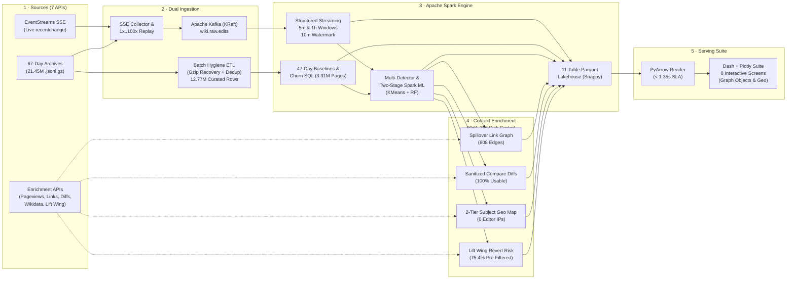

# WikiPulse — Real-Time Detection and Analysis of Wikipedia Knowledge Shifts

**Authors:** Kshama Jain, Senthil Raj K, Pothukanuri Sai Venkat, Akash H S (Team QuadCore)  
**Course:** DA231o — Data Engineering at Scale, Indian Institute of Science (IISc), Bengaluru

WikiPulse is an end-to-end distributed data engineering platform that detects anomalous Wikipedia editing activity in real time and over a **67-day historical archive (`2026-09-15` to `2026-11-20`)**. It normalizes activity bursts against per-page zero-inclusive baselines, disambiguates breaking news from edit wars and major rewrites using an explainable score and two-stage Spark ML (`pyspark.ml`), and enriches top alerts with related-page spillover graphs, sanitized revision diffs, privacy-preserving subject geospatial maps (`0` editor IPs), and Wikimedia Lift Wing revert-risk scoring.

| Metric | Verified 67-Day Scale |
| :--- | :--- |
| **Raw → Curated Events** | **21,454,187** raw (`.jsonl.gz`, `~9.60 GB` JSON) → **12,773,366** curated valid (`100.0%` valid retention, `1.51 GB` Parquet) |
| **Gross Text Churn** | **5.83 GB** across `11,588,460` content edits (`+2.20 GB` Net Growth vs. **3.51 GB / 60.21% Rewriting Volume**) |
| **Baselines & Windows** | **3,307,257** pages profiled over `1,128` zero-inclusive hours · **1,496,507** tumbling `5m`/`1h` windows → **10,631** union alerts |
| **False-Alert Reduction** | **65.04%** (Fixed Rule) → **9.14%** (Explainable Historical Score) → **0.00%** (Two-Stage Spark ML) |
| **Interactive Serving SLA** | **0.003s – 1.342s** across all 8 Dash + Plotly screens (`< 2.0s` target, `~14.5×` faster than raw `.jsonl.gz`) |

---

## 1. Core Use-Cases

1. **Real-Time Wikipedia Observatory & Deterministic Replay (`01 · Live Pulse /`):** Stream live English Wikipedia `recentchange` edits through Wikimedia EventStreams SSE → Apache Kafka (KRaft) → PySpark Structured Streaming with `1m` live preview, `10m`-watermarked `5m`/`1h` windows, `Last-Event-ID` / `?since=` catch-up, and `1x..100x` historical day replay.
2. **Article-Level Page Inspection (`02 · Page Investigation /investigation`):** Lock onto any trending article from the live pulse or rankings ledger to inspect hourly activity bursts, gross vs. net byte movement, contributor balance, additive knowledge-shift evidence (`Edits/35`, `Editors/25`, `Content/20`, `Reverts/10`, `Pageviews/10`), and observed edits against the historical `μ + 2σ` baseline band.
3. **Macro Historical Churn & Event Intelligence (`03 · Historical Intelligence /historical`):** Track 67-day human vs. bot vs. temporary-account (`~2026-...`) ratios, decompose gross byte churn into net encyclopedic growth vs. rewriting conflict, and surface major global events (e.g., *2026 FAA communication outage*, *2026 Microsoft outage*, *2026 US Midterm Elections*, *2026 Kraków shooting*, *Palm Beach Learjet 60 crash*, *Riemann hypothesis*).
4. **Privacy-Preserving Subject Geospatial Mapping (`04 · Geospatial Map /geospatial-map`):** Resolve alerted article subjects onto an interactive world map via 2-tier Wikipedia `prop=coordinates` + 3-hop Wikidata claims (`P625 → P276/P131/P159 → P17`) with explicit quality tags, keeping abstract topics validly `unlocated` and using **zero editor IP addresses**.
5. **Topic Spillover Graph, Diffs & Revert Risk (`05 · Context, Graph & Risk /contextual-features`):** Inspect 1-hop `links`/`backlinks` co-edited spillover networks (`608` edges, `57.4%` co-edited within `±1h`), sanitized plain-text MediaWiki Compare diffs (`100%` usable), and calibrated Wikimedia Lift Wing revert-risk predictions (`75.4%` Spark pre-filter, `τ = 0.65`, `76.92%` F1).
6. **Explainable Anomaly Scoring & Distributed Spark ML (`06 · Anomaly Scoring` & `07 · ML Reports`):** Audit Detector A (fixed rule), Detector B (5-component additive 0–100 score + 4 alert classes: `CONFIRMED_NEWS`, `BREAKING_NEWS_CANDIDATE`, `EDIT_WAR_CONTROVERSY`, `MAJOR_REWRITE`), and Detector C (zero-UDF Catalyst feature engineering → `StandardScaler` → `KMeans k=6` → `.cache()` → `RandomForestClassifier 40 trees`).
7. **Production Engineering & System Health (`08 · Engineering & Health /system`):** Monitor Spark strong/weak scaling, shuffle partition tuning (`16` optimal), streaming capacity (`2.3k–55.8k rows/s`), checkpointed outage backlog drain (`123,537` events in `13.74s`, `0` duplicate alerts), and Parquet lakehouse storage health.

---

## 2. System Architecture



### Technology Stack

| Layer | Technologies |
| :--- | :--- |
| **Streaming & Replay** | Wikimedia EventStreams SSE (`Last-Event-ID`, `?since=`), Apache Kafka (ZooKeeper-free KRaft, `acks=all`, idempotent Snappy), Deterministic `1x..100x` Replay Producer |
| **Distributed Compute** | Apache Spark (`pyspark.sql` Catalyst DataFrames, Structured Streaming with `10m` event-time watermarks, `16` tuned shuffle partitions) |
| **Distributed ML & Risk** | `pyspark.ml` (`VectorAssembler` → `StandardScaler` → `KMeans(k=6)` → `RandomForestClassifier(40 trees)`), Wikimedia Lift Wing `revertrisk-language-agnostic` |
| **Lakehouse Storage** | 11 Day-Partitioned Snappy Parquet tables (`curated/`), PyArrow zero-copy columnar reader, SHA-256 disk API cache |
| **UI & Graph Visualization** | Dash multi-page web suite (8 screens), Plotly `graph_objects` (`Scatter` hub-and-spoke spillover network + `Scattergeo` geospatial maps), Docker Compose |

---

## 3. Project Structure

```text
Repo/
├── Documentation/                          # Final submission deliverables
│   ├── WikiPulse_Final_Presentation.pptx   # 15-slide widescreen PowerPoint deck
│   ├── WikiPulse_Final_Presentation.html   # Interactive HTML presentation (SVG arch + lightbox)
│   ├── Presentation_Deck.md                # Synced 15-slide Markdown outline & speaker notes
│   ├── WikiPulse_Project_Report.pdf        # 7-page final project report (PDF)
│   ├── WikiPulse_Project_Report.html       # Printable A4 HTML source for final report
│   ├── Project_Documentation.md            # Comprehensive project documentation
│   ├── Technical_Documentation.md          # Detailed system & schema reference
│   └── User_Guide.md                       # Operator & analyst user guide
│
├── dashboards/                             # 8-screen Dash + Plotly web application
│   ├── app.py, layout.py, callbacks.py     # Multi-page app shell, navigation & callbacks
│   ├── data_service.py, kafka_replay.py    # PyArrow Lakehouse queries & replay controls
│   ├── charts.py, contextual_charts.py     # Plotly charts, Scatter network & Scattergeo maps
│   ├── activity_*.py                       # Live processing console & background job controls
│   ├── assets/                             # Custom CSS & client JS assets
│   └── pages/                              # Screen modules:
│       ├── live.py                         #   01 · Live Pulse & Replay (/)
│       ├── investigation.py                #   02 · Page Investigation (/investigation)
│       ├── historical.py                   #   03 · Historical Intelligence (/historical)
│       ├── geospatial_map.py               #   04 · Geospatial Map (/geospatial-map)
│       ├── contextual_features.py          #   05 · Context, Graph & Risk (/contextual-features)
│       ├── anomaly_scoring.py              #   06 · Anomaly Scoring (/anomaly-scoring)
│       ├── ml_reports.py                   #   07 · ML Tests & Reports (/ml-reports)
│       └── system.py                       #   08 · Engineering & Health (/system)
│
├── src/                                    # Distributed data engineering & ML pipelines
│   ├── config/settings.py                  # Paths, Spark session factory, safe_write_parquet
│   ├── models/schemas.py                   # 8 canonical PySpark StructType schemas
│   ├── collector.py, stream_source.py      # Wikimedia SSE collector & ?since= catch-up
│   ├── kafka_common.py, stream_control.py  # Kafka KRaft producer/consumer & stream health
│   ├── replay/                             # Deterministic 1x..100x replay engine & patterns
│   ├── detection/                          # Real-time streaming windowing & detector pipeline
│   ├── historical/                         # Batch Lakehouse ETL
│   │   ├── ingest_curate.py                #   Multi-member gzip hygiene & 67d Parquet curation
│   │   ├── build_baselines.py              #   Sparse zero-inclusive 47d baselines (3.31M pages)
│   │   └── rankings_benchmark.py           #   Churn/bot rollups, rankings & RDD/Parquet audit
│   ├── anomaly/                            # Multi-detector scoring & Spark ML
│   │   ├── window_features.py              #   5m & 1h tumbling window feature materialization
│   │   ├── scoring_sparkml.py              #   Detectors A/B/C (KMeans + RandomForest) -> alerts
│   │   └── evaluate_alerts.py              #   Synthetic shift, false-alert & idempotency audit
│   ├── enrichment/                         # Selective SHA-256 cached contextual enrichment
│   │   ├── graph_and_diffs.py              #   1-hop MediaWiki links/backlinks & Compare diffs
│   │   ├── geospatial_map.py               #   2-tier Wikipedia/Wikidata subject coordinates
│   │   └── revert_risk_monitor.py          #   75.4% pre-filter, Lift Wing ML & 48h calibration
│   ├── benchmarks/                         # Strong/weak scaling, shuffle sweep & outage tests
│   ├── dashboard_queries.py                # Fast PyArrow serving queries (< 1.35s SLA)
│   ├── demo/backup_demo.py                 # Offline-safe turnkey demo launcher & verifier
│   └── run_local.py, local_supervisor.py   # Local full-stack process supervisor
│
├── tests/                                  # 45 automated unit & integration tests
├── docs/                                   # Runbooks, benchmark JSONs & milestone notes
├── docker-compose.yml                      # Kafka KRaft container definition
├── run-local.sh, run-demo.sh               # 1-command stack & demo launchers
├── DATA_SETUP.md, DEMO_COMMANDS.md         # Dataset setup & live demo command reference
└── requirements.txt                        # Python dependencies
```

---

## 4. Quickstart & Execution Commands

### A. Launch the Full Live Stack (Kafka KRaft + SSE Collector + Spark Streaming + 8-Screen UI)

See [Local Run Prerequisites](docs/local-prerequisites.md) for environment setup. Start Docker, then run from `Repo/`:

```bash
./run-local.sh --port 8050
```

Starts Kafka KRaft (`wiki.raw.edits`, `wiki.shift.candidates`), supervises the live EventStreams SSE collector, Spark Bronze ingestion, watermarked `5m`/`1h` window aggregators, streaming detectors, and the 8-screen Dash + Plotly UI at `http://127.0.0.1:8050`.

### B. 1-Command Offline-Safe Backup Demo (Curated Parquet Lakehouse)

Runs directly off the curated Parquet lakehouse (`historical/data/curated/`) with zero external network or Docker dependencies:

```bash
# Pre-flight readiness check & real case-study walkthrough:
.venv/bin/python3 Repo/src/demo/backup_demo.py --verify-only

# Launch the 8-screen Dash + Plotly suite on http://127.0.0.1:8050:
.venv/bin/python3 Repo/src/demo/backup_demo.py --port 8050
```

### C. Run the Automated Test Suite

```bash
PYTHONPATH=Repo .venv/bin/python3 -m unittest discover -s Repo/tests -v
```

### D. Batch Curation, Baselines, Spark ML, Enrichment & Benchmarks

```bash
# 1. Verify APIs & canonical PySpark schemas
.venv/bin/python3 Repo/src/verify_milestone1.py

# 2. Ingest & curate 67-day partitioned Parquet lake (21.45M raw -> 12.77M valid)
.venv/bin/python3 Repo/src/historical/ingest_curate.py

# 3. Build 47-day zero-inclusive per-page baselines (3.31M pages) + churn/rankings
.venv/bin/python3 Repo/src/historical/build_baselines.py
.venv/bin/python3 Repo/src/historical/rankings_benchmark.py

# 4. Materialize 5m/1h windows, run Detectors A/B/C (Spark ML) & evaluate alerts
.venv/bin/python3 Repo/src/anomaly/window_features.py
.venv/bin/python3 Repo/src/anomaly/scoring_sparkml.py
.venv/bin/python3 Repo/src/anomaly/evaluate_alerts.py

# 5. Run selective contextual enrichment (spillover graph, diffs, geo map, Lift Wing)
.venv/bin/python3 Repo/src/enrichment/graph_and_diffs.py
.venv/bin/python3 Repo/src/enrichment/geospatial_map.py
.venv/bin/python3 Repo/src/enrichment/revert_risk_monitor.py

# 6. Execute scaling, shuffle sweep & streaming outage recovery benchmarks
.venv/bin/python3 Repo/src/benchmarks/scaling_experiments.py
.venv/bin/python3 Repo/src/benchmarks/load_and_recovery_benchmark.py
```

---

## 5. Documentation & Deliverables

- **[Final Project Report (PDF)](Documentation/WikiPulse_Project_Report.pdf)** & **[HTML](Documentation/WikiPulse_Project_Report.html)** — 7-page report covering problem, architecture, experiments, all 10 application screenshots, and future work (including Apache Spark GraphFrames).
- **[Final Presentation Deck (PPTX)](Documentation/WikiPulse_Final_Presentation.pptx)**, **[Interactive HTML](Documentation/WikiPulse_Final_Presentation.html)** & **[Markdown Outline](Documentation/Presentation_Deck.md)** — 15-slide presentation deck with speaker notes.
- **[Project Documentation](Documentation/Project_Documentation.md)** · **[Technical Documentation](Documentation/Technical_Documentation.md)** · **[User Guide](Documentation/User_Guide.md)** — Full architectural, operational, and analyst manuals.
- **[Historical Data Setup Guide](DATA_SETUP.md)** & **[Demo Commands](DEMO_COMMANDS.md)** — Dataset acquisition and live demo runbook.
