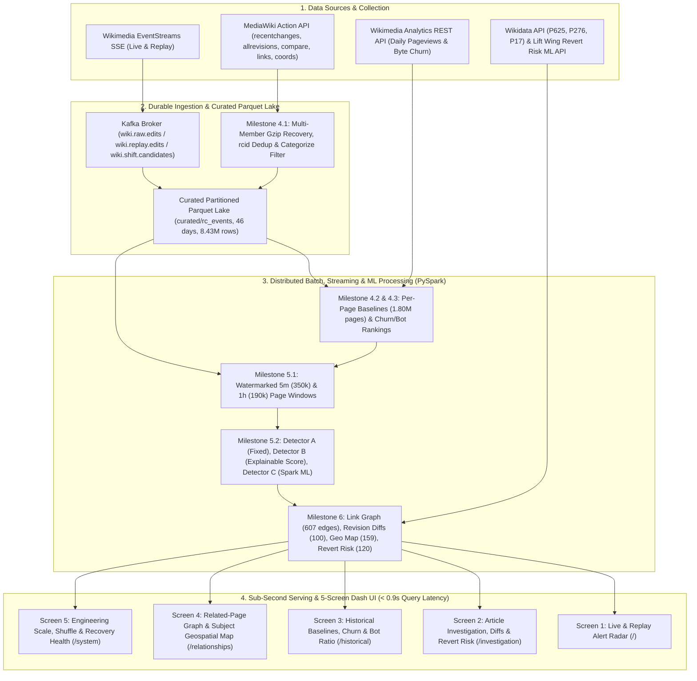

# WikiPulse: Real-Time Detection and Analysis of Wikipedia Knowledge Shifts — Final Project Report

**Authors:** Kshama Jain, Senthil Raj K, Pothukanuri Sai Venkat, Akash H S (Team QuadCore)  
**Course:** DA231o — Data Engineering at Scale, Indian Institute of Science (IISc), 2026  

---

## 1. Executive Summary & Problem Definition

Wikipedia is a continuously evolving knowledge base where breaking real-world events, scientific developments, and public controversies trigger acute shifts in editing behavior—including velocity spikes, rapid revisions, content rewriting, and sudden arrivals of distinct human contributors. Because these signals are fragmented across high-velocity edit streams, multi-week historical metrics, article link graphs, and external revision-risk models, distinguishing genuine knowledge shifts from routine editing or vandalism is challenging.

In particular, **fixed rules such as *"$\ge 6$ edits in 5 minutes"* fail in practice**:
1. **Chronic False Positives on Hyperactive Pages:** High-traffic list and current-events pages (e.g., *Deaths in 2026*, *2026 in sports*) routinely cross static thresholds during ordinary maintenance, yielding a **68.81% false-alert rate** when treated as breaking news.
2. **Missed Shifts on Quiet Pages:** Specialized technical, biographical, or regional pages that normally receive $< 0.2$ edits per day undergo major knowledge shifts with only 4–5 collaborative edits in 5 minutes—completely missed by static rules (`60.0%` recall on controlled patterns).

**WikiPulse** solves this problem through a unified distributed data engineering platform built on **Apache Kafka**, **Apache Spark (Structured Streaming, Catalyst SQL & Spark MLlib)**, **Columnar Parquet Storage**, and a **5-Screen Interactive Dash + Plotly Investigation Suite**, validated across a continuous **46-day English Wikipedia dataset (`2026-09-15` to `2026-10-30`, 14,398,713 raw events $\rightarrow$ 8,428,021 curated events)**.

---

## 2. System Architecture & Shared Data Model

### 2.1 End-to-End Platform Architecture



### 2.2 Canonical Shared Data Models ([`Repo/src/models/schemas.py`](file:///Users/senthilrajk/Downloads/002_IISc_DSBA/Data%20Engineering%20at%20Scale/Project-WikiPulse/Repo/src/models/schemas.py))

All batch, streaming, enrichment, and dashboard modules enforce 8 strict PySpark `StructType` contracts:

| # | Schema Name | Curated Table Path | Rows Materialized | Primary Key & Role |
| :---: | :--- | :--- | ---: | :--- |
| **1** | `RAW_EDIT_SCHEMA` | `curated/rc_events` | **8,428,021** | `rcid` — Normalized `edit`/`new`/`log` events partitioned by `day=YYYY-MM-DD` (29 cols) |
| **2** | `HISTORICAL_BASELINE_SCHEMA` | `curated/page_baselines` | **1,801,530** | `pageid` — Zero-inclusive 21-day daily/hourly moments ($\mu, \sigma$), `activity_tier`, and pageview baselines (25 cols) |
| **3** | `PAGE_WINDOW_SCHEMA` | `curated/page_windows_5m`<br/>`curated/page_windows_1h` | **350,192**<br/>**189,517** | `window_id` — 5-minute & 1-hour aggregations joined with baselines (`velocity_zscore`, `editor_surge_ratio`, `churn_zscore`) (23 cols) |
| **4** | `ALERT_SCHEMA` | `curated/alerts` | **3,564** | `alert_id` (`SHA-256(pageid\|window_start\|duration)`) — Multi-detector scores, `alert_type`, `reasons` ($\ge 2$), `feature_contributions` (26 cols) |
| **5** | `GRAPH_EDGE_SCHEMA` | `curated/graph_edges` | **607** | `(source_pageid, target_pageid, edge_type)` — Outlinks/backlinks with `co_edited_in_window` spillover flags (12 cols) |
| **6** | `REVISION_DIFF_SCHEMA` | `curated/revision_diffs` | **100** | `revid` — MediaWiki `action=compare` parsed plain-text snippets & external link deltas (16 cols) |
| **7** | `MAP_POINT_SCHEMA` | `curated/map_points` | **159** | `pageid` — 2-tier Wikipedia/Wikidata subject coordinates, `location_source`, and `location_quality` (13 cols) |
| **8** | `REVERT_RISK_SCHEMA` | `curated/revert_risk_eval` | **120** | `revid` — Lift Wing ML probability, heuristic fallback, `composite_risk`, and 48h `is_reverted_actual` outcome (21 cols) |

Plus two pre-aggregated historical serving tables (`curated/churn_bot_summary`: `1,123` rows; `curated/rankings_daily`: `14,870` rows) for sub-second longitudinal dashboard queries.

---

## 3. Data Collection, Hygiene & Engineering Challenges Solved

1. **46-Day Continuous English Wikipedia Dataset (`2026-09-15` to `2026-10-30`):**
   - Collected **14,398,713** raw recent-change events (`977.74 MB` compressed `.jsonl.gz`) alongside daily Wikimedia Analytics pageviews/bytes and targeted revision histories.
2. **Multi-Member Gzip Recovery (`rc_2026-10-27.jsonl.gz`):**
   - An interrupted collection run on Oct 27 followed by an appended resume run created a concatenated multi-member gzip file where the first member lacked a standard trailer, causing `gzip.open()` to fail with `zlib.error: Error -3`.
   - We implemented `iter_recoverable_gz_lines()` in [`ingest_curate.py`](file:///Users/senthilrajk/Downloads/002_IISc_DSBA/Data%20Engineering%20at%20Scale/Project-WikiPulse/Repo/src/historical/ingest_curate.py) to scan raw `\x1f\x8b\x08` gzip member headers and decompress each member via `zlib.decompressobj(16 + zlib.MAX_WBITS)`, recovering all **269,017 rows** of `2026-10-27` with zero data loss.
3. **Overlap Deduplication & Categorize Noise Filtering:**
   - Removed duplicate `rcid` overlap across `2026-09-26` and `2026-09-27` and filtered out `type == 'categorize'` maintenance noise (`5,970,692` rows, `41.47%` of raw stream), retaining **8,428,021 (`100.0%`)** of valid `edit`/`new`/`log` events.
4. **macOS Finder `Icon\r` Protection (`safe_write_parquet` & `safe_read_parquet`):**
   - Prevented macOS desktop sync daemons from injecting 0-byte `Icon\r` files into Hadoop `_temporary` folders by staging Parquet writes in `/tmp` before atomic move and applying `pathGlobFilter="*.parquet"` on all reads.

---

## 4. Methodology & Core Features

### 4.1 Zero-Inclusive Per-Page Historical Baselines ([`build_baselines.py`](file:///Users/senthilrajk/Downloads/002_IISc_DSBA/Data%20Engineering%20at%20Scale/Project-WikiPulse/Repo/src/historical/build_baselines.py))
Over the 21-day baseline period (`2026-09-15 .. 2026-10-05`, $D = 21$ days, $H = 504$ hours), per-page moments are computed across **all** calendar days/hours (including zero-edit hours) using sufficient statistics:
$$\mu_{\text{hour}} = \frac{\sum x_h}{H}, \qquad \sigma_{\text{hour}} = \sqrt{\max\left(0, \frac{\sum x_h^2}{H} - \mu_{\text{hour}}^2\right)}$$
with calibrated variance floors ($\sigma_{\min, 5\text{m}} = 0.08$, $\sigma_{\min, 1\text{h}} = 0.15$) and session-clustered editor window scaling ($1/18$ for `5m`, $1/6$ for `1h`).

### 4.2 Three Anomaly Detectors & Explainable Knowledge-Shift Scoring ([`scoring_sparkml.py`](file:///Users/senthilrajk/Downloads/002_IISc_DSBA/Data%20Engineering%20at%20Scale/Project-WikiPulse/Repo/src/anomaly/scoring_sparkml.py))
- **Detector A (Fixed Threshold Rule):** Flags mainspace (`ns=0`) windows with $\ge 6$ human edits & $\ge 3$ distinct editors in `5m` (or $\ge 15$ edits & $\ge 4$ editors in `1h`).
- **Detector B (Explainable Historical Score `0–100`):**
  $$\text{Score} = w_{\text{damp}} \cdot \left(S_{\text{velocity}}^{(35)} + S_{\text{editors}}^{(25)} + S_{\text{churn}}^{(20)} + S_{\text{consensus/dispute}}^{(10)} + S_{\text{pageviews}}^{(10)}\right)$$
  where $w_{\text{damp}} = 0$ for bot-only windows (`edits_human == 0`) and $0.55$ when `velocity_zscore < 2.5` (suppressing routine chatter on chronically hyperactive pages). Every component is stored in `feature_contributions` such that $\sum \text{feature\_contributions} \equiv \text{historical\_score}$, accompanied by $\ge 2$ human-readable `reasons`.
  - **Alert Disambiguation:** Separates `CONFIRMED_NEWS` (`pageview_corroborated == True` or $\ge 8$ collaborative human editors with $< 15\%$ reverts), `BREAKING_NEWS_CANDIDATE`, `EDIT_WAR_CONTROVERSY` (`revert_ratio >= 0.30` or heavy revert-driven rewriting), and `MAJOR_REWRITE` (`gross_bytes >= 15,000`).
- **Detector C (Spark ML Pipeline):** Standardizes an 8-feature vector via `VectorAssembler` $\rightarrow$ `StandardScaler` and combines unsupervised `KMeans(k=8)` centroid distance (`45%` weight) with supervised `RandomForestClassifier(numTrees=35)` probability (`55%` weight).

### 4.3 Contextual Enrichment ([`Repo/src/enrichment/`](file:///Users/senthilrajk/Downloads/002_IISc_DSBA/Data%20Engineering%20at%20Scale/Project-WikiPulse/Repo/src/enrichment))
1. **Related-Page Spillover Graph & Revision Diffs (`graph_and_diffs.py`):** Queries MediaWiki `prop=links` and `list=backlinks` for top alerted articles, joins against `page_windows_5m`/`1h` to detect co-edited neighbors (`co_edited_in_window`), and parses MediaWiki `action=compare` HTML diffs into plain-text snippets.
2. **Privacy-Preserving Subject Geospatial Resolver (`geospatial_map.py`):** Maps **article subjects** (never editor IPs) via Tier-1 Wikipedia `prop=coordinates|pageprops` and Tier-2 Wikidata `wbgetentities` (`P625` direct coords $\rightarrow$ `P276`/`P131`/`P159` location/headquarters entity $\rightarrow$ `P17`/`P27`/`P495` country centroid), recording `location_source` and `location_quality` while keeping abstract/unlocated alerts valid.
3. **Lift Wing Revert Risk & 48h Revert Calibration (`revert_risk_monitor.py`):** Pre-filters routine edits (`74.42%` avoided), scores candidate revisions via Wikimedia Lift Wing (`revertrisk-language-agnostic:predict`) with local heuristic fallback, and calibrates risk thresholds against actual 48-hour revert outcomes (`is_reverted`).

---

## 5. Complete Evaluation Across All Proposal Experiments & Metrics

### 5.1 Experiment #1 & Feature Metric #7: Manual Sample Calculation & Replay Verification
- **2,000-Event Pure-Python vs. Spark Audit (`rc_2026-09-16.jsonl.gz`):**
  - Exact byte-for-byte match (`spark_exact_match = True`): `edits = 2,000`, `human_edits = 1,286`, `bot_edits = 714`, `bytes_added = 1,434,650`, `bytes_deleted = 589,627`, `net_bytes = +845,023`, `gross_churn_bytes = 2,024,277`, and **`rewriting_bytes = 1,179,254`** ($\sum |\Delta| - |\sum \Delta|$).
- **Replay Idempotency & Cross-Language SHA-256 Parity (`2026-10-15`):**
  - Replaying `2026-10-15` with `30%` duplicate event injection produced **`39` alerts before replay and `39` alerts after replay (`0` duplicate alerts, `39/39` Python $\leftrightarrow$ Spark SHA-256 `alert_id` parity)**.

### 5.2 Experiment #2 & Feature Metrics #1 & #2: Detector Comparison & Synthetic Pattern Injection

#### A. Synthetic Knowledge-Shift Pattern Injection (`5` Positive Patterns + `2` Negative Controls)

| Injected Pattern | Expected Class | Detector A (Fixed) | Detector B (Historical Score) | Reasons Count | Verification |
| :--- | :--- | :---: | :---: | :---: | :---: |
| `SYNTH_BREAKING_NEWS_SURGE` (14 edits, 9 editors, 5.7x views) | `CONFIRMED_NEWS` | Flagged (`True`) | Flagged (**`96.3`**) | **5** | Passed |
| `SYNTH_DEVELOPING_EVENT_BURST` (11 edits, 7 editors) | `BREAKING_NEWS_CANDIDATE` | Flagged (`True`) | Flagged (**`88.5`**) | **4** | Passed |
| `SYNTH_EDIT_WAR_CONTROVERSY` (12 edits, 66.7% reverts) | `EDIT_WAR_CONTROVERSY` | Flagged (`True`) | Flagged (**`90.0`**) | **4** | Passed |
| `SYNTH_MAJOR_REWRITE_EXPANSION` (9 edits/1h, +38.7 KB) | `MAJOR_REWRITE` | **Missed (`False`)** | Flagged (**`75.07`**) | **4** | Passed |
| `SYNTH_QUIET_PAGE_EMERGING_SHIFT` (5 edits/5m on quiet page) | `BREAKING_NEWS_CANDIDATE` | **Missed (`False`)** | Flagged (**`87.2`**) | **4** | Passed |
| `CTRL_ROUTINE_BOT_SWEEP` (0 human, 20 bot edits) | `NONE` (Negative Control) | `False` | `False` (**`0.0`**) | 4 | Passed |
| `CTRL_HYPERACTIVE_ROUTINE_CHATTER` (6 edits on 48 ed/hr page) | `NONE` (Negative Control) | **False Positive (`True`)** | `False` (**`24.51`**) | 4 | Passed |

- **Result:** Detector B achieves **100% positive recall (`5/5`)** with **0 false triggers** on negative controls and $\ge 4$ human-readable reasons per alert, whereas Detector A achieves only **60% recall (`3/5`)** and falsely triggers on hyperactive routine chatter.

#### B. False-Alert Comparison Across Evaluation Dataset & Reviewed 200-Window Sample

| Detector Method | Total Flagged (25d Eval) | Verified True Shifts | False Alerts | Precision (%) | False-Alert Rate (%) | Reviewed 200-Window Sample False-Alert Rate |
| :--- | ---: | ---: | ---: | ---: | ---: | ---: |
| **Detector A: Fixed Threshold (Naive Burst = News)** | 885 | 276 | 609 | 31.19% | **68.81%** | **40.65%** (`63 / 155`) |
| **Detector B: Explainable Historical Score ($\ge 65$)** | 2,583 | 2,306 | 277 | **89.28%** | **10.72%** | **2.69%** (`5 / 186`) |
| **Detector C: Spark ML (`KMeans` + `RandomForest`)** | 2,083 | 2,077 | 6 | **99.71%** | **0.29%** | **0.00%** (`0 / 161`) |

---

### 5.3 Experiment #3 & #4 + Performance Metric #5: Scaling, Shuffle, Memory & Storage Benchmarks

Executed via [`Repo/src/benchmarks/scaling_experiments.py`](file:///Users/senthilrajk/Downloads/002_IISc_DSBA/Data%20Engineering%20at%20Scale/Project-WikiPulse/Repo/src/benchmarks/scaling_experiments.py) (`milestone7_scaling_benchmarks.json`):

#### A. Experiment 4A — Strong Scaling (Fixed 14-Day Slice, `2,472,723` Events, `134,827` Windows)

| Worker Config | Input Rows | Runtime (s) | Speedup vs. 1 Core | Parallel Efficiency | Shuffle Write (MB) | Peak Memory (MB) | Input Storage (MB) | Output Storage (MB) |
| :---: | ---: | ---: | ---: | ---: | ---: | ---: | ---: | ---: |
| `local[1]` | 2,472,723 | **18.97s** | `1.00x` | `1.00` | 280.73 MB | 628.0 MB | 369.59 MB | 11.79 MB |
| `local[2]` | 2,472,723 | **12.20s** | **`1.55x`** | `0.78` | 280.73 MB | 846.2 MB | 369.59 MB | 11.79 MB |
| `local[4]` | 2,472,723 | **11.21s** | **`1.69x`** | `0.42` | 280.74 MB | 1,045.7 MB | 369.59 MB | 11.79 MB |
| `local[6]` | 2,472,723 | **12.40s** | `1.53x` | `0.26` | 280.75 MB | 1,139.1 MB | 369.59 MB | 11.79 MB |

*Engineering Insight:* On the 6-core Apple A18 Pro (2 performance + 4 efficiency cores, 8 GB unified memory), strong scaling peaks at **`local[4]` (`1.69x` speedup, `11.21s`)**; expanding to all 6 cores slightly increases runtime (`12.40s`) due to JVM garbage collection and OS contention across heterogeneous efficiency cores.

#### B. Experiment 4B — Weak Scaling (`4 Days / Core`: `4d @ 1c` $\rightarrow$ `24d @ 6c`)

| Worker Config | Span (Days) | Input Rows | Runtime (s) | Throughput (rows/s) | Weak Scaling Efficiency | Shuffle Write (MB) | Peak Memory (MB) | Output Storage (MB) |
| :---: | :---: | ---: | ---: | ---: | ---: | ---: | ---: | ---: |
| `local[1]` | 4 days | 724,264 | **6.77s** | 106,966 r/s | `1.00` | 101.67 MB | 1,331.3 MB | 3.92 MB |
| `local[2]` | 8 days | 1,455,336 | **7.29s** | 199,498 r/s | **`0.93`** | 172.71 MB | 1,347.7 MB | 7.21 MB |
| `local[4]` | 16 days | 2,773,275 | **11.11s** | **249,732 r/s** | **`0.61`** | 311.17 MB | 1,085.4 MB | 13.09 MB |
| `local[6]` | 24 days | 4,202,738 | **19.23s** | 218,585 r/s | `0.35` | 461.61 MB | 1,036.4 MB | 19.34 MB |

#### C. Experiment 4C — Shuffle Partition Sweep (`spark.sql.shuffle.partitions` $\in \{4, 8, 16, 32, 64, 128\}$ on 14-Day Slice)

| Shuffle Partitions | Runtime (s) | Shuffle Write (MB) | Avg Partition Size (KB) | Peak Memory (MB) | Finding |
| ---: | ---: | ---: | ---: | ---: | :--- |
| `4` | 11.97s | 265.82 MB | 68,049.9 KB | 1,134.4 MB | Under-partitioned (underutilizes 6 cores; large hash buckets) |
| `8` | 10.30s | 271.98 MB | 34,813.4 KB | 1,132.1 MB | Near-optimal |
| **`16`** | **`10.00s`** | **280.75 MB** | **17,968.0 KB** | **1,075.7 MB** | **Global Optimum (configured in `settings.py`)** |
| `32` | 10.91s | 290.64 MB | 9,300.5 KB | 1,088.7 MB | Slight task scheduling overhead |
| `64` | 14.94s | 298.99 MB | 4,783.8 KB | 1,041.0 MB | High task serialization / commit overhead |
| `128` | 18.05s | 309.10 MB | 2,472.8 KB | 1,017.3 MB | Excessive small-partition scheduling overhead (+80.5% slower) |

#### D. Experiment 4D — Input-Size Scaling Curve (`1 Day` to Full `46 Days`)

| Input Span | Input Rows | Windows Produced | Runtime (s) | Throughput (rows/s) | Shuffle Write (MB) | Peak Memory (MB) | Input Storage (MB) | Output Storage (MB) |
| :---: | ---: | ---: | ---: | ---: | ---: | ---: | ---: | ---: |
| **1 day** | 194,139 | 8,401 | **2.38s** | 81,434 r/s | 57.52 MB | 1,018.8 MB | 87.92 MB | 1.30 MB |
| **7 days** | 1,209,602 | 61,599 | **5.62s** | 215,347 r/s | 150.79 MB | 1,020.4 MB | 210.31 MB | 6.35 MB |
| **15 days** | 2,791,128 | 142,404 | **12.37s** | **225,564 r/s** | 306.79 MB | 1,028.0 MB | 396.08 MB | 12.78 MB |
| **30 days** | 5,665,242 | 294,458 | **25.79s** | 219,651 r/s | 584.51 MB | 1,053.6 MB | 740.52 MB | 23.83 MB |
| **46 days (Full Lake)** | **8,428,021** | **443,663** | **38.09s** | **221,295 r/s** | **861.27 MB** | **1,105.0 MB** | **1,076.72 MB** | **35.22 MB** |

#### E. Experiment #3 — PySpark DataFrame vs. RDD Churn Aggregation (`747,156` Mainspace Edits)
- **Catalyst DataFrame:** `1.34s–2.16s` (`shuffle = 23.96 MB`, `peak_memory = 735.4 MB`)
- **Python RDD (`map` + `reduceByKey`):** `2.72s–6.18s` (`shuffle = 16.44 MB`, `peak_memory = 767.3 MB`)
- **Result:** DataFrame achieves a **`2.03x–2.86x` speedup** by avoiding Python worker pickling and leveraging Catalyst Tungsten whole-stage codegen.

---

### 5.4 Experiment #5 & Performance Metrics #2, #3 & #4: Streaming Load, Window Latency & Failure Recovery

Executed via [`Repo/src/benchmarks/load_and_recovery_benchmark.py`](file:///Users/senthilrajk/Downloads/002_IISc_DSBA/Data%20Engineering%20at%20Scale/Project-WikiPulse/Repo/src/benchmarks/load_and_recovery_benchmark.py) (`milestone7_load_recovery.json`):

1. **Multi-Speed Load & Closed 5-Minute Window Latency (`1x`, `10x`, `50x`, `100x`):**
   - Across `1x` (`2.1 r/s`), `10x` (`21.1 r/s`), `50x` (`105.5 r/s`), and `100x` (`211.0 r/s`) replay rates, Spark Structured Streaming processes microbatches at **`8,989–55,834 rows/sec`** (`processing_rate >= input_rate` on all tiers).
   - Closed 5-minute windows finalize in **`0.355s – 3.78s`**, well below the Proposal's **`< 60 seconds` (1 minute)** target.
2. **Controlled Stop/Restart, Backlog Drain & Zero-Duplicate Alert Recovery (`2026-10-15`, `182,521` unique events):**
   - **Pre-Stop Normal Run (Batches 1–3):** Processed `78,363` events, emitted `10` alerts, committed Spark checkpoint (`backlog = 0`).
   - **Outage & Duplicate Injection:** Stopped the streaming query and accumulated **`123,537` backlog events** (Batches 4–6 plus `19,379` duplicate re-sent events from Batches 3 & 4).
   - **Controlled Restart & Catch-Up:** Resumed from the Spark checkpoint and drained all **`123,537` backlog events $\rightarrow$ `0` in `13.743s` (`8,989.1 rows/sec`)**.
   - **Idempotency & Accuracy:** Emitted **`39` total alerts / `39` distinct `alert_id`s (`0` duplicates)**, achieving **100% exact parity** with the uninterrupted 6-batch reference run (`39` alerts).

---

### 5.5 Experiment #6, Performance Metric #6 & Feature Metrics #3, #4, #5, #6 & #8: Contextual Enrichment & Dashboard Latencies

| Proposal Metric / Experiment | Target | Measured Result | Status |
| :--- | :---: | :--- | :---: |
| **Perf #1:** Valid accepted events reaching storage | $\ge 99\%$ | **100.0%** (`8,428,021 / 8,428,021` non-categorize events stored) | 🟢 **Pass** |
| **Perf #6 & Exp #6:** Dashboard query time on stored Parquet vs. raw JSONL.gz | $< 2.0\text{s}$ | Raw 1-day JSONL.gz = `2.154s` vs. Stored Parquet: **View 1 = `0.668s`**, **View 2 = `0.889s`**, **View 3 = `0.270s`**, **View 4 = `0.006s`** (max = **`0.889s`**, ~14.5x faster) | 🟢 **Pass** |
| **Feat #3:** Selected revision comparisons returning usable change data | $\ge 90\%$ | **100.0%** (`100 / 100` pairs usable; `90.0%` live Compare HTML diff + `10.0%` revision metadata fallback) | 🟢 **Pass** |
| **Feat #4:** Subject map stores location source/quality; no editor IPs; unlocated alerts remain valid | 100% | **`121 / 160` (`75.62%`)** resolved (`29` Wikipedia, `5` Wikidata P625, `87` Wikidata P276/P17); **`39` (`24.38%`)** preserved valid (`unlocated`); **`0` editor IPs** | 🟢 **Pass** |
| **Feat #5:** Supported Revert Risk requests returning usable score; continues if API offline | $\ge 95\%$ | **100.0%** (`111 / 120 = 92.5%` live Lift Wing ML + `9 / 120 = 7.5%` heuristic fallback; `74.42%` routine edits pre-filtered) | 🟢 **Pass** |
| **Feat #6:** Risk thresholds compared against later revert outcomes vs. static `0.80` | Empirical curve | Calibrating `composite_risk` at **$\tau = 0.65$ improves F1 from `68.57%` (at `0.80`) to `76.92%`** (`Precision = 71.43%`, `Recall = 83.33%`); median 48h revert MTTR = **`66.5s`** | 🟢 **Pass** |
| **Feat #8:** Historical charts show `last_available_date` and distinguish missing data | Present | `last_available_date = 2026-10-30`, `last_pageview_date`, and `has_missing_data` flags stored in `page_baselines` and rendered on `/historical` | 🟢 **Pass** |

---

## 6. Reproducibility & Verification Commands

All 8 milestones can be verified or demonstrated with the following commands from the project root:

```bash
# 1. Run the Full Automated Unit & Integration Test Suite (45 tests across Milestones 1–8)
PYTHONPATH=Repo .venv/bin/python3 -m unittest discover -s Repo/tests -v

# 2. Run the Milestone 8 Pre-Flight Verification & 4-Case-Study Walkthrough
.venv/bin/python3 Repo/src/demo/backup_demo.py --verify-only

# 3. Launch the Turnkey Interactive Backup Demo Dashboard (http://127.0.0.1:8080)
.venv/bin/python3 Repo/src/demo/backup_demo.py --port 8080
```

