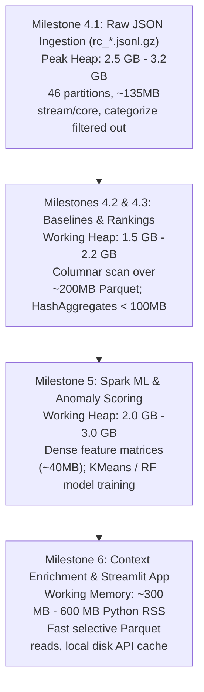

# WikiPulse — Memory Sizing & Capacity Planning Guide

**Project:** WikiPulse — Real-Time Detection and Analysis of Wikipedia Knowledge Shifts  
**Course:** DA231o — Data Engineering at Scale (IISc)  
**Target Platform:** Single-Node Spark / Local Development (macOS Unified Memory)  
**Related Documents:** [milestone1_specs_and_models.md](file:///Users/senthilrajk/Downloads/002_IISc_DSBA/Data%20Engineering%20at%20Scale/Project-WikiPulse/Repo/docs/milestone1_specs_and_models.md) · [wikipulse_milestones_4_5_6_plan.md](file:///Users/senthilrajk/Downloads/002_IISc_DSBA/Data%20Engineering%20at%20Scale/Project-WikiPulse/wikipulse_milestones_4_5_6_plan.md)  
**Configuration Module:** [settings.py](file:///Users/senthilrajk/Downloads/002_IISc_DSBA/Data%20Engineering%20at%20Scale/Project-WikiPulse/Repo/src/config/settings.py)

---

## 1. Executive Summary & Sizing Matrix

Based on 46 days of collected English Wikipedia recentchanges data (`2026-09-15` through `2026-10-30`), the table below outlines the memory requirements across the processing lifecycle:

| Sizing Dimension | Minimum Budget | Recommended Setting | System Reality (Current Host) |
| :--- | :---: | :---: | :---: |
| **Spark Driver Memory (`spark.driver.memory`)** | **`3 GB`** | **`4 GB`** | Configured as `4g` in [`settings.py`](file:///Users/senthilrajk/Downloads/002_IISc_DSBA/Data%20Engineering%20at%20Scale/Project-WikiPulse/Repo/src/config/settings.py#L247) |
| **Spark Shuffle Partitions (`spark.sql.shuffle.partitions`)** | **`8`** | **`16`** | Configured as `16` in [`settings.py`](file:///Users/senthilrajk/Downloads/002_IISc_DSBA/Data%20Engineering%20at%20Scale/Project-WikiPulse/Repo/src/config/settings.py#L264) |
| **Total System RAM** | **`8 GB`** | **`8 GB – 16 GB`** | **8.0 GB Unified Memory (Apple A18 Pro, 6 cores)** |
| **Peak Execution Heap / Active RAM** | **`2.5 GB`** | **`3.2 GB – 3.8 GB`** | Fits within available ~4.2 GB user RAM budget |
| **Disk Space Needed for Curation** | **`2.0 GB`** | **`5.0 GB`** | Curated Parquet (~250 MB) + Temp staging |

> [!NOTE]
> The current system has an **8.0 GB Unified Memory** footprint on an Apple A18 Pro (6 cores). Allocating **4 GB** to the Spark driver leaves approximately **4 GB** for macOS system daemons, WindowServer, terminal, and Python processes, preventing memory thrashing or swap exhaustion.

---

## 2. Collected Data Footprint: Disk vs. Memory

The raw collected data resides in [`historical/data/`](file:///Users/senthilrajk/Downloads/002_IISc_DSBA/Data%20Engineering%20at%20Scale/Project-WikiPulse/historical/data/):

| Directory / Layer | File Format | Files / Span | On-Disk Size | Uncompressed / In-Memory Size |
| :--- | :---: | :---: | :---: | :---: |
| `historical/data/enwiki_recentchanges/` | `.jsonl.gz` | 46 daily files (`rc_*.jsonl.gz`) | **932.4 MB** | **~6.0 GB** uncompressed JSON (~6.6× compression ratio) |
| `historical/data/curated/rc_events/` | `.parquet` (Snappy) | Partitioned by `day=YYYY-MM-DD` | **~180 MB – 250 MB** | **~400 MB – 650 MB** columnar in JVM heap |
| `historical/data/enwiki_revisions/` | `.jsonl.gz` | Targeted historical pages | **10.0 MB** | **~65 MB** |
| `historical/data/analytics/` | `.json` | Daily pageviews & bytes | **2.2 MB** | **~15 MB** |
| `historical/data/curated/page_baselines/` | `.parquet` | ~250k unique active pages | **~15 MB – 25 MB** | **~35 MB – 50 MB** |
| `historical/data/curated/page_windows_*` | `.parquet` | 5m and 1h candidate windows | **~30 MB – 60 MB** | **~80 MB – 120 MB** |
| `historical/data/curated/alerts/` | `.parquet` | High-confidence alerts | **< 5 MB** | **< 10 MB** |

```
┌────────────────────────────────────────────────────────────────────────┐
│                        STORAGE EXPANSION & COMPACTION                  │
│                                                                        │
│   Raw Compressed Gzip       Uncompressed JSON Text      Curated Parquet│
│   (historical/data/)         (Streamed Ingestion)        (curated/)    │
│      [ 932 MB ]        ───►     [ ~6.0 GB ]       ───►   [ ~200 MB ]   │
│                             (Categorize dropped,                       │
│                              pruned to 23 fields)                      │
└────────────────────────────────────────────────────────────────────────┘
```

---

## 3. Memory Demand by Milestone Stage



### 3.1 Milestone 4.1: Data Ingestion & Curated Parquet Lake
* **Execution Script:** [`Repo/src/historical/ingest_curate.py`](file:///Users/senthilrajk/Downloads/002_IISc_DSBA/Data%20Engineering%20at%20Scale/Project-WikiPulse/Repo/src/historical/ingest_curate.py)
* **Memory Bottleneck:** JSON parsing and gzip decompression.
* **Why it fits:**
  * Gzip streams are non-splittable; Spark assigns 1 partition per daily file (46 partitions).
  * On a 6-core machine, Spark runs up to 6 concurrent tasks.
  * Each active task decompresses and parses one daily chunk (~20 MB compressed $\rightarrow$ ~135 MB JSON stream).
  * Active execution buffer across 6 cores: $6 \times 135 \text{ MB} \approx 810 \text{ MB}$.
  * Including Catalyst query planner, string object allocation in JVM, and overhead: **`~2.5 GB – 3.2 GB`**.
  * `type == 'categorize'` rows (~40% of records) are immediately discarded, and events are normalized to `RAW_EDIT_SCHEMA` before writing out partitioned Parquet.

### 3.2 Milestone 4.2 & 4.3: Historical Baselines & Churn Rankings
* **Execution Scripts:** `Repo/src/historical/build_baselines.py` and `Repo/src/historical/rankings_benchmark.py`
* **Memory Bottleneck:** Multi-day `groupBy("pageid", "title")` aggregations.
* **Why it fits:**
  * The dataset switches entirely to **Parquet**. Column projection loads only ~5 columns (`pageid`, `title`, `delta`, `is_revert`, `user`, `is_bot`).
  * In English Wikipedia, roughly 200,000 to 300,000 distinct article pages are edited over 45 days.
  * In-memory hash aggregation tables for ~300k entries with mean, variance, churn sums, and distinct editor sketches require **`< 100 MB`** in JVM off-heap/execution memory.
  * With `spark.sql.shuffle.partitions = 16`, each partition receives under 20,000 keys (< 10 MB per shuffle partition).

### 3.3 Milestone 5: Window Features & Spark ML Anomaly Models
* **Execution Scripts:** `Repo/src/anomaly/window_features.py` and `Repo/src/anomaly/scoring_sparkml.py`
* **Memory Bottleneck:** `VectorAssembler` and ML training iterations (`KMeans`, `RandomForestClassifier`).
* **Why it fits:**
  * Rolling 5-minute and 1-hour windows are evaluated over the evaluation period (`2026-10-06` to `2026-10-30` = 25 days).
  * Filtering for candidate pages (edits $\ge 3$) yields $\approx 300,000$ to $500,000$ feature rows.
  * A 10-feature double vector table occupies:
    $$\text{Memory} \approx 500,000 \times 10 \times 8 \text{ bytes} \approx 40 \text{ MB}$$
  * Spark ML model fitting iterations (gradient updates and tree node splits) run with working heap of **`~2.0 GB – 3.0 GB`**.

### 3.4 Milestone 6: Contextual Enrichment & Streamlit Dashboard
* **Execution Modules:** `Repo/src/enrichment/` and `Repo/src/dashboard/app.py`
* **Memory Bottleneck:** Streamlit process memory and browser rendering.
* **Why it fits:**
  * Contextual lookups (revision diffs, outlinks/backlinks, coordinates, and Lift Wing scores) run only for confirmed alerts (tens to hundreds of pages, not millions).
  * All external Wikimedia REST responses are cached to disk in `historical/data/curated/cache/`.
  * Streamlit runs in Python with **`~300 MB – 600 MB`** RSS.

---

## 4. Spark Tuning Recommendations for 8 GB Systems

To ensure smooth execution without hitting macOS swap memory pressure:

### 4.1 Recommended Spark Configuration (matches `settings.py`)
```python
spark = (
    SparkSession.builder.appName("WikiPulse")
    .config("spark.driver.memory", "4g")               # 50% of 8GB host RAM
    .config("spark.driver.maxResultSize", "1g")        # Caps collect() safety
    .config("spark.sql.shuffle.partitions", "16")      # Keeps shuffle partitions < 15MB
    .config("spark.sql.caseSensitive", "true")
    .config("spark.sql.session.timeZone", "UTC")
    .config("spark.sql.execution.arrow.pyspark.enabled", "true")
    .config("spark.sql.execution.arrow.maxRecordsPerBatch", "10000") # Guard batch memory
    .getOrCreate()
)
```

### 4.2 Critical Rules for Memory Management
1. **Never Cache the Raw 46-Day DataFrame:**
   * Calling `.cache()` or `.persist()` on `raw_df` (the 46 JSONL.gz files) will attempt to materialize deserialized Java objects for ~6 GB of text, causing JVM `OutOfMemoryError` or heavy OS swapping.
   * Only cache curated, filtered, columnar Parquet tables when an intermediate stage is reused $\ge 2$ times, and call `.unpersist()` as soon as the downstream computation finishes.
2. **Use Partition Filtering in Downstream Tasks:**
   * Downstream jobs should always filter on `day` (`WHERE day >= '2026-10-06'`) so Spark prunes entire Parquet directory partitions without reading them into memory.
3. **Run Ingestion in Batch Modes if Multitasking:**
   * If running a heavy web browser or Docker alongside Spark, dial `driver_memory` down to `"3g"`. The pipeline will execute with slightly more frequent garbage collections but zero swap thrashing.

