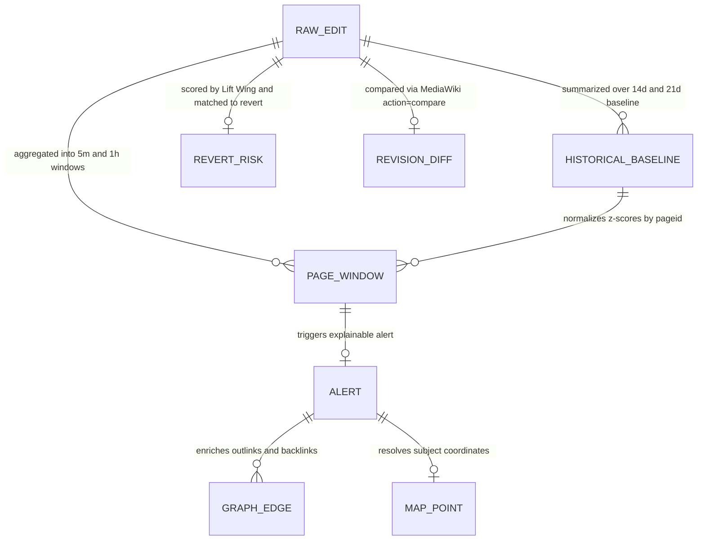

# WikiPulse — Milestone 1: Confirmed APIs, Shared Data Models & Dashboard Specifications

**Milestone 1 Goal:** *Confirm APIs, event schema, and dashboard specs. Feasibility and shared data model complete.*  
**Implementation Modules:** [settings.py](file:///Users/senthilrajk/Downloads/002_IISc_DSBA/Data%20Engineering%20at%20Scale/Project-WikiPulse/Repo/src/config/settings.py) · [schemas.py](file:///Users/senthilrajk/Downloads/002_IISc_DSBA/Data%20Engineering%20at%20Scale/Project-WikiPulse/Repo/src/models/schemas.py)

---

## 1. Confirmed Wikimedia APIs & Operational Contracts

All APIs below have been verified via live probes ([wikipulse-wikimedia-apis.postman_collection.json](file:///Users/senthilrajk/Downloads/002_IISc_DSBA/Data%20Engineering%20at%20Scale/Project-WikiPulse/wikipulse-wikimedia-apis.postman_collection.json)) and 45-day historical collection runs.

| # | API Source | Endpoint / Action | Retention & Granularity | Rate / Pagination Contract | Role in WikiPulse |
| :---: | :--- | :--- | :--- | :--- | :--- |
| **1** | **EventStreams SSE (`recentchange`)** | `https://stream.wikimedia.org/v2/stream/recentchange` | Live + ~7–31d replay (`?since=ISO`) | Streaming SSE (`Last-Event-ID` resume) | Live edit ingestion & Kafka producer feed |
| **2** | **EventStreams SSE (`revert_risk`)** | `.../mediawiki.page_revert_risk_prediction_change.v1` | Live (~7d retention) | Streaming SSE | Live ML Revert Risk probability stream |
| **3** | **MediaWiki `recentchanges`** | `https://en.wikipedia.org/w/api.php?action=query&list=recentchanges` | **~30 days** rolling window; second-level events | `rclimit=500`, `maxlag=5`, ~0.8 req/s polite sequential | **Primary historical event source**: includes `bot`, `oldlen`, `newlen`, `sha1`, `temp`, `tags`, `log` |
| **4** | **MediaWiki `allrevisions`** | `.../w/api.php?action=query&list=allrevisions` | Permanent (all non-deleted pages) | `arvlimit=500`, `maxlag=5`, ~0.9 req/s | Backfill for windows older than 30 days or ~1% redirect/upload edge cases |
| **5** | **Wikimedia Analytics REST API** | `https://wikimedia.org/api/rest_v1/metrics/...` | Multi-year **daily & monthly** (lags ~24h) | REST GET with exponential backoff on 429/5xx | Project-wide aggregates, `pageviews/top`, and per-page `edits`, `bytes-difference`, and `pageviews/per-article` |
| **6** | **MediaWiki `compare`** | `.../w/api.php?action=compare&fromrev={old}&torev={new}` | Permanent (non-deleted revisions) | Per-revision pair; used selectively on alerted windows | Diff snippet, line additions/removals, and external link checks ($\ge 90\%$ usable target) |
| **7** | **MediaWiki `links`, `backlinks`, `coordinates`** | `.../w/api.php?action=query&prop=info\|coordinates\|pageprops\|links` & `list=backlinks` | Current wiki snapshot | Batch up to **50 titles/call**; paginate `pllimit=500` / `bllimit=500` | Topic graph (`Graph edge`), direct article coordinates, and Wikidata `wikibase_item` QID |
| **8** | **Wikidata `wbgetentities`** | `https://www.wikidata.org/w/api.php?action=wbgetentities` | Current knowledge base | Batch up to **50 QIDs/titles** per request | Tier-2 spatial fallback (`P625` coords, `P276` event location, `P17` country, `P131` territory) |
| **9** | **Lift Wing Revert Risk ML API** | `https://api.wikimedia.org/service/lw/inference/v1/models/revertrisk-language-agnostic:predict` | Scores any existing `rev_id` on `en` | POST `{"rev_id": int, "lang": "en"}`; cached on disk | Revision Revert Risk probability $[0, 1]$ with heuristic fallback if API is offline ($\ge 95\%$ target) |

---

## 2. Shared Data Models & Entity Relationships

All PySpark `StructType` definitions are implemented in [schemas.py](file:///Users/senthilrajk/Downloads/002_IISc_DSBA/Data%20Engineering%20at%20Scale/Project-WikiPulse/Repo/src/models/schemas.py).



#### Data Model Flow (Text / ASCII View)

```text
┌───────────────────────────────────────────────────────────┐
│ 1. RAW_EDIT_SCHEMA (curated/rc_events)                    │
│    PK: rcid | Key: revid, pageid, ns, title, ts, day      │
│    Metrics: oldlen, newlen, delta, abs_delta, sha1        │
│    Flags: is_bot, is_anon, is_reverted, is_revert_action  │
└─────────────┬───────────────────────────────┬─────────────┘
              │                               │
              ▼ (14d/21d Rollup + Analytics)  ▼ (5m & 1h Tumbling/Sliding)
┌─────────────────────────────┐ ┌───────────────────────────┐
│ 3. HISTORICAL_BASELINE      │ │ 2. PAGE_WINDOW_SCHEMA     │
│    PK: pageid               │─►    PK: window_id          │
│    • avg/std hourly & daily │ │    • edits_human, editors │
│    • avg_daily_pageviews    │ │    • gross/net/rewriting  │
│    • last_available_date    │ │    • velocity_zscore      │
│    • has_missing_data       │ │    • editor_surge_ratio   │
└─────────────────────────────┘ └─────────────┬─────────────┘
                                              │
                                              ▼ (Detectors A, B, C)
┌───────────────────────────────────────────────────────────┐
│ 4. ALERT_SCHEMA (curated/alerts)                          │
│    PK: alert_id = sha256(pageid, window_start, duration)  │
│    • alert_type (BREAKING_NEWS | CONFIRMED | EDIT_WAR)    │
│    • fixed_threshold_flag, historical_score, spark_ml     │
│    • reasons (Array[String], >= 2 explanations required)  │
│    • feature_contributions (Map[String, Double])          │
└──────┬──────────────────────┬──────────────────────┬──────┘
       │                      │                      │
       ▼                      ▼                      ▼
┌─────────────────┐  ┌──────────────────┐  ┌────────────────┐
│ 5. GRAPH_EDGE   │  │ 6. MAP_POINT     │  │ 7. REVERT_RISK │
│ • source/target │  │ • lat, lon       │  │ • ml_risk      │
│ • out/backlink  │  │ • wikibase_item  │  │ • heuristic    │
│ • co_edited     │  │ • location_source│  │ • is_reverted  │
│ + REVISION_DIFF │  │ • quality tag    │  │ • time_to_rev  │
└─────────────────┘  └──────────────────┘  └────────────────┘
```

### 2.1 Source-to-Target Field Mapping (`RAW_EDIT_SCHEMA`)

| Canonical Field | Type | `list=recentchanges` | `list=allrevisions` | EventStreams `recentchange` | Notes |
| :--- | :--- | :--- | :--- | :--- | :--- |
| `rcid` | `Long` | `rcid` | `null` | `id` | Deduplication primary key for RecentChanges |
| `revid` | `Long` | `revid` | `revid` | `revision.new` | Revision identifier (`0` or `null` for some logs) |
| `old_revid` | `Long` | `old_revid` | `parentid` | `revision.old` | Parent revision ID (used for `action=compare`) |
| `pageid` | `Long` | `pageid` | `pageid` | `id` / lookup | MediaWiki page ID |
| `ns` | `Int` | `ns` | `ns` | `namespace` | `0` = Main Article, `1` = Talk, `2` = User, `4` = Project |
| `title` | `String` | `title` | `title` | `title` | Canonical page title |
| `type` | `String` | `type` | `new` if `parentid=0` else `edit` | `type` | Filtered to `edit`, `new`, `log` (`categorize` dropped) |
| `ts` | `Timestamp` | `timestamp` | `ts` | `meta.dt` / `timestamp` | Normalized to UTC `TimestampType` |
| `is_bot` | `Boolean` | `bot` | `bot_flag` (or user group join) | `bot` | True bot flag at edit time (14.3% of edits) |
| `is_anon` | `Boolean` | `temp` or `user LIKE '~%'` | `anon` or `user LIKE '~%'` | `user LIKE '~%'` | Captures modern Wikimedia temporary accounts (`~2026-...`) |
| `oldlen` / `newlen` | `Long` | `oldlen`, `newlen` | `null`, `size` | `length.old`, `length.new` | RecentChanges provides both sizes on 100% of edits |
| `delta` / `abs_delta` | `Long` | `newlen - oldlen` | Backfill via parent `revid` | `length.new - length.old` | Net growth ($\Delta$) and Gross Churn ($|\Delta|$) |
| `is_reverted` | `Boolean` | `'mw-reverted' in tags` | `'mw-reverted' in tags` | Tag / delayed match | Ground-truth label indicating edit was later reverted |
| `is_revert_action` | `Boolean` | `mw-rollback\|mw-undo\|mw-manual-revert` | Same | Same | Indicates this revision reverted an earlier revision |
| `sha1` | `String` | `sha1` | `null` | `null` | Content hash for exact identity-revert verification |

---

## 3. Confirmed Dashboard Specifications (Milestone 1 Deliverable)

The Proposal specifies four dashboard views backed by stored Parquet result tables with a target query time of **under 2 seconds**.

### 3.1 Dashboard 1 — Live & Replay Alert Radar (`BREAKING NEWS & KNOWLEDGE SHIFTS`)
* **Primary Backing Tables:** `curated/alerts`, `curated/page_windows_5m`, `curated/page_windows_1h`
* **Key Components & Controls:**
  1. **Detector Selector & Comparison Bar:** Toggle and compare alerts flagged by **Detector A (Fixed Rule $\ge 6$ edits/5m)**, **Detector B (Historical Page Score $\ge 65$)**, and **Detector C (Spark ML Anomaly Score)**.
  2. **Alert Feed Table:** Displays `window_start`, `title`, `alert_type` badge (`CONFIRMED_NEWS`, `BREAKING_NEWS_CANDIDATE`, `EDIT_WAR_CONTROVERSY`, `MAJOR_REWRITE`), `historical_score`, `spark_ml_score`, `edits_human`, `distinct_human_editors`, and `revert_ratio`.
  3. **Explainability Drawer (Proposal Requirement):** Clicking any alert displays its `feature_contributions` bar chart and at least **2 human-readable reasons** from `reasons` (e.g., velocity $z$-score vs. baseline, distinct editor surge, byte expansion, or pageview corroboration).
  4. **Unconfirmed vs. Confirmed News Guardrail:** Explicitly labels burst alerts as *Unconfirmed Candidate* unless `pageview_corroborated == True` ($\ge 2.5\times$ baseline views) or linked from a current-events page.

### 3.2 Dashboard 2 — Historical Baselines, Churn & Bot Rankings (`HISTORICAL COMPARISON`)
* **Primary Backing Tables:** `curated/page_baselines`, `curated/rankings_daily`, `curated/churn_bot_summary`
* **Key Components & Controls:**
  1. **Article Longitudinal Time-Series Chart:** Plots daily/hourly edits, gross byte churn, and delayed daily pageviews against the page's historical baseline band ($\mu \pm 2\sigma$).
  2. **Data Freshness & Missing-Data Banner (Proposal Requirement):** Displays `last_available_date` and `last_pageview_date` on every historical chart and shades any gap where `has_missing_data == True` or `pageview_missing_flag == True`.
  3. **Knowledge Churn & Rewriting Leaderboards:** Top articles ranked by:
     - **Net Growth** ($\sum \Delta$ bytes)
     - **Gross Churn** ($\sum |\Delta|$ bytes)
     - **Rewriting Volume** ($\sum |\Delta| - |\sum \Delta|$, isolating heavy rewriting where net size barely changes)
     - **Relative Baseline Surge** ($z$-score rank vs. raw edit count rank).
  4. **Human vs. Bot & Namespace Split:** Stacked hourly/daily breakdown of Registered Humans, Temporary Accounts (`~2026-...`), and Bots across namespaces (`ns=0` Main, `ns=1` Talk, `ns=4` Project).

### 3.3 Dashboard 3 — Contextual Investigation View (`GRAPH, MAP & REVERT RISK`)
* **Primary Backing Tables:** `curated/graph_edges`, `curated/revision_diffs`, `curated/map_points`, `curated/revert_risk_eval`
* **Key Components & Controls:**
  1. **Related-Page Spillover Graph:** Ego-network around the selected alerted article showing outgoing `links` and incoming `backlinks`, highlighting neighboring articles with `co_edited_in_window == True`.
  2. **Revision Diff Inspector:** Table and formatted diff viewer for revisions in the alert window (`from_revid` $\rightarrow$ `revid`), reporting the percentage of comparisons returning usable change data (target $\ge 90\%$).
  3. **Global Geospatial Subject Map (No Editor IPs):** World map plotting active/alerted articles with `has_coordinates == True`, color-coded by `location_source` (`wikipedia_coord` vs. `wikidata_p625` vs. `wikidata_p276_p17`) and `location_quality` (`exact_point`, `related_entity_point`, `country_centroid`), plus a companion panel listing valid alerts where `location_quality == "unlocated"`.
  4. **Edit-Risk & Reversion Calibration Panel:**
     - Scatter/table of scored revisions showing `ml_revert_risk` (Lift Wing), `heuristic_risk`, `composite_risk`, and actual `is_reverted_actual` outcome.
     - **Empirical Threshold Curve (Proposal Requirement):** Precision, Recall, F1, and False Positive Rate across thresholds $\tau \in \{0.20, 0.35, 0.50, 0.65, 0.80, 0.90\}$ vs. the static `0.80` assumption.
     - **MTTR Breakdown:** Mean & Median Time-to-Revert (`time_to_revert_sec`) comparing automated Bots vs. Human editors.

### 3.4 Dashboard 4 — Engineering & Scale Benchmarks (`SYSTEM & EXPERIMENTS`)
* **Primary Backing Tables:** `curated/benchmarks/*.json`
* **Key Components & Controls:**
  1. **Ingestion Completeness & Idempotency Card:** Raw events read, `categorize` filtered, duplicates removed, acceptance rate ($\ge 99\%$ target), and replay duplicate-alert count ($0$ target).
  2. **Storage & Query Latency Benchmark:** Compressed `JSONL.gz` vs. `Parquet` storage footprint and dashboard query latency comparison ($< 2.0\text{s}$ target).
  3. **RDD vs. DataFrame Execution Comparison:** Wall-clock runtime and shuffle metrics for the per-page churn aggregation implemented in both PySpark RDD and DataFrame APIs.
  4. **Synthetic Anomaly Evaluation Matrix:** Detection recall and explainability check ($\ge 2$ reasons) across all injected knowledge-shift patterns.

