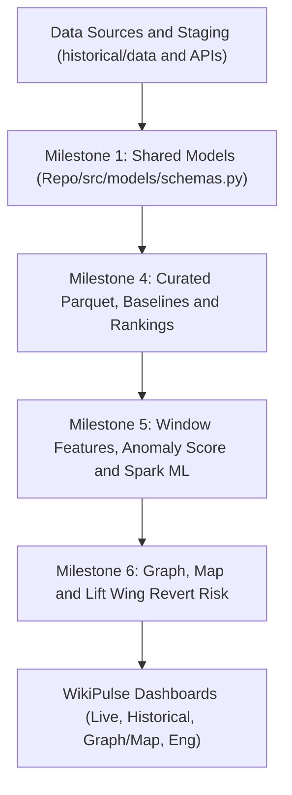

# WikiPulse: Comprehensive Project Plan & Cross-Check (Milestone 1 & Milestones 4–6)

**Project:** WikiPulse — Real-Time Detection and Analysis of Wikipedia Knowledge Shifts  
**Course:** DA231o — Data Engineering at Scale (IISc)  
**Codebase Location:** `Repo/src/` (while `historical/` is strictly for raw data collection)

---

## 1. Current Status & Cross-Check Against Proposal Milestones

### 1.1 Full Milestone Matrix (Proposal vs. Current State)

| Week / Milestone | Planned Work (from Proposal) | Expected Milestone | Current Status | Where It Lives / Will Live |
| :---: | :--- | :--- | :---: | :--- |
| **1** | **Confirm APIs, event schema, and dashboard specs.** | **Feasibility and shared data model complete.** | 🟢 **Complete** | • Formal PySpark/Python shared data models (`Repo/src/models/schemas.py`), API contract registry (`Repo/src/config/settings.py`), and formal Dashboard Specs (`Repo/docs/milestone1_specs_and_models.md`). |
| **2** | Build Kafka ingestion, raw storage, and replay tool. | Events live in Kafka and Parquet. | 🟢 **Complete** | • Historical raw JSONL.gz collected in `historical/data/` (46 days, `Sept 15 – Oct 30`).<br/>• Kafka ingestion (`Repo/src/collector.py`), replay (`Repo/src/replay/`), and Curated Parquet writer (`Repo/src/historical/ingest_curate.py`). |
| **3** | Build Spark streaming windows and live metrics. | First live dashboard operational. | 🟢 **Complete** | • Streaming & batch 5-min & 1-hr Spark window engines (`Repo/src/stream_measurements.py`, `Repo/src/anomaly/window_features.py`, `Repo/src/detection/`) and Dash UI (`Repo/dashboards/`). |
| **4** | **Build historical ingestion, baselines, and rankings.** | **Historical comparison enabled.** | 🟢 **Complete** | • Built & verified in `Repo/src/historical/` (`ingest_curate.py`, `build_baselines.py`, `rankings_benchmark.py`). |
| **5** | **Implement anomaly scoring and Spark ML tests.** | **Repeatable alerts detected and evaluated.** | 🟢 **Complete** | • Built & verified in `Repo/src/anomaly/` (`window_features.py`, `scoring_sparkml.py`, `evaluate_alerts.py`). |
| **6** | **Add contextual features (graph, map, Revert Risk).** | **End-to-end investigation flow ready.** | 🟢 **Complete** | • Built & verified in `Repo/src/enrichment/` (`graph_and_diffs.py`, `geospatial_map.py`, `revert_risk_monitor.py`) and `Repo/src/dashboard/app.py` + `Repo/dashboards/`. |
| **7** | **Execute scaling, load, and failure-recovery tests.** | **Engineering scale results finalized.** | 🟢 **Complete** | • Built & verified in `Repo/src/benchmarks/` (`scaling_experiments.py`, `load_and_recovery_benchmark.py`) and rendered on `/system` (`Repo/dashboards/pages/system.py`). |
| **8** | **Finalize integration, report, and backup demo.** | **Reproducible system and presentation ready.** | 🟢 **Complete** | • Built & verified in `Repo/src/demo/backup_demo.py`, `Repo/docs/final_project_report.md`, `Repo/docs/presentation_and_demo_guide.md`, and `Repo/README.md`. |

---

## 2. Target Architecture Across Milestones 1 & 4–6



#### Architecture Diagram (Text / ASCII View)

```text
┌───────────────────────────────────────────────────────────┐
│             DATA SOURCES & STAGING (historical/)          │
│  - enwiki_recentchanges/rc_*.jsonl.gz (Sept 15 – Oct 31)  │
│  - analytics/ (Pageviews, Edits, Bytes REST APIs)         │
│  - MediaWiki Action API (Compare, Links, Coords)          │
│  - Wikidata API & Lift Wing Revert Risk ML API            │
└─────────────────────────────┬─────────────────────────────┘
                              │
                              ▼
┌───────────────────────────────────────────────────────────┐
│        MILESTONE 1: SHARED DATA MODELS & API SPECS        │
│                   (Repo/src/models/)                      │
│  - 5 Core Schemas: RawEdit, PageWindow,                   │
│    HistoricalBaseline, Alert, GraphEdge (+ Map & Risk)    │
│  - Confirmed API Contracts & 4 Dashboard Specifications   │
└─────────────────────────────┬─────────────────────────────┘
                              │
                              ▼
┌───────────────────────────────────────────────────────────┐
│     MILESTONE 4: CLEANUP, BASELINES & RANKINGS ENGINE     │
│                 (Repo/src/historical/)                    │
│  - Deduplicate Sept 26-27 overlap & filter 'categorize'   │
│  - Write partitioned Parquet lake (curated/rc_events)     │
│  - Compute rolling 14d/21d per-page baselines + priors    │
│  - Generate Churn/Bot rankings & RDD vs DF benchmark      │
└─────────────────────────────┬─────────────────────────────┘
                              │
                              ▼
┌───────────────────────────────────────────────────────────┐
│       MILESTONE 5: ANOMALY SCORING & SPARK ML TESTS       │
│                  (Repo/src/anomaly/)                      │
│  - 5-min & 1-hr window aggregations joined with baseline  │
│  - Detector A: Fixed Threshold (>=6/5m or >=15/1h)        │
│  - Detector B: Explainable Historical Score (>=2 reasons) │
│  - Detector C: Spark ML Pipeline (KMeans / GBT / RF)      │
│  - Synthetic pattern injector & false-alert evaluator     │
└─────────────────────────────┬─────────────────────────────┘
                              │
                              ▼
┌───────────────────────────────────────────────────────────┐
│    MILESTONE 6: CONTEXTUAL ENRICHMENT & INVESTIGATION     │
│        (Repo/src/enrichment/ & Repo/src/dashboard/)       │
│  - Link/Backlink Graph & Co-edit Spillover + Diffs (>=90%)│
│  - Geospatial Subject Map (Wiki Coords + Wikidata, no IP) │
│  - Lift Wing Revert Risk (>=95%) vs Later Revert Outcomes │
│  - End-to-End Investigation Dashboard (<2s query time)    │
└───────────────────────────────────────────────────────────┘
```

---

## 3. Repository Structure Inside `Repo/src/`

All production code will live inside `Repo/src/`, while `historical/` remains the data collection utility folder:

```text
Repo/
├── README.md
├── docs/
│   └── milestone1_specs_and_models.md   # Confirmed APIs, schemas & 4 dashboard specs
└── src/
    ├── __init__.py
    ├── config/
    │   ├── __init__.py
    │   └── settings.py                  # Paths to historical/data, Spark configs, API endpoints
    ├── models/
    │   ├── __init__.py
    │   └── schemas.py                   # Milestone 1: Formal PySpark StructTypes for all 5+ models
    ├── historical/
    │   ├── __init__.py
    │   ├── ingest_curate.py             # Milestone 4.1: Deduplicate rc_*.jsonl.gz -> Parquet lake
    │   ├── build_baselines.py           # Milestone 4.2: Per-page baselines + Analytics API join
    │   └── rankings_benchmark.py        # Milestone 4.3: Churn/Bot rankings + RDD vs DF + JSON vs Parquet
    ├── anomaly/
    │   ├── __init__.py
    │   ├── window_features.py           # Milestone 5.1: 5m & 1h window feature extraction
    │   ├── scoring_sparkml.py           # Milestone 5.2: Fixed vs Historical Score vs Spark ML
    │   └── evaluate_alerts.py           # Milestone 5.3: Synthetic pattern injection & evaluation
    ├── enrichment/
    │   ├── __init__.py
    │   ├── graph_and_diffs.py           # Milestone 6.1: Links/backlinks graph & revision compare diffs
    │   ├── geospatial_map.py            # Milestone 6.2: Subject coordinates + Wikidata fallback
    │   └── revert_risk_monitor.py       # Milestone 6.3: Lift Wing ML scoring & revert calibration
    └── dashboard/
        ├── __init__.py
        └── app.py                       # Milestone 6.4: End-to-end Streamlit investigation flow
```

---

## 4. Milestone 1 Plan (Immediate Task While Collection Finishes)
**Goal:** *Confirm APIs, event schema, and dashboard specs. Feasibility and shared data model complete.*

### 4.1 Confirm APIs & Rate/Retention Contracts (`Repo/src/config/settings.py`)
Consolidate all verified Wikimedia endpoints tested in `wikipulse-wikimedia-apis.postman_collection.json` and `wikipulse_idea_gap_analysis.md`:
1. **Live & Replay Stream:** EventStreams SSE (`recentchange`, `page_revert_risk_prediction_change.v1`).
2. **Historical Revision / Change Feed:** MediaWiki Action API `list=recentchanges` (`rcprop=title|ids|sizes|flags|user|userid|comment|timestamp|tags|loginfo|sha1`, ~30d retention) and `list=allrevisions`.
3. **Historical Aggregate & Pageview Series:** Wikimedia REST Analytics API (`edits/per-page`, `bytes-difference/absolute`, `bytes-difference/net`, `pageviews/per-article` daily, `pageviews/top`).
4. **Contextual Investigation APIs:**
   - Revision Diffs: `action=compare&fromrev={parentid}&torev={revid}&prop=diff|size|ids`
   - Topic Graph: `action=query&prop=links|linkshere` (500/call pagination)
   - Subject Coordinates & QID: `action=query&prop=coordinates|pageprops` (50 titles/call)
   - Wikidata Spatial Fallback: `wbgetentities` (`P625` coords, `P276` location, `P17` country, `P131` region)
   - ML Revert Risk: Lift Wing `enwiki-revertrisk-language-agnostic:predict`

### 4.2 Formalize Shared Data Models (`Repo/src/models/schemas.py`)
Define strict PySpark `StructType` schemas and validation contracts for all models specified in the Proposal:
1. **`RAW_EDIT_SCHEMA` (`Raw edit`):**
   - `rcid` (Long, PK), `revid` (Long), `old_revid` (Long), `pageid` (Long), `ns` (Int), `title` (String), `type` (String: `edit|new|log`), `ts` (Timestamp UTC), `day` (Date), `hour` (Timestamp), `user` (String), `userid` (Long), `is_bot` (Boolean), `is_anon` (Boolean, `temp` or `~` prefix), `is_minor` (Boolean), `oldlen` (Long), `newlen` (Long), `delta` (Long), `abs_delta` (Long), `is_revert` (Boolean), `sha1` (String), `comment` (String), `tags` (Array[String]).
2. **`PAGE_WINDOW_SCHEMA` (`Page windows`):**
   - `window_id` (String, PK), `window_start` (Timestamp), `window_end` (Timestamp), `window_duration` (String: `5m|1h`), `pageid` (Long), `ns` (Int), `title` (String), `edits_total` (Long), `edits_human` (Long), `edits_bot` (Long), `edits_anon` (Long), `distinct_human_editors` (Long), `gross_bytes` (Long), `net_bytes` (Long), `rewriting_bytes` (Long), `reverts_count` (Long), `revert_ratio` (Double), `velocity_zscore` (Double), `editor_surge_ratio` (Double), `churn_zscore` (Double).
3. **`HISTORICAL_BASELINE_SCHEMA` (`Historical baseline`):**
   - `pageid` (Long, PK), `ns` (Int), `title` (String), `baseline_start_date` (Date), `baseline_end_date` (Date), `days_observed` (Int), `last_available_date` (Date), `has_missing_data` (Boolean), `activity_tier` (String), `avg_daily_edits` (Double), `std_daily_edits` (Double), `avg_hourly_edits` (Double), `std_hourly_edits` (Double), `avg_distinct_editors_daily` (Double), `avg_gross_bytes_daily` (Double), `avg_net_bytes_daily` (Double), `baseline_revert_ratio` (Double), `baseline_bot_ratio` (Double), `avg_daily_pageviews` (Double), `last_pageview_date` (Date).
4. **`ALERT_SCHEMA` (`Alerts`):**
   - `alert_id` (String, deterministic hash PK for idempotency), `window_start` (Timestamp), `window_end` (Timestamp), `window_duration` (String), `pageid` (Long), `title` (String), `alert_type` (String: `BREAKING_NEWS_CANDIDATE|CONFIRMED_NEWS|EDIT_WAR_CONTROVERSY|MAJOR_REWRITE`), `fixed_threshold_flag` (Boolean), `historical_score` (Double), `spark_ml_score` (Double), `pageview_corroborated` (Boolean), `reasons` (Array[String], $\ge 2$ required), `feature_contributions` (Map[String, Double]), `has_location` (Boolean).
5. **`GRAPH_EDGE_SCHEMA` (`Graph edge`) + Contextual Tables (`MAP_POINT_SCHEMA`, `REVERT_RISK_SCHEMA`):**
   - `Graph edge`: `source_pageid`, `source_title`, `target_pageid`, `target_title`, `edge_type` (`outlink|backlink`), `co_edited_in_window` (Boolean), `target_edits_in_window` (Long), `snapshot_ts` (Timestamp).
   - `Map point`: `pageid`, `title`, `alert_id`, `wikibase_item`, `lat` (Double), `lon` (Double), `country` (String), `location_source` (String), `location_quality` (String).
   - `Revert risk`: `revid`, `pageid`, `title`, `ts`, `user`, `is_anon`, `delta`, `ml_revert_risk` (Double), `heuristic_risk` (Double), `composite_risk` (Double), `api_status` (String), `is_reverted_actual` (Boolean), `time_to_revert_sec` (Long), `reverter_is_bot` (Boolean).

### 4.3 Formalize the 4 Dashboard Specifications (`Repo/docs/milestone1_specs_and_models.md`)
Per the Proposal (*"The final deliverables will feature live, historical, graph/map, and engineering dashboards"*):
1. **View 1 — Live & Replay Alert Dashboard:** Real-time/replay 5-min & 1-hr alert feed, 3-detector comparison (Fixed vs. Historical vs. Spark ML), $\ge 2$ explainable reasons per alert, and Breaking News corroboration status.
2. **View 2 — Historical Baselines & Churn Rankings Dashboard:** Per-page 30-day activity vs. baseline band ($\mu \pm 2\sigma$), delayed pageview overlay (with `last_available_date` and missing-data indicators), plus Knowledge Churn, Rewriting, and Human-vs-Bot leaderboards.
3. **View 3 — Graph, Map & Edit-Risk Investigation Dashboard:** Related-page link/backlink spillover graph, side-by-side revision diffs (`>=90%` valid), Global Subject Map (with `location_source` & `location_quality`, preserving unlocated alerts), and Lift Wing Revert Risk threshold calibration vs. actual reverts.
4. **View 4 — Engineering & Scale Benchmarks Dashboard:** JSONL.gz vs. Parquet storage & query latency ($<2\text{s}$ target), RDD vs. DataFrame aggregation runtime/shuffle, event acceptance rate ($\ge 99\%$), and synthetic anomaly recall / idempotency results.

---

## 5. Data Cleanup & Milestones 4, 5, and 6 Implementation Plan

### Phase A: Data Collection Completion & Cleanup (Starts as soon as current run finishes)
1. **Finish Remaining Window:** Wait for `2026-10-28..31` to complete, then resume the incomplete `2026-10-27` checkpoint (`16:52 UTC` $\rightarrow$ `24:00 UTC`, ~7 hours left).
2. **Run `Repo/src/historical/ingest_curate.py`:**
   - Read all `historical/data/enwiki_recentchanges/rc_*.jsonl.gz`.
   - Deduplicate by `rcid` (cleaning up the Sept 26–27 duplicate overlap).
   - Filter out `categorize` noise (~40% of raw feed), enforce `RAW_EDIT_SCHEMA`, and write partitioned Parquet to `historical/data/curated/rc_events/`.
   - Log raw vs. accepted counts ($\ge 99\%$ acceptance metric) and JSONL.gz vs. Parquet storage sizes.

### Phase B: Milestone 4 — Historical Baselines & Rankings (`Repo/src/historical/`)
1. **`build_baselines.py`:**
   - Compute per-page baselines over the baseline period (Sept 15 – Oct 05, plus rolling 14-day windows) with namespace fallback priors for quiet pages.
   - Fetch/join Wikimedia Analytics daily pageviews & byte-differences for candidate pages, recording `last_available_date` and `has_missing_data`.
   - Write `historical/data/curated/page_baselines/` conforming to `HISTORICAL_BASELINE_SCHEMA`.
2. **`rankings_benchmark.py`:**
   - Compute daily & multi-day rankings: Gross Churn, Net Growth, Rewriting Volume ($\sum |\Delta| - |\sum \Delta|$), Contributor Diversity, and Human vs. Bot split.
   - Validate Spark churn totals against a deterministic pure-Python manual sample calculation.
   - Run and log the **RDD vs. DataFrame** aggregation benchmark and **JSON vs. Parquet** query time benchmark ($<2\text{s}$ verification).

### Phase C: Milestone 5 — Anomaly Scoring & Spark ML (`Repo/src/anomaly/`)
1. **`window_features.py`:**
   - Build 5-minute and 1-hour page windows (`PAGE_WINDOW_SCHEMA`) joined with `page_baselines`.
2. **`scoring_sparkml.py`:**
   - Run **Detector A** (Fixed threshold), **Detector B** (Historical Knowledge-Shift Score with $\ge 2$ human-readable `reasons` and News vs. Edit-War classification), and **Detector C** (Spark ML `VectorAssembler` $\rightarrow$ `StandardScaler` $\rightarrow$ `KMeans` & `RandomForestClassifier`).
3. **`evaluate_alerts.py`:**
   - Inject 5 deterministic knowledge-shift patterns into a test slice and verify 100% detection with $\ge 2$ reasons each.
   - Compare false-alert rates across Detectors A, B, and C on a reviewed sample, and verify 0 duplicate alerts on replay restart.

### Phase D: Milestone 6 — Contextual Features & Investigation Flow (`Repo/src/enrichment/` & `dashboard/`)
1. **`graph_and_diffs.py`:**
   - Fetch `links` and `linkshere` for alerted pages, detect co-edited neighbors (`GRAPH_EDGE_SCHEMA`), and fetch revision diffs via `action=compare` (verifying $\ge 90\%$ usable change data).
2. **`geospatial_map.py`:**
   - Resolve article subject locations via Tier 1 (Wikipedia `coordinates`) and Tier 2 (Wikidata `P625`/`P276`/`P17`/`P131` via `wikibase_item`), tagging every point with `location_source` and `location_quality` while keeping unlocated alerts valid.
3. **`revert_risk_monitor.py`:**
   - Score sampled & alerted revisions via Lift Wing Revert Risk API (with heuristic fallback & $\ge 95\%$ response verification), match against actual later reverts (`mw-reverted` / `mw-rollback` / `mw-undo` / `sha1`), and evaluate Precision/Recall across thresholds vs. `0.80`.
4. **`dashboard/app.py`:**
   - Build the unified Streamlit application implementing all 4 Dashboard Views over the curated Parquet tables.
