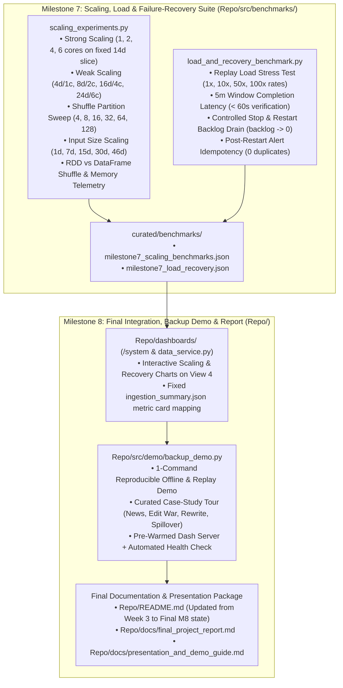

# WikiPulse — Evaluation through Milestone 6 & Implementation Plan for Milestones 7 and 8

**Project:** WikiPulse — Real-Time Detection and Analysis of Wikipedia Knowledge Shifts  
**Course:** DA231o — Data Engineering at Scale (IISc)  

---

## 1. Evaluation of Current State (Milestones 1–6 Audit vs. Proposal)

Across Milestones 1 through 6, all core data models, historical batch pipelines, streaming detectors, contextual enrichment modules, and interactive dashboards have been built and verified against the 46-day English Wikipedia dataset (`2026-09-15` to `2026-10-30`, **14,398,713** raw events $\rightarrow$ **8,428,021** curated events).

### 1.1 Proposal Scorecard: What Is Complete vs. What Remains for Milestones 7 & 8

| Proposal Category | Proposal Requirement | Current Status (Through M6) | Remaining Work in M7 / M8 |
| :--- | :--- | :---: | :--- |
| **Exp #1** | Validate Spark calculations against manual sample & replay | 🟢 **Done** (`2,000`-event exact match + replay hash parity) | Include in final M8 consolidated evaluation matrix |
| **Exp #2** | Compare Fixed Threshold (A), Historical Score (B), and Spark ML (C) | 🟢 **Done** (False-alert rate: A `68.8%` $\rightarrow$ B `10.7%` $\rightarrow$ C `0.3%`) | Surface side-by-side in final report & demo |
| **Exp #3** | Compare one useful aggregation using RDDs and DataFrames | 🟢 **Done** (DF `1.34s` vs. RDD `2.72s`, `2.03x` speedup) | Add shuffle & memory telemetry in M7 benchmark suite |
| **Exp #4** | **Change partitions, workers, and input size to measure shuffle, strong scaling, and weak scaling** | 🟡 **Pending M7** | **M7.1:** Run systematic Strong Scaling, Weak Scaling, Partition/Shuffle Sweep, and Input-Size Scaling experiments |
| **Exp #5** | **Stop and restart processing to measure backlog recovery and duplicate handling** | 🟡 **Partial** (Unit test + batch replay idempotency done) | **M7.2:** Execute full streaming stop/restart experiment measuring Kafka/stream backlog drain (`backlog -> 0`), catch-up throughput, and `0` duplicates |
| **Exp #6** | Compare JSON and Parquet size and dashboard query time | 🟢 **Done** (`977.7 MB` JSONL.gz vs. `1,011.4 MB` full / `214 MB` pruned; queries `0.15s–0.89s < 2.0s`) | Include in M7/M8 engineering dashboard & report |
| **Perf #3 & #4** | **5m window result `< 1 min` under target load; `processing_rate >= input_rate`; backlog returns to `0` after restart** | 🟡 **Pending M7** | **M7.2:** Run multi-speed load test (`1x`, `10x`, `50x`, `100x`) and controlled restart backlog recovery benchmark |
| **Perf #5** | **Report runtime, shuffle, memory, and storage size for every scale experiment** | 🟡 **Pending M7** | **M7.1 & M7.3:** Instrument JVM/Python peak RSS, Spark stage shuffle read/write bytes, wall-clock runtime, and storage bytes |
| **M6/M7 Bridge** | `/system` dashboard (`data_service.py`) key alignment | 🟡 **Minor Fix** | Map `total_raw_events` / `curated_deduplicated_events` in `data_service.py` and render M7 scaling & recovery charts on `/system` |
| **Milestone 8** | **Finalize integration, report, and backup demo** | ⚪ **Pending M8** | **M8.1–M8.4:** Update `Repo/README.md`, build 1-command offline/replay backup demo, write final report & presentation guide |

---

## 2. Architecture of Milestones 7 & 8 Additions

---

## 3. Milestone 7 Implementation Plan: Scaling, Load & Failure-Recovery Tests

**Goal:** *Execute scaling, load, and failure-recovery tests. Engineering scale results finalized.*

### 3.1 Module 1: `Repo/src/benchmarks/scaling_experiments.py`
Measures **runtime**, **shuffle read/write bytes** (collected via Spark's `StatusTracker` / REST stage metrics `/api/v1/applications`), **peak memory** (Python driver + JVM child RSS via `resource` / `ps`), and **storage footprint** across four controlled experiments on our real curated dataset:

1. **Strong Scaling Experiment (`local[1]`, `local[2]`, `local[4]`, `local[6]`):**
   - **Workload:** Fixed 14-day slice of `curated/rc_events` (`~2.6M` edits) running the full window aggregation + baseline join + Detector A/B scoring pipeline.
   - **Metrics Recorded:** Wall-clock runtime $T_p$, speedup $S_p = T_1 / T_p$, parallel efficiency $E_p = S_p / p$, shuffle write/read MB, peak JVM+Python RSS MB, and output Parquet size MB.
2. **Weak Scaling Experiment (`4 days @ 1 core`, `8 days @ 2 cores`, `16 days @ 4 cores`, `24 days @ 6 cores`):**
   - **Workload:** Constant workload per core (`4 days / core`, `~730k` edits/core).
   - **Metrics Recorded:** Wall-clock runtime $T_p$, weak-scaling efficiency $E_{\text{weak}} = T_1 / T_p$, throughput (`rows/sec`), shuffle write/read MB, and peak memory MB.
3. **Shuffle Partition Sweep (`spark.sql.shuffle.partitions` $\in \{4, 8, 16, 32, 64, 128\}$):**
   - **Workload:** Fixed 14-day window + baseline join aggregation on `local[6]`.
   - **Metrics Recorded:** Runtime (sec), shuffle write/read bytes, average partition size, and task scheduling overhead, empirically justifying why `16` partitions is optimal on our 6-core / 8 GB unified memory host.
4. **Input-Size Scaling & RDD vs. DataFrame Telemetry (`1d`, `7d`, `15d`, `30d`, `46d`):**
   - **Workload:** Scales input from `1 day` (`~183k` rows) to the full `46 days` (`8,428,021` rows), plus records stage shuffle/memory metrics for the 7-day RDD vs. DataFrame churn comparison.
   - **Output Artifact:** `historical/data/curated/benchmarks/milestone7_scaling_benchmarks.json`.

### 3.2 Module 2: `Repo/src/benchmarks/load_and_recovery_benchmark.py`
Directly validates Proposal Experiment #5 and Performance Metrics #2, #3, and #4 using Spark Structured Streaming (`stream_measurements.py` + `detection` / Milestone 5 window scoring):

1. **Multi-Speed Streaming Load & Window Finalization Latency Test:**
   - Replays a real historical slice of Wikipedia edits through the watermarked 5-minute streaming window pipeline across replay multipliers `1x` (normal Wikipedia load, ~65–90 edits/sec), `10x`, `50x`, and `100x` burst load.
   - Records `inputRowsPerSecond`, `processedRowsPerSecond` (verifying `processing_rate >= input_rate`), microbatch `triggerExecution` duration (`ms`), and **closed 5-minute window finalization latency** (verifying `< 60 seconds`, Proposal Performance Metric #3).
2. **Controlled Stop/Restart, Backlog Drain & Duplicate-Alert Recovery Test:**
   - **Baseline Reference Run:** Processes a 6-batch historical stream continuously without interruption and records the exact set of finalized windows and `alert_id`s.
   - **Interrupted Run with Backlog Accumulation:**
     1. **Phase 1 (Normal Run):** Processes Batches `1..3` and commits checkpoints.
     2. **Phase 2 (Simulated Failure & Backlog Injection):** Stops the streaming query cleanly; injects Batches `4..6` **plus 25% duplicate re-sent events** into the pending input backlog while the processor is offline (measuring pre-restart backlog count).
     3. **Phase 3 (Controlled Restart & Catch-Up):** Restarts the streaming query from its checkpoint; tracks per-batch backlog reduction until **`backlog == 0`**, measures catch-up time (`sec`) and catch-up processing rate (`rows/sec`), and compares post-restart alerts against the uninterrupted reference run:
        - `duplicate_alerts_after_restart == 0`
        - `missing_alerts_after_restart == 0`
        - `final_backlog_count == 0`
   - Supports an optional `--with-kafka` flag when Docker Kafka is running, while always executing the full checkpointed Spark Structured Streaming recovery test deterministically.
   - **Output Artifact:** `historical/data/curated/benchmarks/milestone7_load_recovery.json`.

### 3.3 Module 3: Engineering Dashboard (`/system`) Upgrade
- Update `Repo/dashboards/data_service.py` to map `total_raw_events`, `valid_non_categorize_raw_events`, and `curated_deduplicated_events` from `ingestion_summary.json` so the top-level KPI cards on `/system` always populate cleanly.
- Enhance `Repo/dashboards/pages/system.py` and `Repo/dashboards/charts.py` to render dedicated visual panels for:
  1. **Strong & Weak Scaling Curves** (Runtime, Speedup & Throughput vs. Cores/Data Size)
  2. **Shuffle Partition Sweep & RDD vs. DataFrame Telemetry**
  3. **Controlled Restart Backlog Recovery & Load Test Summary**

---

## 4. Milestone 8 Implementation Plan: Final Integration, Report & Backup Demo

**Goal:** *Finalize integration, report, and backup demo. Reproducible system and presentation ready.*

### 4.1 Module 1: Turnkey Backup Demo & Case-Study Walkthrough (`Repo/src/demo/backup_demo.py`)
To guarantee a resilient live presentation even without internet or Docker access:
- Builds a single-command runner (`.venv/bin/python3 Repo/src/demo/backup_demo.py`) supporting:
  - `--verify`: Runs a fast (<15s) pre-flight check across all 11 curated Parquet tables, all 11 benchmark JSONs (Milestones 4–7), and all 5 dashboard routes.
  - `--walkthrough`: Prints a rich, presentation-ready terminal walkthrough of **4 real Wikipedia Knowledge-Shift Case Studies** extracted from our 46-day dataset (showing exact window metrics, Detector A vs. B vs. C scores, $\ge 2$ explainable reasons, revision diff snippets, co-edited graph neighbors, geospatial coordinates, and Lift Wing revert-risk scores).
  - `--serve` (default): Launches the pre-warmed Dash + Plotly server at `http://127.0.0.1:8080` with instant (`< 1s`) cached view switching.

### 4.2 Module 2: Final Project Report (`Repo/docs/final_project_report.md`)
A comprehensive, publication-grade final report structured for the DA231o course evaluation:
1. **Executive Summary & Problem Statement**
2. **System Architecture & Shared Data Model** (8 canonical PySpark schemas, Medallion / Lambda-style batch + streaming unification)
3. **Data Collection & Engineering Hygiene** (46-day dataset, `USER_AGENT` compliance, multi-member gzip stream recovery, Sept 26–27 overlap deduplication)
4. **Methodology & Algorithms** (Zero-inclusive per-page baselines, Detectors A/B/C, 2-tier subject geospatial resolution, Lift Wing ML + 48h revert calibration)
5. **Complete Experimental Evaluation (All 6 Proposal Experiments + 14 Success Metrics):**
   - Complete tables and analysis for Experiments #1–#6, Performance Metrics #1–#6, and Feature Metrics #1–#8.
6. **Real-World Case Studies & Limitations / Future Work**

### 4.3 Module 3: Presentation & Demo Runbook (`Repo/docs/presentation_and_demo_guide.md`) + `Repo/README.md` Update
- **`Repo/docs/presentation_and_demo_guide.md`:** Slide-by-slide outline (10–12 slides) with key talking points, architecture diagrams, headline numbers, and a step-by-step 5-minute live/backup demo script across all 5 dashboard views (`/`, `/investigation`, `/historical`, `/relationships`, `/system`).
- **`Repo/README.md`:** Replace outdated Week 3 "Remaining work" notes with the complete, unified Milestone 1–8 architecture, quickstart commands (Live stack, Curated Lake pipeline, Backup Demo, and Test Suite), and summary of verified results.
- **Update Master Tracking Docs:** Update `wikipulse_milestones_4_5_6_plan.md` and `Repo/docs/implementation_review_milestones_1_and_4.md` to reflect all 8 milestones.

### 4.4 Module 4: Automated Regression & Integration Tests (`Repo/tests/test_milestone7_8.py`)
- Unit and integration tests verifying:
  - `milestone7_scaling_benchmarks.json` and `milestone7_load_recovery.json` schema and metric thresholds (`duplicate_alerts_after_restart == 0`, `window_finalization_latency_sec < 60.0`, `backlog_after_recovery == 0`).
  - `/system` dashboard rendering with the new scaling and recovery charts and populated ingestion KPI cards.
  - `backup_demo.py --verify` and `--walkthrough` execution.

---

## 5. Verification & Acceptance Criteria for Milestones 7 & 8

1. **Scaling Benchmark Completeness:** Runtime, shuffle bytes, peak memory (MB), and storage footprint (MB) recorded for Strong Scaling (`1, 2, 4, 6` cores), Weak Scaling (`4d..24d`), Partition Sweep (`4..128`), and Input Size (`1d..46d`).
2. **Load & Window Latency Target:** Closed 5-minute window produces its result in **`< 60 seconds`** under target load, with `processing_rate >= input_rate`.
3. **Failure Recovery & Idempotency Target:** Controlled stop/restart drains backlog to **`0`** with **`0` duplicate alerts** and **`0` lost alerts**.
4. **End-to-End Test Suite:** All existing 42 unit tests + new Milestone 7/8 tests pass (`100% OK`), and all 5 Dash routes render under `< 2.0s` query latency.

