# WikiPulse — Presentation Deck Outline & Live / Backup Demo Runbook (Milestone 8)

**Project:** WikiPulse — Real-Time Detection and Analysis of Wikipedia Knowledge Shifts  
**Course:** DA231o — Data Engineering at Scale (IISc)  
**Team:** QuadCore (Kshama Jain, Senthil Raj K, Pothukanuri Sai Venkat, Akash H S)

---

## 1. 12-Slide Presentation Deck Structure & Key Talking Points

### Slide 1 — Title & Project Vision
- **Title:** *WikiPulse: Real-Time Detection and Analysis of Wikipedia Knowledge Shifts*
- **Core Thesis:** Wikipedia edits reflect breaking news, scientific discoveries, and public controversies within seconds, but raw signals are fragmented across high-velocity edit streams, historical baselines, topic graphs, and ML revert models.
- **What We Built:** An end-to-end distributed data platform (Kafka + PySpark Structured Streaming & Batch + Spark ML + Dash/Plotly) validated on **55 days** of English Wikipedia history (**17.44M raw events $\rightarrow$ 10.19M curated edits**).

### Slide 2 — Why Fixed Rules Fail (Motivation)
- **The Problem with Naive Thresholds:** A static rule like *"$\ge 6$ edits in 5 minutes"* fails in two opposite directions:
  1. **Hyperactive pages** (e.g., *Deaths in 2026*, *2026 in sports*) routinely receive 6+ edits every 5 minutes, causing **68.81% false alerts**.
  2. **Quiet specialized articles** (normally 0.1 edits/day) experiencing a genuine 5-edit multi-editor surge are missed completely (`60%` recall on synthetic patterns).
- **Our Solution:** Normalize every 5-minute and 1-hour window against **per-page zero-inclusive historical baselines** ($\mu, \sigma$), corroborate with delayed daily pageviews, and separate constructive breaking news from revert wars.

### Slide 3 — End-to-End System Architecture

```mermaid
flowchart LR
    subgraph Sources["Wikimedia Data Sources"]
        ES["EventStreams SSE & MediaWiki API (46d, 14.4M raw)"]
        AN["Analytics REST API (Pageviews & Bytes)"]
        CTX["Compare Diffs, Links/Backlinks, Coords, Wikidata & Lift Wing ML"]
    end
    subgraph Processing["Distributed Ingestion & Processing (PySpark & Kafka)"]
        ING["Kafka + Curated Parquet Lake (8.43M events, 100% valid retention)"]
        BASE["Per-Page Baselines (1.80M pages, 21d rolling)"]
        WIN["5m & 1h Page Windows (539,709 windows)"]
        DET["Detectors A (Fixed), B (Historical Score) & C (Spark ML)"]
        ENR["Contextual Enrichment (Graph, Diffs, Subject Geo, Revert Risk)"]
    end
    subgraph UI["WikiPulse 5-Screen Dash + Plotly App (< 0.9s Latency)"]
        V1["1. Live & Replay Radar"]
        V2["2. Investigation & Diffs"]
        V3["3. Historical & Churn"]
        V4["4. Graph & Subject Map"]
        V5["5. Engineering & Scale"]
    end
    Sources --> Processing --> UI
```


### Slide 4 — Shared Data Model (8 Canonical PySpark Schemas)
- Enforced across both batch and streaming pipelines in [`Repo/src/models/schemas.py`](file:///Users/senthilrajk/Downloads/002_IISc_DSBA/Data%20Engineering%20at%20Scale/Project-WikiPulse/Repo/src/models/schemas.py):
  1. `RAW_EDIT_SCHEMA` (`curated/rc_events`: `10,190,119` rows across 55 days)
  2. `HISTORICAL_BASELINE_SCHEMA` (`curated/page_baselines`: `3,307,257` pages across 47 baseline days)
  3. `PAGE_WINDOW_SCHEMA` (`page_windows_5m`: `113,754` rows; `page_windows_1h`: `60,714` rows across 8 evaluation days)
  4. `ALERT_SCHEMA` (`curated/alerts`: `1,321` high-confidence alerts, deterministic SHA-256 `alert_id`)
  5. `GRAPH_EDGE_SCHEMA` (`curated/graph_edges`: `606` directed edges, `35.3%` co-edited spillover)
  6. `REVISION_DIFF_SCHEMA` (`curated/revision_diffs`: `100` pairs, `100%` usable change data)
  7. `MAP_POINT_SCHEMA` (`curated/map_points`: `158` articles, `76.9%` located, `0` editor IPs)
  8. `REVERT_RISK_SCHEMA` (`curated/revert_risk_eval`: `120` revisions, `100%` Lift Wing + fallback coverage)

### Slide 5 — Data Engineering Hygiene & Curated Lake (Milestone 4)
- **Real-World Failure Modes Solved:**
  1. Recovered a truncated multi-member gzip stream in `rc_2026-10-27.jsonl.gz` (`269,017` rows salvaged with zero loss).
  2. Deduplicated overlapping collection windows on Sept 26–27 by `rcid` and filtered out `categorize` noise (`41.47%` of raw stream).
  3. Staged Parquet writes via `/tmp` (`safe_write_parquet`) and filtered `*.parquet` (`safe_read_parquet`) to prevent macOS Finder `Icon\r` files from breaking Hadoop `_temporary` commits.
- **Manual Churn Audit:** 100% exact match between pure-Python stdlib and Spark DataFrame (`gross_churn = 2,024,277 B`, `rewriting_bytes = 1,179,254 B`).

### Slide 6 — Multi-Detector Anomaly Scoring & Spark ML (Milestone 5)
- **Detector A (Fixed Rule):** `885` flags (`68.81%` false-alert rate for breaking news due to edit wars; `60%` synthetic recall).
- **Detector B (Explainable Historical Score `0–100`):** Combines velocity $z$-score (`35 pts`), editor surge (`25 pts`), byte churn (`20 pts`), consensus/dispute (`10 pts`), and pageview corroboration (`10 pts`).
  - **100% synthetic recall (`5/5`)**, $\ge 2$ human-readable reasons on 100% of alerts (`avg 4.03`), and exact additive parity (`sum(feature_contributions) == historical_score`).
  - Reduces false-alert rate from **`68.81%` $\rightarrow$ `10.72%`** (`2.69%` on reviewed 200-window sample).
- **Detector C (Spark ML `KMeans(k=8)` + `RandomForestClassifier`):** Achieves **`99.71%` precision** (`0.29%` false-alert rate; Silhouette `0.4229`).

### Slide 7 — Contextual Investigation: Topic Graph & Revision Diffs (Milestone 6.1)
- **Topic Spillover Graph:** `607` directed outlink/backlink edges around alerted articles; **`195` (`32.13%`)** show synchronized co-editing spillover within $+1\text{h}$.
- **Revision Diffs (`action=compare`):** `90.0%` live HTML diff table extraction + `10.0%` revision metadata fallback on suppressed revisions = **`100.0%` usable change data** (exceeding the $\ge 90\%$ Proposal target).

### Slide 8 — Ethical Article-Subject Geospatial Mapping (Milestone 6.2)
- **Strict Privacy Design:** Editor IP addresses are never used.
- **2-Tier Subject Resolver:**
  - Tier 1: Wikipedia `prop=coordinates|pageprops` (`29` exact points).
  - Tier 2: Wikidata `wbgetentities` traversing `P625` (`5`), `P276`/`P131`/`P159` (`16` related entity points), and `P17`/`P27`/`P495` (`71` country centroids).
- **Result:** **`121 / 160` (`75.62%`)** resolved with explicit `location_source` and `location_quality` tags; **`39` (`24.38%`)** abstract/biographical alerts preserved as valid (`unlocated`).

### Slide 9 — Lift Wing Revert Risk & Empirical Threshold Calibration (Milestone 6.3)
- **Pre-Filter Efficiency:** Avoided `74.42%` of routine mainspace edits before calling external ML inference.
- **Service Resilience:** `92.5%` live Wikimedia Lift Wing ML probabilities + `7.5%` heuristic fallback = **`100.0%` usable score coverage** ($\ge 95\%$ target met).
- **Empirical Threshold Calibration (Experiment #5):** Instead of assuming $\tau = 0.80$ is always optimal, evaluating against 48-hour actual reverts shows calibrating `composite_risk` to **$\tau = 0.65$ improves F1 from `68.57%` to `76.92%`** (`Recall = 83.33%`). Median time-to-revert (MTTR) = **`66.5 seconds`**.

### Slide 10 — Engineering Scale, Shuffle & Partition Benchmarks (Milestone 7.1)
- **Strong Scaling (14 days, `2.47M` rows):** Speedup reaches **`1.69x` at 4 cores** (`18.97s` $\rightarrow$ `11.21s`), with A18 Pro heterogeneous P/E-core saturation analyzed at 6 cores.
- **Shuffle Partition Sweep (`4..128` partitions):** Empirically proves **`16` partitions (`10.00s`)** minimizes both large-partition spill overhead (`4` parts = `11.97s`) and small-task scheduling overhead (`128` parts = `18.05s`).
- **Full 46-Day Linear Scaling (`8.43M` rows):** Processes the entire 46-day lake in **`38.09s`** at **`221,295 rows/sec`**.
- **DataFrame vs. RDD:** Catalyst DataFrame outperforms Python RDD by **`2.03x–2.86x`**.

### Slide 11 — Streaming Load, Latency & Failure Recovery (Milestone 7.2)
- **Multi-Speed Load (`1x`, `10x`, `50x`, `100x`):** Processing capacity exceeds input rate across all tiers, with closed 5-minute windows finalizing well under the `< 60s` target.
- **Controlled Stop & Restart Recovery:** After stopping the streaming processor and injecting a multi-hour outage backlog + `35%` duplicate re-sent events, restarting from the Spark checkpoint drains the backlog to **`0`** with **`0` duplicate alerts** and **100% parity** with an uninterrupted reference run.

### Slide 12 — Summary of All 20 Proposal Targets (100% Met) & Live Demo Transition
- Every single Proposal Experiment (6/6), Performance Metric (6/6), and Feature Metric (8/8) is verified by automated scripts and unit tests.

---

## 2. Step-by-Step 5-Minute Live & Backup Demo Runbook

### Option A — 1-Command Turnkey Backup Demo (Recommended for Presentation)
Requires **no internet connection** and **no Docker container**; runs directly off the verified 46-day Curated Parquet Lake with pre-warmed caches:

```bash
# 1. (Optional) Print the 4 real Wikipedia case studies in the terminal first:
.venv/bin/python3 Repo/src/demo/backup_demo.py --walkthrough-only

# 2. Launch the pre-warmed interactive Dash + Plotly server on http://127.0.0.1:8080:
.venv/bin/python3 Repo/src/demo/backup_demo.py --port 8080
```

### Option B — Full Live Stack with Docker Kafka + EventStreams Collector
If demonstrating live SSE ingestion alongside the historical lake:

```bash
cd Repo && ./run-local.sh --port 8080
```

---

### Guided 5-Screen Browser Tour (`http://127.0.0.1:8080`)

1. **Minute 1 — Screen 1: Live & Replay Alert Radar (`/`)**
   - Show the **Alert Feed** and toggle between `5m` and `1h` durations.
   - Point out the multi-signal alert badges (`CONFIRMED_NEWS`, `BREAKING_NEWS_CANDIDATE`, `EDIT_WAR_CONTROVERSY`, `MAJOR_REWRITE`), `historical_score`, and human-readable `reasons`.
   - Click on a top article in the ranking bar to jump directly to `/investigation`.

2. **Minute 2 — Screen 2: Article Investigation (`/investigation`)**
   - Highlight the **Score Component Breakdown** (`activity_points`, `editor_points`, `content_points`, `revert_points`) and explain how their sum matches `historical_score`.
   - Scroll to the **Revision Diff Inspector** showing actual text additions/removals from MediaWiki `action=compare` and the **Lift Wing Revert Risk** table comparing `ml_revert_risk`, `composite_risk`, and actual 48-hour revert outcomes (`is_reverted_actual`).

3. **Minute 3 — Screen 3: Historical Baselines, Churn & Bot Ratio (`/historical`)**
   - Show the 55-day **Human vs. Bot Edit Timeline**, **Gross Churn vs. Net Byte Growth**, and **Top Articles by Baseline Surge vs. Raw Edits**.
   - Point out the **Data Freshness & Missing-Data Notice** displaying `last_available_date` (`2026-10-31`) and connected pageview baselines (`avg_daily_pageviews`, `last_pageview_date`).

4. **Minute 4 — Screen 4: Topic Relationships & Subject Map (`/relationships`)**
   - Show the **Related-Page Link/Backlink Spillover Graph** (`606` edges, `214` co-edited in window).
   - Show the **Global Article-Subject Map** (`123` located alerts via Wikipedia & Wikidata `P625`/`P276`/`P17`, with `0` editor IPs and `37` unlocated conceptual alerts preserved).

5. **Minute 5 — Screen 5: Engineering, Scaling & Recovery Health (`/system`)**
   - Show the **Ingestion Quality Cards** (`17,441,561` raw $\rightarrow$ `10,190,119` accepted, `100%` valid non-categorize retention).
   - Point to the **Strong Scaling & Parallel Speedup Chart**, **Streaming Load vs. Processing Capacity Chart**, **Controlled Stop/Restart Backlog Recovery Table** (`0` remaining backlog, `0` duplicate alerts), and the **Stored Parquet Footprint & Sub-Second Query Benchmarks**.

