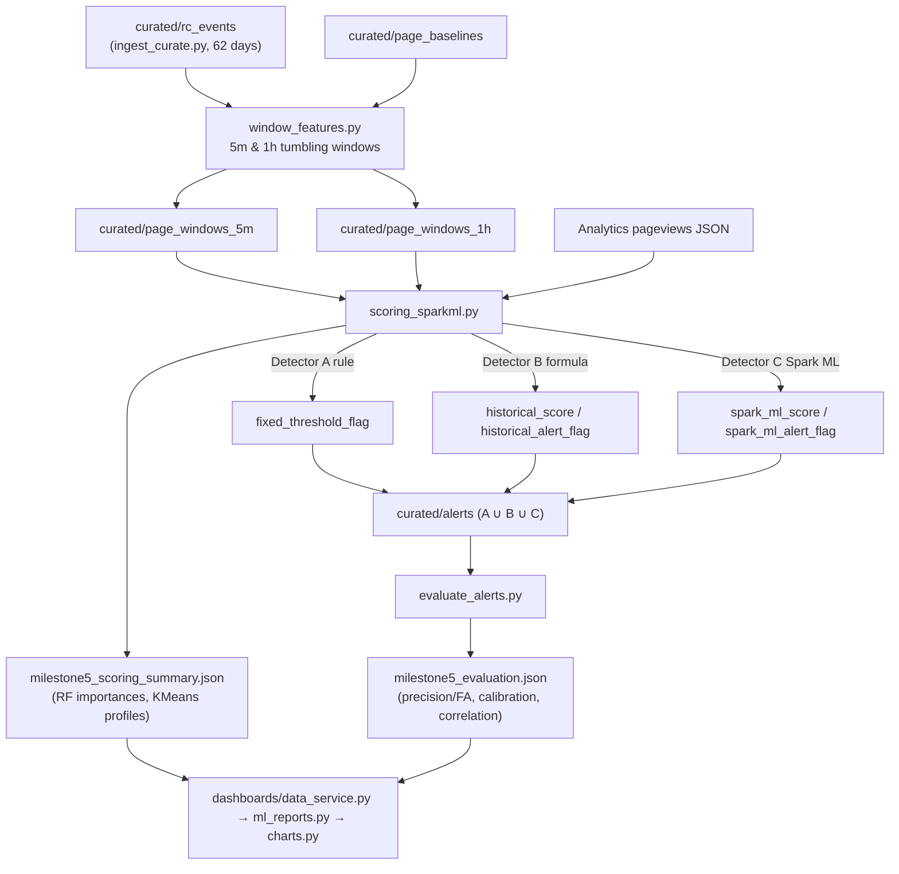
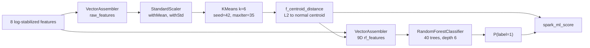

# ML Tests & Reports page: how Spark ML produces every number

This document explains how the data on the **ML tests & reports** page (`/ml-reports`, rendered by
[`dashboards/pages/ml_reports.py`](../dashboards/pages/ml_reports.py)) is produced, from the raw curated
lake through the Spark ML pipeline to the charts. All numbers quoted come from the committed benchmark files
`docs/benchmarks/milestone5_scoring_summary.json` and `docs/benchmarks/milestone5_evaluation.json`. These are
byte-identical copies of `historical/data/curated/benchmarks/*.json`.

---

## 1. What the page shows

| # | Panel | Type | Data key |
|---|-------|------|----------|
| 1 | What Spark ML learnt: Random Forest 9-feature importances (with f_centroid_distance) | Bar chart | `m5_summary.spark_ml_metrics.rf_feature_importances` |
| 2 | What Spark ML learnt: KMeans (k=6) behavioral clusters & centroid distance | Bar + line | `spark_ml_metrics.cluster_profiles` |
| 3 | KMeans (k=6) standardized centroid feature profiles (8D z-score heatmap), **full width** | Heatmap | `cluster_profiles[*].standardized_centroid` |
| 4 | Precision vs False-Alert Rate across Detectors A, B & C | Grouped bar | `experiment_4_detector_false_alert_comparison.full_evaluation_comparison` |
| 5 | Threshold calibration / Precision–Recall–F1 tradeoff curve (50..95) *(retained)* | Line chart | `experiment_3_threshold_calibration` |
| 6 | Detector B vs. Detector C score correlation & disagreement quadrants *(retained)* | Scatter | `experiment_5_detector_correlation_and_disagreement.scatter_points` |
| 7 | Detector disagreement & quiet-page shift audit | Table | `experiment_5_…disagreement_examples` |

**Why panels 5 and 6 were kept from the optional items.** Panel 5 is the threshold-by-threshold version of
panel 4: it shows why the default thresholds (B ≥ 65, C ≥ 68) give the precision and false-alert rates in
panel 4. Panel 6 is the chart view of panel 7: the audit table lists the individual rows behind the scatter's
off-diagonal points.

**Removed:** synthetic-injection chart and table, KMeans cluster profile table (its values are in the hover of
panel 2), threshold calibration table (the same data as panel 5), full-evaluation detector table (the same
data as panel 4), replay idempotency table, and curated lake schema audit table.

The header section was kept as it was: 4 metric cards, the pill row, the Venn-overlap pills and the
key-finding notice.

---

## 2. End-to-end data flow



| Step | Script | Output |
|------|--------|--------|
| 1 | `src/anomaly/window_features.py` | `page_windows_5m`, `page_windows_1h` (baseline-normalized window features) |
| 2 | `src/anomaly/scoring_sparkml.py` | `curated/alerts` + `milestone5_scoring_summary.json` |
| 3 | `src/anomaly/evaluate_alerts.py` | `milestone5_evaluation.json` |
| 4 | `dashboards/data_service.py` | Reads both JSONs (`_read_benchmark`, 300 s cache) plus up to 3,000 alerts |

The dashboard runs **no** Spark at request time. It only plots the JSON written by steps 2 and 3.

---

## 3. Input features (window_features.py)

Each row is one `(pageid, window_start, window_duration ∈ {5m, 1h})` tumbling window. A window is kept only
when it has at least 2 edit/new events. Raw aggregates are computed per window:

| Column | Definition |
|--------|-----------|
| `edits_total`, `edits_human`, `edits_bot` | Event counts, split by `is_bot` |
| `distinct_human_editors` | `countDistinct(user)` over non-bot events |
| `gross_bytes` / `net_bytes` | Σ abs(delta) and Σ delta |
| `rewriting_bytes` | `max(0, gross_bytes − abs(net_bytes))` (bytes that moved back and forth) |
| `reverts_count`, `revert_ratio` | Σ is_revert, and `reverts_count / max(edits_total, 1)` |

Next, these are normalized against the page's own history from `page_baselines`. Pages with no baseline get
fallback priors.

$$
\text{velocity\_zscore}=\frac{\text{edits\_human}-\overline{e}_{h}\cdot f_h}{\max(\text{floor},\ \sigma_{h}\cdot s_h)}
\qquad
\text{editor\_surge\_ratio}=\frac{\text{distinct\_human\_editors}}{\max(\text{floor},\ \overline{ed}_{day}\cdot s_{ed})}
$$

$$
\text{churn\_zscore}=\frac{\text{gross\_bytes}-\overline{b}_{day}\cdot f_d}{\max(\text{floor},\ \sigma_{b,day}\cdot s_d)}
$$

| Scale factor | 5m | 1h |
|---|---|---|
| `f_h` (hour fraction) / `s_h` (std scale) | 1/12, 1/√12 | 1, 1 |
| `f_d` (day fraction) / `s_d` | 1/288, 1/√288 | 1/24, 1/√24 |
| `s_ed` (editor scale) / editor floor | 1/18, 0.20 | 1/6, 0.35 |
| edit-std floor / byte-std floor | 0.08, 100 | 0.15, 250 |

---

## 4. Detector C: the Spark ML pipeline (`fit_and_score_spark_ml`)

Detector C runs as two chained `pyspark.ml.Pipeline`s over the **union of 5m and 1h windows**. Both models
are **fit only on article-namespace rows (`ns = 0`)** and then applied to all rows.



### 4.1 Feature engineering (`_prepare_ml_feature_df`)

Heavy-tailed counts are compressed with `log1p`. The z-score and surge features are also clipped before the
transform, so a few hyperactive pages don't dominate the scaler.

| ML feature | Formula |
|---|---|
| `f_edits_human` | ln(1 + edits_human) |
| `f_distinct_editors` | ln(1 + distinct_human_editors) |
| `f_log_gross_bytes` | ln(1 + gross_bytes) |
| `f_log_rewriting_bytes` | ln(1 + rewriting_bytes) |
| `f_revert_ratio` | revert_ratio (null → 0) |
| `f_bot_share` | edits_bot / max(edits_total, 1) |
| `f_velocity_z` | ln(1 + clip(velocity_zscore, 0, 250)) |
| `f_editor_surge` | ln(1 + clip(editor_surge_ratio, 0, 120)) |

### 4.2 Stage 1: StandardScaler + KMeans(k=6)

1. `VectorAssembler` packs the 8 features into `raw_features`. With `handleInvalid="keep"`, NaN values pass
   through instead of being dropped.
2. `StandardScaler(withMean=True, withStd=True)` converts every feature to a z-score using the mean and
   standard deviation of the `ns = 0` training rows:
   $$z_j = \frac{x_j-\mu_j}{\sigma_j}$$
3. `KMeans(k=6, seed=42, maxIter=35)` clusters the scaled vectors. Spark uses k-means|| initialization and
   Euclidean distance.
4. **Normal baseline cluster** = the cluster with the most `ns = 0` windows. In this run that is **#1, with
   123,885 windows (52.48%)**.
5. **Silhouette** = `ClusteringEvaluator(metricName="silhouette")` on the first 25,000 `ns = 0` scored rows
   (taken with `.limit`, not random sampling). Result: **0.5546**.

### 4.3 The `f_centroid_distance` feature

For every window, the code computes the Euclidean distance in scaled space from the window's vector to the
**normal** centroid $c^{(n)}$. This is the distance to the normal cluster, not to the window's own cluster:

$$
\text{f\_centroid\_distance}=\sqrt{\sum_{j=1}^{8}\left(z_j-c^{(n)}_j\right)^2}
$$

This is implemented as a column expression over `vector_to_array(scaled_features)` and rounded to 4 decimal
places. It is a single "how unusual is this window compared with ordinary editing" number. It feeds the
Random Forest as a 9th feature and also feeds the final score directly (§4.5).

### 4.4 Stage 2: RandomForestClassifier (9 features)

* Features: the 8 behavioral features + `f_centroid_distance`.
* `numTrees=40`, `maxDepth=6`, `seed=42`. Spark defaults apply otherwise: Gini impurity, `featureSubsetStrategy="auto"` (√9 ≈ 3 features per split), and bootstrap sampling.
* **Label (`ml_label`).** There are no human annotations, so this is a structural proxy rule. A window is
  labelled 1 when `ns = 0`, `edits_human ≥ 5`, and **any** of these is true:
  * `velocity_zscore ≥ 5.5` and `distinct_human_editors ≥ 3` and `gross_bytes ≥ 350` (multi-editor surge)
  * `velocity_zscore ≥ 7.5` and `distinct_human_editors ≥ 2` and `gross_bytes ≥ 4500` (heavy rewrite)
  * `edits_human ≥ 6` and `distinct_human_editors ≥ 3` and `revert_ratio ≥ 0.30` (edit war)

### 4.5 Final Spark ML score and flag

$$
\text{kmeans\_score}=\min\!\big(100,\ 25.5\cdot\ln(1+\text{f\_centroid\_distance})\big)
\qquad
\text{rf\_score}=100\cdot P_{RF}(\text{label}=1)
$$

$$
\text{spark\_ml\_score}=
\begin{cases}
0 & \text{edits\_human}\le 0\\
\min\!\big(100,\ 0.45\cdot\text{kmeans\_score}+0.55\cdot\text{rf\_score}\big) & \text{otherwise}
\end{cases}
$$

`spark_ml_alert_flag` = `ns = 0` AND `edits_human ≥ 4` AND (≥3 editors and ≥300 B, OR ≥2 editors and
≥5,000 B) AND `spark_ml_score ≥ 68`.

> Worked example. A window at the centroid distance of cluster #0 (2.258) gets kmeans_score = 25.5 · ln(3.258)
> ≈ 30.1. Without any RF probability its Spark ML score is 0.45 · 30.1 ≈ 13.5, far below 68. A window reaches
> the alert threshold only when the RF is confident (for example P = 0.9 gives rf_score = 90, and
> 0.55 · 90 = 49.5) **and** the window is far from the normal centroid (d ≈ 3.3 gives kmeans_score ≈ 37.2,
> and 0.45 · 37.2 = 16.7). Total ≈ 66–70.

---

## 5. Detectors A and B (needed to read panels 4–7)

**Detector A (fixed rule):** `ns = 0` AND (5m: `edits_human ≥ 6` and `editors ≥ 3`; 1h: `edits_human ≥ 15`
and `editors ≥ 4`). There is no baseline normalization.

**Detector B (explainable historical score, 0–100).** The score is the sum of 5 capped components:

| Component | Max | Formula (before damping) |
|---|---|---|
| Edit velocity | 35 | 11·ln(1+max(0,velocity_z)) + 1.1·min(edits_human, 10) |
| Editor diversity | 25 | 4.5·ln(1+editor_surge) + 2.5·min(editors, 6) |
| Byte churn | 20 | 1.6·ln(1+gross_bytes) + 1.8·ln(1+max(0,churn_z)) |
| Consensus / dispute | 10 | Step function on revert_ratio, reverts, editors, bytes |
| Pageview corroboration | 10 | 4 + 2·ln(1+pv_ratio) if pageview_ratio ≥ 2.5 |

Each component is multiplied by a damping factor: 0 when there are no human edits, 0.55 when
`velocity_z < 2.5`, and 1 otherwise. If `velocity_z < 2.5` the total is also capped at 48.

`historical_alert_flag` requires: score ≥ 65, `velocity_z ≥ 4.2`, ≥4 (5m) or ≥8 (1h) human edits, and the
same editor/byte gate as Detector C.

`curated/alerts` contains every window flagged by **A, B or C**: **2,469 rows** (A = 538, B = 1,757,
C = 1,719, all three = 385).

---

## 6. Panel-by-panel calculation

### Panel 1: Random Forest 9-feature importances

* **Source:** `rf_model.featureImportances` (Spark's mean decrease in Gini impurity, summed over every split
  that uses the feature, averaged over 40 trees, normalized to sum to 1). Stored rounded to 4 decimal places
  and shown ×100 as %.
* **Current values:** distinct editors 29.6%, human edits 24.6%, editor surge 21.4%, gross bytes 8.0%,
  **f_centroid_distance 7.2%**, velocity z 5.1%, revert ratio 2.4%, rewriting bytes 1.7%, bot share 0.01%.
* **How to read it:** the RF mostly learns the variables used inside the `ml_label` rule (editors, edits,
  surge, bytes). `f_centroid_distance` contributes on top of that, because it combines the KMeans geometry
  into a single split-friendly number.

### Panel 2: KMeans (k=6) clusters & centroid distance

* **Bars:** `window_count` per cluster (`groupBy(kmeans_cluster).count()` on `ns = 0`). Blue = normal
  baseline, coral = centroid distance ≥ 3.5, green = everything else.
* **Amber line (right axis):** `centroid_distance_from_normal`, the L2 distance between the cluster's centroid
  and the normal centroid in scaled space:
  $\lVert c^{(k)}-c^{(n)}\rVert_2$. Check for cluster #0: √5.10 ≈ **2.258** ✓.
* **Hover** shows share %, mean human edits, mean editors, revert ratio and bot share from the per-cluster
  `groupBy().agg(avg(...))`.
* **Archetype names** are assigned after fitting by `_infer_cluster_archetype`. KMeans does not produce
  them. The largest cluster is "Normal Quiet Baseline". Every other cluster is named from **its own** mean
  profile, checking these rules in order:
  1. revert ratio ≥ 0.5 → Multi-Editor Edit War (≥ 1.5 editors) or Solo Revert / Cleanup
  2. bot share ≥ 0.10 → Bot-Assisted Maintenance
  3. ≥ 2 editors → Multi-Editor Collaborative Surge
  4. ≥ 1,500 gross bytes → Single-Editor Major Rewrite
  5. otherwise → Moderate Routine Activity

| Cluster | Archetype | Windows | Share | Dist from normal |
|---|---|---|---|---|
| 1 | Normal Quiet Baseline | 123,885 | 52.5% | 0.000 |
| 0 | Single-Editor Major Rewrite | 52,700 | 22.3% | 2.258 |
| 2 | Multi-Editor Edit War | 24,792 | 10.5% | 4.365 |
| 5 | Multi-Editor Collaborative Surge | 15,206 | 6.4% | 3.291 |
| 4 | Solo Revert / Cleanup | 10,268 | 4.4% | 2.750 |
| 3 | Bot-Assisted Maintenance | 9,223 | 3.9% | 3.813 |

### Panel 3: Standardized centroid heatmap (full width)

* Each cell is `kmeans_model.clusterCenters()[k][j]`: the centroid coordinate of cluster *k* on feature *j*,
  in **σ units of the training population** (because of the StandardScaler step). 0 means average, +2 means
  2 standard deviations above average.
* The colour scale is fixed to [−2σ, +3σ].
* Examples: cluster #2 has revert ratio **+2.36σ** and editors **+1.87σ** (edit war). Cluster #3 has bot share
  **+2.11σ** and velocity **−2.77σ** (bot-assisted, low-velocity windows). Cluster #5 has editors **+2.12σ**
  (multi-editor collaboration).

### Panel 4: Precision vs False-Alert Rate (A, B, C)

Calculated by `evaluate_detector_false_alert_rates()` over the **2,469-row `curated/alerts` table**. There are
no human labels, so a rule-based reference truth is applied to each alert:

* `is_true_knowledge_shift` = `velocity_z ≥ 4.0` AND one of:
  * ≥3 editors, revert_ratio < 0.30 and ≥400 B (constructive surge)
  * type EDIT_WAR, ≥4 human edits, ≥3 editors, velocity_z ≥ 4.5
  * type MAJOR_REWRITE, ≥5,000 B, velocity_z ≥ 4.2
* `is_naive_fixed_true_news` (used only for the "Det A Naive" bar) is stricter: it treats any burst as news,
  so edit wars count as misses (velocity_z ≥ 4.5, ≥3 editors, revert < 0.30, ≥500 B).

For each detector's flagged set:

$$
\text{Precision}=\frac{TP}{\text{flagged}}\times100,\qquad
\text{False-alert rate}=\frac{\text{flagged}-TP}{\text{flagged}}\times100 = 100-\text{Precision}
$$

| Bar | Flagged | TP | Precision | False-alert |
|---|---|---|---|---|
| Det A (Naive Fixed) | 538 | 192 | 35.69% | 64.31% |
| Det A (Fixed All) | 538 | 492 | 91.45% | 8.55% |
| Det B (Historical) | 1,757 | 1,593 | 90.67% | 9.33% |
| Det C (Spark ML) | 1,719 | 1,650 | 95.99% | 4.01% |

> The "false-alert rate" here is a **false-discovery rate** (FP / flagged). It is not the classical
> false-positive rate FP / (FP + TN), because true negatives (windows nobody flagged) are not evaluated.

### Panel 5: Threshold calibration curve (50..95)

For each threshold *t* ∈ {50, 55, 60, 65, 68, 70, 75, 80, 85, 90, 95}, the code counts a row as flagged when
its score ≥ *t*. Only the raw score is tested, without the edit/editor gates.

$$
P_t=\frac{TP_t}{\text{flagged}_t},\quad R_t=\frac{TP_t}{\text{total true shifts}},\quad F1_t=\frac{2P_tR_t}{P_t+R_t}
$$

* Green lines = Detector B (`historical_score`). Blue/purple lines = Detector C (`spark_ml_score`).
* Amber dashed horizontal line = Detector A F1 = 2·91.45·21.84 / (91.45 + 21.84) = **35.26%** (A's recall
  = 492 / 2,253).
* Vertical lines mark the production defaults: B = 65, C = 68.
* Readings: at its default, C gets **P 96.1% / R 76.3% / F1 85.1%**. B at 65 gets P 76.1% / R 99.9% /
  F1 86.4%. C's best F1 is **88.6% at t = 60**. Above 80, C flags almost nothing (11 rows at 85, 0 at 90),
  because `spark_ml_score` rarely goes above about 85.

### Panel 6: Detector B vs C correlation scatter

* **x** = `historical_score`, **y** = `spark_ml_score`. The first 220 points are plotted, sorted by
  |B − C| descending, so the largest disagreements are always shown. Marker size = distinct editors + 4
  (clamped to 7–18).
* **Colour** = the agreement cohort from the three boolean flags (A, B, C), for example "B ∩ C only" =
  ¬A ∧ B ∧ C.
* **Pearson r** over all evaluated rows:
  $$r=\frac{\sum(b_i-\bar b)(c_i-\bar c)}{\sqrt{\sum(b_i-\bar b)^2\sum(c_i-\bar c)^2}} = 0.3159$$
  **Mean |B − C|** = 14.95 points.
* A low r is expected. B is a hand-weighted additive formula, while C is driven mainly by RF probability
  mass, which jumps between near 0 and near 1. The two scores agree on *which* windows are anomalous much more
  often than on the exact score.
* **Venn pills (header)** count every alert by cohort: All-3 = 385, B ∩ C only = 758, B only = 597,
  C only = 576, A only = 136, A ∩ B only = 17, A ∩ C only = 0 (total 2,469).

### Panel 7: Disagreement & quiet-page shift audit

* The rows are the first 20 entries of the |B − C|-sorted list whose cohort is **not** "All-3 Consensus".
  This shows the most extreme disagreements.
* Columns: `score_gap` = B − C (positive means the rule score is higher than ML). `fixed_threshold_flag` =
  A's verdict. Every column comes from `curated/alerts`, so a re-run of `evaluate_alerts.py` reproduces the
  table exactly.
* How to read it: large positive gaps are usually small but fast-moving windows. B rewards velocity even with
  few edits, while the RF's learned label requires ≥5 human edits. "B ∩ C only" rows are the *quiet-page
  shifts* that Detector A's absolute thresholds cannot catch.

---

## 7. Reproducing the numbers

```bash
.venv/bin/python Repo/src/anomaly/window_features.py     # page_windows_5m / 1h
.venv/bin/python Repo/src/anomaly/scoring_sparkml.py     # alerts + milestone5_scoring_summary.json
.venv/bin/python Repo/src/anomaly/evaluate_alerts.py     # milestone5_evaluation.json
cp historical/data/curated/benchmarks/milestone5_*.json Repo/docs/benchmarks/   # dashboard fallback copy
```

Every Spark ML component uses `seed=42`, so reruns on the same lake produce the same models.

---

## 8. Caveats and known discrepancies (read before presenting)

> [!WARNING]
> These points come from comparing the committed JSON against the current source code.

1. **Proxy labels, not ground truth.** The RF is trained on the rule-based `ml_label`, and precision/recall
   are measured against another rule, `is_true_knowledge_shift`. The two rules overlap heavily (editors,
   velocity, bytes, reverts). Detector C's ~96% precision therefore shows **agreement with a rule-defined
   notion of a shift**, not verified accuracy. A human-labelled sample would be needed to claim real
   precision.
2. **No train/test split.** The RF is fit and scored on the same `ns = 0` windows. The importances are fine
   for introspection, but the scores are in-sample.
3. **The calibration curve population doesn't match the alerts table.** `experiment_3` reports 3,119 rows with
   `historical_score ≥ 50` and 2,253 true shifts. The current code computes the curve over `curated/alerts`,
   which has only 2,469 rows (the Venn total). So the committed calibration JSON was produced by a different
   or earlier revision of `evaluate_alerts.py`, or over a different population. **Re-run `evaluate_alerts.py`
   before quoting panel 5.**
4. **Fixed: audit-table fields.** `centroid_distance` and `kmeans_*` were removed from the audit table, the
   scatter hover and the JSON, because no current code produced them.
5. **Fixed: archetype names.** Each cluster is now named from its own profile, giving 6 distinct names that
   match the heatmap. The committed summary JSON was relabelled with the same function, so no Spark re-run
   was needed.
6. **Silhouette sampling.** The silhouette uses `.limit(25000)`, which is deterministic but not random. Treat
   0.5546 as indicative only.
7. **Fixed: docstring drift.** The `scoring_sparkml.py` docstring now matches the code (k=6, 40 trees).
