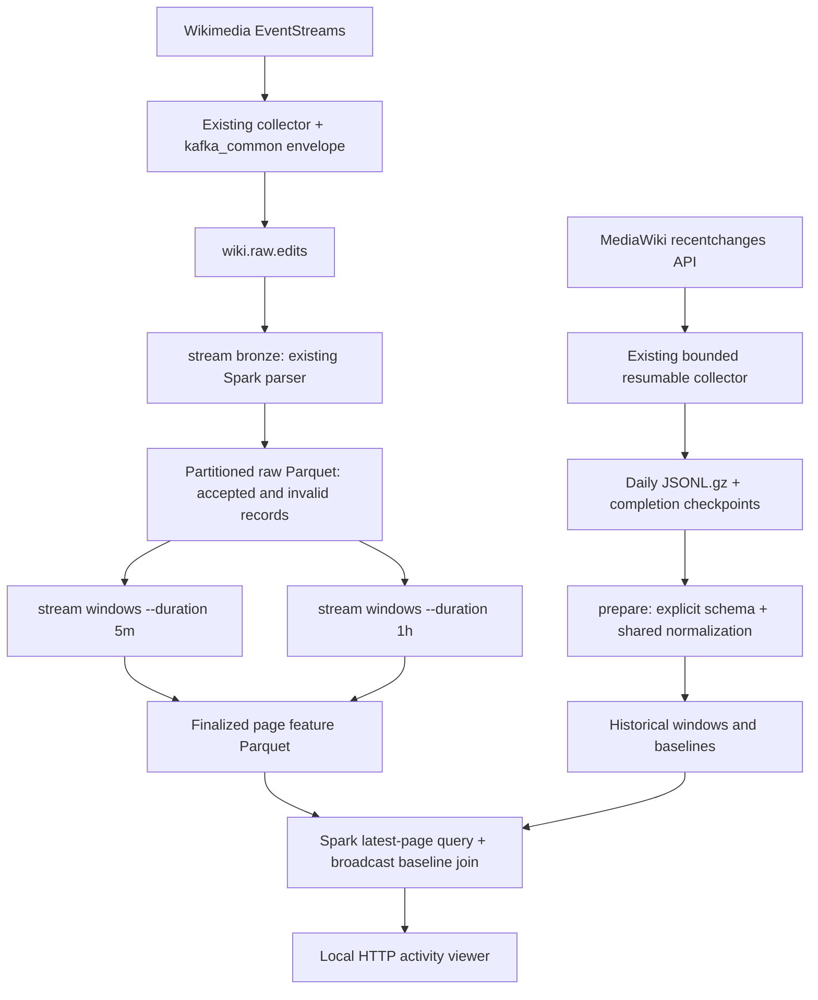

# Week 2 implementation: historical and streaming measurements

This implements the Week 2 scope in `ideas/00-wikipulse-knowledge-shifts.md`:
Spark time windows, page features, limited historical collection, initial page
baselines, and a live activity display. Run commands below from the repository root.
No pandas, pandas UDFs, or `toPandas()` are used in the Week 2 pipeline.

## Architecture



The live collector and its Kafka producer remain the existing foundation.
`src/spark_common.py` supplies Spark configuration, paths, Kafka parsing, and the
expanded Wikimedia schema (user, userid, tags, comment). The parser extracts the
nested raw object separately; envelope parsing no longer declares that object as
a string. Invalid validation results are explicitly false, including missing keys.
`create_spark(..., with_kafka=False)` avoids resolving Kafka jars for offline jobs
and uses the active Python interpreter for local Spark workers by default.

`src/models/schemas.py::normalize_recentchanges_df` is reused by both historical
and live adapters. Existing historical milestone scripts remain available; the
Week 2 pipeline has its own explicit input/output CLI to avoid the older scripts'
external sibling-directory assumptions. There is no application login system in
this checkout; the implementation reuses existing processing logic and configuration.

## Source organization

Source modules are named by responsibility, directly under `src`; there is no
week-specific Python package. `src/templates/activity.html` contains the readable
dashboard HTML and JavaScript. The CLI modules use named helpers for collection
validation, batch preparation, stream reads, and dashboard queries. Comments explain
state retention, missing values, baseline arithmetic, and shared normalization.
Historical tables retain `data/week2/historical`. Live results now use
`data/live_activity`, with checkpoints in `data/checkpoints/page_activity`. The
previous live directories are preserved but no longer used by default.

## Implementation steps and files

1. `src/page_features.py`: explicit historical input schema, canonical adapters,
   shared window aggregation, baseline moments, and historical comparison.
2. `src/prepare_history.py`: bounded date selection, completed collection coverage
   checks, Spark ingestion/deduplication, historical windows and baseline writes.
3. `src/stream_measurements.py`: independent Bronze and window streaming jobs with stable
   checkpoints, bounded offsets per trigger, watermarks, and deduplication.
4. `src/activity_dashboard.py`: local HTTP viewer, latest completed activity per page,
   top 100 rows, auto-refresh, and comparable historical human-edit ratio.
5. `tests/test_page_measurements.py`: deterministic Spark checks using synthetic inputs,
   including a real file-source streaming query and checkpoint restart.

## Setup and limited collection

Use Python 3.12, Java 17, and the repository's pinned dependencies:

```sh
python3.12 -m venv .venv
.venv/bin/python -m pip install -r requirements.txt
cp .env.example .env
```

Preserve an existing `.env` instead of replacing it. Set the real contact user agent
for the live collector. The existing historical collector has its own `USER_AGENT`
constant; confirm its contact before collection. Use explicit recent UTC dates
within the API's retention period. For example, a two-day sample:

```sh
.venv/bin/python enwiki_collect_recentchanges.py --start 2026-10-28T00:00:00Z --end 2026-10-30T00:00:00Z --max-gb 1
.venv/bin/python -m src.prepare_history --start 2026-10-28 --end 2026-10-30
```

The cap can stop collection early. Resume the same collector command until its
checkpoint says complete. Preparation refuses missing files and incomplete
collector coverage, so partial days cannot silently become a zero-activity baseline.
For imported datasets without collector checkpoints, `--trust-complete-files`
explicitly attests full-day completeness; only use it after verifying the source.
A completed API request still cannot prove upstream retention coverage; select
recent dates you know are retained. No live data was downloaded as part of this
implementation. These commands perform the collection when run.

Inputs default to `data/enwiki_recentchanges/rc_YYYY-MM-DD.jsonl.gz`.
Override with `--input`; choose a new `--output` for each historical version.
Preparation overwrites its selected output tables. Keep an established historical
version unchanged while the viewer is using it, or restart the viewer after rebuilding.

## One-command local startup

With a Docker-compatible container engine running, Java 17 available, and a real
`WIKIMEDIA_USER_AGENT` configured in `.env`, run from the repository root:

```sh
./run-local.sh
```

The shell entry point creates `.venv` if absent and installs pinned requirements
only when required. Python 3.10–3.12 is supported by the bootstrap; 3.12 is recommended.
First-run dependency and Kafka connector downloads need network access. The
supervisor in `src/run_local.py` then:

1. Checks Java, Compose, engine availability, local broker configuration, and the
   dashboard port. A file lock prevents two launchers from sharing checkpoints.
2. Starts the Compose Kafka service and waits for its healthcheck.
3. Creates the configured Kafka topic if it is absent (three partitions, one replica).
4. Starts the dashboard server, then the existing live collector and Spark raw job.
5. Waits for the raw query startup marker and a committed raw batch before
   starting both window jobs. Each window query must signal startup readiness.
6. Monitors all processes; on an unexpected exit it reports the service log and
   stops the remaining owned services.

Open [the dashboard](http://127.0.0.1:8080) and choose five-minute or hourly activity
with its duration selector. `/?duration=1h` directly selects hourly activity. Spark
runs in local mode inside the Python services; a standalone Spark cluster is not
required. There are four Spark JVMs, so allow several GB of free memory in addition
to the container engine. The startup console reports readiness; per-service logs
are appended under `logs/local/`.

Press Ctrl+C to stop the collector, Spark drivers/JVMs, and web server. Kafka is
stopped only if this launcher started it; a previously running broker is retained.
Kafka volumes, raw files, and Spark checkpoints are never deleted. Do not run
individual writers from the next section alongside the supervisor's writers.
Historical collection/preparation is a separate, bounded setup step using the
commands above; the supervisor reads existing baselines and also works without them.

```sh
./run-local.sh --check       # Check prerequisites without starting services
./run-local.sh --port 8081   # Use a different dashboard port
```

The launcher does not start a container VM. If the engine is unavailable, start
Docker Desktop, or run `podman machine start` when using a Podman-backed Docker
context, then retry. If `.env` is missing, copy `.env.example` and replace the
placeholder contact. A stalled first download or stream connection times out with
logs to inspect. First finalized results still require the window end plus the
configured event-time watermark delay: roughly 10–15 minutes for five-minute
windows and up to 70 minutes for hourly windows with continuing input. The web server is available earlier. The default live preview recomputes recent
page windows directly from raw events with Spark, so incoming data is visible
without waiting for finalization. Its counts are explicitly provisional.

## Start live processing manually

Use the existing Compose broker and live collector:

```sh
docker compose up -d
.venv/bin/python -m src.collector
```

Run each following command in a separate terminal:

```sh
.venv/bin/python -m src.stream_measurements bronze
.venv/bin/python -m src.stream_measurements windows --duration 5m
.venv/bin/python -m src.stream_measurements windows --duration 1h
.venv/bin/python -m src.activity_dashboard --duration 5m
```

Open [the local activity viewer](http://127.0.0.1:8080). Select hourly features by
starting another viewer with `--duration 1h --port 8081`. The viewer binds only to
loopback and uses no extra dashboard dependency. It defaults to a provisional live preview from raw data. The finalized view waits
until the event-time watermark closes its first window. Kafka connector resolution needs Maven network
access on first use; the offline preparation and tests do not need that connector.

Bronze must start first: it creates `data/live_activity/bronze_schema.json` for explicit
file-stream schema loading. Start the feature jobs after the first Bronze files
arrive. The shared environment paths control Bronze output and checkpoint:
`RAW_PARQUET_PATH`, `RAW_CHECKPOINT_PATH`, `KAFKA_BOOTSTRAP_SERVERS`, `KAFKA_TOPIC`.
`SPARK_TRIGGER_SECONDS` defaults to 10; `SPARK_MAX_OFFSETS` defaults to 50000.
Window jobs expose `--watermark`, `--output`, and `--checkpoint-root`.
The viewer exposes `--live` and `--history` to use matching directories. Its duration
selector supports both window tables from the same server.

## Feature semantics

Only English Wikipedia mainspace **edit** events are compared, matching the existing
live collector. New pages and logs are excluded from both sides. Historical `rcid`
and live `enwiki:rcid` are stable deduplication keys. Actual positive page IDs are used when available. Live EventStreams messages
commonly omit `page_id`: these receive deterministic **negative internal title keys**
from a shared Spark hash expression. They are not MediaWiki IDs. The latest event
title wins within a window. A rename changes the title fallback key; native numeric
IDs preserve identity across renames. Baseline lookup indexes both actual IDs and
title keys, excluding ambiguous title matches.

| Measurement | Definition |
| --- | --- |
| Edits / human / bot / anonymous / minor | Counts per page per tumbling UTC window |
| Human editors | Spark HyperLogLog++ approximate distinct usernames, RSD 0.05 |
| Gross bytes | Sum of absolute known new-minus-old lengths |
| Net bytes | Sum of known new-minus-old lengths |
| Rewriting bytes | Gross minus absolute net |
| Reverts | Revert-action tags: rollback, undo, manual revert |
| Bot / revert ratio | Corresponding count divided by all edits |
| Size coverage | Edits with both lengths divided by all edits |

All-unknown sizes produce null byte totals. Reverted-victim tags are not counted as
revert actions. Usernames can be missing; such rows count as edits but not as known
distinct editors. Live tags can be absent, so revert counts are observed lower bounds.

Baselines use the identical window aggregation over complete UTC days, end exclusive.
For each page and duration, means and population standard deviations include quiet
zero-edit windows. They are calculated as sum/N and sqrt(sum-of-squares/N - mean²),
without a large page-by-window cross join. A page must appear at least once in the
baseline interval. `byte_baseline_complete` identifies incomplete size observations;
byte means are lower bounds when this flag is false. Initial baselines are pooled
across hours; seasonal/day-of-week modelling is future work.

The viewer computes human edits / max(historical mean human edits, 1).
`velocity_zscore` also exists in the comparison table, using a standard-deviation
floor of 1. Comparison is disabled before the baseline end to prevent training-period
leakage. Unseen pages have no baseline, rather than a fabricated zero baseline.
These are measurements, not the Week 3 alert score or a validated anomaly detector.

## Spark coverage

The pipeline exercises explicit/nested schemas, JSON parsing, timestamp/date
expressions, canonical DataFrame transformations, groupBy/window aggregates,
approximate distinct counting, deterministic hashing, population moments,
window ranking, broadcast joins, Catalyst-optimized expressions, memory-and-disk
persistence/unpersist, partitioned Parquet, Structured Streaming Kafka and file
sources, watermarks, bounded stateful deduplication, append sinks, checkpoints,
and available-now triggers. Existing RDD/DataFrame benchmark code remains in
`src/historical/rankings_benchmark.py`. ML and graph work belong to later weeks;
they are not inserted into Week 2's measurement path.

## Reliability and operating limits

- Bronze keeps the original payload and Kafka coordinates, including invalid rows.
  Inspect `is_valid = false` for rejected records. Feature streams exclude them.
- Feature output is append-only and finalized after event-time watermark advancement.
  A five-minute window normally appears after its end plus ten minutes, with later
  events driving advancement. An idle source does not finalize its tail automatically.
- Deduplication is bounded by the watermark. Duplicates beyond retained state and
  events older than the watermark are outside the guarantee. Retained Kafka input
  can be rebuilt in a **new** output/checkpoint directory for a different policy.
- Each duration has its own checkpoint. Keep checkpoints and sink data together,
  never run two instances against one checkpoint, and do not change schemas or
  watermark/duration semantics while reusing state. Bronze defaults also reuse
  the existing common raw checkpoint path; do not run another writer there.
- Spark file sink commit logs/checkpoints support restart without appending committed
  batches twice. This does not make upstream delivery exactly-once.
- `--available-now` drains current input and exits. It does not force unfinished
  event-time windows closed. It is useful for bounded catch-up jobs.
- The viewer runs fresh Spark reads every ten seconds; only 100 result rows reach
  Python. Spark still scans the results table: this local Week 2 display is not a
  production low-latency serving store. Tune or add a serving layer at larger scale.
- Defaults use a small local Spark deployment. Each live process consumes its own
  resources; use `SPARK_MASTER` appropriately. Do not compare runtime with production
  cluster throughput. Kafka history loss fails the Bronze job instead of skipping data.

## Validation

```sh
.venv/bin/python -m unittest discover -s tests -v
```

Checks cover duplicate historical input, human/bot counts, approximate editors,
known and missing byte sizes, churn arithmetic, revert actions, zero-filled baseline
means, leakage prevention, malformed Kafka payloads, shared live normalization,
real stateful streaming execution, watermark finalization, and checkpoint restart
with duplicate input. Tests use temporary files and do not connect to Kafka or
Wikimedia. A live broker/producer/browser integration run remains an environment
check to perform with the start-up commands above.

Validation performed on October 31, 2026: the original three Spark integration tests passed
(PySpark 3.5.6, Python 3.12, Java 17). The preparation CLI also completed against a
small gzip fixture with a completed collection checkpoint, producing canonical
edits, both window tables, and both baseline tables. Python compilation and Git
whitespace checks passed. Live Kafka ingestion and the browser display have not
been exercised end to end in this implementation session.

After the source reorganization, validation also covers the extracted dashboard
query and completed-collection coverage checks. Use the updated module commands
above; the former `src.week2.*` commands have been removed.

Reorganization verification: all five tests in `tests/test_page_measurements.py`
passed, including dashboard reads, collection coverage, shared normalization,
baseline calculations, and streaming restart/deduplication. All three renamed CLI
entry points passed `--help`; Python compilation and whitespace checks also passed.

Local launcher verification: the full 13-test suite passed after adding launcher
and duration-routing checks. The additional committed-batch readiness check also
passed in the six-test launcher suite. Shell syntax, Python compilation, and
whitespace checks passed. Running `./run-local.sh --check` on this machine reports
an unavailable Podman-backed container engine; a full live-stack run remains to be
verified after starting that engine.


## Missing live data: parser correction and recovery

The initial synthetic fixture included `page_id`, but observed EventStreams messages
omitted it. The initial parser therefore rejected incoming edits. The corrected
shared parser uses the explicit internal title fallback described above. Raw JSON
and Kafka metadata remain untouched. `live_edits` reparses retained original
messages, recovering records with outdated `is_valid = false` flags.

Restart `./run-local.sh` after this correction. The fresh live output/checkpoint
paths above replay retained Bronze records without deleting or overwriting old
checkpoint state. Bronze continues using its existing checkpoint. Old output paths
can still be selected explicitly, but should not be reused for the corrected replay.
Historical baselines remain in their existing directory.

The dashboard now defaults to **Live preview**, with a separate **Finalized windows**
selector. Preview calculations use the shared Spark features and event deduplication,
scan the current/prior ingestion day, and display the latest per-page windows over
10 minutes (five-minute mode) or two hours (hourly mode) relative to the latest event.
The latest event timestamp is shown to make stalled input visible. The preview is
recomputed from retained data and may change; it does not modify streaming state.
`/?duration=5m&view=finalized` selects finalized output directly.

Live verification after the correction: Kafka was healthy on the Colima Docker
context; the agent's inherited Docker host pointed at an obsolete Podman socket.
The local stack was restarted against Colima. The live API returned HTTP 200 with
100 displayed pages and edit counts recovered from retained raw messages. All 17
regression tests passed, including absent page IDs, title-based baseline lookup,
recovery of stored rejected records, provisional previews, and stream restart.
