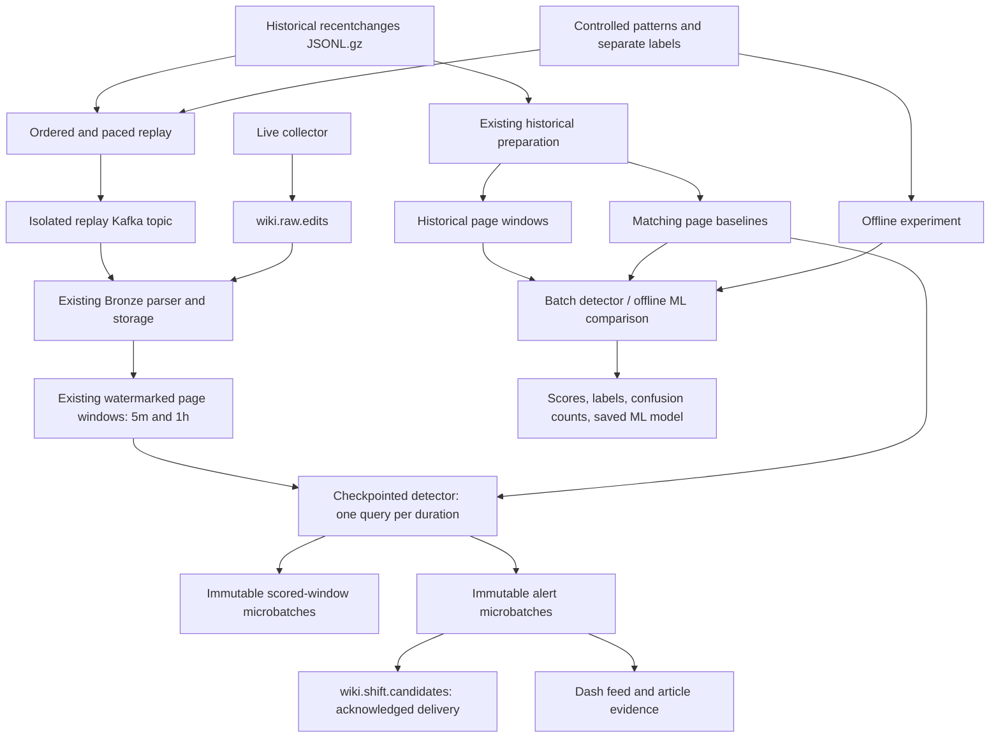

# Week 3: knowledge-shift detection

Implemented the five Week 3 tasks in the [six-week project plan](ideas/00-wikipulse-knowledge-shifts.md#week-3-knowledge-shift-detection):

1. An explainable historical score shared by batch and streaming detection.
2. A Kafka alert topic, durable local alerts, and dashboard integration.
3. Event-time-ordered historical replay with configurable speed.
4. Deterministic controlled editing patterns with separate expected labels.
5. An initial Spark ML comparison using scaled features and K-means distance.

**Files added: 14. Existing files updated: 10.** Generated datasets and model
artifacts live under ignored `data/`; they are not counted as source files.
Production code is grouped by responsibility under `src/detection/` and
`src/replay/`, rather than placed in a week-specific source folder.

## Architecture



Live and replay flows use separate topics, raw directories, result directories,
and checkpoints. The drawing shows shared processing code, not simultaneous mixing
of historical and live events in one watermark. The detector consumes finalized
Week 2 window tables. Provisional dashboard previews never produce alerts.

Each streaming detector uses `foreachBatch` for the baseline join and score.
Local Parquet batches are staged and atomically renamed before publication.
The alert topic is created explicitly because Compose disables auto-creation.
The dashboard reads local Parquet; it does not need a Kafka consumer.

## Added files and their purposes

| File | Purpose |
| --- | --- |
| `src/detection/__init__.py` | Defines the detection package boundary. |
| `src/detection/__main__.py` | Batch/stream CLI, startup markers, progress snapshots, clean shutdown. |
| `src/detection/scoring.py` | Validated configuration, Spark score expressions, eligibility, reasons, missing evidence, stable IDs. |
| `src/detection/pipeline.py` | Baseline loading, batch execution, checkpoint contracts, finalized-window streaming. |
| `src/detection/storage.py` | Immutable local microbatch commits, reuse on retry, acknowledged Kafka delivery. |
| `src/detection/ml.py` | Historical-only training, feature scaling, seeded K-means, distance threshold, model and comparison exports. |
| `src/replay/__init__.py` | Defines the replay package boundary. |
| `src/replay/__main__.py` | Historical JSON/gzip, canonical Parquet, or Bronze Parquet replay CLI; sorting, dry-run, delivery checks. |
| `src/replay/events.py` | Converts canonical edits to collector envelopes and schedules replay using a monotonic clock. |
| `src/replay/patterns.py` | Generates synthetic training/evaluation edits and nine separate pattern labels. |
| `src/replay/demo.py` | Runs the offline controlled experiment, writes fixtures, scores, labels, and confusion counts. |
| `tests/test_detection.py` | Spark score checks, temporal leakage checks, local commit retries, delivery failures, real stream restart, dashboard filters, model roundtrip. |
| `tests/test_replay.py` | Replay pacing at 1x/10x/50x/100x, event contracts, invalid input, fixture determinism. |
| `docs/week3.md` | This implementation inventory, architecture, runbook, scoring contract, and validation report. |

## Updated files and their purposes

| File | Change |
| --- | --- |
| `.env.example` | Documents `KAFKA_ALERT_TOPIC=wiki.shift.candidates`. |
| `README.md` | Adds Week 3 entry points and updates implementation status. |
| `dashboards/README.md` | Documents detector outputs, evidence panels, and current table contracts. |
| `src/kafka_common.py` | Adds alert-topic configuration and explicit topic creation. |
| `src/run_local.py` | Supervises the 5m and 1h detectors after measurement startup. |
| `src/dashboard_queries.py` | Reads bounded, deduplicated alerts filtered by duration and optional article. |
| `dashboards/data_service.py` | Loads duration-specific alerts and detector progress snapshots. |
| `dashboards/pages/live.py` | Shows finalized alerts, score, confidence, reasons, and an accurate waiting state. |
| `dashboards/pages/investigation.py` | Shows each alert's points, available weight, and missing evidence. |
| `tests/test_run_local.py` | Updates expected supervised services to include both detectors. |

## Explainable score

The available proposal components are:

| Component | Raw maximum points | Calculation |
| --- | ---: | --- |
| Human edit increase | 35 | Positive historical z-score, capped at 6, divided by 6 |
| Different human editor increase | 20 | Same calculation using approximate distinct-editor moments |
| Gross content movement | 20 | Same calculation, requiring complete historical/current byte sizes |
| Observed revert activity | 10 | `min(revert_ratio / 0.30, 1)` |
| Related-page activity | 10 | Unavailable until graph enrichment; null |
| Pageviews | 5 | Unavailable until pageview enrichment; null |

For each historical component, `z = (current - mean) / max(stddev, floor)`.
The count floor is 1; the gross-byte floor is 1,024 bytes. Negative increases
contribute zero. The final score is `100 * sum(available points) / available_weight`.
Normally the available weight is 85. Without complete byte evidence it is 65,
and the row is labeled `limited_sizes`. Points are stored before normalization.
Available weight and missing evidence must accompany the score; scores with
different evidence coverage should not be interpreted as equally certain.

An eligible window needs at least six human edits in five minutes, or fifteen
in one hour, at least three approximate human editors, and at least 50% human
edits. With usable history, it alerts at score >=65. These are initial heuristic
thresholds, not calibrated probabilities. A single large deletion without the
participation gate does not trigger this multi-signal detector.

Pages without a matching baseline may emit an `activity_candidate` using the
fixed gate. Its score stays null, its confidence is `low_no_baseline`, and
`historical_alert` stays false. Rows within a matching baseline's training period
are suppressed, including fixed-rule fallback. Existing title-key baseline
matching and ambiguous-title exclusion are reused from Week 2.

Every scored row includes the original measurements, baseline evidence,
`score_version`, `activity_points`, `editor_points`, `content_points`,
`revert_points`, `available_weight`, `historical_score`, `fixed_rule_alert`,
`historical_alert`, `is_alert`, `confidence`, `reasons`, and `missing_evidence`.
`alert_id` hashes the score version and stable page-window ID. Alert types distinguish
activity candidates, revert activity, large deletions, and knowledge shifts.
They do not claim confirmed news or vandalism.

## Run the live pipeline

Use the existing Python 3.12 / Java 17 environment and pinned requirements:

```sh
./run-local.sh
```

The launcher now starts two detector processes after both window jobs. Each
creates the alert topic safely if absent and writes runtime progress under
`data/run/detection-5m.progress.json` or `detection-1h.progress.json`. There are now
six Spark JVMs including the dashboard; allow memory for them and Kafka.
Stop the old launcher before starting the updated version.

Standalone detector commands, in separate terminals:

```sh
.venv/bin/python -m src.detection stream --duration 5m
.venv/bin/python -m src.detection stream --duration 1h
```

Defaults:

```text
Input:       data/live_activity/windows_5m or windows_1h
Baselines:   data/week2/historical/baselines_5m or baselines_1h
Audit rows:  data/curated/scored_windows/duration=5m/batch_id=...
Alerts:      data/curated/alerts/duration=5m/batch_id=...
Checkpoint:  data/checkpoints/detection/5m or 1h
Kafka:       KAFKA_ALERT_TOPIC, default wiki.shift.candidates
```

The live feed and investigation screen display finalized alerts for the selected
duration, with a 200-record cap. The feed is independent of the preview/finalized
activity selector and displays each window's time in its investigation evidence.
First alerts still require event-time watermark advancement. An idle source
does not finalize its last windows automatically.

`--no-kafka` supports local-only streaming; `--available-now` drains committed
window files and exits. `--windows`, `--baselines`, `--output`, `--checkpoint`,
and `--threshold` allow isolated experiments. Use `--help` on any entry point.

## Repeatable offline demonstration

No broker, network, or live Wikimedia collection is required:

```sh
.venv/bin/python -m src.replay.demo --output data/experiments/week3-demo --with-ml
```

Use a new output directory for each run. Without `--with-ml`, the experiment runs
the fixed and historical methods only. The fixture represents a complete
synthetic training day on October 1, 2026 and evaluation on October 2. These are
artificial events with synthetic page/revision IDs and titles, not collected
Wikimedia history. No collector completeness attestation is fabricated.

The nine controlled cases are edit burst, large deletion, human-heavy editing,
bot-heavy editing, repeated reverts, two related-group pages becoming active,
normal high-volume activity, and normal quiet activity. The related group is
ground truth for future graph work; no related-page score is fabricated now.
The six expected alerts are the burst, deletion, human-heavy, repeated-revert,
and two related-group cases.

The command writes `training.jsonl.gz`, `evaluation.jsonl.gz`, `labels.json`,
`windows_training/`, `windows_evaluation/`, `baselines_5m/`, `scored_windows/`,
`alerts/`, per-pattern `evaluation/` JSON, and `summary.json`. With ML it also
writes `ml/model/`, `ml/comparison/`, and `ml/metadata.json`.

Batch scoring can also be run separately on prepared tables:

```sh
.venv/bin/python -m src.detection batch \
  --windows data/experiments/week3-demo/windows_evaluation \
  --baselines data/experiments/week3-demo/baselines_5m \
  --output data/experiments/week3-batch
```

Serve the demo's stored alerts by selecting its curated root:

```sh
.venv/bin/python -m dashboards.app --port 8081 \
  --curated data/experiments/week3-demo
```

Activity charts still use the separately configured live/history roots. The
demo fixtures use synthetic page IDs, so their alerts must remain separate from
real live results.

## Historical Kafka replay

First validate a file without contacting Kafka or waiting between events:

```sh
.venv/bin/python -m src.replay \
  --input data/experiments/week3-demo/evaluation.jsonl.gz --dry-run
```

Publish at a chosen speed:

```sh
.venv/bin/python -m src.replay \
  --input data/experiments/week3-demo/evaluation.jsonl.gz \
  --topic wiki.replay.edits --speed 50
```

Speeds 1, 10, 50, and 100 are supported; any finite nonnegative multiplier is
accepted. Speed 0 is unpaced. `--limit` bounds event count. Use `--format
canonical-parquet` for prepared `edits/` or `--format bronze-parquet` for retained
raw records. Spark filters/normalizes historical JSON, deduplicates by change ID,
and sorts by event time/change ID before bounded iteration to the producer.
The replay preserves original event/revision IDs, timestamps, users, sizes, and
tags, and generates a fresh ingestion timestamp using the existing envelope.

The CLI refuses the configured live raw topic. It creates its separate replay
topic explicitly. Run replay readers with isolated settings, for example:

```sh
# Separate terminal: replay Bronze only, never reuse the live raw checkpoint.
KAFKA_TOPIC=wiki.replay.edits \
RAW_PARQUET_PATH=data/replay/raw \
RAW_CHECKPOINT_PATH=data/replay/checkpoints/bronze \
.venv/bin/python -m src.stream_measurements bronze --output data/replay/live

# After Bronze has created its schema and committed a batch, another terminal:
RAW_PARQUET_PATH=data/replay/raw \
.venv/bin/python -m src.stream_measurements windows --duration 5m \
  --output data/replay/live --checkpoint-root data/replay/checkpoints/windows

# Another terminal: persist and publish replay alerts separately.
KAFKA_ALERT_TOPIC=wiki.replay.alerts \
.venv/bin/python -m src.detection stream --duration 5m \
  --windows data/replay/live/windows_5m \
  --baselines data/experiments/week3-demo/baselines_5m \
  --output data/replay/curated --checkpoint data/replay/checkpoints/detection
```

A short replay's final windows stay open until later events pass the watermark.
Use the offline batch demo for immediate complete results, or replay historical
input extending beyond the evaluation interval plus the configured watermark.
Repeating an old interval against an already advanced streaming watermark will
drop old events. For a fresh experiment, use a new replay topic, raw/output roots,
and checkpoints; source files and deterministic IDs can be reused.

## Initial Spark ML comparison

The comparator uses log human counts, log distinct-editor counts, log gross
bytes, bot ratio, revert ratio, minor-edit ratio, and size coverage. Missing gross
bytes become zero for ML, with coverage retained as a separate input.
`VectorAssembler -> StandardScaler -> KMeans(k=2, seed=42)` is fitted on earlier
historical windows only. It rejects empty evaluation, mixed durations, insufficient
training vectors, and evaluation overlapping training windows.

Distance to the assigned cluster center is compared with the training-distance
99th percentile. `ml_score = 100 * distance / (distance + threshold)` is a bounded
distance indicator, not a probability. The model, feature list, training boundary,
threshold, counts, and measured timings are saved. Zero-variance dimensions follow
Spark's scaler behavior and contribute zero; this is a known limitation if a
feature absent during training appears during evaluation.

```sh
.venv/bin/python -m src.detection.ml \
  --training data/experiments/week3-demo/windows_training \
  --evaluation data/experiments/week3-demo/windows_evaluation \
  --baselines data/experiments/week3-demo/baselines_5m \
  --output data/experiments/week3-ml
```

This is the initial offline comparison requested for Week 3. ML does not silently
replace live explainable scoring. Broader calibration, independent labeled data,
multiple replay speeds, and recovery/performance studies remain Week 5 work.

## Recovery and boundaries

- One writer owns each checkpoint and output duration. Keep results/checkpoints
  together; do not run standalone writers alongside supervised ones.
- A checkpoint manifest pins score version, thresholds, source/output roots,
  baseline location/file signature, duration, and Kafka topic. Changing them
  requires a new checkpoint and output. Baselines must remain immutable while
  the detector is running; they are loaded at startup.
- Local microbatch commits are atomic on the local filesystem. Pending directories
  are hidden from readers and replaced on retry. This is not an object-store
  transaction protocol or a multi-writer sink.
- Kafka publication is at least once. A crash after publication but before Spark's
  checkpoint commit can resend the same IDs. Consumers must deduplicate by
  `alert_id`. Parquet retries reuse the committed batch. Local alerts may be visible
  while Kafka delivery is retrying. See the official [Spark foreachBatch delivery
  contract](https://spark.apache.org/docs/3.5.6/structured-streaming-programming-guide.html#using-foreach-and-foreachbatch).
- Topic delivery errors and timeouts fail the query; they are not reported as
  successful publication. The supervisor stops owned processes if a detector exits.
- Upstream watermark and bounded-deduplication limits still apply. No downstream
  detector can recover events already discarded by those policies.
- Revert tags are observed evidence, not risk probabilities. Revision diffs,
  real related-page graph evidence, and pageview joins remain later work.

## Validation performed November 1, 2026

```sh
.venv/bin/python -m unittest discover -s tests -v
.venv/bin/python -m compileall -q src dashboards tests
git diff --check
```

All **37 tests passed**, including the existing measurement/dashboard/launcher
regressions and ten new detector/replay tests. Spark integration tests used Python
3.12, Java 17, PySpark 3.5.6, temporary files, and no external broker/API. They
exercise real available-now streaming queries and checkpoint restarts, persisted
alert reads, Kafka failure propagation through a mock producer, exact score
arithmetic, missing sizes/history, training-period suppression, and ML save/load.

The full controlled demo with ML also completed, saving local artifacts under
`data/experiments/week3-validation-final/`:

| Method | True positives | False positives | False negatives | True negatives |
| --- | ---: | ---: | ---: | ---: |
| Fixed rule | 6 | 1 | 0 | 2 |
| Historical score | 6 | 0 | 0 | 3 |
| Initial K-means distance | 6 | 1 | 0 | 2 |

These are nine hand-designed synthetic cases, not a real-world accuracy estimate.
Live broker publication and a restarted full live-stack/browser run were not
performed in this session. Existing live services were not interrupted.

The replay CLI dry-run also validated all 202 evaluation events without broker
access. Replay epoch conversion and ML boundary metadata explicitly preserve UTC
when Python/Spark run on a host using a different local timezone.
